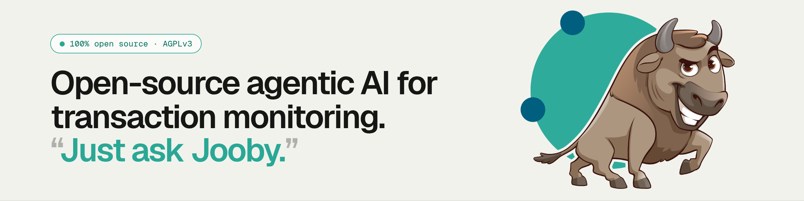

<p align="center">
  
</p>

# Jube

**Open-source agentic AI for transaction monitoring. “Just ask Jooby.”** Real-time AML and fraud monitoring, run by a
Herd of AI agents called Joobriks, with outcomes a regulator can follow.

[](https://github.com/jube-home/aml-fraud-transaction-monitoring/actions/workflows/jube-build-unit-tests.yml)
[](https://github.com/jube-home/aml-fraud-transaction-monitoring/actions/workflows/jube-build-end-to-end-tests.yml)
[](https://github.com/jube-home/aml-fraud-transaction-monitoring/actions/workflows/github-code-scanning/codeql)
[](https://github.com/jube-home/aml-fraud-transaction-monitoring/actions/workflows/trivy.yml)
[](https://github.com/jube-home/aml-fraud-transaction-monitoring/actions/workflows/zap.yml)

**Ask Jooby.** No menu to learn, no query language, no ticket to raise. Type the question the way you'd ask a colleague,
and the Herd does the legwork, showing every step. 150+ Joobriks across five domains, 700+ real platform functions, and
every step validated by the platform before anything reaches you.

**The platform underneath.** Jube was real-time transaction monitoring long before Jooby arrived. Every Joobrik stands
on it, and all of it is in the open: explainable ML, hybrid detection (rules, velocity and sanctions, plus supervised
and unsupervised ML), real-time and horizontally scalable, case management, a rule builder compliance can edit,
cloud-native and multi-tenant, on your infrastructure with no lock-in.

## Quickstart

With Docker installed, Jube is a copy and paste away. It builds from source, so give the first start a few minutes.

```bash
git clone https://github.com/jube-home/aml-fraud-transaction-monitoring
cd aml-fraud-transaction-monitoring
export DockerComposePostgresPassword='IMPORTANT:_ChangeThisKey_SuperSecretPasswordToChangeForPg'
export DockerComposeJWTKey='IMPORTANT:_ChangeThisKey_et8WMyVE3qE0Fxie4dDMGMGLf5nOFaVjQ1UmLQ8L0ouKJoN8ADRaXmcWU1DpeoAu0njC4F4ASCxreCgucaM85dHKV4vIZa3zzDqkkrAzRdAd3sTtXRLhj1U3GPUA9BEL_UsingThisKeyIsDangerous'
export DockerComposeApiHmacKey='IMPORTANT:_ChangeThisKey_et8WMyVE3qE0Fxie4dDMGMGLf5nOFaVjQ1UmLQ8L0ouKJoN8ADRaXmcWU1DpeoAu0njC4F4ASCxreCgucaM85dHKV4vIZa3zzDqkkrAzRdAd3sTtXRLhj1U3GPUA9BEL_UsingThisKeyIsDangerous'
export DockerComposePasswordHashingKey='IMPORTANT:_ChangeThisKey_et8WMyVE3qE0Fxie4dDMGMGLf5nOFaVjQ1UmLQ8L0ouKJoN8ADRaXmcWU1DpeoAu0njC4F4ASCxreCgucaM85dHKV4vIZa3zzDqkkrAzRdAd3sTtXRLhj1U3GPUA9BEL_UsingThisKeyIsDangerous'
export DockerComposeElementSymmetricEncryptionKey='IMPORTANT:_ChangeThisKey_et8WMyVE3qE0Fxie4dDMGMGLf5nOFaVjQ1UmLQ8L0ouKJoN8ADRaXmcWU1DpeoAu0njC4F4ASCxreCgucaM85dHKV4vIZa3zzDqkkrAzRdAd3sTtXRLhj1U3GPUA9BEL_UsingThisKeyIsDangerous'
export DockerComposeEnableAskJooby=False
export DockerComposeAskJoobyApiKey='OPTIONAL_IMPORTANT:_ChangeThisKey_et8WMyVE3qE0Fxie4dDMGMGLf5nOFaVjQ1UmLQ8L0ouKJoN8ADRaXmcWU1DpeoAu0njC4F4ASCxreCgucaM85dHKV4vIZa3zzDqkkrAzRdAd3sTtXRLhj1U3GPUA9BEL_UsingThisKeyIsDangerous'
docker compose up -d
```

1. **Change every value.** They are placeholders, not defaults. Make each key at least as long as the
   example. [What each key does](https://www.jube.io/docs/Concepts/EnvironmentVariables/).
2. **Open [localhost:5001](http://localhost:5001).** Sign in as `Administrator / Administrator` and change it on first
   login.

**Want Ask Jooby?** DigitalOcean Serverless Inference is the default provider, but it can be changed to any
OpenAI-compatible endpoint. Put $20 in a prepaid DigitalOcean account, paste in your inference key, set
`DockerComposeEnableAskJooby=True`, and Ask Jooby is alive.

**Ready for production?** The single-node stack is for evaluation; [Jube Cluster](https://www.jube.io/docs/GettingStarted/DeployingWithJubeCluster/) takes the same platform to
scale. It is a highly available, quorum-based Docker Swarm cluster: multiple Jube instances behind HAProxy,
PostgreSQL under Patroni and Redis under Sentinel, failing over automatically. Add capacity as volume grows, update
online one member at a time, and recover to any point in time from continuous WAL archiving.

## Learn more

The Herd, the platform underneath, security, training and support all live in two places.

|                                                                                      |                                                                  |
|--------------------------------------------------------------------------------------|------------------------------------------------------------------|
| **[Documentation →](https://www.jube.io/docs/)** | Install, configure and run Jube, from first login to production. |
| **[jube.io →](https://jube.io/)**                                                    | Meet the Joobriks, see the platform, and talk to the developer.  |

## Licence

[AGPLv3](LICENSE).