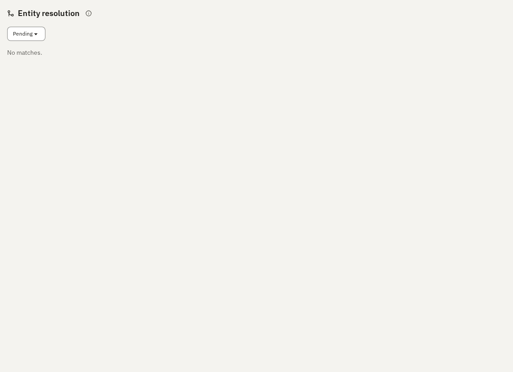

# Entity Resolution

Two nodes in the graph can be one and the same real-world entity, for example two accounts opened with a single national id, or the same customer name typed in two different ways. Entity resolution exists to find such pairs, to present the evidence for each, and to allow an analyst to merge them, such that the two nodes are henceforth recorded as a single entity. The design holds to two principles throughout: a merge is always reversible, and a merge is never silent, which is to say that every pair is recorded as a candidate, with its evidence, before anything is merged and long after.

The question it answers is the one a fraudster hopes will not be asked: is this customer in truth somebody already known under another account? A person refused, restricted or closed for fraud seldom gives up, and returns with a new account, a slightly different spelling of the name, and the same card or the same telephone. Each account viewed alone is unremarkable. It is the recognition that the two are one person that matters.

The feature relies upon the network described in [Graph](../../Configuration/Graph/index.html), the terms of which (node, edge, hub, hard link) are introduced in [Graph Concepts](../../Configuration/Graph/Concepts/index.html). The further terms used on this page are as follows:

| Term              | Meaning                                                                                                                                                         |
|-------------------|-----------------------------------------------------------------------------------------------------------------------------------------------------------------|
| Candidate, match  | One pair of nodes put forward as possibly the same entity. The page calls it a match and the storage a candidate, and the two words mean the same thing.        |
| Source            | How the pair was found: by a Shared identifier, or by a Fuzzy comparison of two values that look alike.                                                         |
| Hard identifier   | An identifier taken as proof of the same controller, such as a card or a national identity number, being the to node of an edge definition whose Hard switch is on. |
| Posterior         | The estimated probability, from 0 to 1, that the two nodes are the same entity, once the evidence has been weighed. The page shows it as a percentage.          |
| Decision          | Pending until an analyst decides, then Confirmed or Rejected.                                                                                                   |
| Resolved entity   | The group of nodes joined by confirmed matches, which share one resolved entity id.                                                                             |

## An example

The demonstration network of a clean installation serves as the example. Its edge definitions Shares email and Shares card are marked Hard. The accounts ACC-441 and ACC-102 both gave the email address m.sterling@example.com, and the accounts ACC-778 and ACC-915 both used the card CARD-7F2A.

Entity resolution is switched off by default, hence on a clean installation the page reads No matches. Upon setting the `EnableGraphEntityResolution` Environment Variable to `True` and restarting, the job runs three minutes after the start and hourly thereafter, and the Pending list then holds two matches:

| The two nodes                              | Source            | Probability | Evidence names                                    |
|--------------------------------------------|-------------------|-------------|---------------------------------------------------|
| AccountId ACC-102 and AccountId ACC-441    | Shared identifier | 99.9%       | Email m.sterling@example.com, Shares email, 2     |
| AccountId ACC-778 and AccountId ACC-915    | Shared identifier | 99.9%       | CreditCardHash CARD-7F2A, Shares card, 2          |

Each is a statement that two accounts are probably one customer, and the analyst decides whether it is so. Confirming the second records ACC-778 and ACC-915 as one resolved entity. Had ACC-441 also shared that card, three matches would have been proposed (each pair of the three), and confirming any two of them would have placed all three accounts in the one entity, as matches chain.

No fuzzy match appears in the example, as fuzzy comparison is made only for the keys named in `GraphEntityMatchFuzzyKeys`, which is empty by default.

TODO(verify): the two matches expected of the demonstration network upon enabling the job, and the three minute delay before its first run, are taken from the seed and the job, and have not been observed on a running installation.

## Where it lives

Navigate through the menu to Administration, then Entity resolution, which presents the page at `/administration/resolution`. The menu item is presented to a user holding permission 49, View Graph, or permission 51, Resolve Graph Entities and Patterns.

The page is a single list of the proposed matches, best first, up to 200 at a time, under a filter that selects the decision of interest. The filter starts on Pending, keeping in mind that the matches awaiting a decision are the purpose of the page, and an empty list reads No matches. The page offers the following:

| Element          | Description                                                                                                                              |
|------------------|------------------------------------------------------------------------------------------------------------------------------------------|
| Show             | The filter, switching the list between Pending, Confirmed and Rejected.                                                                  |
| The two nodes    | Each node of the pair, given as its key followed by its value.                                                                           |
| Source           | A badge, either Shared identifier or Fuzzy comparison, stating how the candidate was found.                                              |
| Probability      | The posterior probability that the two nodes are the same entity, as a percentage to one decimal place.                                  |
| Decision         | A badge with the decision of the match: Pending, Confirmed or Rejected.                                                                  |
| Evidence         | The evidence recorded for the candidate, shown beneath the nodes as it is stored.                                                        |
| Note             | Shown for a pending match only. An optional note of up to 500 characters, recorded with the decision.                                    |
| Confirm          | Shown for a pending match only. Merges the two nodes into one resolved entity.                                                           |
| Reject           | Shown for a pending match only. Records that the two nodes are different entities.                                                       |

Upon a decision being made, Decision recorded. is returned, and the match leaves the Pending list to be found thereafter under Confirmed or Rejected. Where the list cannot be read the page reads Could not load the matches. The Note box and the two buttons are presented only to a user holding permission 51, Resolve Graph Entities and Patterns. A match under Confirmed or Rejected is shown without the Note box and the two buttons, and the page offers no means of changing a decision once made, which is done through the API as described under Deciding below.

The Probability is read as follows. A Shared identifier always reads 99.9%, which is not a measurement but a fixed statement that a hard identifier is taken as near proof. A Fuzzy comparison reads anything from 20.0% upwards, and the figure follows from the arithmetic set out under Candidates below in a manner that is not obvious and is best stated outright:

| Agreement                                                             | Probability shown                                                                                                   |
|-----------------------------------------------------------------------|---------------------------------------------------------------------------------------------------------------------|
| Exact after folding, the two nodes being the only ones with the value | 48.7%, whatever the number of nodes of the key.                                                                     |
| Exact after folding, three nodes having the value                     | 32.2% for each pair. With four it is 24.1%, and with five or more the pairs fall beneath 20% and are not listed.    |
| Close, among 100 nodes of the key                                     | 85.8%.                                                                                                              |
| Close, among 600 nodes of the key                                     | 50.0%.                                                                                                              |
| Close, among 2,400 nodes of the key                                   | 20.0%, and with more nodes than that no close agreement is listed at all.                                           |

It follows that the Probability of a fuzzy match states chiefly how crowded the key is, and that it is not to be read as a measure of how alike the two values are, which is the `similarity` given in the Evidence. A close agreement is commonly shown with a higher Probability than an exact one. Every fuzzy match is therefore a prompt to look at the two values and at what else the two nodes share, and none is to be confirmed upon the figure alone. The list is in order of Probability, the greatest first.

TODO(verify): in GraphEntityResolutionJob.FuzzyAsync the prior (one in the number of nodes of the key) and the term-frequency u of an exact agreement cancel, such that an exact agreement can never exceed a posterior of 0.487 while a close agreement reaches 0.86 among 100 nodes, and with the default GraphEntityMatchMinimumPosterior of 0.2 no close agreement is queued for a key of more than about 2,400 nodes. This inverts the stated intent that an exact agreement on a rare value is worth the most. Owner to decide.

The Evidence is shown as it is stored, in JSON. For a Shared identifier it gives `identifierKey` and `identifierValue` (the identifier shared), `edge` (the edge definition through which it is shared) and `records` (how many nodes share it). For a Fuzzy comparison it gives `field` (the key), `agreement` (Exact or Close), `similarity` (from 0 to 1, 1 being identical after folding), `weight`, and `a` and `b`, being the two values after folding.

SHOT id=concepts-entity-resolution-page
     route=/administration/resolution
     steps=none
     frame=page
     state=the Entity resolution page with the Show filter on Pending, listing at least one Fuzzy comparison match and one Shared identifier match, each showing its two nodes, source badge, probability, evidence, and the Note box with Confirm and Reject
     conveys=each proposed match is presented with its evidence and its probability, and is decided in the row itself
     alt=The Entity resolution page listing pending matches, each with two graph nodes, how they were matched, the probability that they are the same entity, and Confirm and Reject beside a note box



TODO(verify): the list needs permission 49 or 1, so a user holding only 51 is shown the menu item and then Could not load the matches. The page also has no control to undo a decision, which the API allows. Owner to decide whether the page is to follow the permissions and offer the undo.

## Candidates

A candidate is a row of the `GraphEntityMatch` table, recording the two nodes, the source of the candidate, an estimated probability that the two nodes are the same entity (the posterior), the evidence as JSON, and a decision. The pair is always stored with the lower node id first, and the pair is unique within the tenant, from which it follows that a pair is only ever proposed once.

There are two sources of candidates, differing greatly in the strength of what they assert, as follows.

A shared hard identifier is the stronger. Two nodes of the same key (two accounts, for example) are proposed where both are linked, through a graph edge definition marked Hard, to the same identifier node (a national id, a card, a phone). The identifier must not be a hub, restricted edges are not considered, and no more than `GraphEntityMatchMaximumCluster` nodes (10 by default) may share the identifier, the reasoning being that an identifier shared by dozens of nodes is too common to be evidence of anything. The posterior is fixed at 0.999, and the evidence names the identifier, the edge definition and the number of records sharing it.

A fuzzy comparison is the weaker, and is made only for the key names given, comma separated, in `GraphEntityMatchFuzzyKeys`, which is empty by default such that no fuzzy comparison takes place until it is set. The node values are folded, which is to say that case, punctuation and accents are ignored, using the same folding as sanctions screening, and are then compared by Fellegi-Sunter weights:

* An exact agreement after folding weighs log2 (m/u), where m is 0.95 and u is taken from how common the value is among the other nodes of the key (the term-frequency adjustment), such that agreement on a rare value is worth far more than agreement on a common one.
* A close agreement, being a Jaro-Winkler or reordered-token similarity at or above 0.92, weighs less, with m at 0.6 and u at 0.001.
* Anything less similar is not a candidate at all.

The posterior follows from the prior odds that two nodes of the key match, taken as one in the number of nodes of the key, plus the weight. Only candidates at or above `GraphEntityMatchMinimumPosterior` (0.2 by default) are queued. The evidence records the field, whether the agreement was Exact or Close, the similarity, the weight and the two folded values.

So that the work stays bounded, nodes are only compared when they share a token that is not too common (a token shared by more than 50 nodes is ignored), and at most 20,000 nodes of a key are considered. Fuzzy candidates are never confirmed automatically.

The job is off by default. Set the `EnableGraphEntityResolution` Environment Variable to `True` to run it, upon which it runs every `WaitGraphEntityResolution` milliseconds (3600000, hourly, by default) for each tenant having an active graph. Running it again never duplicates a candidate, and never reopens one that has been decided.

| Environment Variable               | Default | Description                                                                      |
|------------------------------------|---------|----------------------------------------------------------------------------------|
| `EnableGraphEntityResolution`      | False   | Whether the job runs.                                                            |
| `WaitGraphEntityResolution`        | 3600000 | The wait between runs, in milliseconds.                                          |
| `GraphEntityMatchMaximumCluster`   | 10      | The largest number of nodes that may share a hard identifier for it to count.    |
| `GraphEntityMatchAutoConfirmHard`  | False   | Whether hard identifier candidates are confirmed without an analyst.             |
| `GraphEntityMatchFuzzyKeys`        | (empty) | The key names, comma separated, for which fuzzy comparison is made.              |
| `GraphEntityMatchMinimumPosterior` | 0.2     | The posterior beneath which a fuzzy candidate is not queued.                     |

## Deciding

The page is a fascia of the API, and the same can be achieved through the API directly, as follows:

| Call                                        | Description                                                                                                                                    |
|---------------------------------------------|------------------------------------------------------------------------------------------------------------------------------------------------|
| `GET /api/GraphEntityMatch`                 | Lists candidates, best first, optionally by `decisionId` (1 Pending, 2 Confirmed, 3 Rejected), with a `limit` of 100 by default and 500 at most. |
| `GET /api/GraphEntityMatch/ByNodeId/{id}`   | Lists the candidates of one node.                                                                                                              |
| `POST /api/GraphEntityMatch/Decide`         | Confirms, rejects or undoes (back to pending) a candidate, with an optional note of up to 500 characters.                                      |

A decision is given as the id of the candidate, the decision and the note:

```json
{
  "id": 42,
  "decisionId": 2,
  "note": "Same national id, same date of birth on the application."
}
```

Confirming merges. Every node in a group of confirmed pairs is given the same `GraphNode.ResolvedEntityId`, being the lowest node id in the group, and pairs that chain (A with B, B with C) become one entity. Rejecting a confirmed pair, or undoing it, takes a node out of the group again, the groups being worked out afresh from the confirmed pairs upon every decision, which is what makes a merge reversible. A candidate that already carries the decision asked for is refused, and undoing a decision clears the user, date and note recorded against it.

With `GraphEntityMatchAutoConfirmHard` on, hard identifier candidates are confirmed by `System`, with the note Shared hard identifier (automatic), without an analyst being involved. Everything else still needs a person.

## What a merge changes, and its limitations

It should be understood exactly what follows from confirming a match, as it is less than the word merge might suggest. The nodes of the group are each given the same resolved entity id, which is stored against the node and returned with the match by the API. Nothing is deleted, the two nodes remain two nodes with their own edges, and the decision can be undone. The limitations are as follows:

* The graph canvas does not draw a resolved entity as one node. The two nodes continue to be drawn separately, with no mark that they have been resolved, and neighbourhoods, hubs, paths, patterns and communities are worked out as before.
* Ask Jooby has no tool for entity resolution.
* The weights are fixed, and are not re-estimated from the decisions analysts make.
* A fuzzy comparison is of one field at a time. It does not weigh a name together with a date of birth and an address, which is what would allow two weak agreements to outweigh one.
* There is no limit upon the size of a resolved entity, hence a long chain of confirmed matches forms one large entity without being sent for review.

## Permissions and security

Listing candidates, whether all of them or those of a node, requires permission 49, View Graph, or permission 1, Read Write Case. Deciding a candidate requires permission 51, Resolve Graph Entities and Patterns. A user without the permission receives 403, and every decision needs the antiforgery token for cookie sessions.

Candidates are scoped to the tenant of the caller. A candidate touching a case node that the caller cannot read is hidden from the lists, and cannot be decided, behaving as though it were missing. Every decision is written to the audit log.
