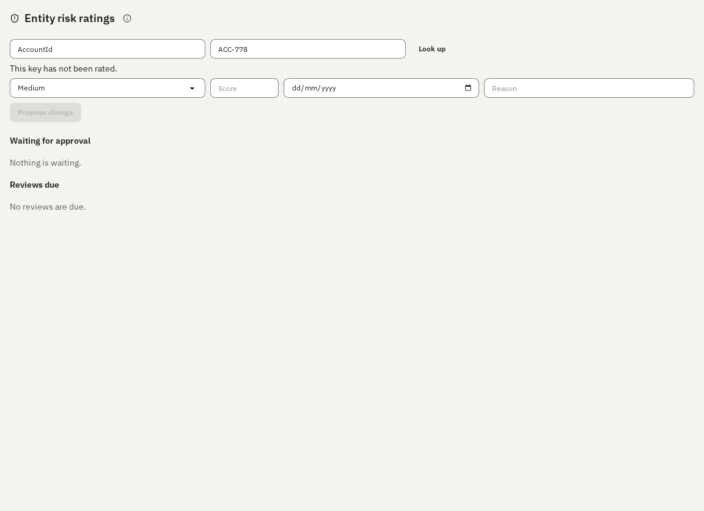

# Entity Risk Rating

Jube is not the customer master, and it follows that it does not decide who a customer is. It can, however, hold the risk rating of an entity key (an account, a customer id, a counterparty), whether that rating is supplied by the institution or set by an analyst, keep every change ever made to it, and remind the right people when a rating falls due a review. A rating set by hand is subject to the approval of a second person, in the manner of [Maker Checker](../MakerChecker/index.html), such that no single user can alter the standing of an entity alone.

The question it answers is that of the compliance officer: what standing does the institution give this customer, who decided it, upon what grounds, and when is it next to be looked at? The terms used are few:

| Term           | Meaning                                                                                                                                                   |
|----------------|-----------------------------------------------------------------------------------------------------------------------------------------------------------|
| Entity key     | The thing rated, given as a key name and a key value, such as AccountId and ACC-441. It is the same pair by which cases and transactions are keyed.       |
| Tier           | The rating itself: Low, Medium or High. A key that has never been rated has no tier, which is not the same as Low.                                        |
| Score          | An optional number kept beside the tier, for an institution that scores its customers. Jube stores it and attaches no meaning to its scale.               |
| Source         | Imported, where the institution supplied the rating, or Set by hand, where an analyst proposed it and a second person approved it.                        |
| Proposal       | A change that has been asked for and has not yet been approved. Until it is approved the rating is unchanged.                                             |
| Review by      | The date upon which the rating falls due to be looked at again.                                                                                           |
| Version        | Each change to a rating is a new version. The highest is current, and the earlier ones are its history.                                                   |

## An example

A clean installation holds no ratings, and the account ACC-441 of the demonstration serves as the example. An analyst holding permission 18 enters the Key name AccountId and the Key value ACC-441 and clicks Look up, and the page reads This key has not been rated. The analyst chooses the Tier High, enters the Reason Shares a device with a confirmed fraud, and clicks Propose change. The page confirms with Change proposed., the Reason is emptied, and the proposal appears under Waiting for approval as AccountId, ACC-441, High, Proposed by and the name of the analyst, with the reason beneath and a Retract button. Looking the key up again still reads This key has not been rated., as a proposal changes nothing.

A second user holding permission 80 opens the same page and is shown the same proposal with a Reason box, Approve and Reject in place of Retract. Upon Approve the page confirms with Recorded., the proposal leaves the list, and Look up thereafter shows High, Set by hand, the name of the analyst who proposed it (and not of the user who approved it) and the reason.

It follows that the example cannot be completed by one user alone: an installation with only the Administrator account can propose and retract, and has nobody to approve.

## Where it lives

Navigate through the menu to Administration, then Entity risk ratings, which presents the page at `/administration/entity-risk`. The menu item is presented to a user holding permission 18, Read Write Case Workflow, or permission 80, Approve Entity Risk Ratings.

The page is arranged in three parts, read from top to bottom: the lookup of a key with the proposal of a change, the changes waiting for approval, and the reviews that have fallen due.

| Element              | Description                                                                                                                                                              |
|----------------------|--------------------------------------------------------------------------------------------------------------------------------------------------------------------------|
| Key name             | The name of the key, up to 128 characters, for example Account.                                                                                                          |
| Key value            | The value of the key, up to 256 characters.                                                                                                                              |
| Look up              | Fetches the current rating of the key, shown as its tier (Low, Medium or High), its source (Imported or Set by hand), the user having made it and the reason, or as This key has not been rated. |
| Tier                 | The proposed tier: Low, Medium or High. Medium is offered to begin with.                                                                                                 |
| Score                | An optional numeric score to sit alongside the tier.                                                                                                                     |
| Review by            | An optional date by which the rating is next due a review.                                                                                                               |
| Reason               | The reason for the change, up to 500 characters, which is required.                                                                                                      |
| Propose change       | Records the proposal, returning Change proposed. Not available until a key and a reason are given.                                                                       |
| Waiting for approval | The pending proposals, each with its key name, key value, proposed tier, Proposed by and the user, and the reason. Nothing is waiting is shown where there are none.     |
| Approve, Reject      | Shown against a proposal made by somebody else, with a box labelled Reason (required to reject). Reject is not available until the reason is given.                      |
| Retract              | Shown against the user's own proposal, withdrawing it.                                                                                                                   |
| Reviews due          | The current ratings whose review date has passed, oldest first, each with its key, tier and review date. No reviews are due is shown where there are none.               |

The proposal controls (Tier through to Propose change) are presented only to a user holding permission 18, Approve and Reject only to a user holding permission 80, and Retract only to a user holding permission 18. The page shows the current rating only: the history of a rating, and the import of ratings in bulk, are available through the API and not through the page.

The behaviour of the page in detail is as follows:

* Look up is not available until both a Key name and a Key value are given. The Key name is trimmed of surrounding spaces, and the Key value is taken exactly as typed, with regard to case, as it must equal the value as stored.
* The current rating is shown as fetched by Look up and is not refreshed of its own accord. After a proposal is approved, Look up must be clicked again to see the new rating. The score and the review date of the current rating are not shown by the page, and are returned by the API.
* Upon Propose change the Reason is emptied, and the Tier, Score and Review by are left as they were. The Review by date is taken as midnight UTC of the day chosen.
* Approve, Reject and Retract each confirm with Recorded. and both lists are read again. The reason given with Approve is optional, and that given with Reject is required, each of up to 500 characters.
* A refusal by the server is shown as a message giving the reason returned: for example that a proposal for the key is already waiting, or that the rating has changed since the proposal was made.
* The two lists are of the tenant as a whole, and are not narrowed by the key looked up. Waiting for approval holds up to 200 proposals, and Reviews due up to 200 ratings, each given as its key name and value, its tier and its review date as year, month and day.

SHOT id=concepts-entity-risk-rating-page
     route=/administration/entity-risk
     steps=fill:Key name=AccountId, fill:Key value=ACC-778, click:Look up
     frame=page
     state=the Entity risk ratings page with a key looked up and its current tier, source, user and reason shown, the proposal controls beneath, one proposal under Waiting for approval made by another user with the reason box, Approve and Reject, and at least one rating under Reviews due
     conveys=one page looks up a rating, proposes a change and decides the proposals of others, and a change never takes effect without a second person
     alt=The Entity risk ratings page showing the current rating of an account, the controls to propose a new tier with a reason, a proposal waiting for approval with Approve and Reject, and the list of reviews due



TODO(verify): the menu item is presented on permission 18 or 80, yet Look up, Waiting for approval and Reviews due each read through endpoints that need permission 1, Read Write Case. A user holding 18 or 80 without 1 is presented with the page and then refused on every read. Owner to decide whether the reads or the menu are to change.

## What is stored

A rating belongs to a tenant and a key, the key being a key name (for example `Account`) and a key value, written exactly as it is stored against transactions and cases, which for an encrypted key is the ciphertext. Against the key a rating has the following:

| Value          | Description                                                                 | Example             |
|----------------|-----------------------------------------------------------------------------|---------------------|
| Tier           | 1 Low, 2 Medium or 3 High. Required.                                        | 3                   |
| Score          | An optional numeric score, which must be a finite number.                   | 0.82                |
| Source         | 1 Imported or 2 Set by hand. Set by the server.                             | 2                   |
| Reason         | Why the rating was set, up to 500 characters. Required when set by hand.    | Adverse media match |
| Review-by date | An optional date, in UTC, upon which the rating falls due a review.         | 2027-01-01          |

The table (`EntityRiskRating`) is append only. Each change is written as a new version, starting at 1, and the highest version is current, from which it follows that the history of a rating is the table itself. Nothing is edited or deleted in place.

## Getting ratings in

| Call                                              | Permission                                                              | What it does                                                                                                                                                                                                                                                                                                                                              |
|---------------------------------------------------|-------------------------------------------------------------------------|-----------------------------------------------------------------------------------------------------------------------------------------------------------------------------------------------------------------------------------------------------------------------------------------------------------------------------------------------------------|
| `POST /api/EntityRiskRating/Import`               | 18, Read Write Case Workflow, and also 80, Approve Entity Risk Ratings  | Up to 500 ratings. Each is checked on its own; a rating whose tier, score and review-by date equal the current one is skipped as unchanged, otherwise it is written as a new version with source Imported. The reply gives how many were written, how many were unchanged, and why each refused rating was refused, by its position in the batch.         |
| `POST /api/EntityRiskRating/Set`                  | 18, Read Write Case Workflow                                            | Proposes a manual rating; a reason is required. Nothing changes until a second person approves.                                                                                                                                                                                                                                                           |
| `GET /api/EntityRiskRating/Requests`              | 1, Read Write Case                                                      | The pending proposals, up to 200.                                                                                                                                                                                                                                                                                                                         |
| `POST /api/EntityRiskRating/Approve` and `Reject` | 80, Approve Entity Risk Ratings                                         | Approve writes the version; reject needs a reason. Never the caller's own proposal.                                                                                                                                                                                                                                                                       |
| `POST /api/EntityRiskRating/Retract/{guid}`       | 18, Read Write Case Workflow                                            | The proposer withdraws a pending proposal.                                                                                                                                                                                                                                                                                                                |

The version, source and user are always set by the server, and anything sent for them is ignored. A proposal is posted as follows:

```json
{
  "keyName": "Account",
  "keyValue": "Test1",
  "tierId": 3,
  "score": 0.82,
  "reviewByDate": "2027-01-01T00:00:00Z",
  "reason": "Adverse media match confirmed by the relationship manager."
}
```

## Reading them

`GET /api/EntityRiskRating/ByKey?keyName=...&keyValue=...` returns the current rating and up to 50 versions, newest first. `GET /api/EntityRiskRating/Due` returns the current ratings whose review-by date has passed, oldest first, up to 200. Both require permission 1, Read Write Case. A key that has never been rated returns no current rating, which is not the same as the lowest tier, and should not be taken to be.

## Approving a manual change

A rating set by hand is a proposal, not a change. `POST /api/EntityRiskRating/Set` records a pending request with its required reason, and the rating itself is left untouched. A different person holding permission 80, Approve Entity Risk Ratings, approves it with `POST /api/EntityRiskRating/Approve`, which writes the new version, or rejects it, giving a reason, with `POST /api/EntityRiskRating/Reject`. `GET /api/EntityRiskRating/Requests` lists what is waiting. The proposer can withdraw their own request with `POST /api/EntityRiskRating/Retract/{guid}`, yet can never decide it, and nobody other than the proposer can retract it.

Only one request per key can be pending at any time, and an approval is refused if the rating has changed since the proposal was made (by an import, say), for the purposes of ensuring that nobody approves a change against a rating they have not seen; the proposal must then be made again. The version written records the proposer as its maker, and the request records the approver.

Imported ratings are supplied by the institution, and do not need a second approver. Keeping in mind that an import writes ratings directly, the caller of the import must hold Approve Entity Risk Ratings as well as Read Write Case Workflow, such that the approval step cannot be bypassed through the import. Approving, rejecting and retracting a request, and the writing of the rating, happen in one database transaction.

## Reviews that fall due

Set the `EnableEntityRiskReview` Environment Variable to `True` and, every `WaitEntityRiskReview` milliseconds (86400000, daily, by default), every user holding permission 18, Read Write Case Workflow, in a tenant having ratings past their review-by date receives one notification, at most once a day, giving how many are due. The notification arrives in the Notifications bell of the user interface and reads, for example, 3 entity risk ratings are due a review. The job is off by default.

A rating stops being due when a newer version with a later review-by date, or with none, is written.

## Limitations

The rating is a record that is held, approved and reviewed, and it should be understood what it does not do, lest more be read into a tier than is there:

* The tier and the score are not computed. They are as supplied by the institution or as proposed by an analyst, and nothing is derived from case outcomes, from the network or from rule activations.
* The rating is not available to detection rules, and takes no part in the calculation of case risk. A key rated High is processed exactly as a key rated Low.
* A change of tier raises no case, no notification and no webhook. The only notification is that of reviews fallen due, described above.
* The rating is not shown on the case page or the Case Key Journal. It is seen on this page and through the API.

## Permissions and security

The permission for each action is as follows, a user without it receiving 403:

| Action                                           | Permission                                                             |
|--------------------------------------------------|------------------------------------------------------------------------|
| Read a rating, the pending proposals, reviews due | 1, Read Write Case                                                     |
| Propose a change, retract one's own proposal     | 18, Read Write Case Workflow                                           |
| Approve or reject a proposal                     | 80, Approve Entity Risk Ratings                                        |
| Import ratings                                   | Both 18, Read Write Case Workflow, and 80, Approve Entity Risk Ratings |

Ratings and requests are scoped to the tenant of the caller, every mutation needs the antiforgery token for cookie sessions, and each proposal, decision and import is written to the audit log.
