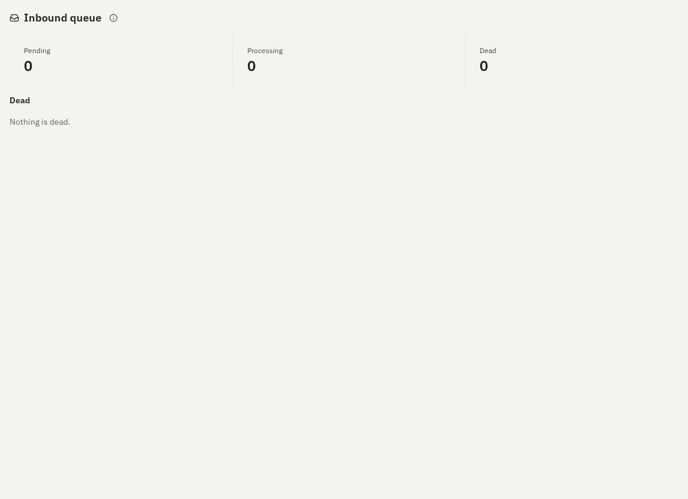

# Getting Transactions In

There are three ways to hand a transaction to a model. They differ in whether the caller waits for the answer, and in what they need of the infrastructure, as follows:

| Way                                                                   | The caller waits?              | Needs                                        | Delivery                                     |
|-----------------------------------------------------------------------|--------------------------------|----------------------------------------------|----------------------------------------------|
| `POST /api/Invoke/EntityAnalysisModel/{guid}`                         | Yes, gets the model's response | Nothing extra                                | The response is the receipt                  |
| **Inbound queue** `POST /api/Invoke/Queue/EntityAnalysisModel/{guid}` | No, gets 202 and a row id      | Nothing extra: it lives in the Jube database | At least once, durable                       |
| RabbitMQ: publish to the `jubeInbound` queue                          | No                             | A RabbitMQ broker                            | At least once, acknowledged after processing |

Jube deliberately does not add Kafka, and it does not use Resp publish and subscribe for ingestion, which would lose a transaction whenever no engine node happened to be listening. For callers that cannot wait for the answer, the database queue is the default way in, for the reason that it needs nothing beyond the database that Jube already has, while RabbitMQ is fully supported for sites that already run it.

## Where it lives

The inbound queue is the only one of the three ways to have a screen of its own. Navigate through the menu to Administration, then Inbound queue, which presents the page at `/administration/queue`. Both the menu item and everything on the page require permission 6, Read Write Model.

The page is for the operator rather than for the caller: it shows how much is waiting, and it presents the transactions that failed too often and were set aside, such that each can be tried again or removed. The counts and the list are refreshed every ten seconds without any action being taken.

| Element     | Description                                                                                                         |
|-------------|---------------------------------------------------------------------------------------------------------------------|
| Pending     | The number of transactions waiting to be processed.                                                                 |
| Processing  | The number of transactions claimed by an engine node and being processed.                                           |
| Dead        | The number of transactions that failed too often and were set aside, followed by the list of them.                  |
| Model       | A column of the Dead list. The Guid of the model that the transaction was sent to.                                  |
| Attempts    | A column of the Dead list. The number of times that the transaction was attempted.                                  |
| Reason      | A column of the Dead list. The short, plain reason for the last failure.                                            |
| Enqueued by | A column of the Dead list. The user having sent the transaction.                                                    |
| Created     | A column of the Dead list. The date and time, in UTC, at which the transaction was queued.                          |
| Requeue     | On each dead row. Returns the row to Pending, with its attempts set back to zero, to be tried again straight away.  |
| Delete      | On each dead row. Removes the row, and with it the transaction, without confirmation being sought.                  |

The Dead list shows the oldest 200 dead rows, never shows a payload, and reads Nothing is dead. when empty. Upon requeueing or deleting a row, Done. is returned and the counts and the list are read again. Where the counts cannot be read the page reads Could not load the queue. in their place. The Created time is given as year, month, day, hour, minute and second.

The three counts are read as follows. On a healthy system Pending and Processing rise and fall with the traffic and return towards zero, and Dead is zero. A Pending that grows steadily means that transactions are arriving faster than the engine nodes are working them, or that no node is working the queue at all, in which event Processing stays at zero. Any figure in Dead is a transaction that was never processed and awaits a decision by the operator: the Reason says why, Requeue is the answer where the cause has since been put right (a model that had not started, say), and Delete where the transaction is not wanted.

On a clean installation nothing has been queued, hence the page reads 0 against each of the three and Nothing is dead. To see the queue at work, post any valid transaction of the default model to `POST /api/Invoke/Queue/EntityAnalysisModel/90c425fd-101a-420b-91d1-cb7a24a969cc` in place of the live route. The reply is 202 with the id of the row, Pending shows 1 for a moment where the page happens to refresh while the row is waiting, and the transaction thereafter appears wherever a transaction sent by the live route would, the row having been deleted from the queue upon the model responding.

SHOT id=concepts-ingestion-inbound-queue
     route=/administration/queue
     steps=none
     frame=page
     state=the Inbound queue page with the Pending, Processing and Dead counts, and a Dead list of several rows showing the model, attempts, reason, who enqueued each and when, with Requeue and Delete on every row
     conveys=the queue is observed as three counts, and only the dead rows need the attention of an operator
     alt=The Inbound queue page showing the pending, processing and dead counts above a table of dead rows, each with its model, attempts, reason, sender and creation time, and Requeue and Delete

## The inbound queue

The caller needs the same access as for the live route, that being an API key whose role is allowed on the model. The body must be JSON and within `MaxInvokeControllerRequestBytes`. The replies are as follows:

| Reply | Meaning                                                                                                                          |
|-------|----------------------------------------------------------------------------------------------------------------------------------|
| `202` | The transaction is safely stored. The body is `{"id": ...}`, the id of the row in the queue.                                     |
| `400` | The body is empty, oversized or not valid JSON.                                                                                  |
| `403` | The caller does not have access to the model.                                                                                    |
| `404` | The model is unknown or inactive, or the `EnablePublicInvokeController` Environment Variable is not True.                        |
| `429` | More than `InboundQueueMaximumDepth` rows are pending. The caller should back off and retry.                                     |
| `500` | The transaction could not be stored.                                                                                             |

Each engine node (`EnableInboundQueue`, on by default) claims a batch with `FOR UPDATE SKIP LOCKED`, such that any number of nodes can work the same queue without taking a row twice, runs each transaction through its model, and deletes the row when the model has produced a response. If a node dies with a batch claimed, the claims expire after `InboundQueueVisibilitySeconds` and another node takes the rows. A failure is retried after 5 seconds, then 10, 20 and so on up to 5 minutes; after `InboundQueueMaximumAttempts` the row is marked **Dead** and kept, with a short plain reason (never database or exception text), for an operator.

The reason recorded against a row is one of the following:

| Reason                                              | Meaning                                                                                          |
|-----------------------------------------------------|--------------------------------------------------------------------------------------------------|
| `ModelNotFound`                                     | The engine node does not have the model.                                                         |
| `ModelNotStarted`                                   | The engine node has the model, yet it has not started.                                           |
| `NoResponse`                                        | The model produced no response.                                                                  |
| `Exception` followed by the type of the exception   | Processing failed. Only the name of the type is recorded, the detail being written to the log.   |
| Gave up after the node stopped while processing it. | The row was claimed the maximum number of times without ever finishing.                          |

The last of these deserves explanation: a row that has already been claimed `InboundQueueMaximumAttempts` times without finishing, for example one that crashes the node every time, is marked Dead on the next claim rather than being retried for ever.

Delivery is at least once, and it follows that a transaction can, rarely, be processed twice, that being when a node finishes a transaction and dies before deleting the row. A unique reference should be put in the transaction if the model must tolerate that.

The behaviour of the queue is set by the following Environment Variables:

| Environment Variable              | Default | Description                                                                             |
|-----------------------------------|---------|-----------------------------------------------------------------------------------------|
| `EnableInboundQueue`              | True    | Whether the engine node works the queue.                                                |
| `InboundQueueBatchSize`           | 50      | The number of rows claimed at a time.                                                   |
| `InboundQueueConcurrency`         | 8       | The number of rows of a batch processed at once, on each node.                          |
| `InboundQueuePollMilliseconds`    | 250     | The wait before looking again, when the queue was found empty.                          |
| `InboundQueueMaximumAttempts`     | 5       | The attempts after which a row is marked Dead.                                          |
| `InboundQueueVisibilitySeconds`   | 120     | The time after which the claim of a node expires. Never less than 10.                   |
| `InboundQueueMaximumDepth`        | 100000  | The number of pending rows above which the queue replies `429`.                         |
| `MaxInvokeControllerRequestBytes` | 4000    | The largest body accepted, shared with the live route.                                  |

### Operating the queue through the API

An operator with permission 6, Read Write Model, sees the queue at `GET /api/InboundQueue/Depth` (pending, processing, dead) and `GET /api/InboundQueue/Dead`, and can requeue (`POST /api/InboundQueue/Dead/{id}/Requeue`) or delete (`DELETE /api/InboundQueue/Dead/{id}`) a dead row, these being the calls that the page itself makes. The dead list never returns a payload. The depth, the dead list, requeue and delete are all scoped to the tenant of the caller through the model that each row belongs to, such that one tenant never sees the queue volume or the rows of another.

### Writing to the queue directly

A producer that cannot make HTTP calls can insert into `TransactionInboundQueue` directly (`EntityAnalysisModelGuid`, `Payload`, `StatusId` 1, `AvailableDate`, `EnqueuedBy`, `CreatedDate`). That bypasses the checks of the API, henceforth it should be granted only to a database role under the control of the site. In a cluster the `jube_app` role is given `DELETE` on this one table, and on no other.

### The cost of the design

The cost of this design is write load on the same Postgres that archives every transaction: an insert and a delete per message, and ordinary vacuum work. It suits moderate volumes and integration-challenged sites, while at sustained high volume RabbitMQ should be used.

It should also be understood that an idle node finds new work by polling, every quarter of a second by default, rather than by being woken with LISTEN/NOTIFY, that concurrency is limited for each node and not for each model, and that the inbound queue does not appear in the infrastructure health dashboards, the page described above being the place to observe it.

## RabbitMQ

Publish to the `jubeInbound` queue with the header `EntityAnalysisModelGuid` set to the Guid of the model. The consumer starts whenever RabbitMQ is configured (it used to start only when `EnableCallback` was True, which is unrelated). It holds at most `AmqpPrefetch` unacknowledged messages (50 by default) and acknowledges a message only after the model has processed it, such that a node that dies mid-message returns it to the queue.

For a message that it cannot process yet, the consumer puts the message back: while the models are still loading it waits a second and requeues, and for a failure, an unknown model, a model that is not started or a model that produced no response it requeues once and, if the redelivery fails too, drops the message rather than loop for ever. A message without the header, or with one that is not a Guid, is dropped.

The queue is declared non-durable by default so as not to clash with queues created by earlier versions; see `AmqpInboundQueueDurable`, which is False by default.

## Batches

Jube does not import batch files. A site that works in batches usually puts a small bridge in front, which posts each transaction to the API or the inbound queue, or publishes it to RabbitMQ, and a bridge is the supported pattern.

## Permissions and security

Sending a transaction, by either of the HTTP routes, requires an API key whose role is allowed on the model, and is refused with 403 otherwise. Observing the queue, and requeueing or deleting a dead row, requires permission 6, Read Write Model, and requeue and delete need the antiforgery token for cookie sessions. Requeue and delete are written to the audit log, and a dead row belonging to another tenant behaves like a missing one.
