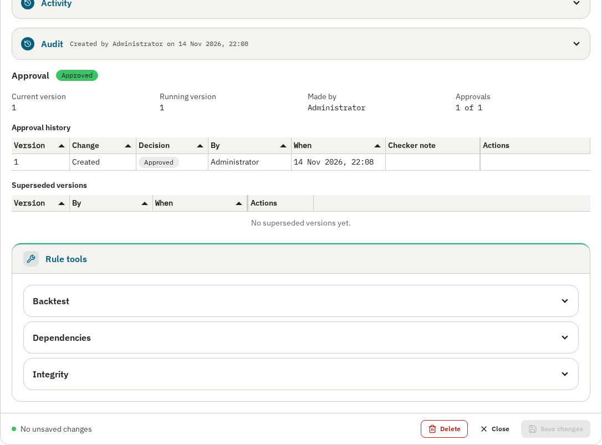
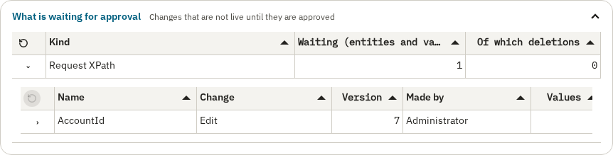

# Maker Checker

Jube loads model configuration into the invoke engine from the database, filtered on `Active`. Maker checker separates the changing of configuration from the releasing of it, which is to say that a maker edits, a checker approves, and only approved configuration reaches the engine. Every change is recorded as a version, and the version history is available for every approvable entity.

The engine loads a model as one immutable snapshot. A change becomes live when a checker approves it, and the next synchronisation cycle publishes it, henceforth no one needs to trigger a synchronisation by hand.

The purpose is the one familiar from the payment of money: no single person should be able to change what the system decides about customers, whether by mistake or by design, without a second person having seen the change. The terms used throughout are as follows:

| Term              | Meaning                                                                                                                                                         |
|-------------------|-----------------------------------------------------------------------------------------------------------------------------------------------------------------|
| Maker             | The user who creates, changes or deletes a piece of configuration.                                                                                              |
| Checker           | A different user, holding permission 44, who approves or rejects what the maker did.                                                                            |
| Version           | Each save of a record is a new version, numbered from 1. The record as it stands in the database is the Current version.                                        |
| Approval          | A recorded decision by a checker upon one version of one record: approved or rejected. A version with no decision is awaiting approval.                         |
| Running version   | The version the engine is using, being the newest version that has been approved. It is also called the effective version, and it may be behind the Current version. |
| Approval cycle    | The passage of one change from being made to being approved, rejected, resubmitted or retracted.                                                                |
| Synchronisation   | The engine taking up what has been approved, which it does of its own accord within seconds of an approval.                                                     |

## An example

The simplest case, carried through, is a change to one Activation Rule of the default model, with `ApprovalsRequired` at its default of 1.

1. The rule stands at version 1, approved. Its Approval section reads Approved, Current version 1, Running version 1.
2. A maker opens the rule, changes it and saves. The Approval section now reads Awaiting approval, Current version 2, Running version 1, Approvals 0 of 1, and the hub card of Activation Rules shows a badge of 1. The engine continues to run version 1 exactly as before, and transactions are decided by the old rule.
3. The maker is not offered Approve. A checker opens the same rule, or finds it under What is waiting for approval, reads the change by way of Compare, and clicks Approve.
4. The Approval section reads Approved, Current version 2, Running version 2, Approvals 1 of 1, with the decision in the Approval history. Within some ten seconds the engine has taken up version 2, and transactions are decided by the new rule.

Had the checker clicked Reject at the third step, the state would read Rejected, the Running version would remain 1, and the maker would choose between Resubmit, to put the same change forward again, Retract, to abandon it and return the record to what it was when last approved, or a further edit, which makes a new version and begins again. It can be seen that at no point does an unapproved change reach a transaction, and that the gap between the Current version and the Running version is the whole of what a checker is asked to judge.

## Where it lives

Maker checker has no page of its own, rather it is present wherever an approvable entity is administered, in the common manner described in [Child Objects](../../Navigation/ChildObjects/index.html):

| Surface                      | What it offers                                                                                                                                                                                       |
|------------------------------|------------------------------------------------------------------------------------------------------------------------------------------------------------------------------------------------------|
| Hub card                     | Navigating through the menu to Models and opening a model, the hub card of each type of child object carries a warning badge with the number awaiting, shown only where children are awaiting approval. |
| List heading                 | The heading of a list of children carries the totals: the number in total, active, locked and awaiting approval.                                                                                     |
| Record                       | The record step carries the approval state of the record alongside its version, and the Approval section sits beneath the form.                                                                      |
| Values panel                 | For Lists and Dictionaries, each value carries its own state and its own Approve, Reject, Resubmit and Retract, with Approve all pending for the whole panel.                                        |
| What is waiting for approval | A section of Integrity, under a model, in which everything awaiting approval in the model is reviewed and decided in one place.                                                                      |
| Override                     | Force overrides awaiting approval are reviewed on the Override page, as described in [Activation Rules Override](../../Configuration/Models/ActivationRulesOverride/index.html).                     |

There is no tree of entities, and no colouring of entities by state, in the user interface. The state of a record is instead given in words, as one of the following:

| State                      | Description                                                                             |
|----------------------------|-----------------------------------------------------------------------------------------|
| Awaiting approval          | Created or changed, and not yet approved. The engine continues with the version before. |
| Approved                   | The current version has been approved and is taken up by the engine.                    |
| Rejected                   | The checker rejected the change. The maker can resubmit or retract.                     |
| Deletion awaiting approval | Deleted by the maker, and still in use by the engine until the deletion is approved.    |
| Deletion rejected          | The checker rejected the deletion.                                                      |
| Deleted                    | The deletion has been approved.                                                         |

### The Approval section

The Approval section shows the state, alongside the following:

| Element            | Description                                                                                                      |
|--------------------|------------------------------------------------------------------------------------------------------------------|
| Current version    | The version of the record as it stands in the database.                                                          |
| Running version    | The version the engine is running, which is the effective version described below, or Not running yet.          |
| Made by            | The user having made the current version.                                                                        |
| Approvals          | The approvals recorded against the number required, for example 1 of 2.                                          |
| Approval history   | Each decision, with its Version, Change, Decision, By, When, Checker note and Return note.                       |
| Superseded versions | The versions that came before, each with Compare, which presents the changes in that version field by field, as the Earlier version against This version. |

The Change of a version is one of Created, Update, Deletion, Restore, Retracted or Resubmitted. For a version awaiting a decision the checker may enter an optional note, then Approve or Reject. For a rejected version the maker may Resubmit or Retract, and a note may be returned with either. Approve is not offered to the maker of the change.

SHOT id=concepts-maker-checker-approval-section
     route=/models
     steps=open-default-model, open-hub:Activation Rules, open-first-row, scroll-to:Approval
     frame=record
     state=an Activation Rule of the default model with an edit awaiting approval, ApprovalsRequired being 2, showing the Approval section with Awaiting approval, a Current version one ahead of the Running version, Approvals reading 1 of 2, and the Approval history with one approval recorded
     conveys=the approval of a record is decided beneath its form, where the version in the database is set against the version the engine is running
     alt=The Approval section of an Activation Rule showing its state as Awaiting approval, the current and running versions, one of two approvals recorded and the approval history

### What is waiting for approval

Navigate through the menu to Models, open the model, then Integrity, then the section What is waiting for approval, which is described as Changes that are not live until they are approved. The section presents a table of Pending approvals by kind:

| Column                        | Description                                                           |
|-------------------------------|-----------------------------------------------------------------------|
| Kind                          | The type of entity.                                                   |
| Waiting (entities and values) | The number of entities, and of List Values or Dictionary KVPs, awaiting approval. |
| Of which deletions            | The number of those which are deletions.                              |

Expanding a kind presents the Entities awaiting approval, each with its Name, the Change (Edit or Deletion), the Version, who it was Made by and, for Lists and Dictionaries, the number of Values awaiting. Each entity may be opened, for the purposes of reviewing the change in its Approval section, or decided there and then with Approve or Reject, and for Lists and Dictionaries, Approve values. Where nothing is waiting the section reads Nothing is awaiting approval in this model.

The remainder of Integrity shows the dependency graph against which each approval is checked, as described under Dependency pre-flight, so a checker can see the dependencies before deciding. Integrity is described further in [Model Integrity](../../Configuration/Models/ModelIntegrity/index.html), and its findings include the following in respect of approval:

* A pending approval is reported as information, as Changed and waiting for approval.
* An approved entity the engine has not loaded is a warning, as Not loaded by an engine instance, and so is a stale engine instance.
* An approved entity that depends on an unapproved one is reported as `DependencyOnUnapproved`, Uses an entity that is not yet approved.

SHOT id=concepts-maker-checker-waiting-for-approval
     route=/models
     steps=open-default-model, open-hub:Integrity, open-section:What is waiting for approval, scroll-to:What is waiting for approval, expand-first-row
     frame=section:What is waiting for approval
     state=Integrity for the default model at the section What is waiting for approval, with several kinds listed with their counts and one kind expanded to show its entities awaiting approval, each with Name, Change, Version and Made by
     conveys=everything awaiting a checker in a model is gathered in one place, by kind
     alt=The What is waiting for approval section of Integrity, listing pending approvals by kind with one kind expanded to show the entities awaiting approval

## What is approvable

Every entity the model synchronisation loads is approvable, as follows:

Model, Lists and List Values, Dictionaries and Dictionary KVPs, Request XPaths, Inline Scripts (the model-level wiring), Inline Functions, Gateway Rules, Sanctions, Abstraction Rules, Abstraction Calculations, TTL Counters, HTTP Adaptations, Graph Recall entities, Svirfd, Exhaustive Search Instances, Advanced Analytics instances, Activation Rules, Response Elevation Ranges and Tags.

Force overrides are also approvable, at the model level (approval kind 22) and against a named Activation Rule (approval kind 23). Only Force rows are governed, and a Suppress override stays outside approval. A Force override takes effect only once approved, an edit to its Delete Expiry Date or its removal is a new version that needs approval while the last approved version stays in force, and the maker of a version is the person who last changed it. The engine loads Suppress overrides directly and Force overrides through the approved version only. See [Activation Rules Override](../../Configuration/Models/ActivationRulesOverride/index.html).

The following are outside approval:

* Suppress overrides (the Suppress kind of override, and the Suppression a case worker makes against live traffic) are operational actions, not configuration changes. They take effect immediately and are not gated by approval. The Force kind is governed, as above.
* The global `EntityAnalysisInlineScript` is a program unit, compiled and deployed through the code release process. Wiring a global script into a model is `EntityAnalysisModelInlineScript`, which is approvable.
* Reprocessing rules and case workflow entities are not loaded by the model synchronisation, and it follows that they are not approvable.

## Approvals

An approval is a row in its own table, `EntityApproval`, never a flag on the entity. Each row records the kind, the entity, the version, the state (approved or rejected), an optional note, and who decided and when.

`(kind, entity, version)` identifies a snapshot of a record. Each update writes the superseded row to the version table and increments the version, so version *N* is the current row and versions *1..N-1* are version rows. An approval for version 4 remains valid after version 5 supersedes it, which is to say that the approval never has to be re-keyed.

The following rules apply:

* Pending is the absence of a row, as only approved and rejected decisions are stored.
* A rejection blocks that version, and a rejected version never takes effect. The maker opens a new approval cycle either by an edit, which creates the next version, or by Resubmit, which puts the same change (a deletion included) forward again, unchanged, where the rejection has been explained and the maker still wants it approved. Where the maker agrees with the rejection, Retract abandons the change, restoring the record to its last approved version (undeleting it, if the rejected change was a deletion) without opening a new approval cycle.
* Several approvers can approve one version. `ApprovalsRequired` in the Environment Variables (default `1`) sets how many distinct approvers make a version effective, and each approver counts once.
* Self-approval is refused, as the approver must differ from the user who made the version. The one exception is the landlord tenant, where a user holding both the write and approve permissions may create a change and approve it alone, this being an operator privilege.
* Approval and rejection are separate permissions from editing. Permission 44, Allow Approval, decides, and permission 45, View Pending Approvals, lists what is waiting (as does permission 44). Approval is one role for every kind, not one per kind.
* A version that is already in effect cannot be rejected. The live rule stays live, and the refusal says so. A version that is not yet live can be rejected.

## Effective version

The engine runs, for each entity, its effective version, shown in the Approval section as the Running version. This is the newest version that has reached `ApprovalsRequired` distinct approvals and has no rejection against it. It follows that:

* The current version runs when it is approved.
* Otherwise the newest earlier approved version runs, such that an edit that is not yet approved leaves the last approved version running.
* An entity that has never been approved does not run.

Resolution is set-based. The engine reads, for each kind of entity in a model, the approval rows for all of its entities in one query, then the current rows and the matching version rows. It never resolves one record at a time.

## Deletes, inserts, values and imports

A delete is a pending change. Deleting writes the pre-delete row to the version table and increments the version, as an update does. The entity keeps running at its last approved version until a checker approves the deletion. An approved deletion removes the entity from the engine and from the lists of the user interface, whereas a rejected deletion keeps the entity running.

TODO(verify): this page formerly stated that deleted records can be opened, reviewed and revived by an edit. The Vue user interface has a Restore change in the Approval history and Retract for a rejected deletion, yet no means could be found from code of opening a record whose deletion has been approved. Confirm on a running system whether an approved deletion can still be opened and revived, and state the manner here.

An insert is invisible until approved. A new record is version 1 with no approval, so the engine does not load it until a checker approves it.

List values and dictionary KVPs are approved per value. Each value has its own approval row, so the audit stays exact. The Values panel of the List or Dictionary shows each value's State, its Approvals and who it was Made by, with Approve and Reject for a checker. Approve all pending approves every pending value of a parent in one action, and values refused on their own are reported and do not stop the others. The approval status of the values of a parent, as returned by the API, lists pending values first.

The text of a List Value or Dictionary KVP is unique within its parent while it exists. A create or update, whether through the API or a CSV upload, is refused if the same text is already live. The check follows the same rule as the effective version resolution above, not the raw deleted flag: a value whose deletion is still pending, or was rejected and has not been retracted or resubmitted, is still occupying the text. The same text becomes free to reuse only once a checker actually approves the deletion.

Preservation imports are approved by the importer. An import stamps every entity it brings in as approved by the user who performed it. This bypasses the second approver by design, because importing is a privileged administrative action, and an import takes effect on the importer's authority, whatever `ApprovalsRequired` is set to.

## Dependency pre-flight

A logical change often spans several entities, such as an abstraction rule and the activation rule that consumes it. Each approval is checked against the dependency graph before it is recorded. The graph is built as it would be after the approval, and the approval is refused when:

* It deletes an entity that an active rule uses (the message names the dependants).
* It approves an entity whose prerequisites are not yet approved (the message lists them in dependency order).
* It names a target that does not exist.

An inactive dependant does not block an approval. Warnings are shown and allowed.

Validation that depends on other entities is re-evaluated at approval, not trusted from the maker's save. The dependency check is one such validation, and deletion safety and rule parsing are others.

## Synchronisation

Synchronisation is driven by a change-detection probe. Each cycle, for each tenant, the engine reads a small set of scalars. The probe covers:

* The latest approval row for the tenant, across every approvable kind.
* The latest suppression change.
* The earliest future expiry of a suppression, list value or dictionary KVP, keeping in mind that a passing expiry is itself a change.
* The exhaustive promoted-trial watermark, since models are promoted asynchronously by the trainer.
* The count and largest identity of live API keys for active users in the tenant, and of live model role grants. Issuing, revoking or re-granting a key or a role, or deactivating a user, is picked up at the next cycle.
* The scheduled synchronisation date.

When nothing has changed, the engine does only two writes, being its heartbeat and rule counter persistence. When something has changed, it rebuilds the whole model and publishes it. The gate fires at most once per `ModelSynchronisationWait` window (10 seconds by default), so approvals landing together produce one rebuild.

It follows that approval publishes: a change goes live at the next cycle after it is approved. The synchronisation schedule remains available for deliberate bulk promotion, from Integrity under a model, in the section Is the engine running it, using Synchronise this model, or for every model of the tenant using Synchronise all models above the table of models.

If reading the API users fails, the cycle fails. The error is recorded, nothing is published, and the watermark is not recorded. The model stays pending and the next cycle retries. The previous snapshot stays live until the retry succeeds, so a revoked key remains admitted for as long as the failure lasts.

Compiling a rule does not repeat for unchanged rules, as they reuse their cached assembly.

## Model snapshots

Each model is held as one immutable snapshot. It contains every collection that synchronisation owns: activation, gateway and abstraction rules, TTL counters, sanctions, adaptations, exhaustive models, request XPaths, abstraction calculations, inline functions and scripts, tags, lists, dictionaries, the suppression collections, and a generation counter.

* Synchronisation builds the whole snapshot off to the side and publishes it with one atomic write per model. A reader sees either the previous generation or the next one, never a mixture of the two.
* Runtime state stays outside the snapshot, so it survives a cutover: counters, the cache, concurrent queues, the shared sanctions dictionaries, archive buffers, the abstraction rule cache and the active model registry. Rule counters carry forward from the outgoing generation.
* Readers outside an invocation, namely the exhaustive recall callback and the abstraction rule caching task, read the snapshot once.

Invocations read the live snapshot at each point they need a collection, not once at entry. A cutover that lands during an invocation is therefore visible to the rest of that invocation, which can read two generations.

## Upgrade behaviour

The migrations add the approval table and its permission rows, and then:

* Stamp an approval for every existing live entity at its current version, so that current models keep running after the upgrade.
* Approve activation rules only where they had been approved by review (`ReviewStatusId` 4), the only state the engine ever activated, so a rule that was pending or rejected before the upgrade does not switch on at the first synchronisation.
* Drop the activation rule review status.

Without the back-fill, an upgrade would leave every model empty, because unapproved entities are not loaded.

## Approved by Review is retired

Activation rules no longer have a review status. The review status column, its DTO and validation, its permission grant and its page control are removed. Permission 41, formerly Allow Approved By Review, is kept as a row for referential integrity and is excluded from the permission listing. The archive serialisation keeps the positions of the removed fields unused, so existing archives still decode into the right fields.

## Version history

Every versioned entity has a version history endpoint, from which the Superseded versions of the Approval section are drawn. Each endpoint checks the caller's permission and tenant on every call. An id the caller cannot see returns not found rather than forbidden, so the endpoint does not reveal which ids exist in another tenant. Where the caller is not permitted, the Approval section states that the version history, or the approval history, is not available.

## Edge behaviour

* Inline script properties are not checked by the approval pre-flight. They carry no version and default to approved.
* The live dictionary of active models is updated by the synchronisation thread without a lock, and request threads enumerate it while that update runs.
* Counters carried forward at publish can miss increments made by invocations still running against the previous generation.
* List and dictionary content is outside the synchronisation watermark. A content change that writes no approval row and no schedule change is picked up at the next full synchronisation rather than by the gate.
* A bulk approval commits each item as it goes. If an item is deleted concurrently, the items before it stay approved and the call returns not found.
* Synchronisation steps other than the API user sync log and continue on error. The API user sync fails the cycle, so a tenant whose API user sync fails permanently holds up the other tenants in the same poll.

TODO(verify): confirm whether changing the output flags of an Advanced Analytics instance opens an approval cycle (a new version awaiting approval), as was noted for addition to this page, and add it to the list above if so.

## Consequences

* Configuration that has never been approved does not run. The back-fill makes this safe for existing installations.
* Approval is the moment of production change. A change cannot be scheduled to go live later, and holding an approved change is the way to defer it.
* A maker cannot approve or reject their own work, including in a single-user installation. A landlord is exempt and may decide their own changes.
