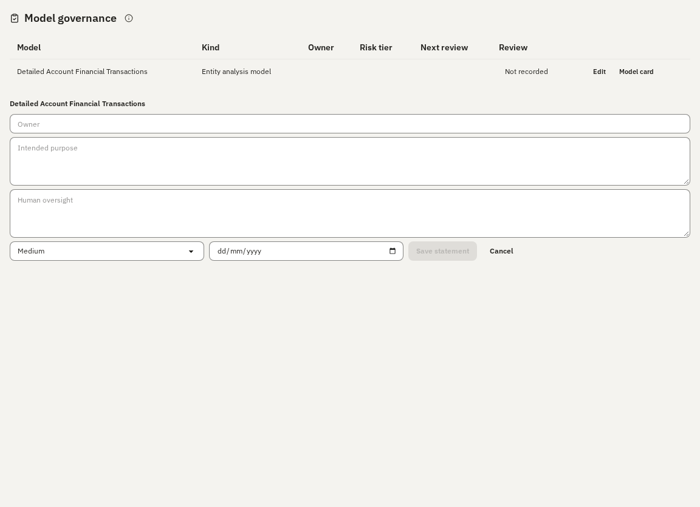

# Model Governance and Model Cards

A model that decides things about people needs an owner, a stated purpose, a view on how risky it is and a description of how a person oversees it. Jube keeps that as a governance statement for each model, lists every model alongside the state of its statement in an inventory, and produces a model card, being one self-contained page that a reviewer or an auditor can keep. The three are described in turn below, keeping in mind throughout that a statement is a record of governance and not a control upon the model.

The question it answers is that put by an auditor or a regulator of any automated decision: who is accountable for this model, what is it meant to do, how serious would it be were it wrong, how does a person keep watch over it, and when was all of that last looked at? The terms used are as follows:

| Term                 | Meaning                                                                                                                                              |
|----------------------|------------------------------------------------------------------------------------------------------------------------------------------------------|
| Model                | Either an entity analysis model, being the model that holds the rules, or an Exhaustive adaptation, being a trained machine learning model within one. |
| Governance statement | Five answers kept against a model: its owner, its intended purpose, its risk tier, its human oversight and the date of its next review.              |
| Risk tier            | The judgement of the institution as to how much harm the model could do were it wrong: Low, Medium or High. It is entered and is not computed.       |
| Human oversight      | A description, in words, of how a person reviews or can overrule what the model decides.                                                             |
| Inventory            | The list of every model with the state of its statement.                                                                                             |
| Review status        | Whether a statement exists and whether its review is due, worked out from the next review date.                                                      |
| Model card           | One page describing a model, made on request from its statement and its history, for a reviewer to keep.                                             |

## An example

On a clean installation the inventory lists the default model, Detailed Account Financial Transactions, as an Entity analysis model, with the Owner, the Risk tier and the Next review blank and the Review reading Not recorded, followed by any Exhaustive adaptation of that model.

Clicking Edit on that row presents the statement beneath the table, empty, with the Risk tier at Medium. Enter the Owner Head of Financial Crime, the Intended purpose Scores account transactions for fraud and money laundering, the Human oversight Every activation raises a case that an analyst decides, choose the Risk tier High, give a Next review date a year hence, and click Save statement. The page confirms with Statement saved., the statement closes, and the row now shows the owner, High, the date and the Review as Current. Were the date given as three weeks hence the Review would read Due soon, and were it a date already passed, Overdue.

Clicking Model card on the row downloads the card, which states the model, the statement just saved as version 1 of 1 with the user and the time, and that drift monitoring is not turned on.

## Where it lives

Navigate through the menu to Administration, then Model governance, which presents the page at `/administration/governance`. Both the menu item and everything on the page require permission 6, Read Write Model.

The page is the inventory, as a table with one row for each model, in the following columns:

| Column      | Description                                                                                                  |
|-------------|--------------------------------------------------------------------------------------------------------------|
| Model       | The name of the model.                                                                                       |
| Kind        | Entity analysis model or Exhaustive adaptation.                                                              |
| Owner       | The accountable owner, blank where no statement has been saved.                                              |
| Risk tier   | Low, Medium or High, blank where no statement has been saved.                                                |
| Next review | The next review date, where one has been given.                                                              |
| Review      | The review status, as a badge: Not recorded, Current, Due soon or Overdue.                                   |
| Edit        | Opens the statement of the model beneath the table, filled with the current version where there is one.      |
| Model card  | Downloads the model card of the model as an HTML file.                                                       |

An inventory with no models reads No models yet. Upon clicking Edit, the statement is presented beneath the table, headed by the name of the model, with the following:

| Value            | Description                                                                                             | Example                                                      |
|------------------|---------------------------------------------------------------------------------------------------------|--------------------------------------------------------------|
| Owner            | The accountable owner. Required, at most 200 characters.                                                | Head of Financial Crime                                      |
| Intended purpose | What the model is for and the decisions that it informs. Required, at most 2,000 characters.            | Scores card payments for fraud ahead of authorisation.       |
| Human oversight  | How a person reviews, or can override, what the model does. Required, at most 2,000 characters.         | Every decline can be overridden by an analyst from the case. |
| Risk tier        | Low, Medium or High. Medium is offered for a model without a statement.                                 | High                                                         |
| Next review      | An optional date upon which the statement is next due a review.                                         | 2027-06-30                                                   |

Save statement is not available until the owner, the intended purpose and the human oversight have been given, and upon saving Statement saved. is returned, the statement closes and the inventory is refreshed. Cancel closes the statement without saving. Surrounding spaces are removed from the three texts, and the Next review is taken as midnight UTC of the day chosen. Where the inventory cannot be read the page reads Could not load the models.

The Review badge is the part of the page to act upon, and is coloured accordingly: Not recorded is grey and means that the model has no statement at all, which for a model in use is the most pressing state of the four; Current is green and needs nothing; Due soon is amber and means that the review falls within 30 days; and Overdue is red and means that the date has passed. Saving the statement again with a later date, after the review has in fact been carried out, returns the badge to Current, each such save being kept as a new version.

Only one statement is open at a time, and clicking Edit on another row replaces the one that is open without saving it. The earlier versions of a statement are not shown on the page, and are returned by the API as described below.

SHOT id=concepts-model-governance-page
     route=/administration/governance
     steps=click:Edit
     frame=page
     state=the Model governance page with the inventory listing several models of both kinds, showing a mixture of Not recorded, Current, Due soon and Overdue review badges, and the statement of the first model opened beneath for editing with owner, intended purpose, human oversight, risk tier and next review filled in
     conveys=every model is listed whether or not it has a statement, the review status is seen at a glance, and the statement is a short form beneath the inventory
     alt=The Model governance page showing a table of models with their kind, owner, risk tier, next review date and review status, and beneath it the governance statement of one model open for editing



## The governance statement

A statement has the accountable owner, the intended purpose (what the model is for and the decisions that it informs), a risk tier (1 Low, 2 Medium or 3 High), the human oversight (how a person reviews, or can override, what the model does) and an optional next review date. The owner, the intended purpose, the human oversight and the risk tier are all required; the owner is at most 200 characters, and the two statements at most 2,000.

The statement is append only. Every save is a new version, the highest is current, and the earlier versions stay, with who saved them and when. Two statements saved at the same moment cannot overwrite each other: the second save is refused, and the user asked to try again.

A statement is kept for two kinds of model, an entity analysis model (the model that holds the rules) and an Exhaustive adaptation. The permission is 6, Read Write Model, for reading and for saving alike.

Through the API, `GET /api/ModelGovernance/ByModel?kindId=1&modelGuid=...` returns the current statement and up to 50 versions, newest first, and `POST /api/ModelGovernance/Set` saves a new version, as follows:

```json
{
  "kindId": 1,
  "modelGuid": "00000000-0000-0000-0000-000000000000",
  "ownerUser": "Head of Financial Crime",
  "intendedPurpose": "Scores card payments for fraud ahead of authorisation.",
  "riskTierId": 3,
  "humanOversight": "Every decline can be overridden by an analyst from the case.",
  "nextReviewDate": "2027-06-30T00:00:00Z"
}
```

The version, the user and the date are set by the server.

## The inventory

`GET /api/ModelGovernance` lists every model in the tenant, whether or not it has a statement, with its owner, tier, next review date and a review status:

| Status       | Meaning                                                                         |
|--------------|---------------------------------------------------------------------------------|
| Not recorded | No statement has been saved.                                                    |
| Current      | A statement exists and its review is 30 days or more away, or it has no date.   |
| Due soon     | The next review date is within 30 days.                                         |
| Overdue      | The next review date has passed.                                                |

The inventory is of the entity analysis models that have not been deleted, followed by the Exhaustive adaptations of those models that have not been deleted, each in order of name.

## The model card

`GET /api/ModelGovernance/Card?kindId=1&modelGuid=...` returns the card as one HTML file, named `model-card-` followed by the Guid of the model, with its styles and its charts inline and no scripts, such that it opens anywhere, prints well and follows the light or dark setting of the reader. It holds the following:

* The name and identity of the model, being its kind and its Guid.
* The current statement, and which version of how many it is, with who saved it and when, or a line stating that no governance statement has been recorded.
* For an entity analysis model, the drift history, taken from the latest 300 checks: for each score a chart of the population stability index against the 0.1 and 0.25 thresholds, and the latest ten checks as a table of date, PSI and status. Drift is described in [Model Drift Monitoring](../ModelDrift/index.html), and where it is not turned on the card says so.
* For an Exhaustive adaptation, the best score, the number of models tried and when training completed.

Every value is escaped, henceforth nothing that a user typed into a statement or a name can run in the card.

The card is generated on request from what is stored, and nothing about the card is itself stored. It is a snapshot, and it follows that it records the date and the user that made it.

## What it is not

A statement is a record, not a control: saving one does not stop a model from running, and an overdue review does not switch it off.

The limitations are as follows:

* A statement is kept for entity analysis models and Exhaustive adaptations only. Advanced Analytics models are not in the inventory.
* A statement is not subject to approval by a second person. Whoever holds permission 6 saves it alone.
* The card carries the drift of the score only. It does not carry a baseline score distribution taken at promotion, the drift of the input variables, or AUC and calibration against outcomes.
* The card does not carry the evidence of promotion or the name of whoever approved it.
* The card is an HTML file. A PDF is had by printing it from the browser.

## Permissions and security

Reading the inventory, reading and saving a statement, and downloading the card all require permission 6, Read Write Model, a user without it receiving 403. Saving a statement needs the antiforgery token for cookie sessions. Statements are scoped to the tenant of the caller through the model, such that a model of another tenant behaves like a missing one, and the reading of the inventory, the saving of a statement and the making of a card are each written to the audit log.
