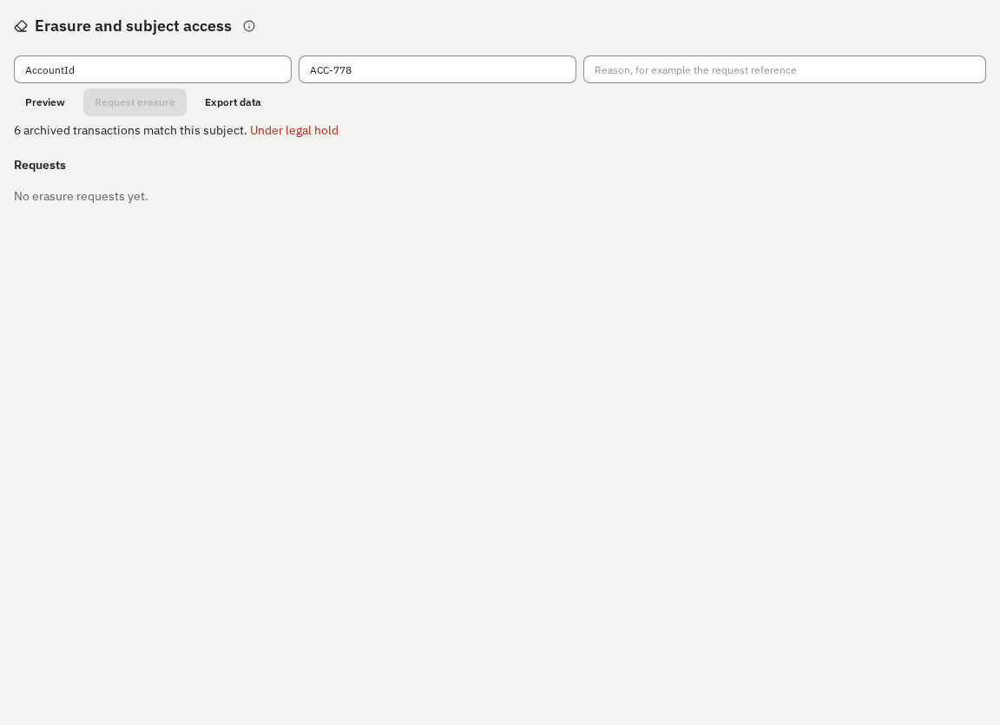

# Data Retention and Legal Hold

By default Jube keeps archived transactions for ever. A deployer who must not do so, whether on account of a data protection retention limit or of the simple cost of storage, turns on the retention purge, and a supervisor protects that which must be kept by placing a case under legal hold. Alongside the two sits the erasure of a single data subject on request, and the export of all that is held about one, both of which are subject to the same protections. It follows that this page describes four things in turn: the retention purge, legal hold, erasure and the subject access export.

## Where it lives

The four are found in three different places, for the reason that they are the business of three different roles:

| Feature                            | Where                                                                                                               | Who                                                                                    |
|------------------------------------|---------------------------------------------------------------------------------------------------------------------|----------------------------------------------------------------------------------------|
| Retention purge                    | No page. It is set entirely by Environment Variables, and reports to the log.                                       | The deployer.                                                                          |
| Legal hold                         | The Legal hold card of the case page, at `/cases/{id}`.                                                             | A supervisor, holding permission 18, Read Write Case Workflow.                         |
| Erasure and subject access export  | Navigate through the menu to Administration, then Erasure and subject access, at `/administration/erasure`.         | Holders of permission 78, Request Erasure and Export Subject Data, or 79, Approve Erasure. |

The Erasure and subject access page identifies a person by an archive key name and value, and is arranged as the subject at the head of the page with the list of requests, headed Requests, beneath:

| Element                                  | Description                                                                                                                                                         |
|------------------------------------------|---------------------------------------------------------------------------------------------------------------------------------------------------------------------|
| Key name                                 | The name of a key that the model archives, up to 200 characters, for example AccountId.                                                                             |
| Key value                                | The value of the key, up to 500 characters.                                                                                                                         |
| Reason, for example the request reference | The reason for the erasure, up to 1,000 characters. Required to request an erasure, and not needed to preview or export.                                            |
| Preview                                  | States how many archived transactions match the subject, or Nothing matches, and, where the erasure could not go ahead, the reason for refusal.                     |
| Request erasure                          | Raises the request, returning Recorded. Not available until the reason is given.                                                                                    |
| Export data                              | Downloads the subject access export as a JSON file, returning Export downloaded, or The export was cut short at the limit.                                          |
| Requests                                 | The latest 200 requests, each with its key name, key value, state, any reason for refusal, Requested by and the user, and the reason given. No erasure requests yet is shown where there are none. |
| Approve, Reject                          | Shown against a pending request made by somebody else, with a box labelled Reason (required to reject). Reject is not available until the reason is given.         |
| Retract                                  | Shown against the user's own pending request, withdrawing it.                                                                                                       |

The subject and its three buttons are presented only to a user holding permission 78, Approve and Reject only to a user holding permission 79, and Retract only to a user holding permission 78. Preview, Request erasure and Export data are not available until both a Key name and a Key value are given, surrounding spaces being removed from each. Where the list of requests cannot be read the page reads Could not load the erasure requests., and Approve, Reject and Retract each confirm with Recorded.

The demonstration data of a clean installation shows the protections at work, and the order in which they are applied. A subject is refused for the first reason that holds, in the order Nothing found, Under legal hold, In an open case, Inside the retention minimum:

| Key name and Key value   | Preview reads                                                                         | Why                                                                                                             |
|--------------------------|---------------------------------------------------------------------------------------|-----------------------------------------------------------------------------------------------------------------|
| AccountId, ACC-000       | Nothing matches. Nothing found                                                        | No archived transaction carries that value.                                                                     |
| AccountId, ACC-441       | 12 archived transactions match this subject. In an open case                          | The case on ACC-441 is open, in First Line Review.                                                              |
| AccountId, ACC-915       | 9 archived transactions match this subject. Inside the retention minimum              | Its case is closed and not held, yet its transactions are far newer than the five years of `ErasureRetentionMinimumDays`. |

It follows that no erasure of the demonstration data can proceed while the retention minimum stands at its default, and that Request erasure upon any of the three records the request at once as Refused, with the reason, in place of Pending approval. To follow an erasure through to Executed on a test installation, set `ErasureRetentionMinimumDays` to 0, restart, and request the erasure of AccountId ACC-915 as one user and approve it as another. The request then reads Approved, waiting for the engine for up to half a minute, and thereafter Executed, with a line in the form Removed 9 transactions, {nodes} graph nodes, {edges} graph edges and cleared {cases} case payloads.

The count given by Preview is of the transactions in which the value appears under that key name. ACC-441 as an AccountId is the account that paid: the eleven cash deposits paid into ACC-441 carry it as ToAccountId, and are a different subject so far as the key is concerned. A person known under several keys is erased by a request for each.

A request is in one of the following states:

| State                            | Description                                                                                                  |
|----------------------------------|--------------------------------------------------------------------------------------------------------------|
| Pending approval                 | Raised, and waiting for a second person to decide it.                                                        |
| Approved, waiting for the engine | Approved, and not yet performed by the engine.                                                               |
| Executed                         | Performed. The request then states the transactions, graph nodes and graph edges removed, and the case payloads cleared. |
| Rejected                         | Rejected by the approver, with a reason.                                                                     |
| Retracted                        | Withdrawn by the person who asked.                                                                           |
| Refused                          | Could not go ahead, either when it was raised or when the engine came to perform it, for the reason shown.   |

SHOT id=concepts-retention-erasure-page
     route=/administration/erasure
     steps=fill:Key name=AccountId, fill:Key value=ACC-778, click:Preview
     frame=page
     state=the Erasure and subject access page with a key name and value entered and the preview stating how many archived transactions match, and beneath it the Requests list holding one request Pending approval raised by another user with the reason box, Approve and Reject, one Executed request stating what was removed, and one Refused request showing Under legal hold
     conveys=an erasure is previewed, requested by one person and decided by another on one page, and the request remains as the record of what was removed or why it was refused
     alt=The Erasure and subject access page showing a subject identified by key name and value with a preview of the matching transactions, above a list of erasure requests in the pending, executed and refused states



## What the retention purge removes

When the `EnableRetentionPurge` Environment Variable is True the engine runs the purge every `WaitRetentionPurge` milliseconds (86400000, daily, by default). Each pass does the following:

1. Removes archived transactions whose reference date is more than `RetentionArchiveDays` old, together with their archive keys, tags and versions. Zero days, which is the default, removes nothing.
2. Removes expired Ask Jooby memory and data cache rows, which were previously only hidden once expired.
3. Removes inbound queue rows whose model has been deleted or no longer exists. Nothing can ever process them, so they would otherwise sit in the queue for ever. The dry run counts them without removing them, and a model that is still live is never touched.

A transaction is never removed while a case that was raised from it is any of these:

| Case state           | Why it is protected                    |
|----------------------|----------------------------------------|
| Open                 | Someone is still working it.           |
| Suspended (any kind) | It will come back to an analyst.       |
| Under legal hold     | A supervisor has said it must be kept. |

A transaction raised into a case that is closed and not under hold is removed after its age limit; the case itself, with its notes, files, events and the payload copy it was created with, is not touched.

The purge is off by default and, when first turned on, only counts: `RetentionPurgeDryRun` defaults to True, which logs how many archived transactions it would remove and removes nothing. The logged counts should be read, and only then `RetentionPurgeDryRun` set to False. Removal is in chunks of `RetentionPurgeDeleteLimit`, such that a large backlog does not hold a long lock. It should be kept in mind that the first run against a large archive may take a long time and generate a good deal of write-ahead log, which is a further reason to take the dry run first and to consider the size of `RetentionPurgeDeleteLimit`.

The purge connects with `PurgeConnectionString` when it is set, falling back to `ConnectionString`. In the cluster the `jube_app` role has no delete rights by design, and `jube_purge` is the role that does; `Jube.Cluster/database.sh` grants it delete on exactly the tables the purge touches (the archive tables, the graph tables, the two Ask Jooby tables and the inbound queue) and read on `Case`.

| Environment Variable        | Default  | Description                                                                              |
|-----------------------------|----------|------------------------------------------------------------------------------------------|
| `EnableRetentionPurge`      | False    | Whether the purge runs.                                                                  |
| `RetentionPurgeDryRun`      | True     | Whether the purge only counts, and logs, what it would remove.                           |
| `RetentionArchiveDays`      | 0        | The age, in days, beyond which an archived transaction is removed. Zero removes nothing. |
| `RetentionPurgeDeleteLimit` | 1000     | The number of archived transactions removed in each chunk.                               |
| `WaitRetentionPurge`        | 86400000 | The wait between passes, in milliseconds.                                                |
| `PurgeConnectionString`     | (empty)  | The connection used by the purge and by erasure, falling back to `ConnectionString`.     |

### What the purge does not reach

`RetentionArchiveDays` is a single value for the whole deployment, and there is not, at present, a value for each tenant or for each model.

The following is not purged, and is still kept for ever: cases, case files and notes, graph nodes and edges, the transaction cache (which expires by itself), Ask Jooby conversations, messages and runs, and application logs beyond their own purge.

## Legal hold

A supervisor, being a user holding permission 18, Read Write Case Workflow, places a case under legal hold, giving a reason of up to 500 characters, and lifts it again. The reason, the user and the time are recorded on the case (`LegalHold`, `LegalHoldReason`, `LegalHoldUser`, `LegalHoldDate`). A hold can be placed on an open or a closed case.

The case page shows a Legal hold card to supervisors, which is not presented to anybody else. Where the case is not held the card reads Not under legal hold, with a box labelled Why the case must be kept and Place legal hold, which is not available until the reason is given. Where the case is held the card shows Under legal hold, the reason, Set by and the user, and Lift legal hold. Each change writes a timeline event, Legal hold placed with the reason, or Legal hold lifted.

Through the API, a hold is placed with `POST /api/CaseSupervision/LegalHold`, and lifted by the same with `hold` set to false, while `GET /api/CaseSupervision/LegalHold/{caseId}` reads the state:

```json
{
  "caseId": 1234,
  "hold": true,
  "reason": "Subject to a production order."
}
```

Submitting a regulatory report places a hold automatically, with the reason Regulatory report filed, and the placement then writes no timeline event, such that the filing is not disclosed. For the same purpose, lifting or overwriting the hold that a filed regulatory report placed needs permission 76, Approve Case Reports, as well as the supervisor permission, and a user without a report permission (75, File Case Reports, 76, Approve Case Reports, or 77, View Case Reports) is told only that such a case is held, and is not shown the reason, the user or the date.

TODO(verify): this page formerly stated that a user without a report permission is not shown the reason, user or date of any hold. The service withholds them only for the hold placed by a filed regulatory report (Jube.Service/Query/CaseSupervision/CaseSupervisionService.cs, GetLegalHoldAsync); a hold placed by a supervisor is shown in full to any supervisor. Owner to confirm which is intended.

It should be understood that the hold protects only the transaction that the case was raised from, and not every transaction of the same account. The whole history of a key is not protected by a hold: the other transactions of the account remain subject to the retention purge once they pass the age limit.

## Erasing a data subject on request

A person asks for their data to be erased. Jube identifies the person by an archive key, which is to say the name of a key that the model archives (for example `AccountId`) and its value. Two different people are involved, and the second must be someone else, in the manner of [Maker Checker](../MakerChecker/index.html).

1. A holder of permission 78, Request Erasure and Export Subject Data, previews the subject with `POST /api/Erasure/Preview`, which says how many archived transactions match and, if the erasure could not go ahead, why. They then raise the request with `POST /api/Erasure/Request`, giving the key name, key value and a reason such as the data subject request reference. Only one request for a subject can be open at any time.
2. A different person holding permission 79, Approve Erasure, approves it with `POST /api/Erasure/Approve` or rejects it, with a reason, with `POST /api/Erasure/Reject`. The person who asked can withdraw a pending request with `POST /api/Erasure/Retract/{guid}`, yet can never decide it.
3. The engine, not the web request, performs an approved erasure (`EnableErasureExecution`, on by default, every `WaitErasureExecution` milliseconds, 30000 by default), on `PurgeConnectionString` when set. This is deliberate: in a cluster the `jube_app` role has no delete rights, and the request that approves an erasure never holds them.

A request is raised as follows:

```json
{
  "keyName": "AccountId",
  "keyValue": "Test1",
  "reason": "Data subject request DSR-2026-0042."
}
```

An erasure is refused, whole and with a reason, when any of the following is true. The check is made when the request is raised, in which case the request is recorded as Refused rather than Pending approval, and again when the engine runs it, such that a hold placed in between still stops it.

| Reason                       | Meaning                                                                                                                      |
|------------------------------|------------------------------------------------------------------------------------------------------------------------------|
| Under legal hold             | A case raised from one of the subject's transactions, or opened on the same key value, is under legal hold.                  |
| In an open case              | Such a case is open or suspended. Close it first.                                                                            |
| Inside the retention minimum | A transaction of the subject is newer than `ErasureRetentionMinimumDays` (1825, five years, by default; 0 means no minimum). |
| Nothing found                | No archived transaction carries that key and value for the tenant.                                                           |

When it proceeds it removes, in one transaction: the subject's archived transactions with their keys, key versions, tags, tag versions and versions; the graph nodes whose key and value are the subject's and every edge touching them; and the payload copy held on closed cases raised from those transactions, or opened on the same key value (the case, its notes, files and events stay). The request row is kept as the record of the erasure: who asked, who approved, why, when, and the counts removed. It holds the key value itself, and it follows that it should be treated as personal data too.

What erasure does not do should be stated plainly. It removes whole transactions, so another person named inside the payload of the same transaction is erased with it. It does not reach the transaction cache, which expires by itself. And field encryption uses one key for the whole deployment, so a person cannot be erased by destroying a key, only by deleting rows.

## Subject access export

`POST /api/Erasure/Export`, under the same permission 78, returns every archived transaction of a subject, oldest first, as one JSON bundle: for each its entry guid, model, dates and the archived record, which holds the payload and the values Jube derived from it. At most 10,000 transactions, and at most 64 MB of archived records, are returned, and the bundle says when it was cut short. Case data and regulatory report data are deliberately not included, for the reason that disclosing them could tip a customer off. Every export is audited.

## Permissions and security

The permission for each action is as follows, a user without it receiving 403:

| Action                                                          | Permission                                                                              |
|-----------------------------------------------------------------|-----------------------------------------------------------------------------------------|
| Place, lift or read a legal hold                                | 18, Read Write Case Workflow                                                            |
| Lift or overwrite the hold placed by a filed regulatory report  | 18, Read Write Case Workflow, and also 76, Approve Case Reports                         |
| Preview a subject, request an erasure, retract one's own request | 78, Request Erasure and Export Subject Data                                             |
| Export the data of a subject                                    | 78, Request Erasure and Export Subject Data                                             |
| Approve or reject an erasure                                    | 79, Approve Erasure                                                                     |
| List the erasure requests                                       | 78, Request Erasure and Export Subject Data, or 79, Approve Erasure                     |

Every mutation needs the antiforgery token for cookie sessions, erasure requests are scoped to the tenant of the caller, and each preview, request, decision and export is written to the audit log. The retention purge and the performing of an erasure are carried out by the engine, never by a web request.
