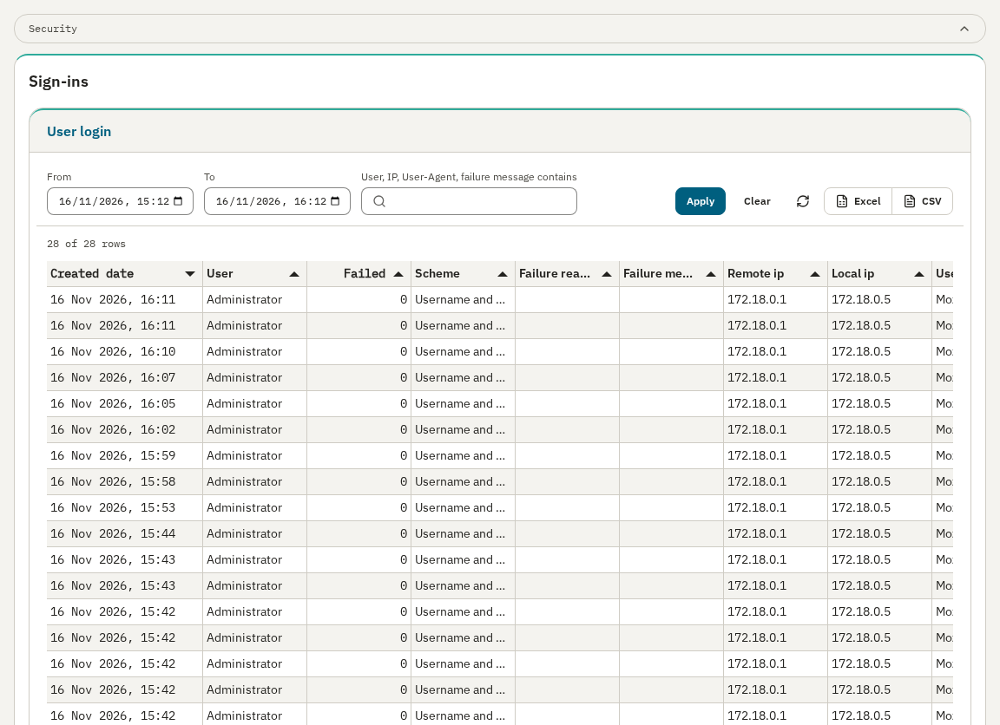

# Login and Logout Audit

Jube keeps two permanent, read only audit trails of authentication. The Login trail records every attempt to sign in, successful or not, and the Logout trail records every session that was cut. Both are presented as a grid in the Security page, and both are available in the database for the purposes of monitoring, in the `UserLogin` and `UserLogout` tables respectively.

## Where it lives

Navigate through the menu to Administration, then Security, then the Sign-ins card or the Sign-outs card. Each opens as a step of the Security story, presenting a grid with a toolbar of filters above it.

SHOT id=administration-login-audit-sign-ins
     route=/administration/security
     steps=open-hub:Sign-ins
     frame=page
     state=the Sign-ins step of the Security page showing the toolbar with From and To at the default of the last hour, and a grid holding a mixture of successful and failed attempts with differing failure reasons
     conveys=every attempt to sign in is listed with its outcome, its scheme and where it came from
     alt=The Sign-ins grid on the Security page, with a toolbar of From, To and search above rows showing the user, whether the attempt failed, the scheme, the failure reason and the IP addresses

## Using the grid

The grids are read only. Nothing can be added, changed or deleted through the page or the API, and the trails are not purged, hence they grow without limit.

| Control        | Description                                                                                                                                                                                     |
|----------------|-------------------------------------------------------------------------------------------------------------------------------------------------------------------------------------------------|
| From and To    | Restrict the rows by the time of the event. Where omitted, each defaults independently to the last hour, which is why a page newly opened is short.                                             |
| Search         | A match on any part of the text, without regard to case. For Sign-ins: user, IP, user agent and failure message. For Sign-outs: user, cut by, IP, user agent and message.                       |
| Apply, Clear   | Run the filters, or return them to their defaults.                                                                                                                                              |
| Refresh        | Reload with the current filters.                                                                                                                                                                |
| CSV, Excel     | Export the rows currently loaded in the grid.                                                                                                                                                   |
| Column headers | Sort the grid, the default being the most recent first. The sorting takes place on the server side, henceforth it holds across all of the rows matching and not only those loaded.            |

At most 100000 rows are returned for a request, and the grid states the number of rows shown against the total matching, asking for a narrower window or filter where the total is the larger.

## Sign-ins

The source is the `UserLogin` table, served by `GET /api/UserLogin`.

| Column                          | Description                                                                                                   |
|---------------------------------|---------------------------------------------------------------------------------------------------------------|
| Created date                    | The time of the attempt, stored as UTC and shown in local time.                                               |
| User                            | The user name the attempt was for. It is the raw name as supplied, even where no such user exists.            |
| Failed                          | 1 for a failed attempt, 0 for a success.                                                                      |
| Scheme                          | Username and Password, Negotiate (Windows / Kerberos), or OAuth / OpenID Connect.                             |
| Failure reason                  | Empty on success, otherwise one of the ten reasons below.                                                     |
| Failure message                 | For OAuth failures only: the error of the identity provider, or the message from the validation of the token. |
| Remote ip, Local ip, User agent | Recorded for the attempt where available.                                                                     |

The failure reasons are as follows:

| Id | Reason                                                |
|----|-------------------------------------------------------|
| 1  | No User Registry found matching the supplied username |
| 2  | User Registry matched is not Active                   |
| 3  | User Registry matched is Password Locked              |
| 4  | Password has expired and must be changed              |
| 5  | Bad credentials (password did not match)              |
| 6  | No password was supplied                              |
| 7  | OAuth: no usable identity claim in principal payload  |
| 8  | OAuth: remote/identity-provider failure               |
| 9  | OAuth: local token validation failed                  |
| 10 | OAuth: internal error during processing               |

The same legend, and the lockout that gives rise to reason 3, are described in [Authentication Concepts](../../../Concepts/Authentication/index.html).

## Sign-outs

The source is the `UserLogout` table, served by `GET /api/UserLogout`.

| Column                          | Description                                                                          |
|---------------------------------|--------------------------------------------------------------------------------------|
| Logged Out                      | The time the session was cut, stored as UTC and shown in local time.                 |
| User                            | The user whose session ended.                                                        |
| Reason                          | Why it ended, as below.                                                              |
| Outcome                         | How the cutting of the session went, as below.                                       |
| Session Started                 | When the session began, where known.                                                 |
| Session                         | How long the session lived, in seconds. Empty where the start is not known.          |
| Cut By                          | The user having cut the session, where it was not the user themselves.               |
| Message                         | Free text detail.                                                                    |
| Remote ip, Local ip, User agent | Recorded where available.                                                            |

The reasons are as follows:

| Id | Reason                             | Recorded when                                                                                             |
|----|------------------------------------|-----------------------------------------------------------------------------------------------------------|
| 1  | User logout                        | A user signs out.                                                                                         |
| 2  | Tokens revoked by an administrator | An administrator uses Revoke sessions on a [User](../Users/index.html), with Cut By naming the administrator. |
| 3  | Password change                    | A user changes their password, which revokes every session issued beforehand, a fresh session being issued to the browser having made the change. |

The outcomes are as follows:

| Id | Outcome                             | Description                                                                                                   |
|----|-------------------------------------|---------------------------------------------------------------------------------------------------------------|
| 1  | Revoked                             | The sessions of the user were revoked in the database.                                                        |
| 2  | No session (cookies cleared only)   | A sign out arrived with no session behind it, hence there was nothing to revoke and no user to record.        |
| 3  | Revocation failed (cookies cleared) | A user signed out, yet the revocation in the database did not succeed, the cookies having been cleared still. |

A revocation by an administrator and a change of password are recorded with the outcome Revoked, whereas a sign out by the user may carry any of the three outcomes.

## Reading the trail

Repeated failures with reason 1 from one remote IP across many user names suggest the enumeration of user names. Repeated failures with reason 5 against one user name, followed by reason 3, show the lockout described in [Authentication Concepts](../../../Concepts/Authentication/index.html).

A user name is not hidden from the trail: the raw name as typed is stored, including a password mistakenly entered into the user name field. It follows that the trail should be treated as sensitive.

## Permissions and security

Both grids require permission 35, Read Write Security User, being the same permission that governs [Users](../Users/index.html). A user without it is not presented with the Sign-ins or Sign-outs cards. The server refuses the read with a 403 independently of the page, and an unauthenticated call receives a 401.

A tenant administrator sees the rows of the users in their own tenant only, whereas a landlord sees every tenant. Attempts to sign in against a user name that does not exist belong to no tenant, so they are visible to a landlord only, and the same applies to sign outs that belong to no tenant, such as a sign out with no session.
