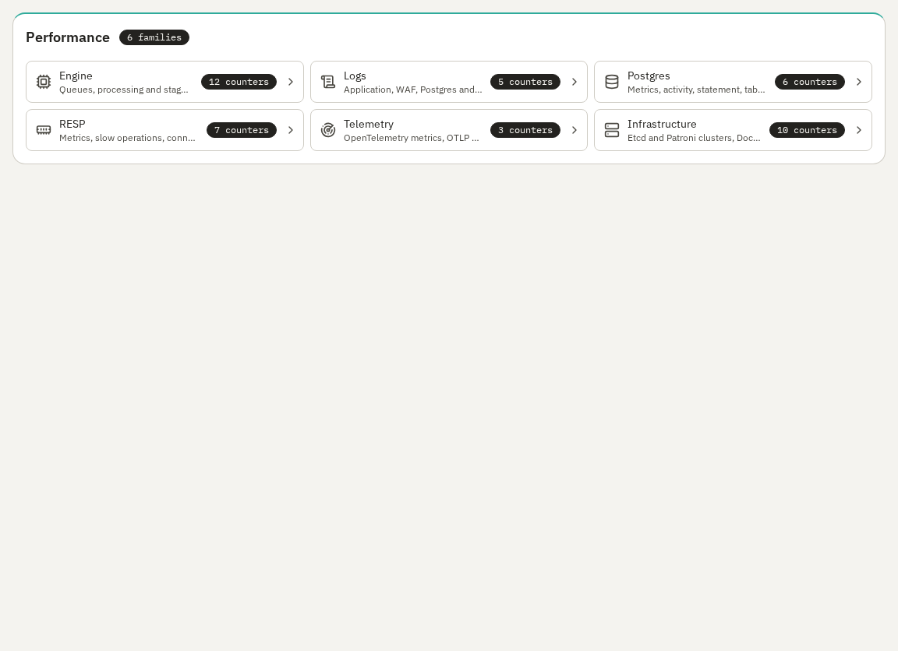
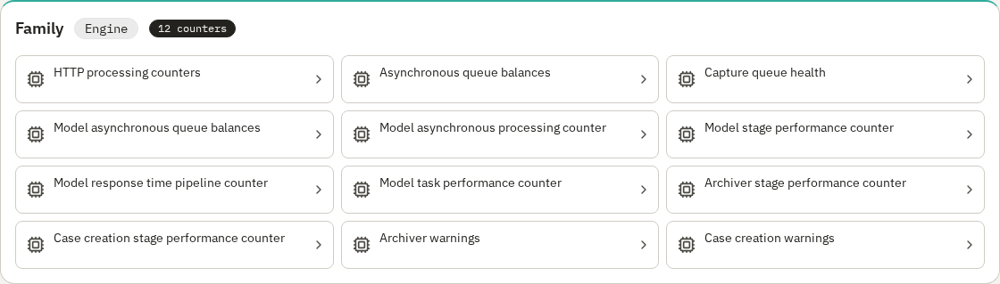
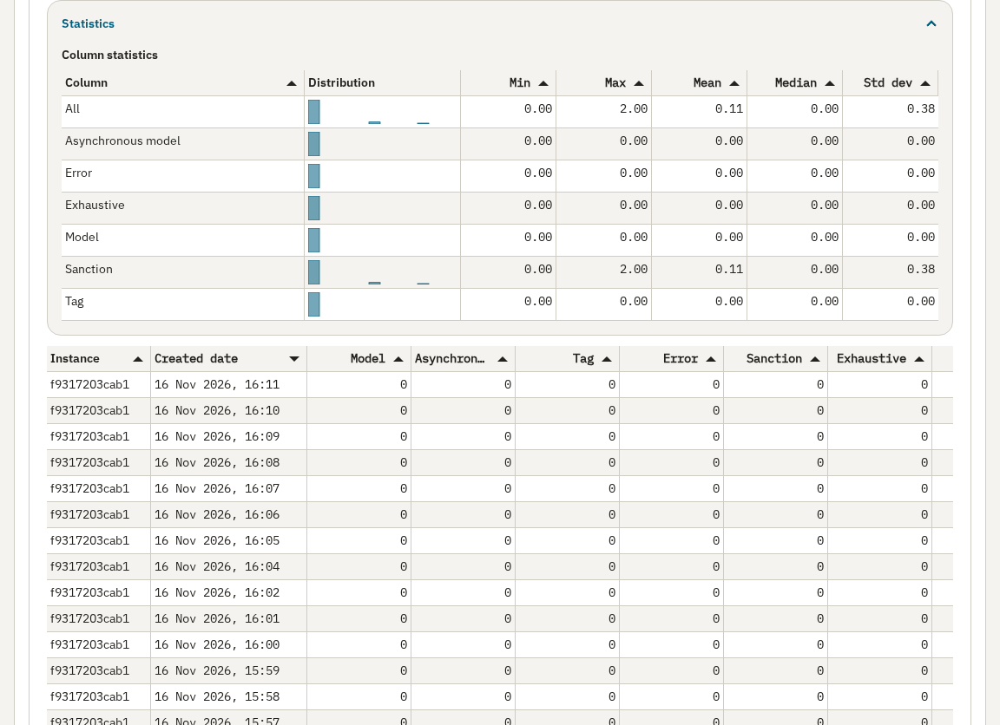
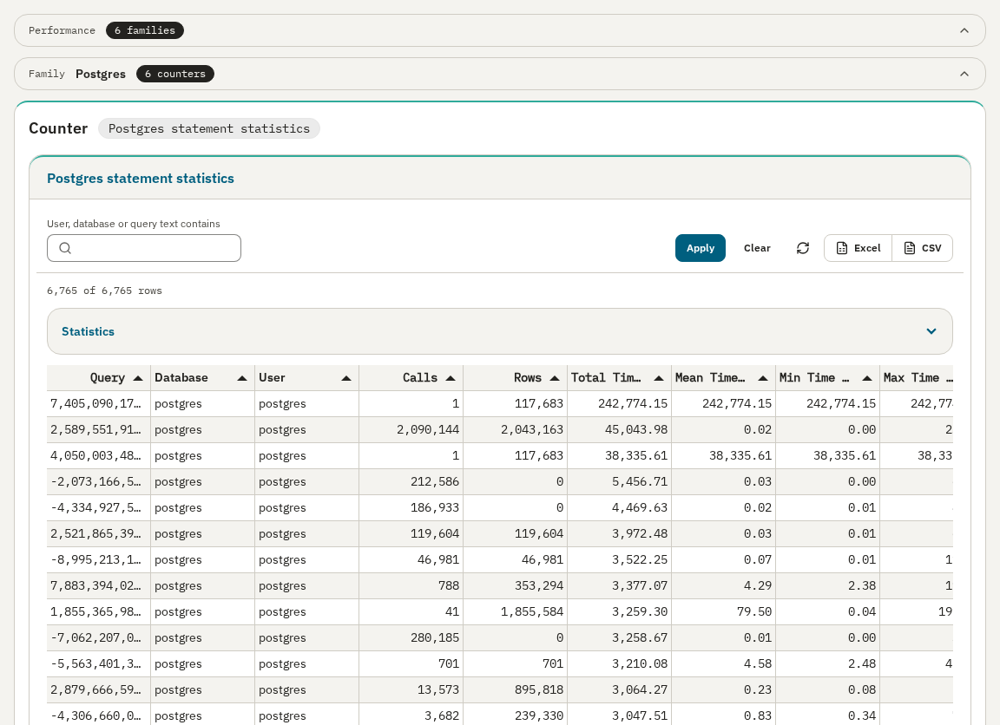

# Performance Counter Balances

The nature of the Jube Platform is that immeasurable harm can be caused by the misconfiguration of a rule. Consider a scenario where all bank transactions are declined or all bidding is taking place on all impression opportunities as a consequence of a bad Activation Rule. Furthermore, the nature of real-time, ultra-high throughput systems, is that it is not especially feasible to measure performance on a transaction by transaction basis, instead relying on near time aggregate counters and statistics to measure the performance of the platform.

Counters keep a track of events that take place in Jube. There are two types of counter, which are known as Rolling counters and Reset counters:

* Rolling Counters, when being incremented, keep a record of the date and time of each component causing the counter to be incremented, which allows for the counter to be decremented at the point in time each counter entry expires. The Rolling Counter will never be reset to zero, rather it will maintain a balance of counter entries moving in, then moving out of the counter.
* Reset Counters are reset to zero every minute.

Rolling Counters include:

* Each time a Response Elevation is returned, greater than zero, a counter is incremented.
* Each time a Response Elevation is returned, greater than zero, a counter is increased by the value of the Response Elevation. Rather than a counter, it is a sum or balance.
* Each time a message is sent to the Activation Watcher, a counter is incremented.

Reset Counters include:

* Each time a transaction is processed through a model, a counter is incremented.
* Each time a Gateway Rule is matched upon, a counter is incremented.
* Each time a request is received on the Web Server \ HTTP Endpoint, a counter is incremented.
* Each time the HTTP Endpoint is switched to invoke an Entity Model, a counter is incremented.
* Each time the HTTP Endpoint is switched to invoke Entity Model Tagging, a counter is incremented.
* Each time the HTTP Endpoint is switched to recall an Exhaustive Adaptation directly, a counter is incremented.
* Each time the HTTP Endpoint is switched and has encountered an Error, a counter is incremented.
* Each time the HTTP Endpoint is switched to invoke an Entity Model asynchronously, a counter is incremented.

It can be observed throughout this documentation that in memory asynchronous queues feature heavily in the architecture of the platform. The counters routine is also responsible for recording the asynchronous queue balances on a snapshot basis.

For each model the following asynchronous queue balances are maintained:

* The number of payload records pending initial processing by the bulk insert routine and case creation routine.
* The number of case records pending processing.
* The number of Activation Watcher entries pending dispatch and storage.

For the platform the following asynchronous queue balances are maintained in the overall execution:

* The number of Tags currently pending in the in memory asynchronous queue.
* The number of Real Time Model Invocation Entity objects pending invocation in the in memory asynchronous queue.

## Where it lives

Navigate through the menu to Administration, then Performance. The page is a story of three steps: the first step presents six families, the second the counters in the family chosen, and the third the counter itself as a grid. The counters described above are found in the Engine family, as follows:

| Counter                               | Holds                                                         |
|---------------------------------------|---------------------------------------------------------------|
| HTTP processing counters              | The HTTP counters.                                            |
| Model asynchronous queue balances     | The asynchronous queue balances maintained for each model.    |
| Asynchronous queue balances           | The asynchronous queue balances maintained for the platform.  |
| Model asynchronous processing counter | The model invocation, gateway, response elevation and Activation Watcher counters. |

The address in the browser follows each step, taking the form `/administration/performance?path=family:Engine,area:HttpProcessingCounter`, so a counter can be bookmarked or shared, and the Back button of the browser and the collapsed steps above the grid return one step at a time. An address naming a family or counter that does not exist falls back to the first step.

SHOT id=administration-performance-families
     route=/administration/performance
     steps=none
     frame=page
     state=the Performance page at its first step, signed in as the landlord, showing the six family cards Engine, Logs, Postgres, RESP, Telemetry and Infrastructure, each with its hint and its number of counters
     conveys=the counters are arranged into six families, each opened to reach its counters
     alt=The Performance page showing six family cards, Engine, Logs, Postgres, RESP, Telemetry and Infrastructure, each stating how many counters it holds



The families and their counters are as follows:

| Family         | Counters                                                                                                                                                                                                                                                                                                                                                                                                                              |
|----------------|---------------------------------------------------------------------------------------------------------------------------------------------------------------------------------------------------------------------------------------------------------------------------------------------------------------------------------------------------------------------------------------------------------------------------------------|
| Engine         | HTTP processing counters, Asynchronous queue balances, Capture queue health, Model asynchronous queue balances, Model asynchronous processing counter, Model stage performance counter, Model response time pipeline counter, Model task performance counter, Archiver stage performance counter, Case creation stage performance counter, Archiver warnings, Case creation warnings                                                 |
| Logs           | Application log, WAF attack log, Postgres log, Container log, Model invoke warnings                                                                                                                                                                                                                                                                                                                                                   |
| Postgres       | Postgres metrics, Postgres activity, Postgres statement statistics, Postgres table statistics, Postgres index statistics, Postgres replication status                                                                                                                                                                                                                                                                                 |
| RESP           | RESP metrics, RESP slow operations, RESP connection multiplexer metrics, RESP sentinel status, RESP sentinel events, RESP connection events, RESP call counter                                                                                                                                                                                                                                                                        |
| Telemetry      | OpenTelemetry metrics, OTLP dispatch counter, .NET runtime metrics                                                                                                                                                                                                                                                                                                                                                                    |
| Infrastructure | Etcd member status, Patroni member status, Etcd cluster events, Patroni cluster events, Docker container metrics, Docker events, Docker host metrics, HAProxy server status, HAProxy reachability probes, Overlay network task drift                                                                                                                                                                                                  |

The first step states the number of families, each family card the number of counters it holds, and a user who is not the landlord is told: Performance counters are only available to the landlord.

By way of example, to see whether the platform is keeping up with its traffic, Engine is opened, then HTTP processing counters, which presents a row for each minute of the last hour. A steady count of requests alongside an error count of 0 is a healthy platform. Returning one step and opening Model asynchronous queue balances shows, for each model and each minute, how much work was waiting: a balance that returns to zero, or near it, between bursts is healthy, whereas a balance that rises minute upon minute says that work is arriving faster than it is completed, and is the figure that ought to prompt action before anything is lost. A sudden rise in the response elevation counters of Model asynchronous processing counter, lastly, is the mark of the misconfigured Activation Rule with which this page began.

SHOT id=administration-performance-engine-counters
     route=/administration/performance?path=family:Engine
     steps=none
     frame=section:Family
     state=the second step of the Performance page with the Engine family opened, headed Family, Engine and 12 counters, with a card for each of the twelve counters of the family, HTTP processing counters and the asynchronous queue balances among them
     conveys=opening a family presents its counters as cards, from which one is opened as a grid
     alt=The Engine family of the Performance page showing a card for each of its twelve counters, among them HTTP processing counters and Model asynchronous queue balances



## The counter grid

Each counter grid is generated from the description of its table in the server, so the columns, the exact match filters and the search box differ by counter. The toolbar above the grid carries the following:

| Control        | Description                                                                                                                                             |
|----------------|---------------------------------------------------------------------------------------------------------------------------------------------------------|
| From and To    | The window of time, being the last hour by default.                                                                                                     |
| Filters        | The exact match filters and the search box particular to the counter.                                                                                   |
| Apply, Clear   | Apply queries again with the filters chosen, and Clear restores the defaults.                                                                           |
| Refresh        | Queries again on demand, keeping in mind that nothing refreshes automatically.                                                                          |
| CSV, Excel     | Export the rows currently loaded.                                                                                                                       |
| Statistics     | Presents the Column statistics, being the Min, Max, Mean, Median and Std dev of each measured column, alongside its distribution.                       |
| Column headers | Sort the grid. The sorting takes place on the server side, henceforth it holds across the whole of the rows matching and not only those loaded.         |

Free text in exports is neutralised, such that a cell beginning with `=`, `+`, `-` or `@` is not run as a formula. Rows are capped at 100000 per request, and when the true total is larger the grid states how many rows are shown and asks for a narrower window or filter.

Free text from logs, Postgres statements and similar sources has secrets, such as passwords, bearer tokens, private keys and the credentials of connection strings, replaced with a mask before it leaves the server, and the search box matches the masked text, not the original.

TODO(verify): confirm on a running system that the masking covers every free text column shown for Postgres activity, Postgres statement statistics and the logs. The Matched Value column of the WAF attack log is shown unmasked by design, being the fragment of the attack itself truncated to 512 characters, and the owner is to confirm that this is intended.

For Arabic and Urdu the page is mirrored to read from right to left, while numbers are shown in Western digits, and timestamps, GUIDs and IP addresses remain left to right inside the right to left text.

SHOT id=administration-performance-counter-grid
     route=/administration/performance?path=family:Engine,area:HttpProcessingCounter
     steps=open-section:Statistics
     frame=page
     state=the HTTP processing counters grid for the last hour, with the Engine family and counter steps collapsed above, the toolbar showing From and To, rows of per minute counts, and the Column statistics shown with their distributions
     conveys=a counter is a grid of per minute rows over a window of time, with summary statistics for each measured column
     alt=The HTTP processing counters grid on the Performance page, with a toolbar for the time window above rows of counts for each minute, and a panel of column statistics showing minimum, maximum, mean, median and standard deviation



## Observability tables

Performance counter balances are written to PostgreSQL tables every 60 seconds. These tables are available for monitoring and alerting purposes.

In addition, several observability tables provide visibility into critical software areas where reliability is paramount. These areas include:

- The Least Recently Used (LRU) cache.
- Cache payload eviction.
- Cache payload latest eviction.
- Cache TTL counter eviction.
- Real-time performance counters.
- Local concurrent queue balances (used for asynchronous operations such as writes).
- Breakdowns by stage and by task of the invoke pipeline itself (Model Stage, Response Time Pipeline and Task Performance Counters), and of the two background pipelines that run off that thread entirely (Archiver and Case Creation).
- Breaches of the warn threshold for those same three pipelines (Model Invoke, Archiver and Case Creation Warning), and the health of the bounded in memory queues that capture them.
- Cache call and OTLP export dispatch counters, and the aggregate statistics that Postgres itself keeps for each shape of query.

| Table                                          | Description                                                                                                                                                                                                                                                                                                                                                                                                                                                                                                                                                      |
|------------------------------------------------|------------------------------------------------------------------------------------------------------------------------------------------------------------------------------------------------------------------------------------------------------------------------------------------------------------------------------------------------------------------------------------------------------------------------------------------------------------------------------------------------------------------------------------------------------------------|
| CacheTtlCounterEntryRemovalBatch               | Records reference date expiration events for processing expired Time-to-Live (TTL) counters. Includes system reference date, overall expired counts, first and most recent reference dates. A record exists only if expired records are present.                                                                                                                                                                                                                                                                                                                 |
| CacheTtlCounterEntryRemovalBatchEntry          | Contains TTL counter entries that have been updated or purged, including the system reference date, deprecated value, and revised counter value.                                                                                                                                                                                                                                                                                                                                                                                                                 |
| CacheTtlCounterEntryRemovalBatchResponseTime   | Details task performance and response times for TTL counter maintenance.                                                                                                                                                                                                                                                                                                                                                                                                                                                                                         |
| CachePayloadLatestRemovalBatch                 | Tracks expiration of Payload Latest data for a given search key, including system reference date, total expired records, and first and most recent reference dates.                                                                                                                                                                                                                                                                                                                                                                                              |
| CachePayloadLatestRemovalBatchEntry            | Contains details of payload latest values removed in a batch.                                                                                                                                                                                                                                                                                                                                                                                                                                                                                                    |
| CachePayloadLatestRemovalBatchResponseTime     | Details task performance and response times for CachePayloadLatestRemovalBatch.                                                                                                                                                                                                                                                                                                                                                                                                                                                                                  |
| CachePayloadRemovalBatch                       | Tracks expiration of payload data, including system reference date, total expired records, and first and most recent reference dates.                                                                                                                                                                                                                                                                                                                                                                                                                            |
| CachePayloadRemovalBatchEntry                  | Contains details of payload GUIDs removed in a batch.                                                                                                                                                                                                                                                                                                                                                                                                                                                                                                            |
| CachePayloadRemovalBatchResponseTime           | Details task performance and response times for CachePayloadRemovalBatch.                                                                                                                                                                                                                                                                                                                                                                                                                                                                                        |
| LocalCacheInstance                             | Tracks counts and memory pressure of the local cache.                                                                                                                                                                                                                                                                                                                                                                                                                                                                                                            |
| LocalCacheInstanceKey                          | Tracks performance metrics and counters for a corresponding cache key, including requests, misses, removals, distributed subscriptions, and response times. Highlights local cache pressure and cache misses, indicating load on the cache server.                                                                                                                                                                                                                                                                                                               |
| LocalCacheInstanceLru                          | Tracks LRU cache performance metrics, including bytes and counters for additions, removals, updates, and evictions.                                                                                                                                                                                                                                                                                                                                                                                                                                              |
| EntityAnalysisAsynchronousQueueBalance         | Tracks system-level background concurrency tasks, such as asynchronous model invocations, pending callbacks, case creation backlogs, pending notifications, and tags pending storage.                                                                                                                                                                                                                                                                                                                                                                            |
| EntityAnalysisModelAsynchronousQueueBalance    | Tracks model-level background concurrency tasks, such as records pending storage to archive and activation watcher dispatch.                                                                                                                                                                                                                                                                                                                                                                                                                                     |
| EntityAnalysisModelProcessingCounter           | Tracks model invocation events and limit breaches, including overall invocations, gateway flow counts, response elevations, total response elevations, pressure on response elevation limits, and activation watcher activity. Also carries the minimum and maximum response time of the whole invocation for the interval (MinResponseTimeMicroseconds and MaxResponseTimeMicroseconds), alongside the existing total.                                                                                                                                          |
| EntityAnalysisModelStagePerformanceCounter     | A rollup for each Model, for each minute, of the stages of the invoke pipeline itself (Parse, Gateway, Activation, and so on), being the total, minimum and maximum microseconds and the count of invocations for each stage. See [HTTP API Performance Trace](../../../Concepts/API/PerformanceTrace/index.html#monitoring-stage-performance-across-transactions).                                                                                                                                                                                              |
| EntityAnalysisModelResponseTimePipelineCounter | The always on equivalent for the main serial checkpoint pipeline (Parse, Gateway, WriteResponse, etc), additionally carrying the total, minimum and maximum allocated bytes for each checkpoint. See [HTTP API Performance Trace](../../../Concepts/API/PerformanceTrace/index.html#monitoring-the-response-time-pipeline-across-transactions).                                                                                                                                                                                                                  |
| EntityAnalysisModelTaskPerformanceCounter      | A rollup for each Model of the asynchronous read and write tasks queued during invocation (for example SanctionsAsync, CachePayloadUpsertAsync), with time and allocated bytes, being the most direct way to attribute the cost of cloud compute to a specific task. See [HTTP API Performance Trace](../../../Concepts/API/PerformanceTrace/index.html#monitoring-task-performance-across-transactions).                                                                                                                                                        |
| ArchiverStagePerformanceCounter                | The same stage rollup for each minute as EntityAnalysisModelStagePerformanceCounter, applied to the background stages of the Archiver itself (BuildArchiveJson, CaseCreationDispatch, RdbmsArchiveWrite, BulkCopyArchiveBuffer) rather than the invoke pipeline. See [Background Processing Performance](../../../Concepts/API/BackgroundProcessingPerformance/index.html#archiverstageperformancecounter).                                                                                                                                                      |
| ArchiverWarning                                | One row for each Archiver stage invocation that took longer than the configured warn threshold, carrying the Model, the specific invocation and which stage was slow. See [Background Processing Performance](../../../Concepts/API/BackgroundProcessingPerformance/index.html#archiverwarning).                                                                                                                                                                                                                                                                 |
| CaseCreationStagePerformanceCounter            | The equivalent stage rollup for the stages of case creation itself (ExistingCasePriorityLookup, WorkflowStatusLookupAndPersist, Notification, HttpEndpoint), being a single global queue shared by every Model and not scoped to one. See [Background Processing Performance](../../../Concepts/API/BackgroundProcessingPerformance/index.html#casecreationstageperformancecounter).                                                                                                                                                                             |
| CaseCreationWarning                            | One row for each case creation stage invocation that took longer than its warn threshold, carrying the case workflow and key and, for a slow Notification or HttpEndpoint stage, the actual destination or URL involved. See [Background Processing Performance](../../../Concepts/API/BackgroundProcessingPerformance/index.html#casecreationwarning).                                                                                                                                                                                                          |
| ModelInvokeWarning                             | The database backed counterpart of the warn threshold of the invoke pipeline's trace log, being one row for each trace point whose gap since the previous one breached the Logs: Warn Threshold Milliseconds of that Model. See [Background Processing Performance](../../../Concepts/API/BackgroundProcessingPerformance/index.html#modelinvokewarning).                                                                                                                                                                                                        |
| CaptureQueueHealth                             | A health check for each minute, of QueueDepth and DroppedCount, across the six bounded in memory capture queues of the platform (ModelInvokeWarning, CaseCreationWarning, ArchiverWarning, RespSentinelEvent, RespConnectionEvent, OpenTelemetryMetric). A QueueDepth that never falls, or any DroppedCount that is not zero, means that real data is being delayed or silently discarded. See [Background Processing Performance](../../../Concepts/API/BackgroundProcessingPerformance/index.html#capturequeuehealth).                                         |
| RespCallCounter                                | A rollup for each minute of the cache calls made by every `Jube.Cache` repository method (for example CachePayloadRepository.InsertAsync), by Call label, which answers exactly where the load on the cache is coming from by area of the system. See [Infrastructure Health Metrics](../../../Concepts/API/InfrastructureHealthMetrics/index.html#redis).                                                                                                                                                                                                       |
| OtlpDispatchCounter                            | A rollup for each minute of the OTLP export attempts made by this instance to its configured OpenTelemetry backend, by Signal (Traces, Metrics, Logs), carrying Count, SuccessCount, FailureCount and DroppedCount, such that a dead or overwhelmed backend is observable rather than silent. See [OTLP Dispatch Counter](../../../Concepts/API/OtlpDispatchCounter/index.html).                                                                                                                                                                                 |
| PostgresStatementStatistics                    | Not a rollup for each minute as the rows above, rather a live, on demand view over the `pg_stat_statements` extension of Postgres: the aggregate calls, time, rows, cache hit, temp spill and WAL statistics for each shape of query, accumulated since the extension was created or last reset. Requires `shared_preload_libraries = 'pg_stat_statements'` on the server side (see `Jube.Cluster/PgStatStatementsRollout.md`). See [Infrastructure Health Metrics](../../../Concepts/API/InfrastructureHealthMetrics/index.html#per-query-aggregate-statistics-get-apipostgresstatementstatistics). |
| HttpProcessingCounter                          | Tracks overall HTTP counters for API requests.                                                                                                                                                                                                                                                                                                                                                                                                                                                                                                                   |

The tables can be queried via SQL, and filtered as required for monitoring. For example, to monitor for Archive events backing up:

```sql
select * from "EntityAnalysisModelAsynchronousQueueBalance"
         where "Archive" > 1000
         order by 1 desc
```

The query returns a row for each minute in which more than 1000 records were pending storage to the archive for a model, the most recent first, and it follows that an empty return means there is no backlog.

SHOT id=administration-performance-postgres-statements
     route=/administration/performance
     steps=open-hub:Postgres, open-hub:Postgres statement statistics
     frame=page
     state=the Performance page at its third step with the Postgres family and then Postgres statement statistics opened, the two earlier steps collapsed above, and the grid listing a row for each shape of query with its calls, times and rows
     conveys=the observability tables are read through the same counter grid as the counters, without recourse to SQL
     alt=The Performance page with Postgres statement statistics opened as a grid, a row for each shape of query alongside its calls, times and rows



## Reading the counters through the API

The four original counter tables are also browsable without a database connection, via `GET /api/HttpProcessingCounter`, `GET /api/EntityAnalysisAsynchronousQueueBalance`, `GET /api/EntityAnalysisModelAsynchronousQueueBalance` and `GET /api/EntityAnalysisModelProcessingCounter`, these being the endpoints behind the grids of the Performance page. Each accepts the following parameters, which are pushed down to the database rather than filtered after the fetch:

| Value                     | Description                                                                                                                                                                                                                                                         | Example              |
|---------------------------|---------------------------------------------------------------------------------------------------------------------------------------------------------------------------------------------------------------------------------------------------------------------|----------------------|
| from, to                  | A range of UTC date and time against `CreatedDate`, inclusive, each defaulting independently to the last hour when omitted.                                                                                                                                         | 2026-11-16T09:00:00Z |
| take                      | The number of rows to return, the most recent first, clamped to 100000.                                                                                                                                                                                             | 500                  |
| samplePercentage          | From 0 to 100, clamped. It is not exposed in any toolbar, being intended for an agent building an unbiased random baseline sample of activity rather than for browsing.                                                                                             | 10                   |
| sortField, sortDirection  | Any column the grid displays. The direction is taken without regard to case, `asc` for ascending and anything else, including omitted, for descending. An unrecognised or omitted `sortField` falls back to the most recent first.                                  | modelInvoke, asc     |
| search                    | Accepted by the two tables scoped to a Model only (`EntityAnalysisModelAsynchronousQueueBalance` and `EntityAnalysisModelProcessingCounter`), being a match on any part of the name of the Model, without regard to case.                                           | Detailed             |

Each response is an envelope and not a bare array, taking the form `{ rows, total, statistics }`:

* `rows` is the page actually returned, respecting `take`.
* `total` is the true count of every row matching the filter, irrespective of `take`.
* `statistics` is a block of summary statistics, being the Min, Max, Mean, Median and StandardDeviation and a histogram of 10 buckets, computed over the full filtered set (capped at 100000, independent of `take`), and keyed by the camelCase name of every continuous or measured numeric column (a reset counter or a rolling balance, whatever its CLR type).

The columns for which statistics are returned are as follows, noting that categorical numeric columns (ids, codes) are never included even though numeric:

| Table                                         | Statistics keys                                                                                                                                                                                                                 |
|-----------------------------------------------|---------------------------------------------------------------------------------------------------------------------------------------------------------------------------------------------------------------------------------|
| `HttpProcessingCounter`                       | `model`, `asynchronousModel`, `tag`, `error`, `sanction`, `exhaustive`, `all`                                                                                                                                                   |
| `EntityAnalysisAsynchronousQueueBalance`      | `caseCreation`, `tagging`, `notification`, `asynchronousEntityInvoke`                                                                                                                                                           |
| `EntityAnalysisModelAsynchronousQueueBalance` | `archive`, `activationWatcher`                                                                                                                                                                                                  |
| `EntityAnalysisModelProcessingCounter`        | `modelInvoke`, `gatewayMatch`, `responseElevation`, `responseElevationSum`, `activationWatcher`, `responseElevationLimit`, `modelTotalResponseTime`, `minResponseTimeMicroseconds`, `maxResponseTimeMicroseconds`, `archiveWalPendingCount` |

The finer grained breakdown by stage behind the totals of `EntityAnalysisModelProcessingCounter`, and the equivalent rollups for the Archiver and case creation background pipelines, are documented separately in [HTTP API Performance Trace](../../../Concepts/API/PerformanceTrace/index.html) and [Background Processing Performance](../../../Concepts/API/BackgroundProcessingPerformance/index.html).

Every table presented in the Performance page beyond the original four follows the same envelope, the same convention of `take`, `from`, `to`, `samplePercentage`, `sortField` and `sortDirection`, and the same restriction to the landlord, each adding only its own further filter (an exact match `stageId`, `directionId`, `taskTypeId`, `signalId` or `queueId`, or a free text `search`). In brief, grouped by what each is for:

| Group                                      | Tables                                                                                                                                             | Purpose                                                                                                                                                                                                                                                                                                                                                 |
|--------------------------------------------|----------------------------------------------------------------------------------------------------------------------------------------------------|---------------------------------------------------------------------------------------------------------------------------------------------------------------------------------------------------------------------------------------------------------------------------------------------------------------------------------------------------------|
| Model pipeline breakdown                   | `EntityAnalysisModelStagePerformanceCounter`, `EntityAnalysisModelResponseTimePipelineCounter`, `EntityAnalysisModelTaskPerformanceCounter`        | Turns the single invoke pipeline totals already in `EntityAnalysisModelProcessingCounter` into a breakdown by stage and by task, such that a slow Model can be traced to the specific stage or task responsible. Described in [HTTP API Performance Trace](../../../Concepts/API/PerformanceTrace/index.html).                                          |
| Background pipeline breakdown and warnings | `ArchiverStagePerformanceCounter`, `ArchiverWarning`, `CaseCreationStagePerformanceCounter`, `CaseCreationWarning`, `ModelInvokeWarning`, `CaptureQueueHealth` | The same idea applied to the two pipelines that run entirely off the invoke thread (persisting the Archive payload, then case creation), plus a database backed record of every breach of a warn threshold across all three pipelines, and a health check on the bounded in memory queues that capture them. Described in [Background Processing Performance](../../../Concepts/API/BackgroundProcessingPerformance/index.html). |
| Cache and OTLP export                      | `RespCallCounter`, `OtlpDispatchCounter`                                                                                                           | The same shape of rollup for each minute, applied to outbound cache calls and to the OTLP export attempts of this instance, such that a slowdown of the cache or a dead OpenTelemetry backend is observable from a table rather than only from logs. Described in [Infrastructure Health Metrics](../../../Concepts/API/InfrastructureHealthMetrics/index.html#redis) and [OTLP Dispatch Counter](../../../Concepts/API/OtlpDispatchCounter/index.html). |
| Postgres query shape statistics            | `PostgresStatementStatistics`                                                                                                                      | The one table that is not a rollup for each minute: a live view over `pg_stat_statements`, refreshed on demand rather than written every 60 seconds, answering which shape of query is worst overall, across all history, rather than what happened in the last minute. Described in [Infrastructure Health Metrics](../../../Concepts/API/InfrastructureHealthMetrics/index.html#per-query-aggregate-statistics-get-apipostgresstatementstatistics). |

The OpenTelemetry Log Counter is not an observability table itself, rather the configuration behind a related feature: maintained by the landlord at Administration, then Telemetry settings, under Log counters, it defines Name and Regex rules that are checked against every unstructured log line reaching this instance (`ApplicationLogEntry`, `PostgresLogEntry`, `ContainerLogEntry`, `RespSlowOperation`, `EtcdClusterEvent`, `PatroniClusterEvent`), incrementing a named OpenTelemetry counter on a match, as described in [OpenTelemetry Log Counter](../../../Concepts/API/OpenTelemetryLogCounter/index.html).

## Permissions and security

The Performance page is available to the landlord only, and no permission grants it. The menu entry is hidden from every other user, a tenant administrator opening the address directly is presented with the message that performance counters are only available to the landlord, and every data endpoint behind the page answers 403 to anyone who is not a landlord, whatever permissions that user holds. The rows cover every tenant, because these counters describe the whole instance rather than one tenant.

The Sign-ins and Sign-outs grids use the same grid mechanism, yet they are not on this page: they require permission 35, Read Write Security User, and are described in [Login and Logout Audit](../LoginAudit/index.html).
