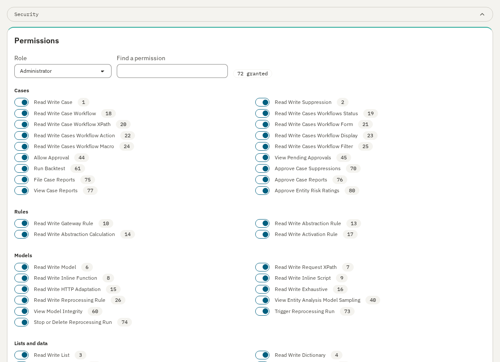
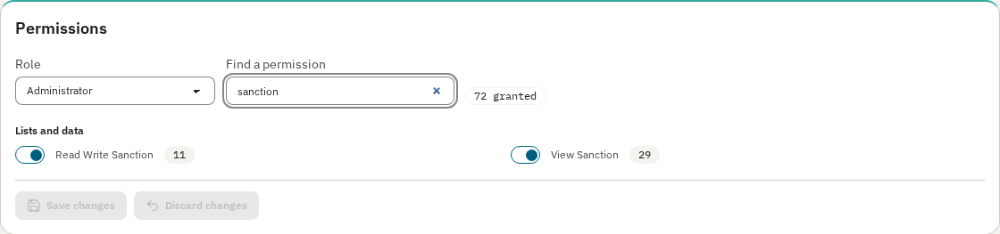

# Permissions

Permissions grant access to resources in the user interface, typically pages, and to the API behind them. Permissions are granted to Roles, and a Role is allocated to a User, as described in [Roles](../Roles/index.html).

In practice, it is unlikely that a user with day to day responsibilities in customer services would require access beyond Case Management, Lists, Dictionary or Override. Similarly, an analyst that has responsibility for the creation of rules and reports is unlikely to need access to those pages enjoyed by customer service.

In the absence of a permission the user will not see the menu entry. In the event of deep linking to a resource without a permission, an unauthorised http status code will be returned.

The Administrator role is created during migrations and has all available permissions allocated.

## Where it lives

Navigate through the menu to Administration, then Security, then the Permissions card, which is presented to a user holding permission 36. Permissions can also be reached from the record of a Role, where a Permissions card opens the allocation for that Role alone. There is no longer a tree to expand, and a permission is no longer added to or deleted from a Role as a record of its own: the permissions of a Role are instead presented together as a set of switches.

SHOT id=administration-permissions-allocation
     route=/administration/security
     steps=open-hub:Permissions, select:Role=Administrator
     frame=page
     state=the Permissions step of the Security page with the Administrator Role chosen, the permissions grouped by area with their switches on, the count of permissions granted, and the Find a permission box empty
     conveys=the permissions of a Role are a set of switches grouped by area, saved together
     alt=The Permissions step of the Security page for the Administrator Role, listing each permission with a switch, its name and its number, grouped under headings such as Cases, Rules and Models

## Granting and revoking permissions

A Role is chosen in the Role selector, which is not available to be changed where the page was opened from the record of a Role, nor while there are unsaved changes. The permissions are grouped by area, in the following order: Cases, Rules, Models, Lists and data, Visualisation, Security, Operations, Analytics, then Other for any permission that has not been assigned to an area. Each permission has a switch, its name and its number. The Find a permission box filters by name, and a badge shows the number of permissions the Role has been granted, in the form 12 granted. Until a Role has been chosen the page states Pick a role to see and change its permissions., and where the search leaves nothing it states No permissions match that search. Should the permissions fail to load, the page states: The permissions could not be loaded. Refresh the page to try again.

By way of example, to allow a Role named Fraud analyst to search sanctions, the Role is chosen, sanction is typed in the Find a permission box, which leaves Read Write Sanction (11) and View Sanction (29) under Lists and data, and View Sanction is switched on. The page shows 1 unsaved until Save changes is pressed, whereupon it confirms Permissions saved., the badge rises by one, and a user holding that Role sees the Sanctions menu item upon next refreshing the page.

SHOT id=administration-permissions-find-sanction
     route=/administration/security
     steps=open-hub:Permissions, select:Role=Administrator, fill:Find a permission=sanction
     frame=section:Permissions
     state=the Permissions step of the Security page with the Administrator Role chosen and sanction typed in the Find a permission box, the badge beside it reading 72 granted, leaving under Lists and data only Read Write Sanction (11) and View Sanction (29), both switched on, with Save changes and Discard changes unavailable beneath
     conveys=the Find a permission box narrows the catalogue to the few permissions that bear upon the matter in hand
     alt=The Permissions step for the Administrator Role with sanction typed in the Find a permission box, leaving Read Write Sanction, numbered 11, and View Sanction, numbered 29, both switched on under Lists and data

Switching a permission on or off changes nothing in the server until Save changes is pressed, with Discard changes returning to the stored state, and the number of unsaved changes being shown throughout. Upon saving, only the differences are sent, as follows:

| Change made                                 | What the server is asked to do                                                                |
|---------------------------------------------|-----------------------------------------------------------------------------------------------|
| Switch on a permission never granted        | Create an active grant of that permission on the Role.                                        |
| Switch on a permission having been inactive | Reactivate the existing inactive grant, as a permission is never granted twice to one Role.   |
| Switch off an active permission             | Delete the grant, on a logical basis.                                                         |
| Duplicate grants found for a permission     | The surplus grants are removed.                                                               |

A grant that is locked is shown with a Locked badge and its switch is disabled, which is to say that it cannot be changed or removed here.

If any request fails the page reports the problem and reloads the stored grants, such that the switches always show what is stored. The requests are sent together, so a partial result is possible after an error, and the reloaded state should be checked.

## Validation

A grant is validated in the server, and is rejected where:

* The Role is absent, or is not a Role of the tenant of the caller.
* The permission is absent, does not exist in the catalogue, or is already granted to the Role.

A grant naming a Role of another tenant, or a Role that does not exist, is refused with the same 400 response, such that a caller cannot tell which of the two it was.

## When a change takes effect

Services read the permissions of the caller on every request, henceforth a grant, a revocation or a deactivation applies to the very next request. The menu is built when the page loads, so a User whose Role has changed sees the new menu upon refreshing the page.

A grant counts only where the grant is active and not deleted, the Role is active and not deleted, and the User is active, not locked and not deleted. Locking a Role or a grant does not revoke it. Users whose Role belongs to the landlord tenant hold every permission irrespective of what is granted, provided that the Role is active, as described in [Roles](../Roles/index.html).

## Permissions gating a single action

Most permissions grant access to a page. A small number instead gate a single action that is materially more dangerous than the rest of the page, and are withheld by default:

* Apply Force Override (62) is one of these. The ordinary Override permission lets an operator mute an Activation Rule for a value, whereas Apply Force Override lets them make one fire, raising response elevations, creating cases and sending notifications.
* Import Preservation Snapshot (63) is another. The ordinary Preservation permission lets an operator take a snapshot and export, whereas this one lets them roll the configuration of the whole tenant back to an earlier one.
* Approve Case Suppressions (70) is a third. A suppression requested from a case changes nothing in the engine until someone other than the person having made the request approves it, and this permission is what allows that approval.

All three are granted on upgrade to the Administrator role only, and must be granted explicitly to any other role that needs them.

Reprocessing is divided across three permissions such that the running of a filter can be delegated without delegating its editing: Read Write Reprocessing Rule (26) edits the rule of a filter, Trigger Reprocessing Run (73) starts a run, and Stop or Delete Reprocessing Run (74) stops or deletes one. Any of the three allows the reading of both. On upgrade every Role that held 26 was given 73 and 74 as well, with the same active state, so no Role gained or lost an ability, as described in [Reprocessing Instances](../../Reprocessing/ReprocessingInstances/index.html).

## The catalogue

The list of permissions is fixed. It is created by database migration and cannot be changed through the user interface or the API, the catalogue endpoint being read only. The catalogue is the same for every tenant, and the number of a permission is the number that every service checks. Two retired entries, 27 and 41, are not offered for granting, while 42 and 43 are offered yet have no effect.

| Number | Name                                                             | Area           |
|--------|------------------------------------------------------------------|----------------|
| 1      | Read Write Case                                                  | Cases          |
| 2      | Read Write Suppression                                           | Cases          |
| 3      | Read Write List                                                  | Lists and data |
| 4      | Read Write Dictionary                                            | Lists and data |
| 5      | Allow Synchronisation                                            | Operations     |
| 6      | Read Write Model                                                 | Models         |
| 7      | Read Write Request XPath                                         | Models         |
| 8      | Read Write Inline Function                                       | Models         |
| 9      | Read Write Inline Script                                         | Models         |
| 10     | Read Write Gateway Rule                                          | Rules          |
| 11     | Read Write Sanction                                              | Lists and data |
| 12     | Read Write TTL Counter                                           | Lists and data |
| 13     | Read Write Abstraction Rule                                      | Rules          |
| 14     | Read Write Abstraction Calculation                               | Rules          |
| 15     | Read Write HTTP Adaptation                                       | Models         |
| 16     | Read Write Exhaustive                                            | Models         |
| 17     | Read Write Activation Rule                                       | Rules          |
| 18     | Read Write Case Workflow                                         | Cases          |
| 19     | Read Write Cases Workflows Status                                | Cases          |
| 20     | Read Write Case Workflow XPath                                   | Cases          |
| 21     | Read Write Cases Workflow Form                                   | Cases          |
| 22     | Read Write Cases Workflow Action                                 | Cases          |
| 23     | Read Write Cases Workflow Display                                | Cases          |
| 24     | Read Write Cases Workflow Macro                                  | Cases          |
| 25     | Read Write Cases Workflow Filter                                 | Cases          |
| 26     | Read Write Reprocessing Rule                                     | Models         |
| 27     | View Counter and Balance (retired, not offered)                  | Operations     |
| 28     | View Visualisation Directory                                     | Visualisation  |
| 29     | View Sanction                                                    | Lists and data |
| 30     | View Watcher                                                     | Operations     |
| 31     | Read Write Visualisation Administration                          | Visualisation  |
| 32     | Read Write Visualisation Parameter Administration                | Visualisation  |
| 33     | Read Write Visualisation Datasource                              | Visualisation  |
| 34     | Read Write Security Role                                         | Security       |
| 35     | Read Write Security User                                         | Security       |
| 36     | Read Write Security Role User Permission                         | Security       |
| 37     | Read Write Tags                                                  | Lists and data |
| 38     | Allow Preservation Import and Export                             | Operations     |
| 39     | View Performance Counters                                        | Operations     |
| 40     | View Entity Analysis Model Sampling                              | Models         |
| 41     | Retired - no effect (the Activation Rule Review Status is retired), not offered | Operations     |
| 42     | Retired - no effect (OpenTelemetry Log Counter is landlord only) | Operations     |
| 43     | Retired - no effect (OpenTelemetry Exclude is landlord only)     | Operations     |
| 44     | Allow Approval                                                   | Cases          |
| 45     | View Pending Approvals                                           | Cases          |
| 46     | Advanced Analytics Recall                                        | Other          |
| 47     | Advanced Analytics Promote Model                                 | Other          |
| 48     | Advanced Analytics                                               | Other          |
| 49     | View Graph                                                       | Other          |
| 50     | Author Graph                                                     | Other          |
| 51     | Resolve Graph Entities and Patterns                              | Other          |
| 60     | View Model Integrity                                             | Models         |
| 61     | Run Backtest                                                     | Cases          |
| 62     | Apply Force Override                                             | Other          |
| 63     | Import Preservation Snapshot                                     | Other          |
| 64     | Sandboxed Script Execution                                       | Other          |
| 65     | Access AskJooby                                                  | Analytics      |
| 66     | Advanced Analytics Training                                      | Other          |
| 67     | Author Case Workflow SQL                                         | Other          |
| 68     | Release Held Payments                                            | Other          |
| 69     | Author Case Workflow Release Hooks                               | Other          |
| 70     | Approve Case Suppressions                                        | Cases          |
| 71     | Override Case Checklist Gate                                     | Other          |
| 72     | View Svirfd                                                      | Operations     |
| 73     | Trigger Reprocessing Run                                         | Models         |
| 74     | Stop or Delete Reprocessing Run                                  | Models         |
| 75     | File Case Reports                                                | Cases          |
| 76     | Approve Case Reports                                             | Cases          |
| 77     | View Case Reports                                                | Cases          |
| 78     | Request Erasure and Export Subject Data                          | Security       |
| 79     | Approve Erasure                                                  | Security       |
| 80     | Approve Entity Risk Ratings                                      | Cases          |

TODO(verify): the names above are those of the English locale file and the areas those of the user interface grouping; confirm on a running system that the names served by the catalogue endpoint for the Permissions step agree, in particular for 42 and 43.

## Permissions and security

Granting and revoking permissions requires permission 36, Read Write Security Role User Permission, alone. Creating or changing Roles requires 34, Read Write Security Role, and managing Users requires 35, Read Write Security User. It follows that a holder of only 36 cannot create Roles or Users, and a holder of only 34 cannot grant permissions.

A holder of permission 36 can grant, change or remove only grants of permissions they hold themselves, landlord users being exempt, so a holder of 36 alone cannot give themselves 34 or 35. Effective permissions are the active, undeleted grants of the active, undeleted Role of the user.

The page does not stop an administrator removing permission 36 from the Role they themselves hold, in which case they would lose access to this page on their next request.
