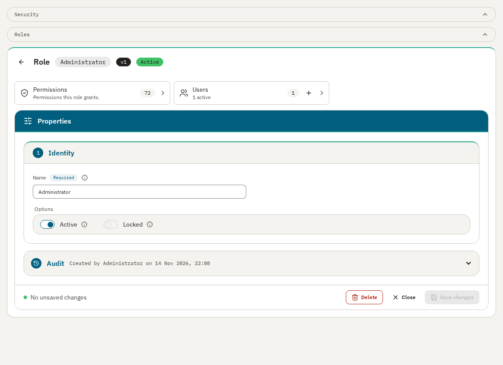
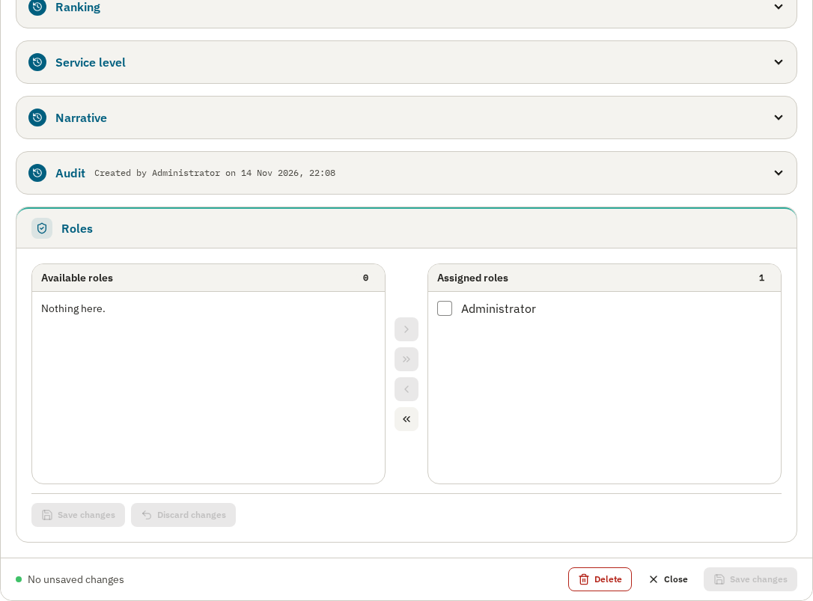

# Roles

A Role is a named set of permissions. Users are not given permissions one by one, rather a [User](../Users/index.html) is allocated to exactly one Role and receives whatever the Role grants, with permissions being allocated to the Role as described in [Permissions](../Permissions/index.html). Roles are also allocated to individual records, such as Models, Case Workflows, Visualisations and Graphs, for the purposes of deciding who may use those records, as described in Allocating Roles to records below.

Roles belong to a tenant, and it follows that a tenant administrator sees and changes only the Roles of their own tenant. The same Name may be used by Roles in different tenants.

## Where it lives

Navigate through the menu to Administration, then Security, then the Roles card. The Security page is arranged as a story, in the same manner as Models, and there is no longer a tree of roles. The Roles card presents the list of Roles in the tenant, with the columns Name and Active. Creating, changing and deleting a Role follows the common manner described in [Child Objects](../../../Navigation/ChildObjects/index.html), with the exception that Roles are not subject to approval, which is to say that a change takes effect upon being saved.

Upon opening a Role, two cards are presented above the Properties form: Users, which opens the list of the users holding the Role and from which a user can be created directly in that Role, and Permissions, which opens the allocation of permissions for the Role and is presented only to a holder of permission 36.

SHOT id=administration-roles-role-record
     route=/administration/security
     steps=open-hub:Roles, open-row:Administrator
     frame=page
     state=the Security page with the Roles step collapsed and the Administrator Role opened, showing the Users and Permissions cards above the Properties form with the Identity group expanded and the Audit group collapsed
     conveys=a Role is a small record, and its users and permissions hang from it as cards
     alt=The Administrator Role opened on the Security page, with cards for its Users and Permissions and the Properties form showing Name, Active and Locked

## Fields

| Value  | Description                                                                                                                                             | Example       |
|--------|---------------------------------------------------------------------------------------------------------------------------------------------------------|---------------|
| Name   | The name of the Role, as shown when allocating permissions, users or records to it.                                                                     | Fraud analyst |
| Active | Whether the Role grants anything. Where it is off, every user holding the Role loses all permissions, as described below.                               | True          |
| Locked | Whether the Role is protected from change. Where it is on, the Role cannot be edited or deleted, as described below.                                    | False         |

The collapsed Audit group shows the date and user of creation and of the last update, alongside the version.

## Validation

A Role is validated in the server, and is rejected where the Name is empty, is longer than 256 characters, or is already in use by another Role in the tenant without regard to case. An invalid Role is refused with a 400 response, and the message is written beneath the field.

## Behaviour

### Active

An inactive Role is ignored when permissions are resolved: the users holding it have no permissions, cannot use any page or API that is subject to a permission, and are treated as inactive. Reactivating the Role restores the permissions immediately, because permissions are read on every request and there is no cache to flush. A Role that is deleted behaves in the same manner as an inactive one.

The landlord tenant is treated differently in one respect. A user whose Role belongs to the landlord tenant is granted every permission in the catalogue, irrespective of what has been granted to the Role. The Role must nonetheless be active and not deleted, which is to say that a landlord user whose Role is inactive has no permissions, exactly as any other user.

### Locked

A locked Role cannot be updated or deleted, both being refused as not found. Locking is a protection against editing and does not revoke anything, hence the Role continues to grant its permissions. The permissions of a locked Role can still be added and removed in Permissions, unless the individual grant is itself locked.

### Deleting a Role

Deletion is done on a logical basis (the record is kept, marked as deleted, with the user and the date) and it cannot be undone through the user interface. A Role cannot be deleted while it is locked. Deleting a Role that users still hold is not blocked: those users keep their record, yet hold no permissions until they are moved to another Role.

### Concurrent edits

Each update carries the version at which the record was loaded. If another user saved first, the server refuses the update as a conflict, and the page offers to reload the record. A version of zero skips the check, which is what an API client not tracking versions sends.

## Allocating Roles to records

Besides the allocation of a Role to a User, a Role can be allocated to the records of several areas: Models, Case Workflows and their Statuses, Actions, Forms, Filters, Displays, Macros and XPaths, Visualisations, Visualisation Datasources and Parameters, and Graphs. The record of each of these presents a Roles section with two lists, Available roles and Assigned roles, and arrows to move Roles between them, which mirror in languages reading from right to left. The actions between the lists are Assign selected, Assign all, Unassign selected and Unassign all, and a list having no Roles in it states Nothing here. Nothing is saved until Save changes is pressed, and Discard changes returns to the stored assignment, the number of changes yet to be saved being shown in the meantime. Upon saving, the section confirms Roles saved., and where the Roles cannot be read it states: The roles could not be loaded. Refresh the page to try again. Only the differences are sent, being one create for each Role added and one delete for each Role removed.

Role allocation is for these records and not for Users, keeping in mind that a User holds one Role, chosen in the Role registry field of the User record.

The server checks every assignment: the Role must exist in the tenant of the caller, such that a Role of another tenant cannot be allocated by guessing its Guid. Each area applies its own permission to the allocation.

SHOT id=administration-roles-allocation-to-record
     route=/models
     steps=open-default-model, open-hub:Cases Workflows, open-first-row, scroll-to:Roles
     frame=record
     state=a Case Workflow of the default model opened and scrolled to the Roles section, with one Role under Assigned roles, the remainder under Available roles, and No unsaved changes shown
     conveys=Roles are allocated to a record by moving them between two lists on the record itself
     alt=The Roles section of a Case Workflow, showing the Available roles and Assigned roles lists with arrows between them

## Roles and Model invocation access

Beyond the permissions of the user interface, the allocation of a Role to a [Model](../../Models/Models/index.html), in the Roles section of the Model, serves a further purpose. It is a separate concern from the allocation of permissions: it does not affect what a signed in user can see or do in the user interface, rather it governs which users are allowed to invoke that specific Model through the API (`api/Invoke` and the related endpoints scoped to a Model).

The Role of a User determines the set of Models they may invoke. The engine continuously resolves, in the background, which Users fall under each Role allocated to a Model, and keeps that resolved list synchronised as Users, Roles and Role allocations change, henceforth there is no need to restart the engine or to explicitly synchronise a Model for a change of Role to take effect. A request made with a valid identity (JWT or API key) for a User outside the resolved list is rejected in the same manner as an unauthenticated request, irrespective of whether the calling User otherwise holds every relevant permission.

This is the mechanism that makes it practical to share a single Model Guid across multiple tenants while still routing the traffic of each tenant only to the Models that their Role is entitled to invoke, as described in [Multi Tenancy](../../../Concepts/MultiTenancy/index.html).

## Permissions and security

| Permission | Name                                     | Description                                                                              |
|------------|------------------------------------------|------------------------------------------------------------------------------------------|
| 34         | Read Write Security Role                 | Create, change and delete the Roles of the tenant. It cannot grant permissions to a Role. |
| 36         | Read Write Security Role User Permission | Grant and revoke permissions on the Roles of the tenant. It cannot create Roles or Users. |
| 35         | Read Write Security User                 | Create Users and move them between the Roles of the tenant.                              |

The three are separate such that duties can be divided. Listing Roles, as is needed wherever a Role is to be chosen, is also allowed to the holders of 34, 35 and 36, and to the holders of the model, case workflow and visualisation permissions that allocate Roles to records (6, 18 to 25, and 31 to 33).

Dividing 34, 35 and 36 across people gives a separation of duties, yet each is powerful in combination, and it is for this reason that no holder may act beyond their own privilege. A holder of 36 can grant only the permissions they hold themselves, to any Role of the tenant including the Role they hold, and can change or remove only a grant of a permission they hold. No one may grant, or assign a Role carrying, a permission they do not hold themselves, and no one may reset the password of, or issue an API key as, a user whose permissions are not a subset of their own. Renaming, deactivating, locking or deleting a Role is likewise refused where the Role carries a permission the caller does not hold, such that a Role cannot be edited to get at a more privileged user. Landlord users are exempt. A refused request is answered as an ordinary permission refusal (403) that does not disclose which permission or user was involved.
