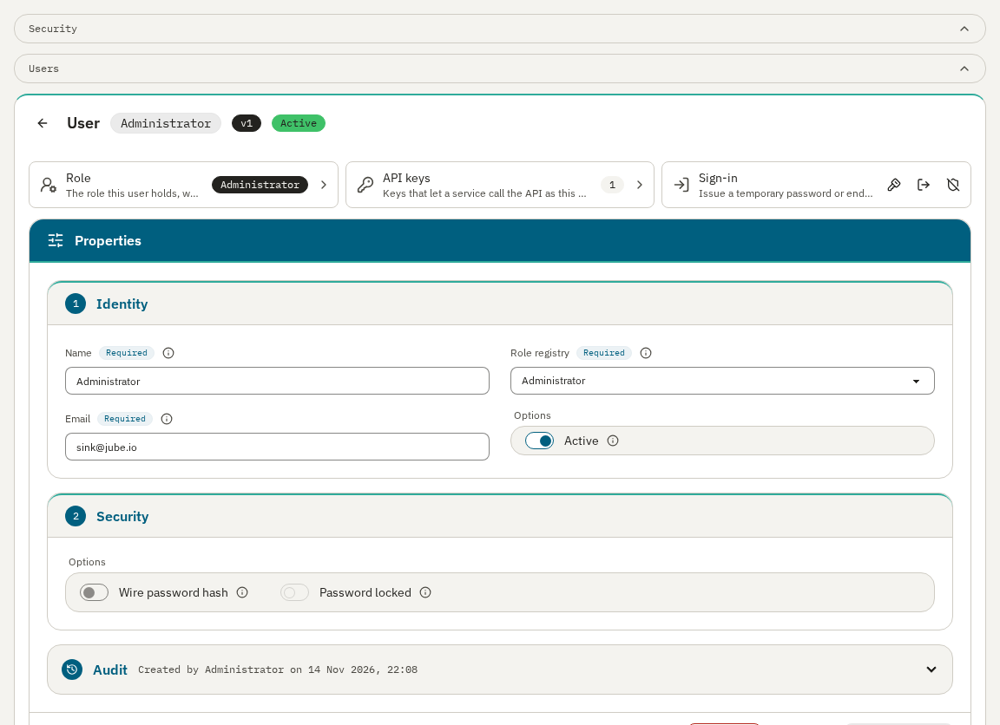
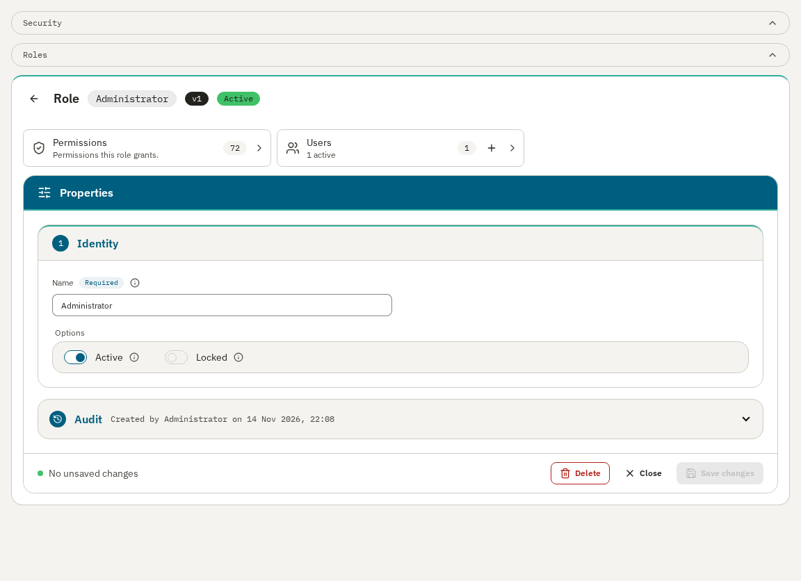

# Users

All user interactions in the user interface are subject to authentication and authorisation. Authentication is rooted in a user account, which is more often than not accompanied by a password (keeping in mind the software also supports JSON Web Tokens and API keys for authentication, as described in [Authentication Concepts](../../../Concepts/Authentication/index.html)).

Users are allocated to [Roles](../Roles/index.html), which serve to consolidate authorisations upon authentication, in the form of [Permissions](../Permissions/index.html). A user holds exactly one Role, and it is the Role that determines both the permissions afforded to the user and the tenant to which the user belongs.

## Where it lives

Navigate through the menu to Administration, then Security. The Security page is arranged as a story in the same manner as Models: the first step presents a card for each part of Security that the signed in user is permitted to use, being Users, Roles, Permissions, Sign-ins and Sign-outs, and each step taken thereafter is added beneath the last. There is no longer a tree of roles with the users beneath, although the users holding a given Role can still be reached from the record of that Role.

The Users card presents the list of users in the tenant of the signed in user, with the columns Name, Email and Active. It should be noted that a landlord user sees the users of their own tenant, and not those of every tenant. Creating, changing and deleting a user follows the common manner described in [Child Objects](../../../Navigation/ChildObjects/index.html), with the exception that users are not subject to approval, which is to say that a change to a user takes effect upon being saved.

SHOT id=administration-users-security-story
     route=/administration/security
     steps=open-hub:Users, open-first-row
     frame=page
     state=the Security page with the Users step collapsed and a user record opened, showing the Role, API keys and Sign-in cards above the Properties form with its Identity and Security groups
     conveys=a user is one record in the Security story, carrying its Role, its API keys and its sign-in actions as cards
     alt=A user record opened on the Security page, with cards for the Role held, the API keys and Sign-in, and the Properties form beneath



## Fields

| Value              | Description                                                                                                                                                                                                                              | Example       |
|--------------------|------------------------------------------------------------------------------------------------------------------------------------------------------------------------------------------------------------------------------------------|---------------|
| Name               | The name with which the user signs in, matching the Name claim of the JSON Web Token issued upon authentication.                                                                                                                         | test          |
| Role registry      | The Role to which the user is allocated, selected from the Roles of the tenant. Changing it moves the user from one Role to another, and it follows that the permissions held by the user change with it.                                 | Administrator |
| Email              | The email address of the account holder. It is not used to deliver the temporary password, which is instead shown once to the administrator issuing it.                                                                                  | test@test.com |
| Active             | Whether the user may sign in. Where it is off, sign in is refused irrespective of the password being correct. Active is off for a new user and must be switched on.                                                                      | True          |
| Wire password hash | Where on, a temporary password issued by the administrator is salted with the name of the user and hashed with SHA-256 before it is hashed with Argon2, being the format that some client integrations send. It is on for a new user.    | True          |
| Password locked    | Shown for information, and not available to be changed in the form. It is on where repeated failed attempts to sign in have locked the account, and it is cleared only by the issuing of a temporary password.                           | False         |

The collapsed Audit group shows the Id, the user and date of creation, the Version (which serves as the optimistic concurrency token) and the identifier inherited where the user arrived by way of a Preservation import. All are assigned by the server.

A user created in this manner has no password, and it follows that the user cannot sign in until a temporary password has been issued, as described below.

Renaming a user is allowed. The name is the key under which the allocation of the user to a tenant is held, henceforth the allocation moves to the new name in the same operation. Sessions issued under the old name are not carried over by the rename, and they should be revoked upon a rename, as described below.

Deleting a user is done on a logical basis: the user disappears from the list and can no longer sign in, and cannot be restored from the page. The API keys of a deleted user are not revoked one by one, yet they cease to work, as only the keys of active users that have not been deleted are loaded for the purposes of validation.

## Validation

A user is validated in the server, and is rejected where:

* Name is empty, or longer than 256 characters.
* Name is already in use by another user that has not been deleted, without regard to case. The name is the identifier with which a user signs in, and the users of all tenants share the one sign in page, hence the name must be unique across the whole instance rather than within the tenant. A name in use in another tenant is refused with the same message as a duplicate in the tenant of the signed in user.
* Email is empty, is not a valid email address, or is longer than 256 characters.
* Role registry is empty, or does not resolve to a Role existing in the tenant of the signed in user.

Any identifier, tenant, created user, created date, version or inherited identifier sent in the body of a create or update is ignored, as these values are set by the server.

## The cards on a user

Upon opening a user, the following cards are presented above the Properties form:

| Card     | Description                                                                                                                                                                           |
|----------|---------------------------------------------------------------------------------------------------------------------------------------------------------------------------------------|
| Role     | Shows the Role the user holds, and opens the record of that Role where the signed in user is permitted to use Roles (permission 34).                                                  |
| API keys | Shows the number of keys held by the user, and opens the list of keys.                                                                                                                |
| Sign-in  | Shows Locked where the account is locked, and carries three actions, being Temporary password, Revoke sessions and Reset authenticator. The card itself does not open anything.       |

SHOT id=administration-users-role-card-opened
     route=/administration/security
     steps=open-hub:Users, open-first-row, open-hub:Role
     frame=page
     state=the Security page after the Role card of the Administrator user has been followed, presenting the record of the Administrator Role beneath the collapsed steps Security and Roles, with its own cards, Permissions with 72 and Users with 1 active, above the Properties form of the Role
     conveys=the Role card of a user leads to the record of the Role that the user holds, from which its permissions and its users are reached
     alt=The record of the Administrator Role reached from the Role card of a user, showing a Permissions card with 72, a Users card with 1 active and the Properties form of the Role beneath the collapsed steps Security and Roles



### Issuing a temporary password

The Temporary password action on the Sign-in card seeks confirmation under the heading Issue a temporary password for (the name of the user)?, stating: The current password stops working at once. The new one is shown here once and must be changed at the next sign-in. A locked account is unlocked. The dialog offers Issue password and Cancel, the latter leaving everything as it was. Upon confirmation a random password of 16 characters is generated in the server, stored as an Argon2 hash (never in clear text) and shown once in a dialog headed Copy the password for (the name of the user) now, alongside its expiry (Expires, followed by the date and time), with a Copy button, which reads Copied once it has been used, and Done. Where the browser will not allow the copy, the dialog states: The password could not be copied. Select it and copy it yourself. The page confirms with the message Temporary password issued. On the dialog being closed the password is gone, and it cannot be shown again.

The password is set as having already expired, which forces the user to change it upon first signing in, and any lock on the account is cleared. Upon the change of the password, the permissions are afforded as the Role to which the user was allocated. The response carrying the password is sent with caching disabled, and the action is not available to the AI agent tools.

### Revoking sessions

The Revoke sessions action seeks confirmation under the heading Revoke every session of (the name of the user)?, whereupon every browser and bearer (JWT) session of the user is refused on its next request, and the user must sign in again. API keys are not affected, and are revoked separately from the list of API keys, which the page confirms as: Sessions revoked. API keys are not affected. The action is recorded in the `UserLogout` table, with the administrator as the user having cut the session, as described in [Login and Logout Audit](../LoginAudit/index.html).

It should be noted that a user signing out by themselves has the same effect on their own sessions: the JSON Web Token is cleared from the header and the cookies, and every browser and bearer session of the user is revoked in the database.

### Resetting the authenticator

Where an authenticator app is in use as a second factor, the Reset authenticator action causes the user to be asked to set up an authenticator app again upon next signing in, for use where the telephone of the user has been lost or replaced. It seeks confirmation under the heading Reset the authenticator of (the name of the user)?, and confirms with the message Authenticator reset. Multi factor authentication is described in [Authentication Concepts](../../../Concepts/Authentication/index.html).

### API keys

An API key allows a service to call the API as the user, with the permissions of that user. The API keys card opens a panel headed Keys held by this user, listing for each key its Name, Description, the first eight characters of the Key and the date it was Created.

Before any key has been generated the panel states No API keys yet, and where the keys cannot be read, The API keys could not be loaded. The Key column shows the first eight characters followed by an ellipsis.

Generate key takes a Name, which is required and limited to 256 characters, and optionally a Description, limited to 1024 characters, and offers Generate and Cancel. The page itself refuses an empty Name with A name is needed., a Name that is too long with The name must be 256 characters or fewer., and a Description that is too long with The description must be 1024 characters or fewer., and a refusal by the server is given as The key could not be generated. The complete key is shown once, under the heading Copy the key for (the name of the key) now and the statement It will not be shown again. Only its first eight characters stay visible in the list., with Copy and Done, and the page confirms with the message Key generated. Only a SHA-256 hash of the key and its first eight characters are stored, so the key cannot be recovered: should it be lost, it is a simple matter of revoking it and generating another. The response is sent with caching disabled, and the generation of keys is not available to the AI agent tools.

Revoke, on the row of a key, seeks confirmation under the heading Revoke this key?, whereupon anything using the key stops authenticating at once, and this cannot be undone. The key leaves the list and the page confirms with the message Key revoked. Revoking a key that is already gone, or one that belongs to another tenant, succeeds without doing anything.

A client presents the key in the `X-API-KEY` header of each request, which takes precedence over a bearer token or a cookie:

```http
GET https://localhost:5001/api/Invoke/Sanction?multiPartString=Robert+Mugabe&distance=2
X-API-KEY: <the complete key>
```

## Tenants and moving users

A user belongs to the tenant of the Role they hold. Only a landlord user can move a user between tenants (the tenant allocation, held in the `UserInTenant` table), and that action belongs to the Tenants page, reached through the menu at Administration, then Tenants, and described in [Multi Tenancy](../../../Concepts/MultiTenancy/index.html).

## Sign-in audit

An authentication journal is maintained in the database, logging each successful and unsuccessful sign in, the local IP, the remote IP and the user agent of the browser. It is presented in the Sign-ins card of the Security page, and is also available via selection from the `UserLogin` table:

```sql
select *
from "UserLogin"
order by 1 desc
```

Sessions that are cut (a user signing out, an administrator using Revoke sessions, a change of password) are recorded in the `UserLogout` table and presented in the Sign-outs card. Both are described in [Login and Logout Audit](../LoginAudit/index.html).

## Permissions and security

Reading and writing users, issuing a temporary password, revoking sessions, resetting an authenticator, and the generating and revoking of API keys all require permission 35, Read Write Security User. The Roles card requires permission 34, Read Write Security Role, and the Permissions card permission 36, Read Write Security Role User Permission. A user holding none of the three is presented with the message that they do not have permission to use any part of Security. Each action is available only for the users of the tenant of the signed in user.

Permission 35 is a powerful permission, keeping in mind that its holder can create users, move the users of the tenant to a Role, issue a temporary password for a user, revoke the sessions of any user and generate API keys that act as a user. It is for this reason that the holder is confined to their own privilege: the Role assigned (to a new user, to another user or to their own account) may carry only permissions that the holder also has, and a temporary password or an API key may be issued only for a user whose permissions are all held by the holder. The same limit applies to editing (including deactivating), deleting and revoking the sessions of a user, and to revoking the API key of a user, which is to say that a user whose permissions are not all held by the caller cannot be touched. Rights over oneself are never restricted in this manner, and landlord users are exempt. A refusal is a plain 403 that does not disclose which permission or user was involved.

In the event of all users having invalid credentials, the Command Line Interface (CLI) will need to be used to reset the Administrator password, as described in [Password Reset](../../../Concepts/CLI/PasswordReset/index.html).
