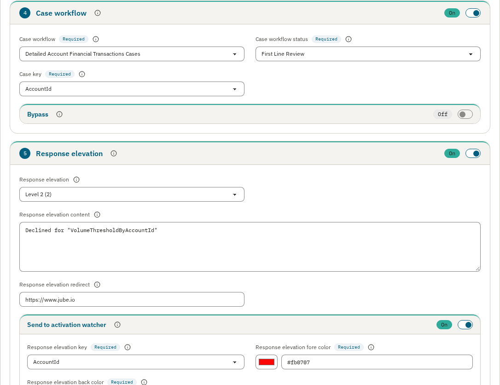

# Creating Case Entry With Activation Rule

A case record is created as a consequence of an Activation Rule match. It is advised to revisit [Activation Rules](../../Models/BasicActivationRules/index.html) and [Reprocessing](../../Reprocessing/index.html) in this documentation before proceeding, alongside the creation of a [Case Workflow](../CreatingCaseWorkflows/index.html) and a [Cases Workflow Status](../CreatingCaseWorkflowStatus/index.html), without which there is nothing for an Activation Rule to create a case in.

## Where it lives

The creation of a case is configured in the Activation Rule itself. Navigate through the menu to Models, open the model, then the Activation Rules hub card, and open the Activation Rule. The fields are in the group Case Workflow, and are presented once the Cases switch of that group is on. An Activation Rule is created, changed and approved in the common manner described in [Child Objects](../../../Navigation/ChildObjects/index.html), and a change to it is taken up by the engine at its next cycle upon being approved.

## Fields

| Value                | Description                                                                                                                                                                        | Example           |
|----------------------|------------------------------------------------------------------------------------------------------------------------------------------------------------------------------------|-------------------|
| Cases                | Whether a case is created as a consequence of this Activation Rule matching.                                                                                                       | True              |
| Case workflow        | The Case Workflow the new case will be assigned to, chosen from the Case Workflows of the model. Required when Cases is on.                                                        | Fraud Prevention  |
| Case workflow status | The Cases Workflow Status, rolling up to the Case Workflow chosen, that the new case will be assigned to. Required when Cases is on.                                               | First Line Review |
| Case key             | The Request XPath, Inline Script or Inline Function data element used as the Case Key when creating the case. Required when Cases is on.                                           | AccountId         |
| Enable bypass        | Whether a sample of the cases created are set to a Suspend Bypass status, as described in [Creating Case Entry With Defer Activation Rule](../CreatingCaseEntryWithDeferActivationRule/index.html). | False             |

The Case Key refers to the value that will be used to distinctly create the case, whereby the case creation integrity will be enforced on that key. For example, if a Case Key is AccountId, only a single case record can be created for a Case Key Value combination, for a case workflow, for as long as that case is in all but a closed status. Where such a case exists already, a further match does not create another, yet it may raise the status of the existing case, as described in [Creating Status Elevation](../CreatingStatusElevation/index.html).

So that the Case Key Journal of the case can be read, the field chosen as the Case key should be flagged as Archive Key in its Request XPath, as described in [Working Case Key Journal](../WorkingCaseKeyJournal/index.html).

## Validation

The fields are validated in the server upon saving the Activation Rule, and only where Cases is on, the three selections being neither presented nor checked while it is off. The Activation Rule is refused as follows:

| Condition                                                           | Message                                                                          |
|---------------------------------------------------------------------|----------------------------------------------------------------------------------|
| Case workflow not chosen                                            | A Case Workflow is required when Cases is enabled.                               |
| Case workflow status not chosen                                     | A Case Workflow Status is required when Cases is enabled.                        |
| Case workflow status not a status of a Case Workflow of the model   | The Case Workflow Status was not found in a Case Workflow of the selected Model. |
| Case key not chosen                                                 | A Case Key is required when Cases is enabled.                                    |

Keep in mind that the Case workflow status selection is empty until a Case workflow has been chosen, and remains empty where the Case Workflow chosen has no status as yet, in which circumstance the Activation Rule cannot be saved with Cases on.

## Example

Open the Activation Rule Volume1DayUSDForIPOver100 created beforehand, and in the Case Workflow group complete as follows, for the time being leaving Enable bypass off:

| Value                | Example           |
|----------------------|-------------------|
| Cases                | True              |
| Case workflow        | Fraud Prevention  |
| Case workflow status | First Line Review |
| Case key             | AccountId         |

Upon the change having been approved and taken up by the engine, repeat the HTTP POST to endpoint [https://localhost:5001/api/invoke/EntityAnalysisModel/90c425fd-101a-420b-91d1-cb7a24a969cc](https://localhost:5001/api/invoke/EntityAnalysisModel/90c425fd-101a-420b-91d1-cb7a24a969cc).

It can be seen from the response that the Activation Rule has activated, which will have driven the creation of a case, the instruction for which is carried in the createCase element:

```json
{
  "createCase": {
    "caseWorkflowGuid": "957c6ab0-ef2b-4d06-a7a5-e923762dd917",
    "caseWorkflowStatusGuid": "faf5c83a-5c3e-4a62-b224-aea9e2e1efa6",
    "caseKeyValue": "Test20",
    "caseKey": "AccountId",
    "suspendBypass": false,
    "suspendBypassDate": "2026-02-20T09:19:46.3793539+02:00"
  }
}
```

To view the created case, navigate through the menu to Cases. If not already selected by session, choose the Case Workflow and select a [Case Workflow Filter](../CreatingCaseWorkflowFilter/index.html) to display open cases. It can be seen that upon matching, a case has been created.

SHOT id=case-entry-activation-rule-case-workflow-group
     route=/models
     steps=open-default-model, open-hub:Activation Rules, open-row:VolumeThresholdByAccountId, scroll-to:Case Workflow
     frame=record
     state=the Case Workflow group of an Activation Rule of the default model with Cases switched on, showing the Case workflow, Case workflow status and Case key selections completed and Enable bypass off
     conveys=case creation is a group of the Activation Rule, naming the workflow, the status and the key of the case
     alt=The Case Workflow group of an Activation Rule with the Cases switch on and selections for the case workflow, its status and the case key



## Permissions and security

Configuring an Activation Rule to create a case requires permission 17, Read Write Activation Rule, which also permits the listing of the Case Workflows and Cases Workflow Status of the model for selection. The case itself is created by the engine upon the transaction being processed, and is thereafter available only to the roles allocated to both its Case Workflow and its Cases Workflow Status, as described in [Case Management Security Policy](../SecurityPolicy/index.html).
