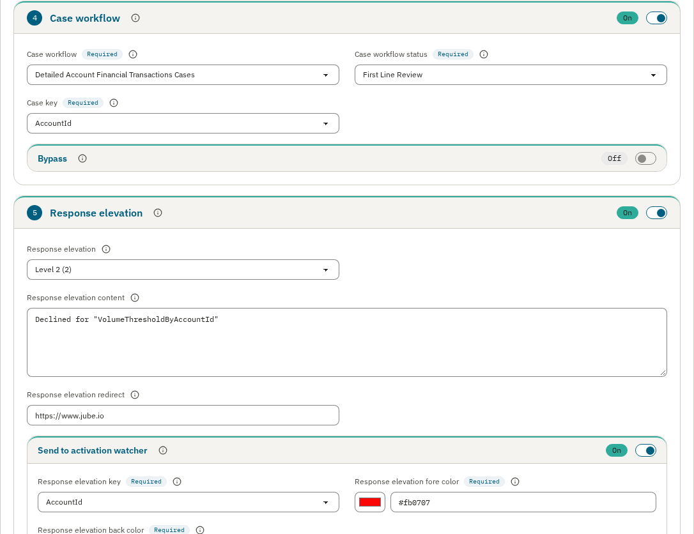

# Creating Case Entry With Defer Activation Rule

When a case is created as a consequence of an Activation Rule match it would be placed into the case workflow, and assuming it is not already open pending closure, it will be in an open status. In the event that the case record is already in existence, and not in closed status, a case record will not be created.

Cases can be newly created either as an Open status, or a Suspend Bypass status.

The Suspend Bypass status is used to create a case which is not intended to receive attention and only exists to ensure that no other case can be created for a case key and case key value in the cases workflow. An example of where a Suspend Bypass might be useful is in an audit use case, where a sample of a very large population is adequate, as it may not be necessary to review each customer or client. By using a Suspend Bypass status, on case creation, a random sample of case creation can be allocated to Open, with the remainder being allocated to Suspend Bypass. The Suspend Bypass will denote that the case has been sampled out and disallow any other case being created until a closed status is set for that case record.

Suspend Bypass status is subject to the diary automation functionality, and in concert with a diary date, will automatically lapse, moving from a Suspend Bypass status to a Closed status on a given date and time.

## Where it lives

The bypass is configured in the Activation Rule that creates the case, as described in [Creating Case Entry With Activation Rule](../CreatingCaseEntryWithActivationRule/index.html). Navigate through the menu to Models, open the model, then the Activation Rules hub card, and open the Activation Rule. In the group Case Workflow, with Cases switched on, the Enable bypass switch is presented, and upon that being switched on the remaining fields of the bypass are presented in turn.

SHOT id=case-entry-defer-bypass-switch
     route=/models
     steps=open-default-model, open-hub:Activation Rules, open-row:VolumeThresholdByAccountId, scroll-to:Case workflow
     frame=record
     state=the VolumeThresholdByAccountId Activation Rule of the default model scrolled to the Case workflow group of its form, switched on, with the Case workflow, the Case workflow status of First Line Review and the Case key of AccountId chosen, and the Bypass switch beneath them switched off, above the Response elevation group
     conveys=the bypass is a switch within the Case workflow group of the Activation Rule that creates the case, and is off until wanted
     alt=The Case workflow group of an Activation Rule record showing the Case Workflow, a status of First Line Review and a Case key of AccountId, with the Bypass switch beneath them switched off



## Fields

| Value                   | Description                                                                                                                                                                             | Example |
|-------------------------|-----------------------------------------------------------------------------------------------------------------------------------------------------------------------------------------|---------|
| Enable bypass           | Whether a sample of the cases created by this Activation Rule are set to a Suspend Bypass status rather than Open.                                                                      | True    |
| Bypass suspend sample   | A slider from 0 to 1, being the share of case creations set to a Suspend Bypass status. It is evaluated against a random number on each case creation.                                  | 0.5     |
| Bypass suspend interval | The unit of the Bypass suspend value: Minutes, Hours, Days or Months. Hours is the default.                                                                                             | Days    |
| Bypass suspend value    | The number of the intervals after which a case in a Suspend Bypass status moves to a Closed status. It must not be negative.                                                            | 30      |

The case creation closed status is controlled by the Bypass suspend sample, which is evaluated against a random number on case creation. For example, suppose the Bypass suspend sample is set at 0.5, which is to say 50%. This would have the effect of sending half of the cases to an Open status and half the cases to a Suspend Bypass status.

The Bypass suspend interval and Bypass suspend value together set the diary date of a case created in a Suspend Bypass status, which is important so that the case management system knows when to move any Suspend Bypass status to a closed status (which will allow for the reopening of a case). A case created in an Open status is given a diary date of the time of its creation.

## Example

Open the Activation Rule that creates the case, and in the Case Workflow group complete the bypass as follows:

| Value                   | Example |
|-------------------------|---------|
| Enable bypass           | True    |
| Bypass suspend sample   | 0.5     |
| Bypass suspend interval | Days    |
| Bypass suspend value    | 30      |

Upon the change having been approved and taken up by the engine, repeat the HTTP POST to endpoint [https://localhost:5001/api/invoke/EntityAnalysisModel/90c425fd-101a-420b-91d1-cb7a24a969cc](https://localhost:5001/api/invoke/EntityAnalysisModel/90c425fd-101a-420b-91d1-cb7a24a969cc), noting a change of AccountId to Test2. Repeat, changing AccountId to Test3, Test4, Test5, and so on.

Note the createCase element in the response by way of indication of Bypass having taken place:

```json
{
  "createCase": {
    "caseWorkflowGuid": "957c6ab0-ef2b-4d06-a7a5-e923762dd917",
    "caseWorkflowStatusGuid": "faf5c83a-5c3e-4a62-b224-aea9e2e1efa6",
    "caseKeyValue": "Test20",
    "caseKey": "AccountId",
    "suspendBypass": false,
    "suspendBypassDate": "2026-02-20T09:19:46.3793539+02:00"
  }
}
```

In the above example, suspendBypass is false, which is to say that there is no Bypass, henceforth the case will be in an Open status. Where suspendBypass is true, the suspendBypassDate is the date and time at which the case will move to a Closed status.

Given the Bypass Sampling is at 50%, it would be expected that roughly half of the newly created cases will be allocated an Open status, and half of the newly created cases will be allocated a Suspend Bypass status. This can be observed in the Cases page by comparing a [Case Workflow Filter](../CreatingCaseWorkflowFilter/index.html) targeting a Closed Status of Open with one targeting a Closed Status of Suspend bypass.

Given that it is common that filters target only open cases, notwithstanding the existence of a case record (which has the effect of disallowing further creation) it is practically removed from view until such time as the case is moved automatically to a Closed status.

## Validation

The fields of the bypass are validated in the server upon saving the Activation Rule, where Cases and Enable bypass are both on. The Activation Rule is refused where the Bypass suspend sample is not from 0 to 1, the Bypass suspend interval is not one of Minutes, Hours, Days or Months, or the Bypass suspend value is negative, the messages being as follows:

| Condition                                        | Message                                                           |
|--------------------------------------------------|-------------------------------------------------------------------|
| Bypass suspend sample not from 0 to 1            | The bypass suspend sample must be between 0 and 1.                |
| Bypass suspend interval not one of the four      | The bypass suspend interval must be Minutes, Hours, Days or Months. |
| Bypass suspend value negative                    | The bypass suspend value cannot be negative.                      |

It follows from the range of the sample that a Bypass suspend sample of 0 sends every case to an Open status, being the same as Enable bypass off, and a sample of 1 sends every case to a Suspend Bypass status. A Bypass suspend value of 0 is accepted, and gives a case in a Suspend Bypass status a diary date of the moment of its creation, such that it is closed upon the diary next being processed.

## Permissions and security

Configuring the bypass requires permission 17, Read Write Activation Rule. The allocation of a case to Open or Suspend Bypass is made by the engine upon the transaction being processed. A case in a Suspend Bypass status is a case as any other for the purposes of isolation, being available only to the roles allocated to both its Case Workflow and its Cases Workflow Status, as described in [Case Management Security Policy](../SecurityPolicy/index.html).
