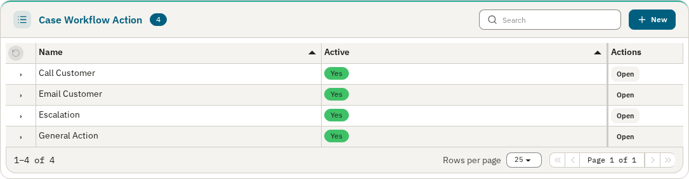
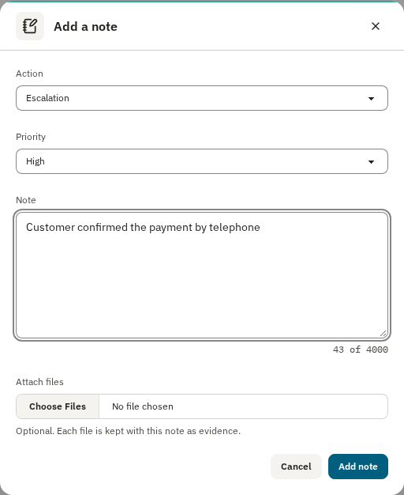

# Case Workflow Action

Case Notes provide a means to annotate cases and provide a history of the unstructured actions taken. Case notes by their nature are unstructured and cannot be reported upon. There are two structured data items that can be attached to a case note:

* Priority and;
* Action Codes which are configured rolling up to the Cases Workflow.

In addition to providing typing and structure to unstructured notes, Action Codes can also drive Notifications and integrations \ automation.

## Where it lives

Navigate through the menu to Models, open the model, then the Cases Workflows hub card, open the Case Workflow, then the Action hub card. Creating, changing and deleting a Cases Workflow Action follows the common manner described in [Child Objects](../../../Navigation/ChildObjects/index.html), with the exception that the children of a Case Workflow are not subject to approval, and a change takes effect upon being saved.

Upon an update, a Cases Workflow Action remains with its Case Workflow, and cannot be moved to another.

SHOT id=case-workflow-action-list
     route=/models
     steps=open-default-model, open-hub:Cases Workflows, open-first-row, open-hub:Action
     frame=section:Case Workflow Action
     state=the Action list of the demonstration Case Workflow, showing its four Cases Workflow Actions, Call Customer, Email Customer, Escalation and General Action, each on a row with its Active state and an Open action
     conveys=the actions an analyst may record against a note are a short list kept under the Case Workflow
     alt=The Action list of the demonstration Case Workflow with four actions, Call Customer, Email Customer, Escalation and General Action, each on a row with its Active state

## Fields

Actions are extremely basic in comparison to other child elements available to the case workflow, really only taking a generic parameter of Name and the common parameters to drive HTTP Endpoints and Notifications:

| Value            | Description                                                                                                                                                              | Example    |
|------------------|--------------------------------------------------------------------------------------------------------------------------------------------------------------------------|------------|
| Name             | The name of the action, shown to the end user when adding a note. Required, limited to 256 characters, and unique within the Case Workflow without regard to case.       | Escalation |
| Active           | Whether the action is available for selection when adding a note.                                                                                                        | True       |
| Locked           | Whether the action is protected from change.                                                                                                                             | False      |
| SQL for the case | Optional. A single SELECT run for the case, from the rows of which the Notification and the HTTP Endpoint are then drawn.                                                |            |

The groups for the HTTP endpoint and the Notification, and the SQL for the case, are described in [Creating Automation](../CreatingAutomation/index.html). For an action they are dispatched upon the creation of a note by the end user alongside the action.

## Validation

Validation takes place in the server. A Cases Workflow Action is refused where:

* The Name is empty, longer than 256 characters, or already in use within the Case Workflow, without regard to case.
* The HTTP endpoint is switched on, and the Http endpoint is empty, not well formed or longer than 2,048 characters, or the Http endpoint type is neither POST nor GET.
* The Notification is switched on, and the Notification destination is empty, or the Notification type is neither Email nor SMS.
* The Notification destination or Notification subject is longer than 1,024 characters, or the Notification body is longer than 100,000 characters.
* The SQL for the case is not acceptable, as described in [Creating Automation](../CreatingAutomation/index.html).
* The parent Case Workflow does not exist within the tenant.

The messages returned are as follows, every problem being reported at once against the field to which it belongs:

| Condition                                                   | Message                                                                                                                                                              |
|-------------------------------------------------------------|----------------------------------------------------------------------------------------------------------------------------------------------------------------------|
| Name empty                                                  | The name is required.                                                                                                                                                |
| Name longer than 256 characters                             | The name cannot exceed 256 characters.                                                                                                                               |
| Name already in use in the Case Workflow                    | This name already exists.                                                                                                                                            |
| HTTP endpoint on, Http endpoint empty                       | A webhook URL is required when the HTTP endpoint is enabled.                                                                                                         |
| Http endpoint not well formed                               | The HTTP endpoint must be an absolute http or https URL whose scheme, host and port are written out literally, with tokens only in the path and query.              |
| Http endpoint longer than 2,048 characters                  | The HttpEndpoint must be 2048 characters or fewer.                                                                                                                   |
| Http endpoint type neither POST nor GET                     | A valid HTTP method is required when the HTTP endpoint is enabled.                                                                                                   |
| Notification on, Notification destination empty             | A notification destination is required when notification is enabled.                                                                                                 |
| Notification type neither Email nor SMS                     | A valid notification type is required when notification is enabled.                                                                                                  |
| Notification destination or subject longer than 1,024 characters | The NotificationDestination must be 1024 characters or fewer. \ The NotificationSubject must be 1024 characters or fewer.                                       |
| Notification body longer than 100,000 characters            | The NotificationBody must be 100000 characters or fewer.                                                                                                             |
| Parent Case Workflow missing                                | The referenced case workflow was not found in your tenant.                                                                                                           |

For a new action every switch is off, Active included, and upon the HTTP endpoint or the Notification being switched on the Http endpoint type is POST and the Notification type is Email until chosen otherwise.

## Example

Create a Cases Workflow Action with the Name Escalation and Active switched on, then navigate to a case.

To allocate the newly created action, select the Note tile in the Decide pane, which presents the dialog Add a note. The dialog takes the Note itself, limited to 4,000 characters, alongside two selections: Action, containing the newly created Cases Workflow Action, and Priority. Having typed the note and set the values, Add note creates the note, and confirmation is returned as Note added.

The note is thereafter presented in the Notes and research section of the case page, with the Action and Priority recorded alongside, as described in [Working Case Note](../WorkingCaseNote/index.html).

SHOT id=case-workflow-action-note-dialog
     route=/cases
     steps=open-demo-case, open-decide-tile:Note, fill:Note=Customer confirmed the payment by telephone, select:Action=Escalation
     frame=dialog
     state=the Add a note dialog of a demonstration case with a note typed, the Action selection showing Escalation and the Priority selection beside it
     conveys=an action code is chosen as a note is written, giving structure to an otherwise unstructured note
     alt=The Add a note dialog in the case page with the text of a note, an Action selection set to Escalation and a Priority selection

## Permissions and security

Creating, changing and deleting a Cases Workflow Action, and the allocation of roles to it, requires permission 22, Read Write Cases Workflow Action. Writing or changing the SQL for the case requires in addition permission 67, Author Case Workflow SQL. The active actions are also available to a user holding permission 1, Read Write Case, for the purposes of adding a note.

An action is offered in the case page only to the roles allocated to it in the Roles panel, and the notes recorded against an action are likewise isolated by that allocation, which allows for the more general hiding of notes based on the actions available to a given role, as described in [Case Management Security Policy](../SecurityPolicy/index.html).

The HTTP Endpoint of an action is subject to the [Outbound Host Policy](../../Administration/OutboundHostPolicy/index.html), whether it is drawn from the stored payload or from the SQL for the case.
