# Case Workflow Action

Case Notes provide a means to annotate cases and provide a history of the unstructured actions taken. Case notes by
their nature are unstructured and cannot be reported upon. There are two structured data items that can be attached to a
case note:

* Priority (High, Medium and Low) and;
* Action Codes which are configured rolling up to the Cases Workflow.

In addition to providing typing and structure to unstructured notes, Action Codes can also drive Notifications and
integrations \ automation.

To create an Action Code, begin by navigating to Models >> Cases Workflows >> Cases Workflow Action:

<!-- TODO(screenshot): file=case-workflow-config-case-workflow-action-01.png route=/models state="Models page, Case Workflows tab, case-workflow-action screen replacing the Razor-era CasesWorkflowsActionTopOfTree.png" -->
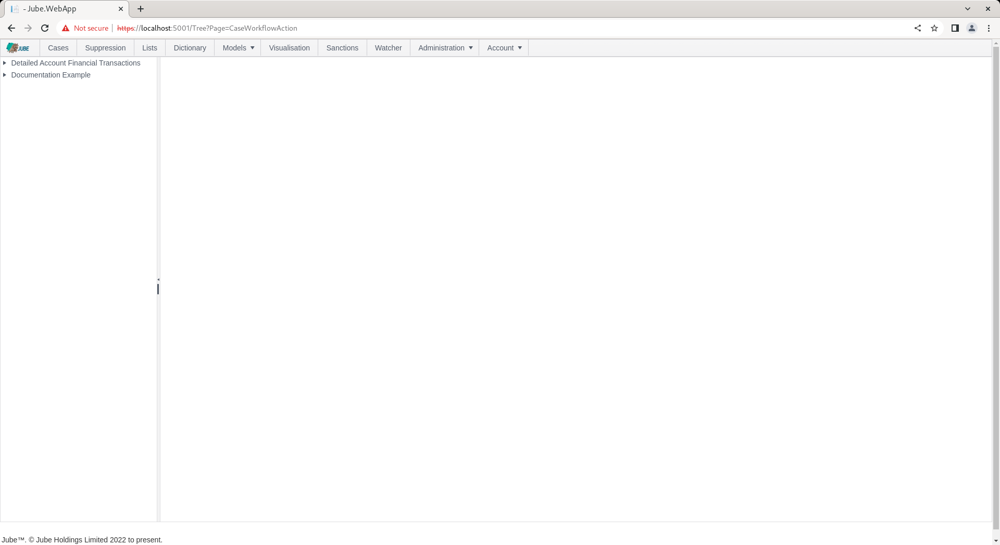

Expand the first level of the tree and click on the model to start a new entry:

<!-- TODO(screenshot): file=case-workflow-config-case-workflow-action-02.png route=/models state="Models page, Case Workflows tab, case-workflow-action screen replacing the Razor-era EmptyCasesWorkflowAction.png" -->
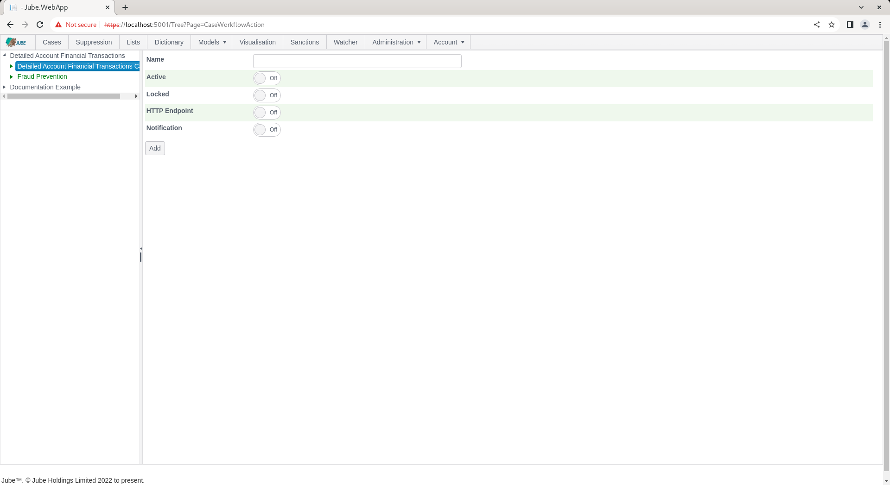

Actions are extremely basic in comparison to other child elements available to the case workflow, really only taking a
generic parameter of Name and the common parameters to drive HTTP Endpoints of Notifications.

Complete the form as follows:

<!-- TODO(screenshot): file=case-workflow-config-case-workflow-action-03.png route=/models state="Models page, Case Workflows tab, case-workflow-action screen replacing the Razor-era ExampleValuesCasesWorkflowAction.png" -->
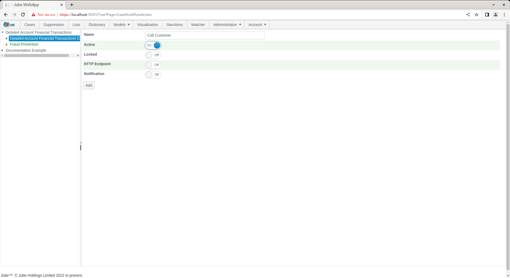

Scroll down and click the Add button to create a version of the Cases Workflow Action:

<!-- TODO(screenshot): file=case-workflow-config-case-workflow-action-04.png route=/models state="Models page, Case Workflows tab, case-workflow-action screen replacing the Razor-era VersionOfCasesWorkflowAction.png" -->
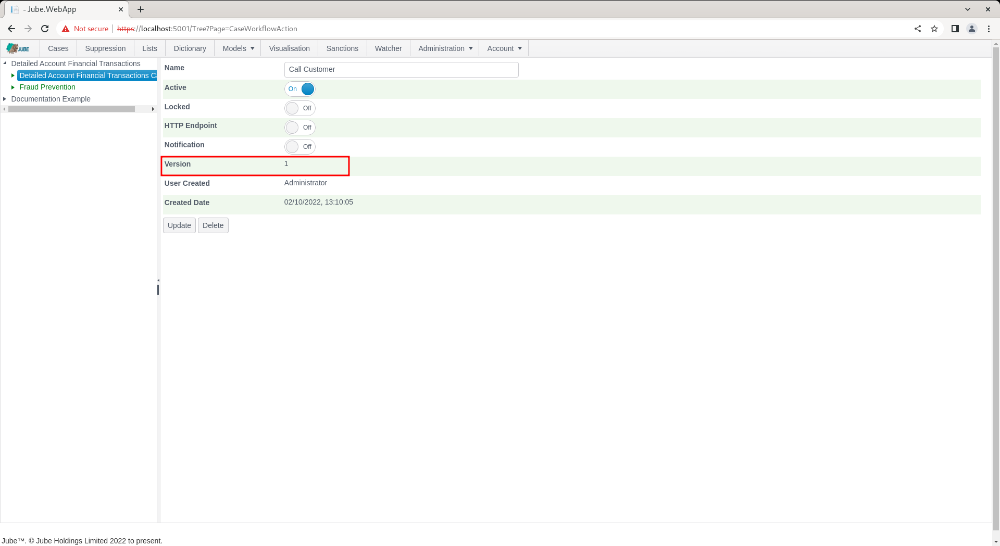

Navigate to a case:

<!-- TODO(screenshot): file=case-workflow-config-case-workflow-action-05.png route=/models state="Models page, Case Workflows tab, case-workflow-action screen replacing the Razor-era DefaultCasePage.png" -->
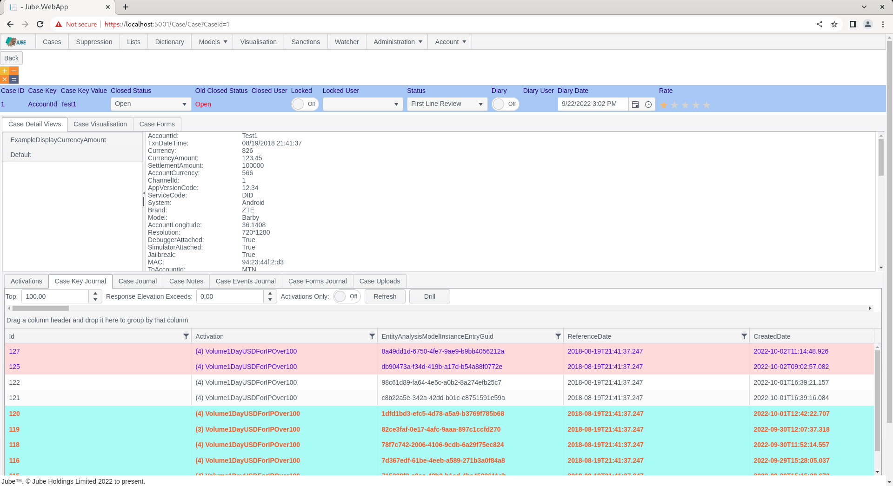

To allocate the newly created Action, locate the Case Notes tab:

<!-- TODO(screenshot): file=case-workflow-config-case-workflow-action-06.png route=/models state="Models page, Case Workflows tab, case-workflow-action screen replacing the Razor-era LocationOfCaseNotesTab.png" -->
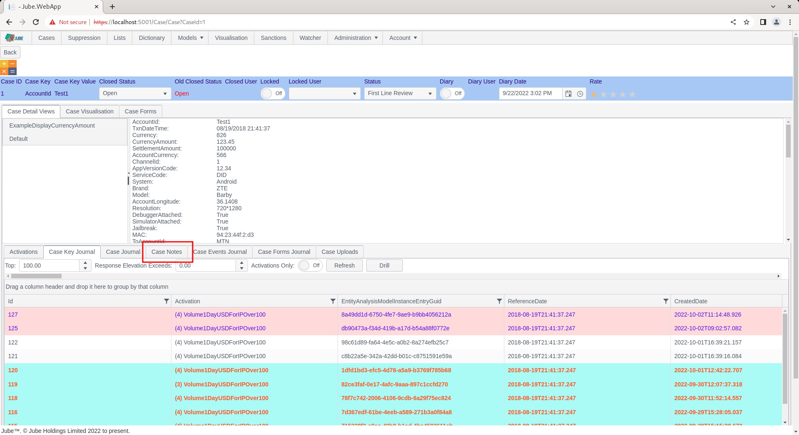

Click on the Case Notes tab to expose recent notes, and the ability to create a new entry:

<!-- TODO(screenshot): file=case-workflow-config-case-workflow-action-07.png route=/models state="Models page, Case Workflows tab, case-workflow-action screen replacing the Razor-era ExposedCaseNotes.png" -->
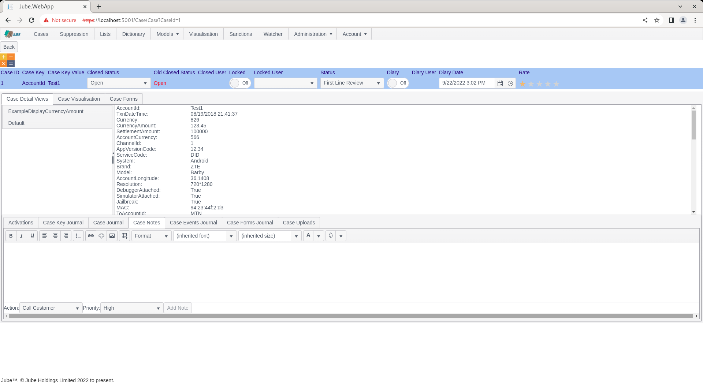

Locate the text editor section to create a new Note:

<!-- TODO(screenshot): file=case-workflow-config-case-workflow-action-08.png route=/models state="Models page, Case Workflows tab, case-workflow-action screen replacing the Razor-era LocationOfTextEditor.png" -->
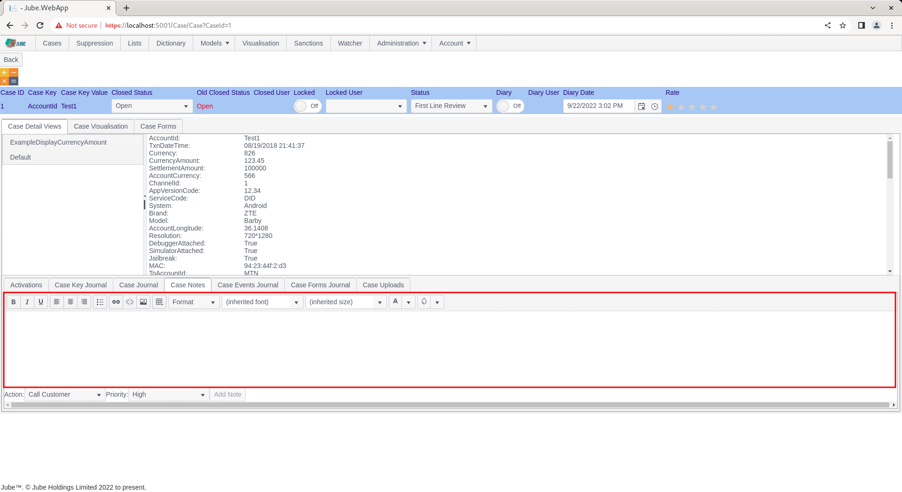

Type into the text editor as required:

<!-- TODO(screenshot): file=case-workflow-config-case-workflow-action-09.png route=/models state="Models page, Case Workflows tab, case-workflow-action screen replacing the Razor-era ExampleNote.png" -->
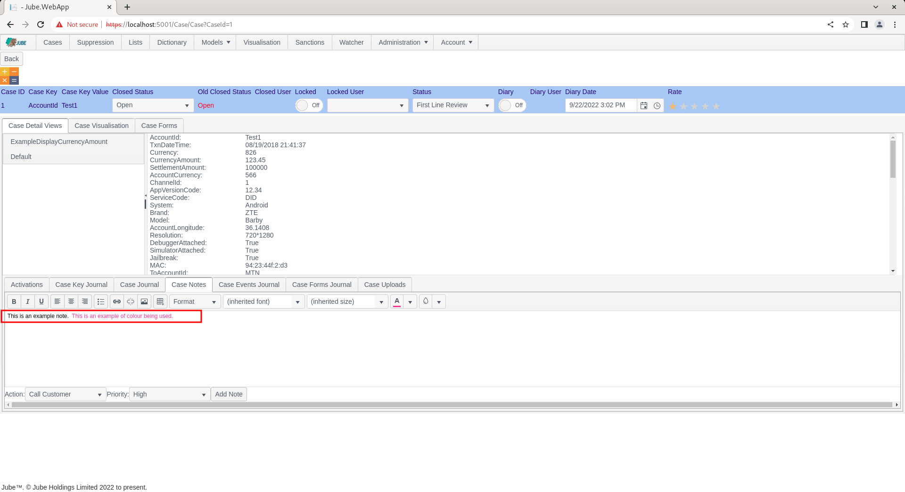

On typing, the Add Note button will be enabled:

<!-- TODO(screenshot): file=case-workflow-config-case-workflow-action-10.png route=/models state="Models page, Case Workflows tab, case-workflow-action screen replacing the Razor-era LocationOfAddNote.png" -->
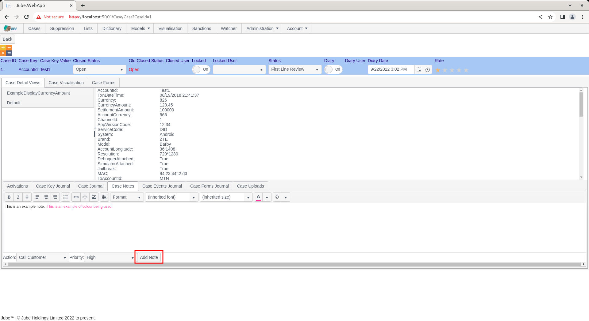

Alongside the add button there is a drop down containing the newly created Cases Workflows Action:

<!-- TODO(screenshot): file=case-workflow-config-case-workflow-action-11.png route=/models state="Models page, Case Workflows tab, case-workflow-action screen replacing the Razor-era ActionDropDown.png" -->
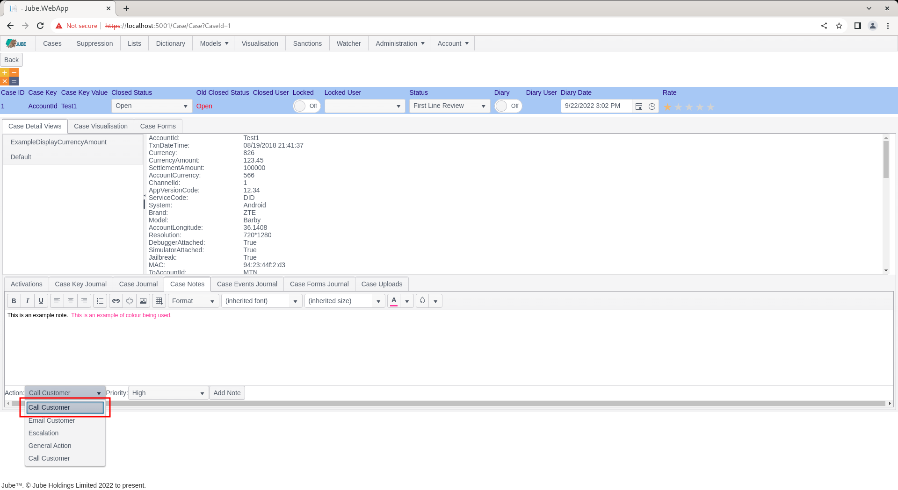

Having set the values, click on the Add Note button to create the note:

<!-- TODO(screenshot): file=case-workflow-config-case-workflow-action-12.png route=/models state="Models page, Case Workflows tab, case-workflow-action screen replacing the Razor-era NoteAdded.png" -->
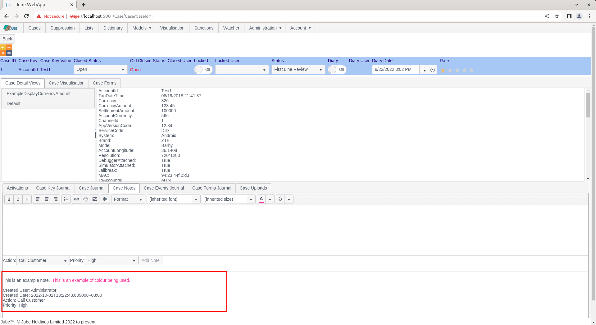

Notice how the note had been added and the Action and Priority recorded alongside.

<!-- TODO(docs): Verify Action fields (HTTP endpoint, notification, SQL) against CaseWorkflowActionDto; owner to confirm which actions are exposed on the case page. -->
<!-- TODO(docs): Document that an update keeps the Case Workflow, import id and inherited id of an action. -->
<!-- TODO(docs): Outbound HTTP calls of an action in SQL mode go through the outbound host policy; in payload (legacy) mode they do not: see SHARED-TODO BUG. -->
