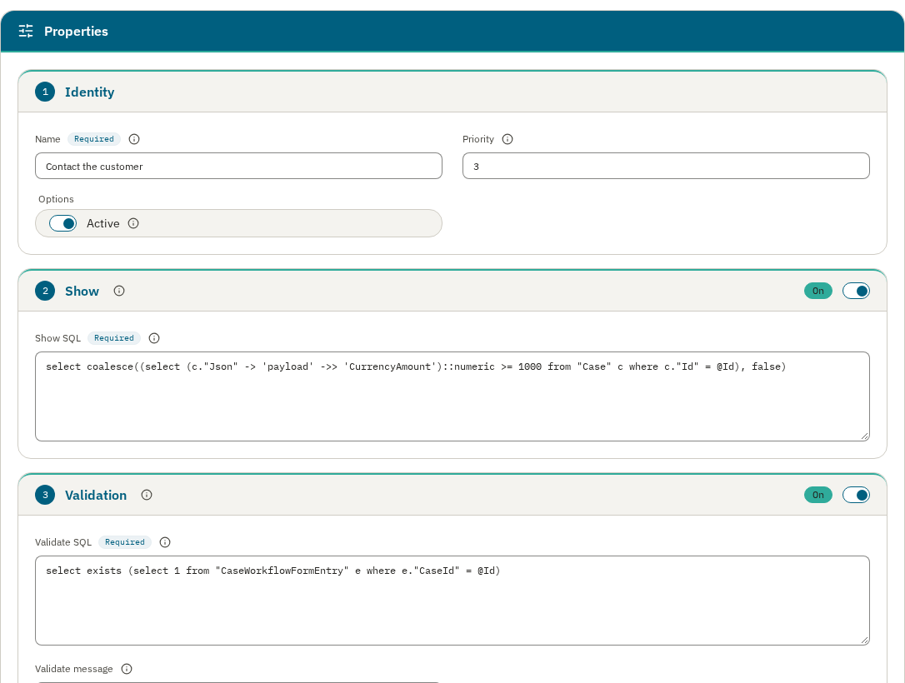
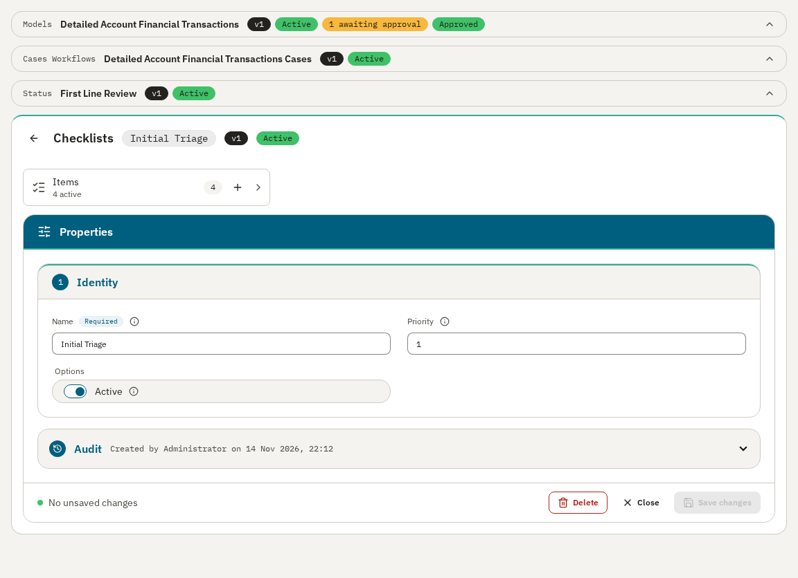

# Creating Case Workflow Checklist

An investigation is rarely a single decision, rather it is a series of steps that a procedure requires to have been taken before a case may be moved on: the transactions reviewed, a note recorded, the customer contacted, a second person having looked. A checklist exists for the purposes of writing that procedure down against a Cases Workflow Status, such that every case arriving in the status is presented with the steps, and such that the case cannot leave the status, nor be closed, until each step showing has been ticked.

A checklist answers three questions for the administrator configuring it: which steps apply to a case in this status, what must be true of the case before a step can be claimed as done, and how long the step is allowed to take. This page describes the configuration, and [Working Case Checklists](../WorkingCaseChecklists/index.html) describes what the analyst sees as a result.

The terms used throughout are as follows:

| Term                 | Meaning                                                                                                                                                               |
|----------------------|-----------------------------------------------------------------------------------------------------------------------------------------------------------------------|
| Checklist            | A named group of items belonging to one Cases Workflow Status. A status may carry several checklists.                                                                 |
| Item                 | One step of a checklist, presented on the case as a box to be ticked.                                                                                                 |
| Show condition       | An optional SQL statement deciding whether the item applies to a given case. In its absence the item applies to every case in the status.                            |
| Validation condition | An optional SQL statement deciding whether the item may be ticked for a given case. In its absence the item can always be ticked.                                    |
| Service level        | An optional number of minutes allowed between the item being shown on a case and its being ticked, abbreviated to SLA in the user interface.                         |
| Gate                 | The refusal to move, escalate or close a case while any item showing for its status is unticked.                                                                      |

## Where it lives

Checklists are children of a Cases Workflow Status, and items are children of a checklist. Navigate through the menu to Models, open the model, then the Cases Workflows hub card, open the Case Workflow, then the Status hub card, and open the status. The status presents a Checklists hub card, and upon opening a checklist an Items hub card is presented in turn.

Creating, changing and deleting a checklist or an item follows the common manner described in [Child Objects](../../../Navigation/ChildObjects/index.html), with the exception that the children of a Case Workflow are not subject to approval, and a change takes effect upon being saved. The list of checklists shows the Name, Priority and Active columns, and the list of items shows Name, Priority, SLA minutes and Active.

SHOT id=case-workflow-checklist-item-record
     route=/models
     steps=open-default-model, open-hub:Cases Workflows, open-first-row, open-hub:Status, open-row:First Line Review, open-hub:Checklists, open-row:Initial Triage, open-hub:Items, open-row:Contact the customer
     frame=record
     state=the demonstration item Contact the customer of the Initial Triage checklist opened, showing the Identity group with Name, Priority and Active, the Show card switched on with its Show SQL, the Validation card switched on with its Validate SQL and Validate message, and the Service Level group with 240 minutes
     conveys=an item is a name and a priority, with two optional conditions written in SQL and an optional service level
     alt=A checklist item record with its name and priority, a Show card containing SQL, a Validation card containing SQL and a message, and a Service Level group



## How a checklist behaves

It is helpful to understand the life of an item on a case before configuring one, as the fields follow from it.

Upon a case being read while in a status, the active items of the active checklists of that status are brought up to date for the case. An item having no show condition is shown. An item having a show condition is shown where the condition returns true, and is not shown otherwise. The moment an item is first shown on a case is recorded, and where the item has a service level, the time by which it falls due is set at that moment as the time shown plus the minutes allowed.

Thereafter, each time the checklist of the case is brought up to date:

* An item that was not shown is shown if its show condition has come to pass.
* An item that is shown and unticked is hidden again if its show condition no longer passes, on the basis that the step no longer applies to the case.
* An item that has been ticked is never hidden, whatever its show condition returns later, as the record that the step was taken must not disappear.
* An item that has been deleted, made inactive, or whose checklist has been deleted or made inactive, is hidden on the cases where it is still unticked.

An item hidden and then shown again does not have its service level restarted: the time due remains that set when the item was first shown.

The name and priority of an item, the name of its checklist, and the time due, are copied to the case when the item is first shown there. It follows that renaming an item, reordering it or altering its service level affects the cases on which the item is shown for the first time afterwards, and does not rewrite the items already on cases.

A checklist is brought up to date when it is read (by the case page, by Ask Jooby or through the API) and whenever the gate is evaluated. To avoid running the show conditions needlessly, a read brings the checklist up to date only where something has happened to the case since the last occasion (any event on the case other than the checklist's own, or a further activation attaching to the case), or where the last occasion was more than 60 seconds ago, that period being the Environment Variable CaseChecklistReconcileMaxAgeSeconds. The gate always brings the checklist up to date beforehand, henceforth a move is never refused or allowed on stale information.

## Fields of a checklist

| Value    | Description                                                                                                                                                                                                             | Example        |
|----------|-------------------------------------------------------------------------------------------------------------------------------------------------------------------------------------------------------------------------|----------------|
| Name     | The name of the checklist, shown to the analyst as the heading above its items. Required, limited to 100 characters.                                                                                                    | Initial Triage |
| Priority | The order of the checklist among the checklists of the status. A lower number is presented first, and where two checklists share a number they are presented in order of name. Left blank, it is stored as 0.          | 1              |
| Active   | Whether the checklist is carried by the status. The items of an inactive checklist are not shown on cases.                                                                                                              | True           |

SHOT id=case-workflow-checklist-record
     route=/models
     steps=open-default-model, open-hub:Cases Workflows, open-first-row, open-hub:Status, open-row:First Line Review, open-hub:Checklists, open-row:Initial Triage
     frame=page
     state=the Initial Triage checklist of the First Line Review status opened beneath the collapsed steps of the model, the Case Workflow and the status, showing its Items card with 4 active and its Properties form with the name, a Priority of 1 and the Active switch switched on
     conveys=a checklist is a small record under a status, whose substance is the items kept beneath it
     alt=The Initial Triage checklist record beneath the collapsed steps of its model, Case Workflow and status, showing an Items card and a Properties form with the name, priority and Active switch



## Fields of an item

The fields are arranged in the groups Identity, Show, Validation and Service Level, with a collapsed Audit group showing who created and last changed the item, when, and its version. Show and Validation are each presented as a card with a switch, and the fields dependent upon the switch are presented only once it is on. For a new item, as for a new checklist, Active is off, and it follows that neither is shown on any case until Active has been switched on and saved. Both switches of a new item are off also, the Priority is 0 and there is no service level, which is to say that a new item left as it is, once active, is shown on every case in the status and can always be ticked.

| Value             | Description                                                                                                                                                                                                                                             | Example                                                      |
|-------------------|---------------------------------------------------------------------------------------------------------------------------------------------------------------------------------------------------------------------------------------------------------|--------------------------------------------------------------|
| Name              | The name of the item, shown to the analyst beside the box to be ticked. Required, limited to 100 characters.                                                                                                                                            | Record an investigation note                                 |
| Priority          | The order of the item within its checklist. A lower number is presented first, and where two items share a number they are presented in order of name. Zero or more, and 0 for a new item.                                                             | 2                                                            |
| Active            | Whether the item is carried by its checklist. An inactive item is not shown on cases.                                                                                                                                                                   | True                                                         |
| Enable show       | Whether the show condition is evaluated. When off, the item is always shown on a case in the status, and any Show SQL is retained yet not run, such that it can be switched back on.                                                                   | False                                                        |
| Show SQL          | The show condition. Required when Enable show is on, limited to 8000 characters.                                                                                                                                                                        | See the example below                                        |
| Enable validation | Whether the validation condition is run upon the item being ticked. When off, the item can always be ticked, and any Validate SQL and Validate message are retained yet not used.                                                                      | True                                                         |
| Validate SQL      | The validation condition. Required when Enable validation is on, limited to 8000 characters.                                                                                                                                                            | See the example below                                        |
| Validate message  | The text shown to the analyst beneath the item when a tick is refused by the validation condition. Optional, limited to 500 characters. Where blank, the message is The condition for ticking this item is not met.                                    | Add at least one note to the case before ticking this item. |
| Sla minutes       | The service level: the minutes allowed from the item being shown on a case to its being ticked. A whole number greater than zero, or blank for no service level.                                                                                       | 60                                                           |

## Show SQL and Validate SQL

Both conditions are written in the same manner and are subject to the same rules. A condition is a single SELECT statement returning exactly one row of exactly one column, that column being a boolean. The condition passes only where that value is true. A statement returning false, null, no rows, more than one row, more than one column or a value that is not a boolean does not pass.

### Tokens

Two tokens are available, and they are bound to the statement as parameters rather than being substituted into its text, so the value of a case key can never alter the statement:

| Token         | Value                                           |
|---------------|-------------------------------------------------|
| @Id           | The identifier of the case, which is to say the Case Id. |
| @CaseKeyValue | The Case Key Value of the case, as text.        |

There are no other tokens. A statement using any other name prefixed with @ is refused upon saving, the message being as follows, where Amount stands for the name used:

```text
The SQL uses the parameter @Amount, which is not available. Use @Id or @CaseKeyValue.
```

It is a simple matter of joining from the case to arrive at anything else: the payload of the event \ transaction that created the case is the `Json` column of the `Case` table, the notes are in `CaseNote`, and the submitted forms are in `CaseWorkflowFormEntry`, as the examples below show.

### How a condition is run

A condition is run read only, against the rows of the tenant alone, and against the reporting connection where the ReportConnectionString Environment Variable is set. It is allowed three seconds, after which it is abandoned.

The consequence of a condition failing to run (an error in the database, or the three seconds being exceeded) differs between the two, in each case erring on the side of leaving the case as it stands:

* A show condition that cannot be run leaves the item as it was for that case: an item not yet shown remains not shown, and an item already shown remains shown. A warning is written to the log of the server.
* A validation condition that cannot be run refuses the tick, in the same manner as a condition returning false.

Keep in mind that a show condition is run for every item of the status each time the checklist of a case is brought up to date. Conditions are best kept to a lookup on the Case Id or the Case Key Value, both of which are indexed.

### Checks made upon saving

Upon a checklist item being saved with SQL in either condition, the statement is checked before anything is stored, and the item is refused with the message The SQL was rejected, followed by the finding and, where known, the line and column, in the following circumstances:

* The statement is not a single SELECT, or it cannot be parsed.
* The statement refers to a table or column that does not exist.
* The statement refers to a table that the roles of the author do not permit them to query.

## The item test facility

A saved item can be tried against a real case without ticking anything, for the purposes of confirming that a condition returns what was intended before analysts meet it. The facility is an operation of the API, and is available to Ask Jooby as the operation CaseWorkflowChecklistItemTest:

```http
POST /api/CaseWorkflowChecklistItem/Test
Content-Type: application/json

{
  "id": 3,
  "conditionId": 2,
  "caseId": 1234
}
```

| Value       | Description                                                                                                                                     |
|-------------|-------------------------------------------------------------------------------------------------------------------------------------------------|
| id          | The identifier of the saved checklist item.                                                                                                     |
| conditionId | The condition to try: 1 for the Show SQL, 2 for the Validate SQL. Any other value is refused with The condition must be 1 (show) or 2 (validate). |
| caseId      | The Case Id supplying @Id and @CaseKeyValue. Where 0, or where the case does not exist, @CaseKeyValue is empty.                                |

The response states whether the condition passed, and if not, why:

```json
{
  "passed": false,
  "code": "sql",
  "message": "Add at least one note to the case before ticking this item.",
  "milliseconds": 4
}
```

| Value        | Description                                                                                                                                                                                                                                                       |
|--------------|-------------------------------------------------------------------------------------------------------------------------------------------------------------------------------------------------------------------------------------------------------------------|
| passed       | True where the SQL ran and returned true. A condition having no SQL is reported as passed.                                                                                                                                                                       |
| code         | Absent where passed. Otherwise `sql`, where the SQL ran and did not return true, or `sqlFailed`, where the SQL could not be run or exceeded three seconds.                                                                                                      |
| message      | For `sqlFailed`, The SQL could not be run. For `sql` on the validation condition, the Validate message of the item where it has one. Otherwise The SQL did not return true.                                                                                     |
| milliseconds | The time the condition took.                                                                                                                                                                                                                                      |

The test runs the SQL as saved, whether or not the switch of the condition is on, which allows a condition to be written, saved with its switch off, tried, and only then switched on. Nothing is recorded against the case.

TODO(verify): the item form has no control to run the test facility; it is reachable only as POST /api/CaseWorkflowChecklistItem/Test and as the Ask Jooby operation. Owner to decide whether a Run control beside Show SQL and Validate SQL, in the manner of the SQL for the case editor, is to be added, at which point this section should describe it.

## Validation

A checklist is refused where:

| Rule                                                    | Message                                    |
|---------------------------------------------------------|--------------------------------------------|
| The status is missing.                                  | The status is required.                    |
| The status does not exist.                              | The status was not found.                  |
| The Name is blank.                                      | A name is required.                        |
| The Name is longer than 100 characters.                 | The name must be 100 characters or fewer.  |
| The Priority is less than zero.                         | The priority must be zero or greater.      |

An item is refused where:

| Rule                                                        | Message                                                                               |
|-------------------------------------------------------------|---------------------------------------------------------------------------------------|
| The checklist is missing.                                   | The checklist is required.                                                            |
| The checklist does not exist.                               | The checklist was not found.                                                          |
| The Name is blank.                                          | A name is required.                                                                   |
| The Name is longer than 100 characters.                     | The name must be 100 characters or fewer.                                             |
| The Priority is less than zero.                             | The priority must be zero or more.                                                    |
| Sla minutes is given and is not greater than zero.          | The SLA must be a whole number of minutes greater than zero, or blank.                |
| The Validate message is longer than 500 characters.         | The validation message must be 500 characters or fewer.                               |
| Enable show is on and Show SQL is blank.                    | Enter the show SQL, or switch the show condition off.                                 |
| Enable validation is on and Validate SQL is blank.          | Enter the validation SQL, or switch the validation condition off.                     |
| Either SQL is longer than 8000 characters.                  | The SQL must be 8000 characters or fewer.                                             |
| Either SQL uses a token other than @Id or @CaseKeyValue.    | The SQL uses the parameter @Name, which is not available. Use @Id or @CaseKeyValue.   |
| Either SQL fails the checks made upon saving.               | The SQL was rejected, followed by the finding.                                        |

## Example

A clean installation carries demonstration checklists on the Case Workflow named Detailed Account Financial Transactions Cases, which serve as the worked example. Three statuses have a checklist each:

| Status            | Checklist           | Item                                 | Priority | Show condition | Validation condition | Sla minutes |
|-------------------|---------------------|--------------------------------------|----------|----------------|----------------------|-------------|
| First Line Review | Initial Triage      | Review the triggering transactions   | 1        | None           | None                 |             |
| First Line Review | Initial Triage      | Record an investigation note         | 2        | None           | Yes                  | 60          |
| First Line Review | Initial Triage      | Contact the customer                 | 3        | Yes            | Yes                  | 240         |
| First Line Review | Initial Triage      | Check related cases on the case key  | 4        | Yes            | None                 | 120         |
| Supervisor Review | Supervisor Sign-off | Second-person review                 | 1        | None           | Yes                  | 120         |
| Fraudulent        | Fraud Confirmation  | Record the finding                   | 1        | None           | Yes                  |             |

Consider a case created in First Line Review for the account Test1, from a transaction of 250.00, there being no other case for Test1. Taking the items of Initial Triage in turn shows each feature building upon the last.

Review the triggering transactions has neither condition nor service level. It is shown on every case in First Line Review and can be ticked at any time, and is the simplest item that can be made: a prompt that the analyst attests to.

Record an investigation note is shown on every case, yet can be ticked only once the case has at least one note, by means of the following Validate SQL:

```sql
select exists (select 1 from "CaseNote" n where n."CaseId" = @Id)
```

An analyst ticking the item before writing a note has the tick refused, the item remains unticked, and the Validate message, Add at least one note to the case before ticking this item., is presented beneath it. With 60 in Sla minutes, the item falls due an hour after the case was first read in the status.

Contact the customer applies only to cases of consequence, by means of a Show SQL reading the amount from the stored payload of the case:

```sql
select coalesce((select (c."Json" -> 'payload' ->> 'CurrencyAmount')::numeric >= 1000 from "Case" c where c."Id" = @Id), false)
```

For the case of 250.00 the condition returns false, the item is not shown, and it takes no part in the gate. Had the transaction been of 1,000.00 or more the item would be shown, and its Validate SQL would require a Case Workflow Form to have been submitted on the case before it could be ticked, with four hours allowed:

```sql
select exists (select 1 from "CaseWorkflowFormEntry" e where e."CaseId" = @Id)
```

Check related cases on the case key uses the second token, and is shown only where there is more than one case for the Case Key Value:

```sql
select (select count(*) from "Case" c where c."CaseKeyValue" = @CaseKeyValue) > 1
```

As there is no other case for Test1, the item is not shown. Were a second case to be created for Test1 while the first remains in First Line Review, the item would appear on the first case the next time its checklist is brought up to date, and the two hours of its service level would start from that moment.

It can be seen that the analyst working the case for Test1 is presented with two items of the four, and that the case cannot leave First Line Review, nor be closed, until a note has been written and both items ticked.

The remaining two checklists show conditions spanning more than one row. Second-person review, in Supervisor Review, requires a note by the user holding the case and a note by somebody else, and carries the Validate message The reviewer must add their own note, and the first-line analyst must already have noted the case.:

```sql
select exists (select 1 from "CaseNote" n join "Case" c on c."Id" = n."CaseId" where c."Id" = @Id and n."CreatedUser" = c."LockedUser") and exists (select 1 from "CaseNote" n join "Case" c on c."Id" = n."CaseId" where c."Id" = @Id and n."CreatedUser" <> coalesce(c."LockedUser", chr(32)))
```

Record the finding, in Fraudulent, requires a note marked as a finding, with the Validate message Add a note marked as a finding before ticking this item.:

```sql
select exists (select 1 from "CaseNote" n where n."CaseId" = @Id and n."IsFinding" = true)
```

## The service level sweep

An item passing its time due while unticked is recorded as breached once, against the case, whether or not anybody is looking at the case at the time. This is performed by the engine in the background, and is governed by the following Environment Variables:

| Environment Variable           | Default | Description                                                              |
|--------------------------------|---------|--------------------------------------------------------------------------|
| EnableCaseChecklistSlaSweep    | True    | Whether the engine runs the sweep.                                       |
| CaseChecklistSlaSweepSeconds   | 60      | The seconds the sweep waits between passes.                              |
| CaseChecklistSlaSweepBatchSize | 200     | The most breached items recorded in one pass, the oldest due first.      |

It follows that a breach is recorded within about a minute of the item falling due. With the sweep switched off, a breach is still recorded when the checklist of the case is next brought up to date, or when the item is ticked late.

## Permissions and security

Reading, creating, changing and deleting checklists and items requires permission 19, Read Write Cases Workflows Status. In the absence of the permission the request is refused with HTTP status 403.

As a condition is SQL run against the database on behalf of every analyst opening a case, authoring it requires permission 67, Author Case Workflow SQL, in addition. The second permission is required for:

* Creating an item having SQL in either condition, or either switch on.
* Changing the Show SQL or Validate SQL of an item, the refusal being You do not have permission to author checklist item SQL.
* Switching Enable show or Enable validation on, even where the SQL is unchanged, the refusal being Switching a show or validation condition on needs the SQL authoring permission.
* Deleting an item that carries SQL.
* Testing a condition that has SQL.

Switching a condition off, renaming an item, reordering it, changing its service level and making it inactive do not require permission 67. A user having only permission 19 can therefore withdraw a troublesome condition, yet cannot put one in place.

The tables a condition may read are checked against the roles of the author upon saving. Thereafter the condition is run for whichever analyst opens the case, irrespective of the table permissions of that analyst, and it receives nothing from the case other than the Case Id and the Case Key Value.
