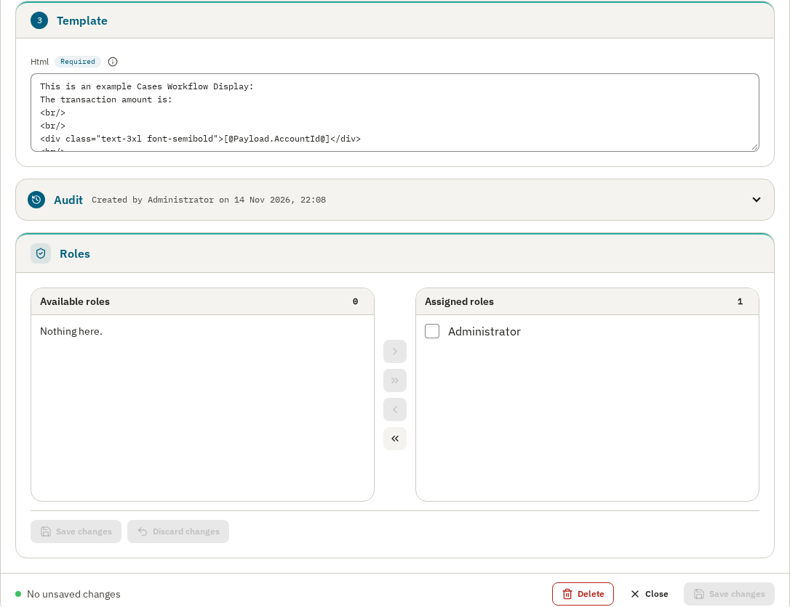
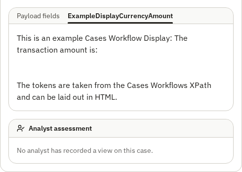

# Case Workflow Display

Upon the creation of a case the payload that caused the creation is stored alongside the case record. Upon navigation to the case in the case page, the record is of course displayed in the default view, titled Payload fields, whereby data is extracted and coloured from the payload record using the [Case Workflow XPath](../CreatingCaseWorkflowXPath/index.html) functionality. It is a key value table.

The Cases Workflow XPath functionality provides some capability to format cells but it is quite limited and the amount of information can be overwhelming in the case of very large payloads. Cases Workflow Displays provide a means to create a custom display based on arranging tokens in a template of markup. A Cases Workflow Display allows a narrower and emphasised display as compared with the default.

## Where it lives

Navigate through the menu to Models, open the model, then the Cases Workflows hub card, open the Case Workflow, then the Display hub card. Creating, changing and deleting a Cases Workflow Display follows the common manner described in [Child Objects](../../../Navigation/ChildObjects/index.html), with the exception that the children of a Case Workflow are not subject to approval, and a change takes effect upon being saved.

## Fields

The record looks almost identical to the [Case Workflow Form](../CreatingCaseWorkflowForm/index.html) configuration, with the differences being that the template is intended for display and not for form elements, and that a display has neither an HTTP endpoint nor a Notification:

| Value            | Description                                                                                                                                                              | Example               |
|------------------|--------------------------------------------------------------------------------------------------------------------------------------------------------------------------|-----------------------|
| Name             | The name of the display, shown to the end user in the View selection of the case page. Required, limited to 256 characters, and unique within the Case Workflow without regard to case. | Amount                |
| Active           | Whether the display is offered in the case page.                                                                                                                         | True                  |
| Locked           | Whether the display is protected from change.                                                                                                                            | False                 |
| Html             | The template of display elements, in the Template group. Required, and limited to 65,536 characters. Tokens can be used to replace the token placeholder with a value. | As below for clarity. |
| SQL for the case | Optional. A single SELECT run for the case, from the rows of which the template is then drawn.                                                                           |                       |

## The template

The template is written in the same deliberately small dialect as a Cases Workflow Form, evaluated in the server, with the case page being sent an escaped fragment. It is not arbitrary HTML, which is to say that `script`, `style`, `a`, `img`, `iframe` and `svg` are refused, as are the `id`, `style` and `href` attributes and event handlers, and a display written for an earlier version of Jube that makes use of them must be rewritten. Styling is by `class`, using the classes available to the user interface. The tags and attributes allowed are tabulated in [Case Workflow Form](../CreatingCaseWorkflowForm/index.html), and where form elements are used in a display they are drawn disabled.

The Cases Workflow Display supports tokenization that will swap tokens for values. The tokenization takes the same form as is expected in the Notification functionality, with an expression being flanked by the `[@` and `@]` characters, and every value is escaped upon being written:

| Aspect      | What is available                                                                                                                                                                                                 |
|-------------|-------------------------------------------------------------------------------------------------------------------------------------------------------------------------------------------------------------------|
| Names       | `Case` (`Id CaseKey CaseKeyValue Status Priority Created`, the Priority being the number of the priority of the status, from 1 for Ultra high to 5 for Ultra low) and the elements of the stored payload: `Payload Abstraction Dictionary TtlCounter Sanction HttpAdaptation ExhaustiveAdaptation AdvancedAnalyticsAdaptation Graph Activation`. Each element of `Activation` is true for an Activation Rule that matched and absent otherwise. Names are not case sensitive. |
| Expressions | Literals (numbers, text in quotes, `true`, `false` and `null`), member access (`Payload.AmountUSD`, `row['order total']`, `rows[0]`), arithmetic (`+ - * / %`), comparison (`== != < <= > >=`), and as `&&`, or as <code>&#124;&#124;</code>, not as `!`, the conditional `a ? b : c` and parentheses. There are no calls and no assignment. |
| Filters     | Following a pipe, as tabulated below. Number and date formats follow the language of the page.                                                                                                                    |
| Directives  | `v-for="row in rows"` or `v-for="(row, index) in rows"`, `v-if`, `v-else-if` and `v-else`, of which an element may carry one only.                                                                                |
| Limits      | 65,536 characters of template, 24 levels of nested elements, 32 levels of nested expression, 100,000 steps of rendering and 1,000,000 characters of output.                                                       |

The filters are as follows, and several may be chained, each being applied to the result of the one before:

| Filter              | Result                                                                                                           | Example                                   |
|---------------------|------------------------------------------------------------------------------------------------------------------|-------------------------------------------|
| `number(digits)`    | The number with thousands separators, to the digits given, or to at most two decimal places where none is given. | <code>[@ Payload.AmountUSD &#124; number(2) @]</code> |
| `percent(digits)`   | A fraction as a percentage, to one decimal place where no digits are given, such that 0.125 is 12.5%.            | <code>[@ row.rate &#124; percent @]</code> |
| `currency('GBP')`   | The code given, a space, then the number to two decimal places. The code is required.                            | <code>[@ Payload.AmountUSD &#124; currency('USD') @]</code> |
| `date`              | A date and time as day, short month and year, such as 12 Nov 2026.                                               | <code>[@ Case.Created &#124; date @]</code> |
| `dateTime`          | The same followed by hours and minutes on the 24 hour clock.                                                     | <code>[@ Case.Created &#124; dateTime @]</code> |
| `upper`, `lower`    | The text in upper or lower case.                                                                                 | <code>[@ Case.Status &#124; upper @]</code> |
| `truncate(n)`       | The first n characters followed by an ellipsis, where the text is longer than n. The length is required.         | <code>[@ row.note &#124; truncate(40) @]</code> |
| `round(digits)`     | The number rounded half away from zero to the digits given, 0 where none is given and 10 at most, remaining a number for further arithmetic. | <code>[@ Abstraction.Sum &#124; round(2) @]</code> |
| `default(x)`        | x where the value is missing or empty, otherwise the value. The argument is required.                            | <code>[@ Payload.Email &#124; default('none') @]</code> |
| `join(separator)`   | The elements of a list joined by the separator, or by a comma and a space where none is given.                   | <code>[@ row.tags &#124; join(' / ') @]</code> |

A value that is not a number, given to `number`, `percent` or `currency`, or not a date, given to `date` or `dateTime`, is written as nothing rather than being an error.

The spelling `[@Payload.AmountUSD@]`, without spaces, is the same expression as `[@ Payload.AmountUSD @]`. A name that is not in scope is an error in the template rather than being left as written.

Where the display has SQL for the case, the rows returned are the only data the template sees, and neither `Case` nor `Payload` is available. The names in scope are then `rows`, being the rows in the order returned, each addressed by the name of its column as `row.amount` or `row['order total']`; `columns`, each having a `name`, an `ordinal` counted from 1 and a `type`; `rowCount`, the number of rows; and `truncated`, which is true where more rows existed than were returned. The SQL for the case is a single SELECT, read only, taking the parameters `@Id` and `@CaseKeyValue`, returning 200 rows at most within a limit of 8 seconds, as described in [Creating Automation](../CreatingAutomation/index.html).

SHOT id=case-workflow-display-record
     route=/models
     steps=open-default-model, open-hub:Cases Workflows, open-first-row, open-hub:Display, open-first-row, scroll-to:Template
     frame=record
     state=the ExampleDisplayCurrencyAmount display of the demonstration Case Workflow scrolled to the Template group of its form, showing the first lines of the template in the Html box, markup carrying a payload token, with the Audit group collapsed and the Roles panel, with Administrator assigned, beneath
     conveys=a display is a template kept on the Case Workflow, written in a box on the record
     alt=A Cases Workflow Display record scrolled to its Template group, showing the template markup in the Html box, with the collapsed Audit group and the Roles panel beneath



## Validation

Validation takes place in the server. A Cases Workflow Display is refused where:

* The Name is empty, longer than 256 characters, or already in use within the Case Workflow, without regard to case.
* The Html is empty, longer than 65,536 characters, or breaks the rules of the template dialect.
* The SQL for the case is longer than 8,000 characters, is not a single read only SELECT of tables the author is permitted to read, or uses a parameter other than `@Id` and `@CaseKeyValue`.
* The parent Case Workflow does not exist within the tenant.

The messages returned are as follows:

| Condition                                          | Message                                                                                                             |
|----------------------------------------------------|---------------------------------------------------------------------------------------------------------------------|
| Name empty                                         | The name is required.                                                                                               |
| Name longer than 256 characters                    | The name cannot exceed 256 characters.                                                                              |
| Name already in use in the Case Workflow           | This name already exists.                                                                                           |
| Html empty                                         | The display HTML template is required.                                                                              |
| Html longer than 65,536 characters                 | The Html must be 65536 characters or fewer.                                                                         |
| Html breaking the rules of the dialect             | The message of the fault, with its line and column, as tabulated in Case Workflow Form.                             |
| SQL for the case longer than 8,000 characters      | The SQL is longer than 8,000 characters.                                                                            |
| SQL for the case not acceptable                    | The SQL was refused: followed by the reason.                                                                        |
| SQL for the case using another parameter           | The SQL uses the parameter @Name, which is not available here. Use @Id for the case or @CaseKeyValue.               |
| Parent Case Workflow missing                       | The referenced case workflow was not found in your tenant.                                                          |

The template is compiled upon saving, by the same compiler that draws it in the case page, hence a template that breaks the rules of the dialect is refused with the particular message, giving the line and column at which the fault was found. The faults and their messages are the same as those tabulated in [Case Workflow Form](../CreatingCaseWorkflowForm/index.html), and the rules for form elements given there (a `name` on every field, literal choices, a `label` naming a field that exists) apply to any form elements used in a display also. The two limits that depend upon the data of a case, being the steps of rendering and the characters of output, can be met only when the display is drawn, in which event This view could not be drawn. is stated in place of the display; it follows that a new or changed display should still be chosen on a case before it is relied upon.

## Example

Complete a new display with the Name Amount, Active switched on, and the Html as follows:

```html
<p class="text-3xl font-semibold">Another Format. The AmountUSD is [@ Payload.AmountUSD @]</p>
```

Navigate to a case record. Above the Payload fields of the case there is a View selection, in which Payload fields is the default and each Cases Workflow Display available to the role of the user is offered beside it. Notice the new entry, Amount. Selecting it presents the tokenized display in place of the Payload fields, rendered in the manner of the configuration, with the token being swapped for the actual value on case creation. Should a display fail to render, This view could not be drawn. is stated in its place.

The View selection is presented as a row of tabs, Payload fields first and the displays thereafter, and it is presented only where at least one display is available to the role of the user, there being otherwise just the heading Payload fields. While Payload fields is chosen, the number of fields is stated at the end of the row. The display chosen is kept in the address of the page, as `display` followed by the id of the display, such that the address can be shared or reloaded and opens upon the same view, and an id that is not among the displays offered falls back to Payload fields. Where no [Case Workflow XPath](../CreatingCaseWorkflowXPath/index.html) is available to the role, Payload fields states No payload fields are configured for this workflow.

SHOT id=case-workflow-display-view
     route=/cases
     steps=open-demo-case, open-tab:Amount, scroll-to:Payload fields
     frame=section:Case detail views
     state=the View selection of a demonstration case with the Amount display chosen in place of Payload fields, showing the rendered template with the AmountUSD of the transaction that created the case
     conveys=a display is an alternative, narrower view of the case chosen beside the default Payload fields
     alt=The View selection of a case with a custom display chosen, showing one emphasised line stating the AmountUSD of the transaction



## Case SQL runs with the author's access

Case SQL runs with the access of the person who saved it, and not that of the person who opens the case. It follows that everyone who can open a case in the workflow sees what the SQL returns on a Display or Form, whatever their own table permissions are, which is to say that an analyst holding only the permission to work cases sees rows from tables they could not query directly, as long as the author could. The SQL only ever receives the id and key value of the case itself (`@Id`, `@CaseKeyValue`), is read only, and stays inside the tenant. The editor shows the same statement beside the SQL box.

Keeping the above in mind, permission 67, Author Case Workflow SQL, should be granted only to those who would be trusted to publish that data to every role in the workflow, and each saved Display or Form SQL should be treated as a decision to share its tables with all of those roles. A narrow SELECT of only the columns the display needs is to be preferred.

The children of a Case Workflow are not subject to approval by a second user, hence SQL takes effect upon being saved by its author.

## Permissions and security

Creating, changing and deleting a Cases Workflow Display, and the allocation of roles to it, requires permission 23, Read Write Cases Workflow Display. Writing or changing the SQL for the case requires in addition permission 67, Author Case Workflow SQL. The active displays are also available to a user holding permission 1, Read Write Case, for the purposes of the case page.

A display is offered in the View selection only to the roles allocated to it in the Roles panel, as described in [Case Management Security Policy](../SecurityPolicy/index.html). A display is rendered only for a case of its own Case Workflow, and a request to render the display of another workflow is answered as not found.
