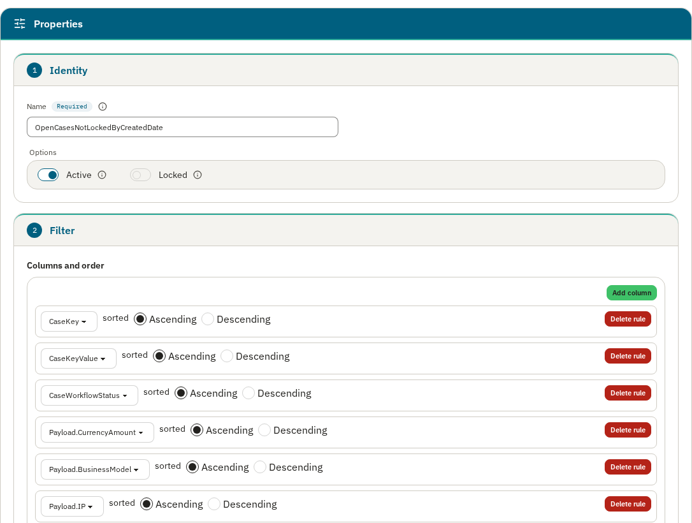
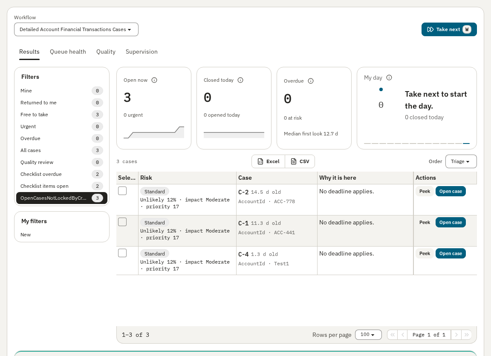

# Case Workflow Filter

Throughout a case life cycle, a case record can move through a multitude of dispositions. The most simple is the hard-coded closed status, as follows:

| Value          | Description                                                                                                                                                  |
|----------------|--------------------------------------------------------------------------------------------------------------------------------------------------------------|
| Open           | A new case with a status of Open, pending review.                                                                                                            |
| Suspend open   | A case which has been suspended that will move to an Open status again once the Diary Date has lapsed.                                                       |
| Suspend closed | A case which has been suspended that will move to a Closed status once the Diary Date has lapsed.                                                            |
| Closed         | A closed case whereby the Case Key and Case Key Value will be eligible for reopening.                                                                        |
| Suspend bypass | A status indicating that a case would have been created, except it was sampled out. The case will move to a closed status upon the lapse of the Diary Date.  |

Cases Workflows Filters are a means to access Cases via the Cases page. Case Workflow Filters allow for the filtering of cases based on a customisable filter, which is to say that each filter is a queue of work offered to the roles allocated to it.

## Where it lives

Navigate through the menu to Models, open the model, then the Cases Workflows hub card, open the Case Workflow, then the Filter hub card. Creating, changing and deleting a Cases Workflow Filter follows the common manner described in [Child Objects](../../../Navigation/ChildObjects/index.html), with the exception that the children of a Case Workflow are not subject to approval, and a change takes effect upon being saved.

A Cases Workflow Filter cannot be moved to another Case Workflow by an update.

## Fields

| Value  | Description                                                                                                                                                       | Example                                                           |
|--------|-------------------------------------------------------------------------------------------------------------------------------------------------------------------|-------------------------------------------------------------------|
| Name   | The name of the filter, as it is listed in the Cases page. Required, limited to 256 characters, and unique within the Case Workflow without regard to case.      | All Open                                                          |
| Active | Whether the filter is offered in the Cases page.                                                                                                                  | True                                                              |
| Locked | Whether the filter is protected from change.                                                                                                                      | False                                                             |
| Filter | A query builder that allows both filtering and sorting of created cases, in the Filter group.                                                                     | Sort: Created Date, Ascending. Rule: Closed Status is equal to Open |

The query builder is in two parts, and what is built in each is stored with the filter as JSON, rather than being typed by hand:

| Part              | Description                                                                                                                                                                                        |
|-------------------|----------------------------------------------------------------------------------------------------------------------------------------------------------------------------------------------------|
| Columns and order | The columns returned to the grid of the Cases page, added using Add column, each of which may be sorted, Ascending or Descending.                                                                 |
| Filter            | The conditions a case must satisfy, each taking a field, an operator (is equal to, is not equal to, is less than, is less than or equal to, is greater than, is greater than or equal to, is like, is not like) and a value, combined in groups. |

The fields offered are those of the case itself, such as the Closed Status, the status of the Case Workflow, the priority and the diary, alongside the fields of the payload extracted by [Case Workflow XPath](../CreatingCaseWorkflowXPath/index.html). For a field of fixed values, such as the Closed Status, the value is chosen from those values rather than typed.

SHOT id=case-workflow-filter-record
     route=/models
     steps=open-default-model, open-hub:Cases Workflows, open-first-row, open-hub:Filter, open-first-row
     frame=record
     state=the OpenCasesNotLockedByCreatedDate filter of the demonstration Case Workflow opened at its Properties form, showing the Identity group with its name and switches and the Filter group beneath opening with Columns and order, a row for each column the filter lists, CaseKey, CaseKeyValue, CaseWorkflowStatus and fields of the payload among them, each with its choice of Ascending or Descending
     conveys=a filter is kept on the record together with the columns it lists and the order in which it sorts them
     alt=A Cases Workflow Filter record showing its Identity group with the name OpenCasesNotLockedByCreatedDate and its Filter group listing the columns of the filter, each with a choice of Ascending or Descending

## Validation

Validation takes place in the server. A Cases Workflow Filter is refused where:

* The Name is empty, longer than 256 characters, or already in use within the Case Workflow, without regard to case.
* Nothing is stored for either part of the query builder.
* What is stored for either part is not valid JSON, or is longer than 1,000,000 characters.
* The parent Case Workflow does not exist within the tenant.

The messages returned by the server are as follows:

| Condition                                          | Message                                               |
|----------------------------------------------------|-------------------------------------------------------|
| Name empty                                         | The name is required.                                 |
| Name longer than 256 characters                    | The name cannot exceed 256 characters.                |
| Name already in use in the Case Workflow           | This name already exists.                             |
| Nothing stored for Columns and order               | The selected columns configuration is required.       |
| Nothing stored for Filter                          | The filter configuration is required.                 |
| Either part not valid JSON                         | The value must be valid JSON.                         |
| Either part longer than 1,000,000 characters       | The SelectJson must be 1000000 characters or fewer. \ The FilterJson must be 1000000 characters or fewer. |
| Parent Case Workflow missing                       | The referenced case workflow was not found in your tenant. |

The query builder states the problems of a condition in place, before the filter is saved, as follows:

| Problem                                         | Message                                |
|-------------------------------------------------|----------------------------------------|
| A condition with no field chosen                | Choose a field.                        |
| A group with no conditions                      | The group is empty.                    |
| A field of fixed values with no value chosen    | Choose a value.                        |
| A field of text with no value                   | A value is needed.                     |
| A numeric field with something other than a number | A number is needed. \ A whole number is needed. |
| A date field with no date, or one not in the form expected | A date is needed. \ The date must be written as, followed by the form. |

While the query builder is being prepared it states Loading the filter builder, and should it fail, The filter builder could not be loaded. Refresh the page to try again. Where the Case Workflow has nothing that can be filtered upon, No filterable columns are available for this data source yet. is stated. Where a field used by a stored filter is no longer offered, as happens upon a [Case Workflow XPath](../CreatingCaseWorkflowXPath/index.html) being removed, opening the filter states These fields are no longer available and were removed from the filter: followed by the names and Review this filter., and where what is stored cannot be restored to the query builder at all, The saved filter could not be restored. Review this filter.

## Example

Create a Cases Workflow Filter named All Open with Active switched on. In Columns and order, add the Created Date column sorted Ascending, such that the oldest case is first, alongside any other columns wanted in the grid. In Filter, add the condition Closed Status is equal to Open.

Navigate through the menu to Cases. The Cases page has a rail of case queues, in which the Workflow is chosen and its Filters are listed. Upon navigation to the Cases page the new Cases Workflow Filter can be seen immediately to afford access to the cases. Selecting the entry for the Cases Workflow Filter will return cases if available, in the columns and order of the filter, and also make the filter available for peeking by the end user.

SHOT id=case-workflow-filter-cases-rail
     route=/cases
     steps=click:OpenCasesNotLockedByCreatedDate
     frame=page
     state=the Cases page with the rail of case queues showing the Workflow selection and the Filters of the workflow, the All Open filter selected and the Results grid listing open cases, oldest first
     conveys=each Cases Workflow Filter is a queue in the rail of the Cases page, deciding the cases returned and their columns
     alt=The Cases page with a rail listing the filters of a workflow, one selected, and a grid of the open cases it returns

The availability of cases and the peeking of cases is explained in more detail in [Working Skim, Lock and Next](../WorkingSkimLockNext/index.html), as part of case working. In addition to the Cases Workflow Filters configured here, a user may keep filters of their own in the Cases page, under My filters.

## Permissions and security

Creating, changing and deleting a Cases Workflow Filter, and the allocation of roles to it, requires permission 25, Read Write Cases Workflow Filter. The active filters are also available to a user holding permission 1, Read Write Case, for the purposes of the Cases page.

A filter is listed in the Cases page only to the roles allocated to it in the Roles panel, and only where the role is also allocated to the Case Workflow. The allocation of roles to a filter is largely cosmetic, as the isolation of cases is enforced once more by the query of the session itself, which returns only cases whose Case Workflow and Cases Workflow Status are allocated to a role of the user, as described in [Case Management Security Policy](../SecurityPolicy/index.html).
