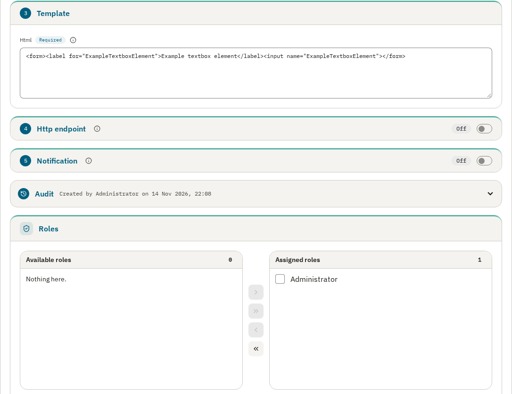

# Case Workflow Form

There are several ways to capture outcome in case management, such as:

* Updating Status.
* Updating Closed Status.
* Notes and;
* Action Codes on Notes.
* File Uploads.

The issue with the aforementioned data capture methods is that the data captured, beyond the payload data having created the case, is largely unstructured and provides limited opportunity for reporting, and even less opportunity for integration or automation (using the Notification and HTTP endpoint functionality documented in [Creating Automation](../CreatingAutomation/index.html)).

Workflow Forms allow the embedding of form elements in the case page for the purposes of data capture and integration \ automation. In this page, a basic form is created to compile a Suspicious Activity Report (SAR) for submission to a regulator, with the following example fields:

* First Transaction Date.
* Last Transaction Date.
* Name.
* Date Of Birth.
* Address.
* Comments.

While the form may not be compliant with the requirements of SAR for a local regulator, it provides a solid example.

## Where it lives

Navigate through the menu to Models, open the model, then the Cases Workflows hub card, open the Case Workflow, then the Form hub card. Creating, changing and deleting a Cases Workflow Form follows the common manner described in [Child Objects](../../../Navigation/ChildObjects/index.html), with the exception that the children of a Case Workflow are not subject to approval, and a change takes effect upon being saved.

A Cases Workflow Form cannot be moved to another Case Workflow by an update.

## Fields

| Value            | Description                                                                                                                                                                                         | Example               |
|------------------|-----------------------------------------------------------------------------------------------------------------------------------------------------------------------------------------------------|-----------------------|
| Name             | The name of the form, shown to the end user in the case page. Required, limited to 256 characters, and unique within the Case Workflow without regard to case.                                     | SAR                   |
| Active           | Whether the form is offered in the case page.                                                                                                                                                       | True                  |
| Locked           | Whether the form is protected from change.                                                                                                                                                          | False                 |
| Html             | The template of form elements for the purposes of data capture, in the Template group. Required. It is not necessary to include a submit button as this is handled by the case page.                | As below for clarity. |
| SQL for the case | Optional. A single SELECT run for the case, from the rows of which the template, the Notification and the HTTP Endpoint are then drawn.                                                             |                       |

The groups for the HTTP endpoint and the Notification are common to several sections of the Cases Workflows configuration, and are described in [Creating Automation](../CreatingAutomation/index.html). For a form they are dispatched on submission of the form.

## The template

The template is not arbitrary HTML. It is written in a deliberately small dialect which is evaluated in the server, the case page being sent an escaped fragment that it checks once more against the same list of what is allowed, such that there is no JavaScript, and no value entered into the template can become markup. It follows that a form written for an earlier version of Jube using scripts, styles, links, images or the id attribute is refused, and must be rewritten.

| Aspect      | What is allowed                                                                                                                                                                                                                              |
|-------------|----------------------------------------------------------------------------------------------------------------------------------------------------------------------------------------------------------------------------------------------|
| Form tags   | `form fieldset legend label input select option textarea`.                                                                                                                                                                                   |
| Layout tags | `div span p h1` to `h6 ul ol li strong em b i small br hr table thead tbody tfoot tr th td caption section article header footer dl dt dd time code pre abbr mark sub sup`, plus `template` as an invisible wrapper.                         |
| Attributes  | `name type placeholder value` on `input`, `name` on `select`, `value` on `option`, `name placeholder rows` on `textarea`, and `for` on `label`, which takes the name of a field rather than an id, and must name a field that the form has. Otherwise `class title role scope colspan rowspan datetime lang dir`, `aria-*` and `data-*`, the latter two in lower case letters, digits and hyphens. A `template` tag takes directives only. |
| Input types | `text number date datetime-local email tel checkbox radio`. An `input` without a `type` is taken as `text`.                                                                                                                                  |
| Field names | Every `input`, `select` and `textarea` needs a `name`, written literally rather than as a token: a letter then letters, digits and underscores, 64 characters at most, unique without regard to case. Radio buttons of one name form a single field. |
| Choices     | A `select` needs at least one `option`, each having a literal `value` (which may be empty, for a choice of nothing), and each radio button needs a literal `value` that is not empty, these being the choices enforced by the server. Neither may be produced by a `v-for`. |
| Tokens      | `[@ expression @]`, in text and inside the value of an attribute, with every value escaped. The names in scope are `Form` (the values entered so far, by field name), `Case` (`Id CaseKey CaseKeyValue Status Priority Created`) and the elements of the stored payload: `Payload Abstraction Dictionary TtlCounter Sanction HttpAdaptation ExhaustiveAdaptation AdvancedAnalyticsAdaptation Graph Activation`. Names are not case sensitive, and a name that is not in scope is an error rather than being left as written. |
| Directives  | `v-for`, `v-if`, `v-else-if` and `v-else`, of which an element may carry one only. A `v-for` is written `row in rows` or `(row, index) in rows`, and a `v-else-if` or `v-else` must directly follow an element having `v-if` or `v-else-if`. A field cannot sit inside a `v-for`. |
| Size        | 65,536 characters of template, 24 levels of nested elements, 32 levels of nested expression, 100,000 steps of rendering and 1,000,000 characters of output.                                                                                  |

The expressions, and the filters that may follow a pipe, are the same as those of a display and are tabulated in [Case Workflow Display](../CreatingCaseWorkflowDisplay/index.html).

Showing and hiding parts of a form is achieved with `v-if`, for example `v-if="Form.reason == 'other'"`. As values are entered, the case page asks the server which fields are to be shown, and a field that the template does not show for the values submitted is dropped on submission.

Where the form has SQL for the case, the rows returned are the only data that the template sees, as `rows`, `columns`, `rowCount` and `truncated`, alongside `Form`, and neither `Case` nor `Payload` is available.

SHOT id=case-workflow-form-record
     route=/models
     steps=open-default-model, open-hub:Cases Workflows, open-first-row, open-hub:Form, open-first-row, scroll-to:Template
     frame=record
     state=the ExampleForm of the demonstration Case Workflow scrolled to the Template group of its form, showing the template in the Html box, a form holding one labelled text box, with the Http endpoint and Notification groups switched off beneath it, then the collapsed Audit group and the Roles panel with Administrator assigned
     conveys=a form is a template kept on the Case Workflow, with the dispatch groups beneath it as on any other record that can dispatch
     alt=A Cases Workflow Form record scrolled to its Template group, showing the form markup in the Html box, with the Http endpoint and Notification groups switched off, the collapsed Audit group and the Roles panel beneath



## Validation

Validation of the Cases Workflow Form itself takes place in the server upon saving. A form is refused where:

* The Name is empty, longer than 256 characters, or already in use within the Case Workflow, without regard to case.
* The Html is empty, or breaks the rules of the template dialect, which includes being longer than 65,536 characters.
* The HTTP endpoint or the Notification is switched on and is not complete, as described in [Creating Automation](../CreatingAutomation/index.html).
* The SQL for the case is not acceptable, as described in the same page.
* The parent Case Workflow does not exist within the tenant.

The messages returned for the fields of this page are The name is required., The name cannot exceed 256 characters., This name already exists., The HTML template is required. and The referenced case workflow was not found in your tenant.

The template is compiled upon saving, by the same compiler that draws it in the case page. A template that breaks the rules of the dialect is therefore refused, the fault being stated against the Html and giving the line and column of the template at which it was found. The two limits that depend upon the data of a case, being the steps of rendering and the characters of output, can be met only when the form is drawn, and it follows that a new or changed form should still be opened on a case before it is relied upon. The faults are reported as follows, each being preceded by Template line, the line, column and the column where a position applies:

| Fault                                                         | Message                                                                                                   |
|---------------------------------------------------------------|-----------------------------------------------------------------------------------------------------------|
| A tag outside the two lists                                   | `the tag <script> is not allowed.`                                                                        |
| An attribute outside the list for its tag                     | `the attribute "id" is not allowed on <input>.`                                                           |
| A tag opened and not closed                                   | `the tag <div> is never closed.`                                                                          |
| A closing tag with nothing to close                           | `the closing tag </div> has no matching opening tag.`                                                     |
| A directive other than the four, two on one element, or a `v-else` with no `v-if` before it | the directive "v-else" is not valid here.                                   |
| A `v-for` of the wrong shape                                  | the v-for "rows" must look like "row in rows" or "(row, index) in rows".                                  |
| A token opened and not closed                                 | an opening [@ is never closed with @].                                                                    |
| An expression that cannot be read                             | the expression "Form.a +" is not valid near "".                                                           |
| A name that is not in scope                                   | "Payment" is not known here. The names known here are Abstraction, Activation, AdvancedAnalyticsAdaptation, Case, Dictionary, ExhaustiveAdaptation, Form, Graph, HttpAdaptation, Payload, Sanction, TtlCounter. |
| A filter that does not exist, or given too many arguments     | the filter "money" does not exist. \ the filter "date" does not take that many arguments.                 |
| A field with no `name`                                        | `the <input> needs a name.`                                                                               |
| A `name` of the wrong form                                    | the field name "first name" must start with a letter and use only letters, digits and underscores.        |
| A `name` used twice                                           | the field name "name" is used more than once.                                                             |
| A field inside a `v-for`                                      | `a <input> field cannot be inside a v-for, because a field name must be fixed.`                           |
| An input type outside the list                                | the input type "password" is not allowed.                                                                 |
| A `select` or radio button without literal choices            | the field "reason" needs fixed options, each with a plain value and none inside a v-for.                  |
| A `label` whose `for` names no field                          | the label is for "dob", which is not a field in this form.                                                |
| Nesting beyond 24 elements or 32 levels of expression         | the template nests deeper than 24 levels.                                                                 |
| More than 65,536 characters of template                       | The template is longer than the limit of 65536 characters.                                                |
| More than 1,000,000 characters of output                      | The template produced more than 1000000 characters of output. Narrow the rows in SQL.                     |
| More than 100,000 steps of rendering                          | The template needed more than 100000 steps to render. Narrow the rows in SQL or loop less.                |

A submission of the form by the end user is validated in the server also, and a problem with a value is shown beneath the field concerned, the form remaining open with what was entered:

* A template that does not compile refuses every submission.
* Any value submitted that is not a field of the template is rejected, with That field is not part of the form.
* Each value shown is checked against the type of its input, with That value is not valid for the type of the field.: a number in the plain form with a full stop for the decimal point, a date as the browser sends it (year, month and day), a datetime-local likewise, an email address of 320 characters at most, a tel of 3 to 32 digits, spaces, brackets and hyphens with an optional leading plus sign, and a checkbox as true or false.
* The value of a `select` or radio group must be one of its choices, with regard to case, else That value is not one of the choices offered.
* A value is limited to 4,000 characters, or 20,000 for a `textarea`, else That value is not of a length the field allows.
* A field left empty is not checked for type and is not stored, and it follows that every field is optional unless a Form validator of the kind Required says otherwise.
* A submission may carry 500 values at most.
* A form whose SQL fails cannot be submitted, with The data this form is drawn from could not be loaded, so it cannot be submitted.
* The submission must satisfy each active Form validator of the form. Form validators are children of the Case Workflow, in the Form validators hub card, as described in [Creating Case Workflow Form Validator](../CreatingCaseWorkflowFormValidator/index.html). A Pattern validator is tested by an engine that does not backtrack, within a limit of 250 milliseconds, and a SQL validator within a limit of 3 seconds.
* The case must not be locked to another user, else The case is locked by another user.

## Example

Complete a new form with the Name SAR, Active switched on, and the Html as follows:

```html
<form>
  <label for="name">Name:</label><br>
  <input type="text" name="name"><br>
  <label for="DOB">DOB:</label><br>
  <input type="date" name="DOB"><br>
  <label for="first">First Transaction:</label><br>
  <input type="datetime-local" name="first"><br>
  <label for="last">Last Transaction:</label><br>
  <input type="datetime-local" name="last"><br>
  <label for="address">Address:</label><br>
  <textarea name="address" rows="10"></textarea><br>
  <label for="comments">Comments:</label><br>
  <textarea name="comments" rows="10"></textarea>
</form>
```

Navigate to a case. In the Decide pane, under Actions, there is a tile for each Cases Workflow Form available to the role of the user, titled for the form, in this example SAR. Selecting the tile presents the form in a dialog titled for the form, rendered from the template, with Cancel and Submit form buttons being added by the case page (these were not specified in the configuration). Each time the entry of values pauses, for about a third of a second, the form is drawn afresh by the server from the values entered so far, which is the means by which a `v-if` upon `Form` shows and hides fields as the form is completed. Nothing is kept until Submit form is pressed, and closing the dialog, or opening it again, discards what was entered.

Upon submission, the value of each field shown is posted to the case alongside the name of the field, confirmation is returned as Form submitted. and the dialog closes. Where the submission is refused the dialog remains open, with the message beneath each field at fault.

SHOT id=case-workflow-form-dialog
     route=/cases
     steps=open-demo-case, open-decide-tile:SAR
     frame=dialog
     state=the SAR form opened from its tile in the Decide pane, with the Name, DOB, First Transaction, Last Transaction, Address and Comments fields partly completed and the Submit form button beneath
     conveys=a Cases Workflow Form is drawn in the case page from its template, with the submit button supplied by the page
     alt=A dialog in the case page showing the SAR form with text, date and text area fields and a Submit form button

To validate that the form was processed and the data captured, open the Forms section of the case page. It can be observed that an instance of the submission has been recorded, where the form results are brought back rolling up to the Case Key and Case Key Value (and not the id of the case), newest first, to a limit of 50. Each entry states the user and the time of submission, and is drawn read only from the template of the form, with the values filled in and every field disabled. Any values for which the form has no field, as happens where a field has since been removed from the template, are listed beneath, under Values the form has no field for. Where the template has since been changed such that it no longer compiles, the entry instead states This form can no longer be drawn: followed by the fault and The values it holds are listed below., and every value is listed. Before any form has been submitted the section states No forms have been submitted for this case key., and should the entries fail to load, The submitted forms could not be loaded.

The values submitted are stored before any Notification or HTTP Endpoint invocation. They are carried in the body of an HTTP POST, and where the form has SQL for the case they are available for tokenization as `Form`, for example `[@ Form.name @]`. Given the structured nature of the data capture, it is now easy to produce rich reporting based on the structured data submissions, although the most powerful use case for Cases Workflow Forms is for the purposes of Integration and Automation via HTTP invocation.

TODO(verify): this page formerly stated that the elements of the form are merged into the case creation payload on submission, such that they are available for tokenization in the Notification and HTTP Endpoint. In the absence of SQL for the case, tokens are replaced from the stored payload only (CaseWorkflowFormEntryService with EntryPayloadExtensions.ReplaceTokens), and the submitted values reach only the POST body. Owner to decide whether the submitted values are to be offered to tokens in that mode.

## Case SQL runs with the author's access

Case SQL runs with the access of the person who saved it, and not that of the person who opens the case. It follows that everyone who can open a case in the workflow sees what the SQL returns on a Display or Form, whatever their own table permissions are, which is to say that an analyst holding only the permission to work cases sees rows from tables they could not query directly, as long as the author could. The SQL only ever receives the id and key value of the case itself (`@Id`, `@CaseKeyValue`), is read only, and stays inside the tenant. The editor shows the same statement beside the SQL box.

Keeping the above in mind, permission 67, Author Case Workflow SQL, should be granted only to those who would be trusted to publish that data to every role in the workflow, and each saved Display or Form SQL should be treated as a decision to share its tables with all of those roles. A narrow SELECT of only the columns needed is to be preferred.

The children of a Case Workflow are not subject to approval by a second user, hence SQL takes effect upon being saved by its author.

## Permissions and security

Creating, changing and deleting a Cases Workflow Form and its Form validators, and the allocation of roles to a form, requires permission 21, Read Write Cases Workflow Form. Writing or changing SQL, whether of the form or of a Form validator, requires in addition permission 67, Author Case Workflow SQL. Completing a form in the case page requires permission 1, Read Write Case.

A form is offered in the case page, and its submissions presented in the Forms section, only to the roles allocated to it in the Roles panel. A submission is furthermore refused as not found where the case, its status or the form is not available to the role of the user, as described in [Case Management Security Policy](../SecurityPolicy/index.html).
