# Case Workflow Form

There are several ways to capture outcome in case management, such as:

* Updating Status.
* Updating Closed Status.
* Memos and;
* Acton Codes on Memos.
* File Uploads.

The issue with the aforementioned data capture methods is that the data captured, beyond the payload data having created
the case, is largely unstructured and provides limited opportunity for reporting, and even less opportunity for
integration or automation (using the Notification and HTTP endpoint functionality documented separately).

Workflow Forms allow the embedding of HTML form elements for the purposes of data capture and integration \ automation.
In this example, a basic form will be created to compile a Suspicious Activity Report (SAR) for submission to a
regulator, with the following example fields:

* First Transaction Date.
* Last Transaction Date.
* Name.
* Date Of Birth.
* Address.
* Comments.

While the form may not be compliant with the requirements of SAR for a local regulator, it provides a solid example.

Start by navigating to the Cases Workflow Forms configuration by navigating Models >> Cases Workflows >> Cases Workflow
Forms:

<!-- TODO(screenshot): file=case-workflow-config-case-workflow-form-01.png route=/models state="Models page, Case Workflows tab, case-workflow-form screen replacing the Razor-era TopOfTreeForCasesWorkflowsForm.png" -->
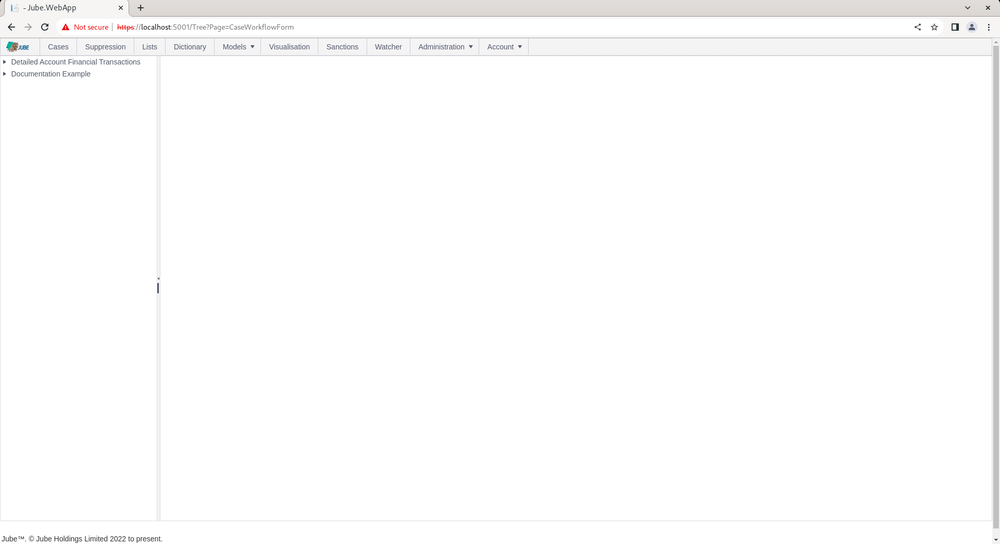

Expand the second level of the tree and click on the Case Workflow highlighted above to add a new Case Workflow Form:

<!-- TODO(screenshot): file=case-workflow-config-case-workflow-form-02.png route=/models state="Models page, Case Workflows tab, case-workflow-form screen replacing the Razor-era EmptyCasesWorkflowForm.png" -->
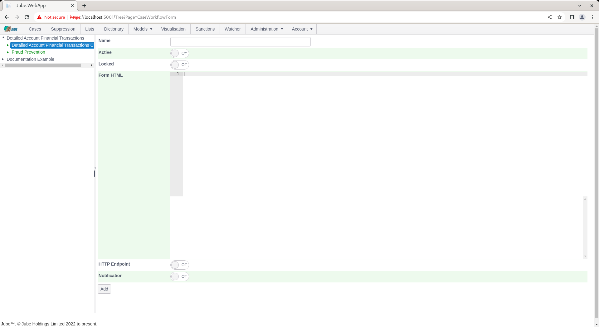

The form takes the following parameters:

| Value     | Description                                                                                                                                                                                                                                             | Example               |
|-----------|---------------------------------------------------------------------------------------------------------------------------------------------------------------------------------------------------------------------------------------------------------|-----------------------|
| Form HTML | HTML Form Elements for the purposes of data capture. The HTML form elements will be embedded in a HTML div on rendering, hence,  it will support all HTML use case. It is not necessary to include a submit button as this is handled by the case page. | As below for clarity. |

```html
  <label for="fname">Name:</label><br>
  <input type="text" id="name" name="name"><br>
  <label for="DOB">DOB:</label><br>
  <input type="date" id="DOB" name="DOB"><br>
  <label for="first">First Transaction:</label><br>
  <input type="datetime" id="last" name="last"><br>
  <label for="last">Last Transaction:</label><br>
  <input type="datetime" id="first" name="first"><br>
  <label for="address">Address:</label><br>
  <textarea name="address" rows="10" cols="60"></textarea><br>
  <label for="comments">Comments:</label><br>
  <textarea name="comments" rows="10" cols="60"></textarea>
```

Complete the form as above and below example:

<!-- TODO(screenshot): file=case-workflow-config-case-workflow-form-03.png route=/models state="Models page, Case Workflows tab, case-workflow-form screen replacing the Razor-era ExampleFormFields.png" -->
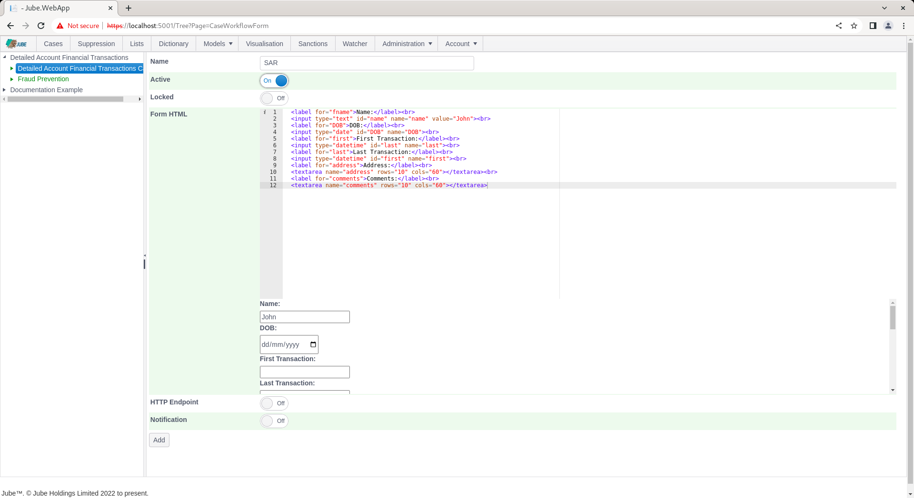

Notice that the HTML is rendered in the text box below, which will provide an accurate preview of the form rendering in
the case page.

Scroll down and click the add button to create a version of the Cases Workflow Form:

<!-- TODO(screenshot): file=case-workflow-config-case-workflow-form-04.png route=/models state="Models page, Case Workflows tab, case-workflow-form screen replacing the Razor-era AddedVersionCasesWorkflowForm.png" -->
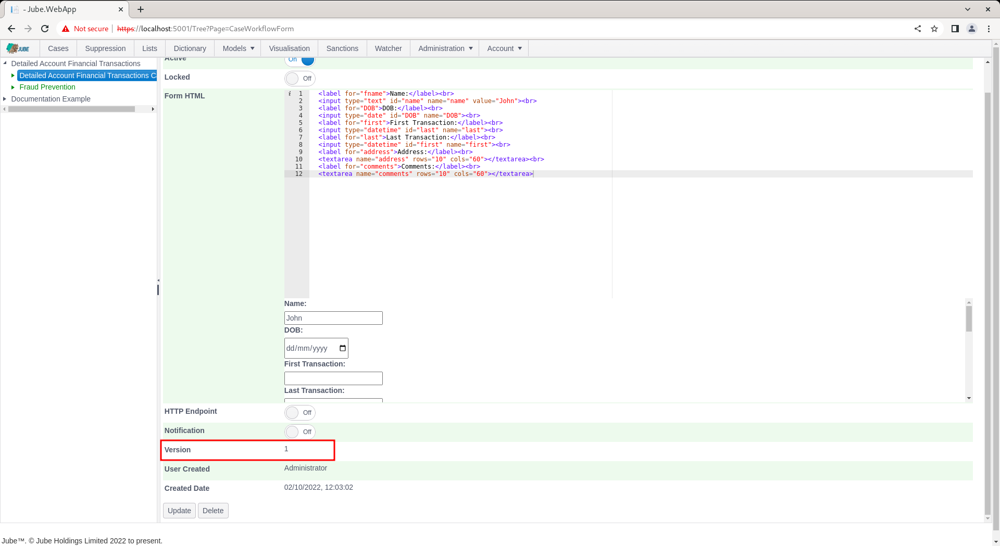

Navigate to the case page using the previous case record:

<!-- TODO(screenshot): file=case-workflow-config-case-workflow-form-05.png route=/models state="Models page, Case Workflows tab, case-workflow-form screen replacing the Razor-era DefaultCasePage.png" -->
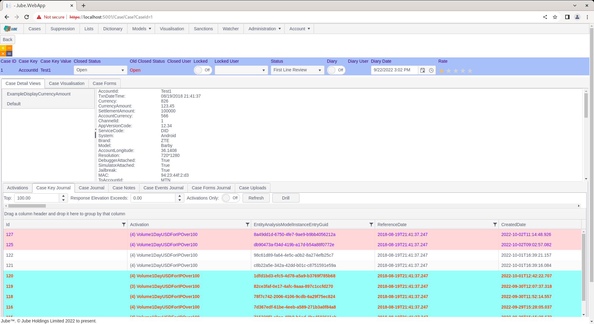

Click on the Case Forms tab towards the top of the page, under the status bar:

<!-- TODO(screenshot): file=case-workflow-config-case-workflow-form-06.png route=/models state="Models page, Case Workflows tab, case-workflow-form screen replacing the Razor-era LocationOfCaseForms.png" -->
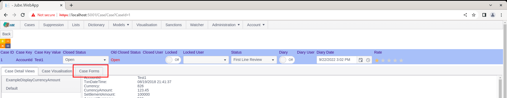

The tab will reveal all Cases Workflow Forms towards the left hand side of the tab content pane:

<!-- TODO(screenshot): file=case-workflow-config-case-workflow-form-07.png route=/models state="Models page, Case Workflows tab, case-workflow-form screen replacing the Razor-era NewFormLocation.png" -->
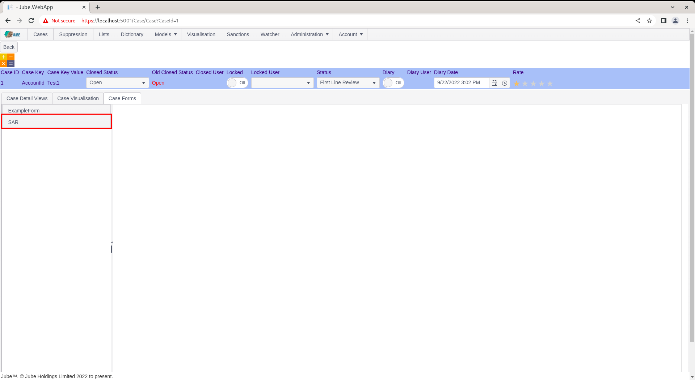

Click on the list item SAR to load the form:

<!-- TODO(screenshot): file=case-workflow-config-case-workflow-form-08.png route=/models state="Models page, Case Workflows tab, case-workflow-form screen replacing the Razor-era FormReadyForInput.png" -->
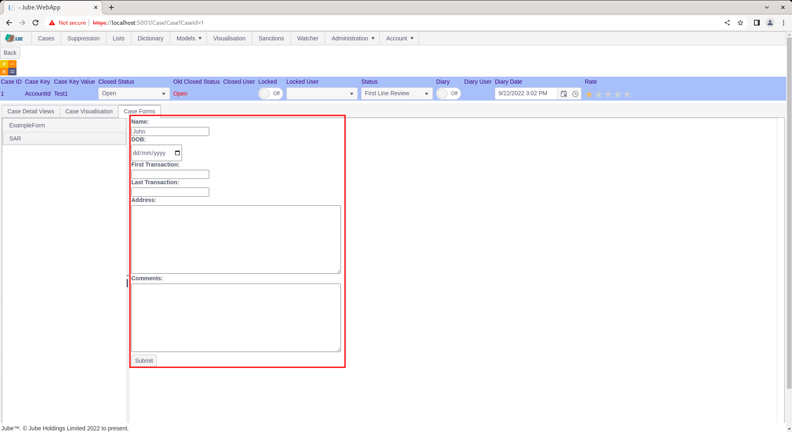

Notice how the form has been rendered in the same fashion as configuration, with a Submit button being added by the case
page (this was not specified in the configuration).

Complete the form as follows (or as required):

<!-- TODO(screenshot): file=case-workflow-config-case-workflow-form-09.png route=/models state="Models page, Case Workflows tab, case-workflow-form screen replacing the Razor-era ExampleDataForForm.png" -->
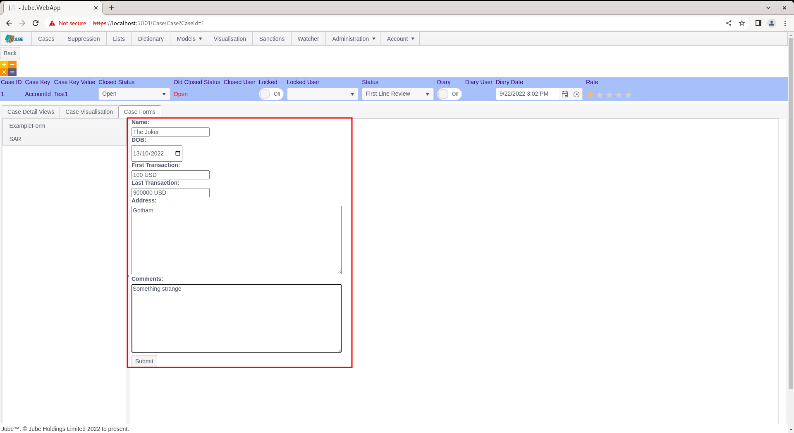

Upon clicking the submit button, the page will iterate through each form element and extract the input element value
alongside the name property of the input element, and post it to the case.

Click Submit for the purposes of this example:

<!-- TODO(screenshot): file=case-workflow-config-case-workflow-form-10.png route=/models state="Models page, Case Workflows tab, case-workflow-form screen replacing the Razor-era LocationOfSubmitButton.png" -->
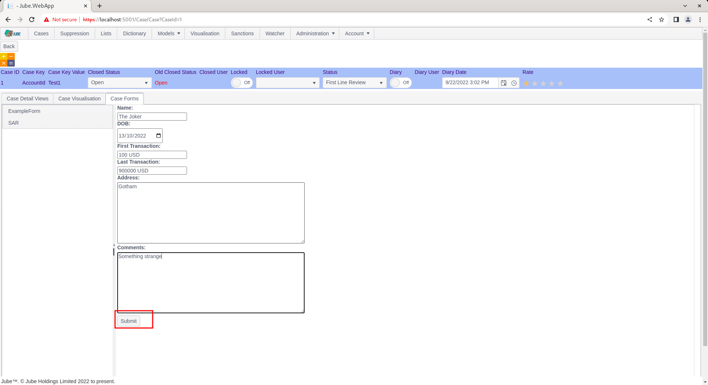

On submission of the form, a Done message is shown. To validate that the form was processed and the data captured:

<!-- TODO(screenshot): file=case-workflow-config-case-workflow-form-11.png route=/models state="Models page, Case Workflows tab, case-workflow-form screen replacing the Razor-era DoneForm.png" -->
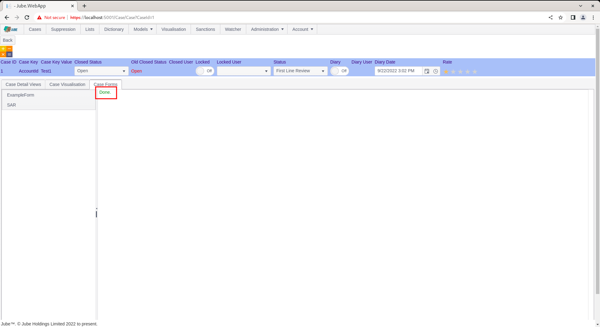

Navigate to the Case Detail Views tab:

<!-- TODO(screenshot): file=case-workflow-config-case-workflow-form-12.png route=/models state="Models page, Case Workflows tab, case-workflow-form screen replacing the Razor-era LocationOfCaseDetailTab.png" -->
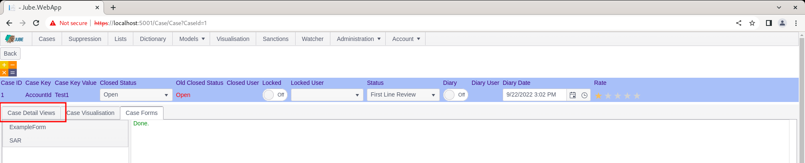

Locate the Case Forms Journal tab in the Case Detail Views tab:

<!-- TODO(screenshot): file=case-workflow-config-case-workflow-form-13.png route=/models state="Models page, Case Workflows tab, case-workflow-form screen replacing the Razor-era LocationOfCaseFormsJournalTab.png" -->
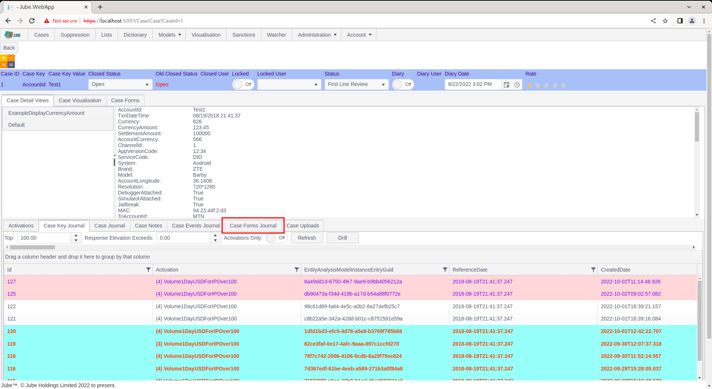

Upon clicking the Case Form Journal tab, it can be observed that an instance of a Case Form Submission has been
recorded, where the form results are brought back rolling up to the Case Key and Case Key Value (and not CaseId):

<!-- TODO(screenshot): file=case-workflow-config-case-workflow-form-14.png route=/models state="Models page, Case Workflows tab, case-workflow-form screen replacing the Razor-era FormInstance.png" -->
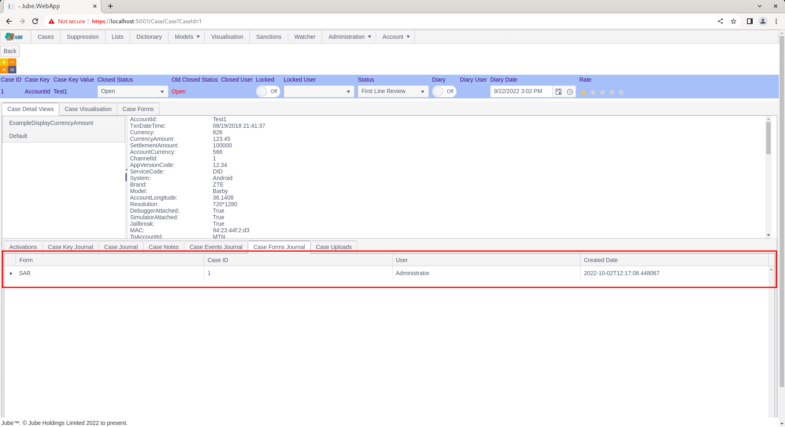

The grid is hierarchical in nature, hence clicking on the expansion icon on the left hand side:

<!-- TODO(screenshot): file=case-workflow-config-case-workflow-form-15.png route=/models state="Models page, Case Workflows tab, case-workflow-form screen replacing the Razor-era ExpandFormJournal.png" -->
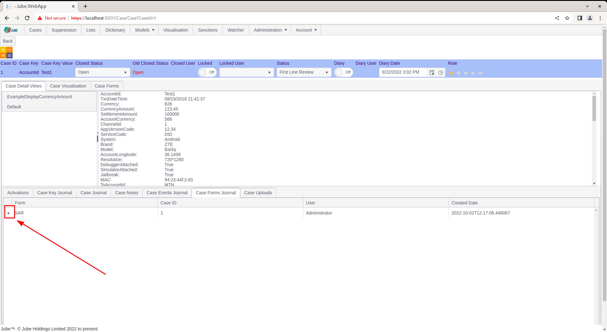

Clicking the expand icon will proceed to expand to reveal the form element entries and values:

<!-- TODO(screenshot): file=case-workflow-config-case-workflow-form-16.png route=/models state="Models page, Case Workflows tab, case-workflow-form screen replacing the Razor-era DataCapturedByForm.png" -->
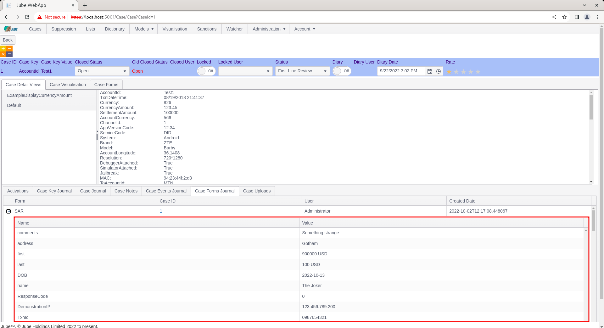

Notice how the elements of the form have been merged into the case creation payload, which happened during the
submission of the form and before any Notification or HTTP Endpoint invocation, such that all these elements are
available for tokenization. Given the structured nature of the data capture, it is now easy to produce rich reporting
based on the structured data submissions, although the most powerful use case for Cases Workflow Forms is for the
purposes of Integration and Automation via HTTP invocation.

<!-- TODO(docs): The form dialect page (docs/Frontend/DatasourceTemplateDialect.md) is the specification; link it from here and remove the Razor-era HTML guidance that no longer applies (scripts, styles, links, images are refused). -->
<!-- TODO(docs): Document the form validators (required, required when, range, length, pattern, compare, in list, in dictionary, SQL) and that Pattern uses a non-backtracking engine with a 250 ms limit. -->
<!-- TODO(docs): Document that a form's SQL runs with permission 67 gating and a 3 second limit when used as a validator. -->
<!-- TODO(docs): Document that a form cannot be moved to another Case Workflow by an update. -->

## Case SQL runs with the author's access

<!-- TODO(docs): Owner to check this wording; it states the design decision recorded in review/case-workflow-config.md section 12.6 (definer rights, option c). -->
Case SQL runs with the access of the person who saved it, not the person who opens the case. Everyone who can open a
case in this workflow sees what the SQL returns on a Display or Form, whatever their own table permissions are: an
analyst holding only the case-view permission sees rows from tables they could not query directly, as long as the author
could. The SQL only ever receives the case's own id and key value (`@Id`, `@CaseKeyValue`), is read only, and stays
inside the tenant. The editor shows the same statement beside the SQL box.

**Who should author case SQL.** Give permission 67 (*Author Case Workflow SQL*) only to people you would trust to
publish that data to every role in the workflow. Treat each saved Display or Form SQL as a decision to share its tables
with all of those roles. Prefer a narrow SELECT of only the columns the display needs.
<!-- TODO(docs): Case workflow children are not yet covered by maker-checker approval (see review/case-sql-author-access.md); once they are, add: a second person with the approval permission must approve the SQL before it goes live. -->
<!-- TODO(screenshot): the note shown above the SQL editor on the Display and Form screens -->
