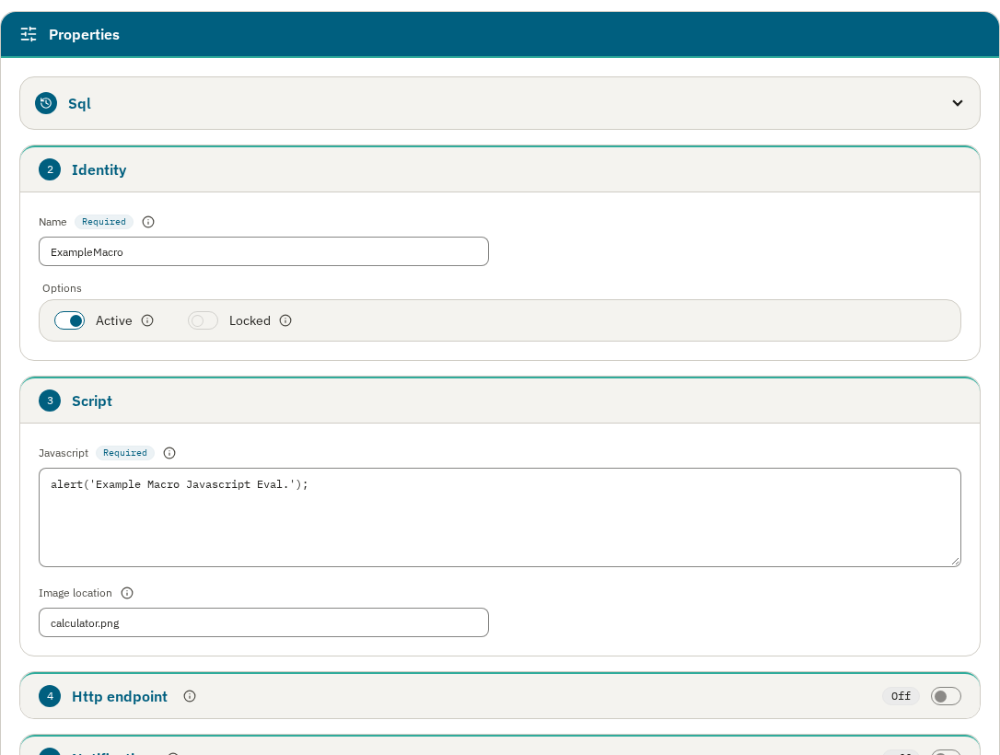
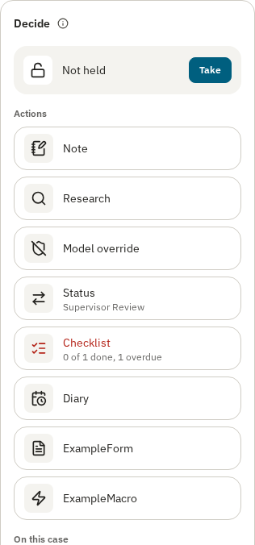

# Case Workflow Macro

There are a multitude of functions in the case page for the purposes of updating and annotating a case. Each of these update functions have their own user interface controls, in the Decide pane of the case page. For example, to change the status of a case, it is a simple matter of selecting the Status tile and choosing the status.

The case page can be extended by Macros, each of which is presented as a further tile in the Decide pane, to expedite the case working process for an analyst. Upon a macro being invoked, the Notification and HTTP Endpoint configured for it are dispatched in the context of the case, and it is in conjunction with that common HTTP Endpoint or Notification functionality that Macros become especially powerful.

## Where it lives

Navigate through the menu to Models, open the model, then the Cases Workflows hub card, open the Case Workflow, then the Macro hub card. Creating, changing and deleting a Cases Workflow Macro follows the common manner described in [Child Objects](../../../Navigation/ChildObjects/index.html), with the exception that the children of a Case Workflow are not subject to approval, and a change takes effect upon being saved.

## Fields

| Value            | Description                                                                                                                                                                      | Example                      |
|------------------|----------------------------------------------------------------------------------------------------------------------------------------------------------------------------------|------------------------------|
| Name             | The name of the macro, which titles its tile in the case page. Required, limited to 256 characters, and unique within the Case Workflow without regard to case.                  | ExampleMacro                 |
| Active           | Whether the macro is offered in the case page.                                                                                                                                   | True                         |
| Locked           | Whether the macro is protected from change.                                                                                                                                      | False                        |
| Javascript       | Javascript held with the macro, in the Script group. Required. Script tags are not to be included.                                                                               | alert('This is an example'); |
| Image location   | The name of an image held with the macro, in the Script group. Limited to 256 characters of letters, digits, spaces, underscores, hyphens and full stops, without two full stops together. | Image                        |
| SQL for the case | Optional. A single SELECT run for the case, from the rows of which the Notification and the HTTP Endpoint are then drawn.                                                        |                              |

The groups for the HTTP endpoint and the Notification, and the SQL for the case, are described in [Creating Automation](../CreatingAutomation/index.html).

In earlier versions of Jube, the Javascript was invoked in the case page upon a click of an image button bearing the Image, by way of the onClick event and then the eval() function of Javascript, such that a macro could automate a series of common click sequences against the undocumented Javascript functions of that page. The case page no longer evaluates Javascript taken from configuration, and it presents a macro as a tile titled by its Name rather than as an image button. It follows that the Javascript and Image location are retained with the macro, and the Javascript remains required upon saving, yet neither has an effect in the case page.

TODO(verify): the Vue case page (Jube.App/Vue/src/cases/detail/CaseDecide.vue) runs a macro in the server only, and neither evaluates Javascript nor shows Image location, while CaseWorkflowMacroDtoValidator still requires Javascript and the description of the field still states that it is evaluated on the Case page. Owner to decide whether the two fields are to be withdrawn from the form or the behaviour restored, and this section and the Fields table then follow that decision.

SHOT id=case-workflow-macro-record
     route=/models
     steps=open-default-model, open-hub:Cases Workflows, open-first-row, open-hub:Macro, open-first-row
     frame=record
     state=the ExampleMacro of the demonstration Case Workflow opened at its Properties form, showing a collapsed Sql group, the Identity group with its name and the Active and Locked switches, the Script group with a line of Javascript and an Image location of calculator.png, and the Http endpoint group switched off beneath
     conveys=a macro is a named record on the Case Workflow, which is what places its tile in the Decide pane
     alt=A Cases Workflow Macro record showing a collapsed Sql group, its Identity group with the name ExampleMacro, its Script group with a line of Javascript and an image location, and the Http endpoint group switched off



## Validation

Validation takes place in the server. A Cases Workflow Macro is refused where:

* The Name is empty, longer than 256 characters, or already in use within the Case Workflow, without regard to case.
* The Javascript is empty.
* The Image location is given and is not of the form described above.
* The HTTP endpoint or the Notification is switched on and is not complete, as described in [Creating Automation](../CreatingAutomation/index.html).
* The SQL for the case is not acceptable, as described in the same page.
* The parent Case Workflow does not exist within the tenant.

The messages returned for the fields particular to a macro are as follows, those of the HTTP endpoint and the Notification being the same as for a [Case Workflow Action](../CreatingCaseWorkflowAction/index.html):

| Condition                                 | Message                                                                                         |
|-------------------------------------------|-------------------------------------------------------------------------------------------------|
| Name empty                                | The name is required.                                                                           |
| Name longer than 256 characters           | The name cannot exceed 256 characters.                                                          |
| Name already in use in the Case Workflow  | This name already exists.                                                                       |
| Javascript empty                          | The JavaScript is required.                                                                     |
| Image location not of the form described  | The image location must be the file name of an icon and cannot contain path separators.         |
| Parent Case Workflow missing              | The referenced case workflow was not found in your tenant.                                      |

For a new macro every switch is off, Active included, and upon the HTTP endpoint or the Notification being switched on the Http endpoint type is POST and the Notification type is Email until chosen otherwise. A macro having neither an HTTP endpoint nor a Notification switched on can be saved and invoked, yet dispatches nothing.

## Example

Create a Cases Workflow Macro named ExampleMacro, with Active switched on, the Javascript as in the table above, and in the HTTP endpoint group an Http endpoint of a receiving service, with an Http endpoint type of POST.

To invoke the Cases Workflow Macro, navigate to a case record. Notice in the Decide pane, under Actions, that a tile titled ExampleMacro has been created. Selecting the tile invokes the macro straight away, there being no dialog and no confirmation sought beforehand, and on conclusion confirmation is returned as Macro ran. While a macro is running the tiles of every macro are disabled, so that it cannot be invoked twice by a second click. Where the invocation is refused, the message of the server is shown in place of the confirmation, being The case or case workflow macro was not found, or is not available to you. where the macro is not allocated to the role of the user or does not belong to the Case Workflow of the case.

SHOT id=case-workflow-macro-decide-tiles
     route=/cases
     steps=open-demo-case
     frame=decide-pane
     state=the Decide pane of a demonstration case showing the Actions group with its tiles for Note, Status and Close, a tile for a Cases Workflow Form and a tile titled ExampleMacro
     conveys=a macro extends the case page as one more tile among the actions of the Decide pane
     alt=The Decide pane of a case with a row of action tiles, among them a tile for a form and a tile for the ExampleMacro macro



The receiving service is posted the definition of the macro alongside the context of the case, as printed in the POST Body Context of [Creating Automation](../CreatingAutomation/index.html):

```json
{
  "caseId": 1,
  "caseWorkflowMacroId": 1,
  "caseWorkflowMacroName": "ExampleMacro",
  "case": {
    "id": 1,
    "caseKey": "AccountId",
    "caseKeyValue": "Test20",
    "caseWorkflowStatus": "First Line Review"
  }
}
```

The listing above is abbreviated, the `case` element having further elements, among them the full Archive payload on case creation.

Every invocation is recorded for audit. Each email, text or web call fired by a macro is written to the Messages section of the case page as a message of kind Macro, stating whether it was Sent, Failed or Refused, where it went and what was sent.

## Permissions and security

Creating, changing and deleting a Cases Workflow Macro, and the allocation of roles to it, requires permission 24, Read Write Cases Workflow Macro. Writing or changing the SQL for the case requires in addition permission 67, Author Case Workflow SQL. Invoking a macro in the case page requires permission 1, Read Write Case.

A macro is offered in the case page only to the roles allocated to it in the Roles panel. Putting aside that in the absence of such an allocation the macro will not be displayed, an invocation verifies the allocation once more in the server, and a macro runs only against a case of its own Case Workflow, an invocation against anything else being answered as not found, as described in [Case Management Security Policy](../SecurityPolicy/index.html).

The HTTP Endpoint of a macro is subject to the [Outbound Host Policy](../../Administration/OutboundHostPolicy/index.html), whether it is drawn from the stored payload or from the SQL for the case.
