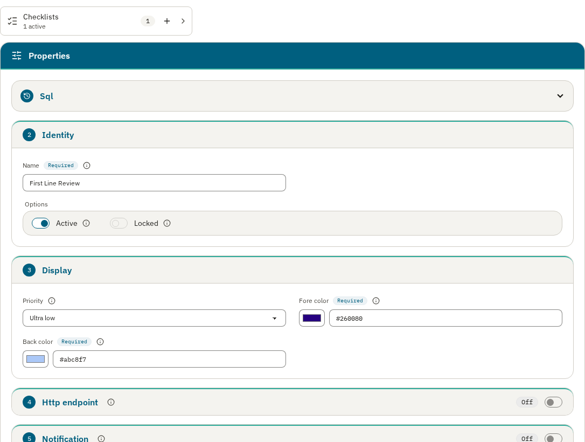
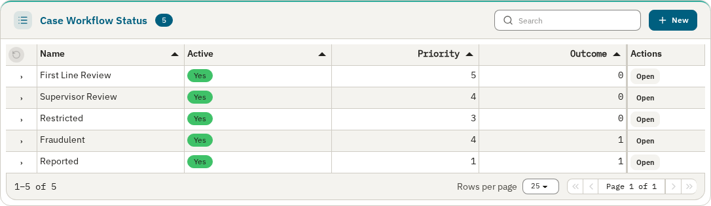

# Cases Workflow Status

When a case is created, it can be allocated a status, which is helpful for filtering. Furthermore, when a case is being worked, changing the status allows for the sub allocation of the record (for example to a money laundering officer for review). Statuses are separate from the closed status (which is to say Open, Closed and so on).

A common example for case status use is to escalate cases through a hierarchy in a money laundering team, such as:

* Front Line Defence (FLD).
* Deputy Anti Money Laundering Compliance Officer (DAMLCO).
* Anti Money Laundering Compliance Officer (AMLCO).

The Cases Workflow Status are available for allocation on case creation, by an Activation Rule, or by the end user while navigating the case.

## Where it lives

Cases Workflows Status is a child of Cases Workflows, itself a child of Models. Navigate through the menu to Models, open the model, then the Cases Workflows hub card, open the Case Workflow, then the Status hub card. Creating, changing and deleting a Cases Workflow Status follows the common manner described in [Child Objects](../../../Navigation/ChildObjects/index.html), with the exception that the children of a Case Workflow are not subject to approval, and a change takes effect upon being saved.

A Cases Workflow Status has children of its own, in that upon opening one a Checklists hub card is presented, and each Checklist has an Items hub card in turn. The items of the checklists of a status are those that must be ticked, in the Decide pane of the case page, before a case in that status can be moved, escalated or closed, as described in [Creating Case Workflow Checklist](../CreatingCaseWorkflowChecklist/index.html).

A Cases Workflow Status cannot be moved to another Case Workflow by an update.

SHOT id=case-workflow-status-record
     route=/models
     steps=open-default-model, open-hub:Cases Workflows, open-first-row, open-hub:Status, open-first-row
     frame=record
     state=a Cases Workflow Status of the default model opened, showing the Checklists hub card, the Identity and Display groups with the Priority and the two colours, and the collapsed groups for the HTTP endpoint, Notification, Outcome, Service level and Escalation
     conveys=a status carries its priority and colours, and optionally automation, an outcome, a service level and an escalation rule
     alt=A Cases Workflow Status record with a Checklists hub card, its Priority and colour fields, and collapsed groups for automation, outcome, service level and escalation

## Fields

The fields are arranged in groups, of which Identity and Display are open at first, the groups for the SQL for the case, the HTTP endpoint, the Notification, Outcome, Service level, Escalation and Audit being collapsed. For a new status every switch is off, Active included, the Outcome is Not an outcome, and the Priority and the two colours are not yet given, all three being required before the status can be saved.

| Value          | Description                                                                                                                                                                                                                | Example           |
|----------------|----------------------------------------------------------------------------------------------------------------------------------------------------------------------------------------------------------------------------|-------------------|
| Name           | The name of the status, shown to the end user when allocating or changing the status of a case. Required, limited to 256 characters, and unique within the Case Workflow without regard to case.                          | First Line Review |
| Active         | Whether the status is available for allocation to a case.                                                                                                                                                                  | True              |
| Locked         | Whether the status is protected from change.                                                                                                                                                                               | False             |
| Priority       | The priority of the status, being one of Ultra high, High, Medium, Low or Ultra low. A status can be upwardly classified, such that if a case record already exists, the priority can be raised for that record, yet the priority of a case record may never decrease. | High              |
| Fore color     | The colour of the text for this status. The colour is used in the status bar of the case.                                                                                                                                 | #0000FF           |
| Back color     | The colour of the background for this status, in the status bar of the case.                                                                                                                                               | #880808           |
| Outcome        | What closing a case in this status says about the alert: Not an outcome, Confirmed (a true positive) or Not confirmed (a false positive). The likelihood of the case ranking is calibrated against closed cases in Confirmed and Not confirmed statuses, and closures by Suspend Bypass are never counted. | Not an outcome    |
| Max dwell minutes | The most minutes a case may stay in this status before it counts as overdue there. Empty for no target.                                                                                                                 | 240               |

The fields of the Escalation group (Escalation trigger, Escalation threshold, Escalation target case workflow status and Escalation release lock) are described in [Creating Automatic Escalation](../CreatingAutomaticEscalation/index.html), and the manner in which Priority raises the status of an existing case in [Creating Status Elevation](../CreatingStatusElevation/index.html). The Outcome is put to use by the case ranking described in [Creating Case Workflows](../CreatingCaseWorkflows/index.html).

Notifications and HTTP Endpoint, alongside the SQL for the case from which they may be drawn, are common to several sections of the Cases Workflows configuration, and are documented separately in [Creating Automation](../CreatingAutomation/index.html) rather than in detail here. They are common to:

* Cases Workflow Status.
* Cases Workflow Form.
* Cases Workflow Action.
* Cases Workflow Macro.

For a status, the Notification and HTTP Endpoint are dispatched upon a case arriving in the status, whether on creation of the case by an Activation Rule, by elevation, by automatic escalation or by the end user changing the status in the case page.

SHOT id=case-workflow-status-list
     route=/models
     steps=open-default-model, open-hub:Cases Workflows, open-first-row, open-hub:Status
     frame=section:Case Workflow Status
     state=the Status list of the demonstration Case Workflow, showing its five statuses, First Line Review, Supervisor Review, Restricted, Fraudulent and Reported, each on a row with its Active state, its Priority, its Outcome and an Open action
     conveys=the statuses through which a case may pass are a short list kept under the Case Workflow
     alt=The Status list of the demonstration Case Workflow with five statuses, First Line Review, Supervisor Review, Restricted, Fraudulent and Reported, each on a row with its Active state, Priority and Outcome

## Validation

Validation takes place in the server. A Cases Workflow Status is refused where:

* The Name is empty, longer than 256 characters, or already in use within the parent Cases Workflow, without regard to case.
* The Priority is not one of the five values, Ultra high to Ultra low.
* Fore color or Back color is empty, or is not a 6-digit hex colour code such as `#0000FF`.
* The HTTP endpoint or the Notification is switched on and is not complete, as described in [Creating Automation](../CreatingAutomation/index.html).
* The Escalation group is not complete or not consistent, as described in [Creating Automatic Escalation](../CreatingAutomaticEscalation/index.html).
* The parent Case Workflow does not exist within the tenant.

Every problem is reported at once, against the field to which it belongs, and nothing is saved while any remains. The messages returned for the fields of this page are as follows:

| Condition                                             | Message                                                        |
|-------------------------------------------------------|----------------------------------------------------------------|
| Name empty                                            | The name is required.                                          |
| Name longer than 256 characters                       | The name cannot exceed 256 characters.                         |
| Name already in use in the Case Workflow              | This name already exists.                                      |
| Priority not chosen                                   | A valid priority is required.                                  |
| Fore color empty or not six hexadecimal digits        | A valid status text colour (e.g. #0000FF) is required.         |
| Back color empty or not six hexadecimal digits        | A valid status background colour (e.g. #880808) is required.   |
| Parent Case Workflow missing                          | The referenced case workflow was not found in your tenant.     |
| Max dwell minutes given and not from 1 to 525600      | The max dwell minutes must be between 1 and 525600, or left empty for no target. |

Keep in mind that the colours of a status are stricter than those of a [Case Workflow XPath](../CreatingCaseWorkflowXPath/index.html): only the six digit form is accepted, and neither a colour name, the three digit form nor rgb() will do. The Max dwell minutes, where given, is limited to between 1 and 525600, which is a year, and is left empty where time in the status is not to be measured.

## Example

Complete a new status as follows, leaving all else as the default:

| Value      | Example           |
|------------|-------------------|
| Name       | First Line Review |
| Active     | True              |
| Priority   | Ultra low         |
| Fore color | #0000FF           |
| Back color | #880808           |

For confirmatory purposes, open the [Activation Rule](../../Models/BasicActivationRules/index.html) Volume1DayUSDForIPOver100 of the same model, switch on Cases in the Case Workflow group, and select the Case Workflow. It can be seen that the newly created Cases Workflow Status is now available in the Case workflow status selection, as a child of the Cases Workflow.

At this stage, no case record has been created, but Cases Workflow Status are available for filtering via the [Case Workflow Filter](../CreatingCaseWorkflowFilter/index.html), described separately.

## Permissions and security

Creating, changing and deleting a Cases Workflow Status, its Checklists and their Items, and the allocation of roles to a status, requires permission 19, Read Write Cases Workflows Status. Writing or changing the SQL for the case, or the SQL of a Checklist Item, requires in addition permission 67, Author Case Workflow SQL. The statuses of a Case Workflow are also listed for a user holding permission 17, Read Write Activation Rule, permission 25, Read Write Cases Workflow Filter, or permission 1, Read Write Case, given that each of those has need to select a status.

A case is available to a user only where a role of that user is allocated to both the Case Workflow and the Cases Workflow Status of the case, in the Roles panel of each. It follows that moving a case to a status allocated to fewer roles has the effect of isolating the case, and everything recorded against it, from more junior roles, as described in [Case Management Security Policy](../SecurityPolicy/index.html).
