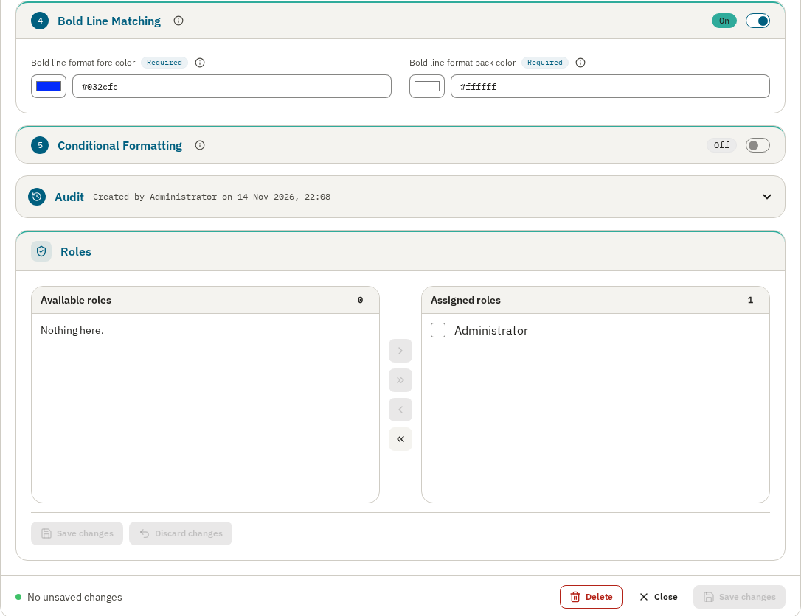
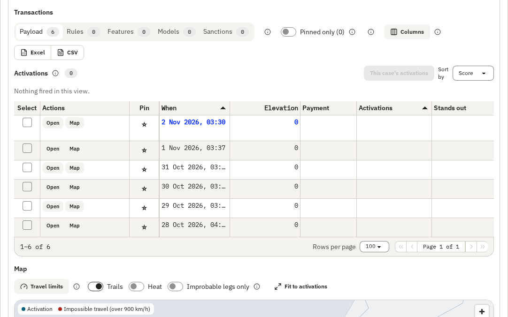

# Case Workflow XPath

Upon navigating to a case, the Journal section of the case page is open by default, and it is the first thing an agent will see. The Case Key Journal is the retrieval of all events processed for the model where the Case Key Value matches that used in the creation of the case record, for example AccountId = Test1. The use of the Case Key Journal is covered in more detail in [Working Case Key Journal](../WorkingCaseKeyJournal/index.html), and for the purposes of this page it suffices to recognise that each row corresponds to an event \ transaction.

A picture of the event is captured and stored alongside the case record at creation also, and it is presented in the case page as Payload fields.

All data comes to rest in the case record and archive in JSON format, being exactly the same format as returned in the response (except it will include all elements, not only those specified as a response payload). There is an enormous amount of columns and granularity available in that JSON after model invocation, yet none of it is presented in the case page of its own accord. Cases Workflow XPath allows for the extraction of data from the JSON for presentation in the case page, which is to say that each Cases Workflow XPath is a column of the Payload lens of the Case Key Journal and an entry in the Payload fields of the case.

The default installation of Jube has a comprehensive list of columns, however this is as a result of the default installation having a Cases Workflow XPath for each element available in the payload JSON of the Detailed Financial Transaction model.

Beyond extraction, a Cases Workflow XPath carries the Bold Line Matching and Conditional Formatting that paint the rows and cells of the Case Key Journal, and it decides which fields can be drilled upon.

## Where it lives

Navigate through the menu to Models, open the model, then the Cases Workflows hub card, open the Case Workflow, then the XPath hub card. Creating, changing and deleting a Cases Workflow XPath follows the common manner described in [Child Objects](../../../Navigation/ChildObjects/index.html), with the exception that the children of a Case Workflow are not subject to approval, and a change takes effect upon being saved.

SHOT id=case-workflow-xpath-record
     route=/models
     steps=open-default-model, open-hub:Cases Workflows, open-first-row, open-hub:XPath, fill:Search records=TxnId, open-row:TxnId, scroll-to:Bold Line Matching
     frame=record
     state=the TxnId Cases Workflow XPath of the default model opened, with the Identity, Extraction and Analytics groups, and the Bold Line Matching and Conditional Formatting groups expanded, Bold line matched switched on and its two colours showing
     conveys=one record decides what is extracted, how it is treated by analytics and how it paints the journal
     alt=A Cases Workflow XPath record showing the Source selection, the Role and Segment, and the Bold Line Matching and Conditional Formatting groups with their colour pickers

## Fields

The fields are arranged in the groups Identity, Extraction, Analytics, Bold Line Matching and Conditional Formatting, the latter two being collapsed at first, with a further Audit group, also collapsed, showing who created and last changed the entry, when, and its version. The fields of Bold Line Matching and of Conditional Formatting are presented only once the switch of the group is on. For a new entry every switch is off, Active included, the Role is Inferred from the values, and nothing else is completed, so that an entry must be switched to Active before it shows in the case page.

### Identity and Extraction

| Value  | Description                                                                                                                                                                 | Example                      |
|--------|-----------------------------------------------------------------------------------------------------------------------------------------------------------------------------|------------------------------|
| Name   | The name to be allocated to this entry, shown as the heading of the column in the Case Key Journal. Required, limited to 256 characters, and unique within the Case Workflow without regard to case. | AmountUSD                    |
| Active | Whether the entry takes part in the presentation of the case page and the Case Key Journal.                                                                                 | True                         |
| Locked | Whether the entry is protected from change.                                                                                                                                 | False                        |
| Source | The field of the model that is to be extracted for presentation. Required.                                                                                                  | AmountUSD (Request XPath)    |

The Source is chosen rather than typed. The fields offered are the Request XPath, Inline Functions, Abstraction Rules, Abstraction Calculations, TTL Counters, HTTP Adaptations and Activation Rules of the model to which the Case Workflow belongs, with the model itself standing for its entry key. Each is listed by its name and its kind, and where the field is not flagged as Archive Key this is stated alongside. The JSONPath used to extract the value (for example Payload.AmountUSD), the archive key and the data type are all derived from the field chosen, and it follows that the JSONPath is validated where it is written, on the [Request XPath](../../Models/RequestXPath/index.html) of the model, and not here.

### Analytics

| Value   | Description                                                                                                                                                                                                                              | Example                  |
|---------|------------------------------------------------------------------------------------------------------------------------------------------------------------------------------------------------------------------------------------------|--------------------------|
| Role    | What kind of field this is to the statistics and charts of the Case Key Journal and to network mapping: Inferred from the values, Measure, Category, Counterparty, Identifier, Time or Geography. Anything other than Inferred from the values overrides the inference made from sampled values. | Inferred from the values |
| Segment | Whether the field splits the distributions of peers, so that a value is compared with peers in the same segment, such as a customer tier.                                                                                               | False                    |

### Bold Line Matching

| Value                       | Description                                                                                                                                                              | Example |
|-----------------------------|--------------------------------------------------------------------------------------------------------------------------------------------------------------------------|---------|
| Bold line matched           | A switch detailing if the row will be placed to bold based on this value matching that in the case creation entry.                                                       | True    |
| Bold line format fore color | If the value extracted from the transaction or event that caused the case creation matches a row in the grid, then the colour will be allocated in the text.             | #0000FF |
| Bold line format back color | If the value extracted from the transaction or event that caused the case creation matches a row in the grid, then the colour will be allocated in the background.       | #00FF00 |

### Conditional Formatting

| Value                                     | Description                                                                                                                                                                                              | Example |
|-------------------------------------------|----------------------------------------------------------------------------------------------------------------------------------------------------------------------------------------------------------|---------|
| Conditional regular expression formatting | A flag that indicates if further regular expression matching will be performed on the event for the purposes of specifying individual row or cell formatting based on the disposition of the record.     | True    |
| Regular expression                        | The Regular Expression to search for a value in the extracted string.                                                                                                                                    | 1       |
| Conditional format fore color             | Subject to the regular expression matching a value, the text colour to be used.                                                                                                                          | #880808 |
| Fore row color scope                      | Whether the text colour is applied to the entire row, rather than just the cell.                                                                                                                         | False   |
| Conditional format back color             | Subject to the regular expression matching a value, the background colour to be used.                                                                                                                    | #9F2B68 |
| Back row color scope                      | Whether the background colour is applied to the entire row, rather than just the cell.                                                                                                                   | False   |

## Bold Line Matching

The bold line matching functionality will match the specified value between the event \ transaction stored on case creation and the same value in the Case Key Journal.

Most ideally bold line matching should be on a unique basis, as the intention is to show the exact record that caused the case to be created (keeping in mind that a case can be created only once for a Case Key and Case Key Value, for a case workflow, however it may well comprise of many problematic transactions \ events). In the default installation the entry TxnId has Bold line matched switched on, with a white background and blue foreground, given that the TxnId should be unique on each transaction JSON post.

The bold line matching details are returned alongside the Cases Workflow XPath. When the journal is being prepared, for each entry where Bold line matched is on, a check is made to compare the value extracted for the row with that same value in the case creation payload, and upon a match, the text of that row only is emboldened and its fore and back colour set. The comparison is exact and has regard to case. Where more than one entry has Bold line matched on and matches the same row, the colours of the first to match are taken.

So that the highlighting need not be inferred from colour alone, the reason is written to the Highlighted because column of the journal, in the form Same TxnId as this case: 0987654321.

## Conditional Formatting

In bold line matching, a straightforward match is done between the extracted field and the case creation field, whereby a match applies the row formatting (the fore colour and back colour specified, and emboldening the text).

Conditional formatting is similar functionality that uses regular expressions to change either cell or row colour based on a regular expression matching when tested against the extracted value only (which is to say that it does not compare to the case creation record).

In the absence of Fore row color scope and Back row color scope being switched on, upon match, only the cell will have formatting applied. It is possible to mix and match fore colour and back colour, row and cell formatting, such that the background of a row is coloured, yet just the fore of the cell is coloured. Where a background is applied without a text colour to accompany it at the same scope, the text colour is chosen such that it remains legible against that background.

The formatting is applied to both the case creation record, in the Payload fields of the case page, and the records in the Case Key Journal. In the Payload fields the formatting is always of the value alone, there being no row to speak of. The reason is written to the Highlighted because column of the journal, in the form DemonstrationIP matches 127.0.0.1.

The regular expression is tested for each row of the journal, and a test that has not concluded within 100 milliseconds is taken as not matching. For the same reason, the regular expression must be valid for an engine that does not backtrack, hence back references and look-around are refused upon saving.

## Drilling

When a case record is returned, the contents of the Case Key Journal is all records matching the case key value combination (for example AccountId = Test1). The Case Key Journal supports wider fetching via a concept called Drill, whereby a field and a value are taken as the criteria to fetch the journal afresh, which is useful functionality for identifying links in data and creates link analysis functionality directly in the case page.

Drilling can and must only exist on fields that are properly indexed. For the reason of thought about indexing, drilling is not available on each field by default, and it is no longer a switch of the Cases Workflow XPath: an entry can be drilled exactly when the field chosen as its Source is flagged as Archive Key, a switch in the Behaviour group of the [Request XPath](../../Models/RequestXPath/index.html) of the model. A Source that is not so flagged is marked as not an Archive Key in the selection.

The drill fields of the Case Workflow are put to use in the Case Key Journal as follows, each being described in [Working Case Key Journal](../WorkingCaseKeyJournal/index.html):

* Add key takes a drill field, the manner of match and a value, and adds it to the scope as a further lane alongside the case key.
* In the detail of a transaction, under Identifiers, Pivot to this shows the journal for the value of a drill field instead of the case key, with a control to return, and Merge adds the value as a further lane.
* Clear keys and filter restores the journal to the initial state, being the Case Key and Case Key Value alone.

Where no entry of the Case Workflow can be drilled, the journal states that no drill fields are set on the workflow.

## Validation

Validation takes place in the server, every problem being reported at once against the field to which it belongs, and nothing is saved while any remains. A Cases Workflow XPath is refused where:

* The Name is empty, longer than 256 characters, or already in use among the entries belonging to the same Case Workflow, without regard to case.
* The Source is not chosen, or is not a field of the model of the Case Workflow.
* The Role is not one of the seven values offered.
* Bold line matched is on, and Bold line format fore color or Bold line format back color is empty or longer than 32 characters.
* Conditional regular expression formatting is on, and the Regular expression is empty or longer than 1,024 characters, or Conditional format fore color or Conditional format back color is empty or longer than 32 characters.
* Conditional regular expression formatting is on, and the Regular expression is not valid, or makes use of back references or look-around.
* A colour, when supplied, is not a hexadecimal value of three to eight digits such as #FF0000, a colour name such as red, or an rgb() / rgba() value. Anything else (quotes, angle brackets, semicolons, url() and so on) is rejected, as colours are written into the markup of the case page.
* The parent Case Workflow does not exist within the tenant.

The messages returned are as follows:

| Condition                                                              | Message                                                                                           |
|------------------------------------------------------------------------|---------------------------------------------------------------------------------------------------|
| Name empty                                                             | The name is required.                                                                             |
| Name longer than 256 characters                                        | The name cannot exceed 256 characters.                                                            |
| Name already in use in the Case Workflow                               | This name already exists.                                                                         |
| Source not chosen                                                      | A source field is required: choose the model field the extraction reads.                          |
| Source not a field of the model                                        | The source field is not a field of the workflow's model.                                          |
| Role outside the values offered                                        | The field role must be between 0 and 6.                                                           |
| Bold line matched on, Bold line format fore color empty                | The bold line format fore colour is required when Bold Line Matched is enabled.                   |
| Bold line matched on, Bold line format back color empty                | The bold line format back colour is required when Bold Line Matched is enabled.                   |
| Conditional regular expression formatting on, Regular expression empty | The regular expression is required when Conditional Formatting is enabled.                        |
| Regular expression longer than 1,024 characters                        | The regular expression cannot exceed 1024 characters.                                             |
| Regular expression not valid, or using back references or look-around  | The regular expression is not valid. Back references and look-around are not supported.           |
| Conditional formatting on, Conditional format fore color empty         | The conditional format fore colour is required when Conditional Formatting is enabled.            |
| Conditional formatting on, Conditional format back color empty         | The conditional format back colour is required when Conditional Formatting is enabled.            |
| A colour longer than 32 characters                                     | The colour cannot exceed 32 characters.                                                           |
| A colour not in one of the three forms                                 | The colour must be a hexadecimal value such as #FF0000, a colour name or an rgb() value.          |
| Parent Case Workflow missing                                           | The referenced case workflow was not found in your tenant.                                        |

It follows from the colours being required once the switch of their group is on that both a fore colour and a back colour must be given, even where only one is wanted, and in that case the other is best set to the colour the journal already has.

## Example

### Basic Extraction

Start with the extraction of a field only. Create a Cases Workflow XPath as follows, leaving all else as the default:

| Value  | Example            |
|--------|--------------------|
| Name   | DemonstrationIP    |
| Active | True               |
| Source | IP (Request XPath) |

Upon navigating to a case, DemonstrationIP is a column of the Payload lens of the Case Key Journal, with the IP extracted for each record, and the new extracted value is also available in the Payload fields of the event having caused the case entry.

### Bold Line Matching

Open the existing entry titled TxnId, and note in the Bold Line Matching group the white background and blue foreground, and Bold line matched switched on. Alter Bold line format fore color and Bold line format back color as desired, in this example to a red foreground and light green background, and save.

POST to [https://localhost:5001/api/invoke/EntityAnalysisModel/90c425fd-101a-420b-91d1-cb7a24a969cc](https://localhost:5001/api/invoke/EntityAnalysisModel/90c425fd-101a-420b-91d1-cb7a24a969cc), but pay special attention to changing the TxnId in the request, as this will likely have been the same, so as to assure that only a single bold line match is visible for that TxnId.

Upon navigating to the case record there are two observations. Firstly, the colour of the bold line match on TxnId has now changed. Secondarily, as the TxnId in the most recent request payload does not match the TxnId of the record having driven the case, it is not bold line matched, thus it does not have corresponding highlighting.

SHOT id=case-workflow-xpath-journal-highlighting
     route=/cases
     steps=open-demo-case, click:Hide the sections, click:Hide the decide panel, open-section:3 Journal, open-tab:Payload, scroll-to:Transactions
     frame=section:3 Journal
     state=the Payload lens of the journal of a demonstration case, with the row of the transaction that created the case emboldened in the bold line colours, one cell coloured by conditional formatting, another row coloured in full, and the Highlighted because column stating each reason
     conveys=Bold Line Matching picks out the transaction that created the case, and Conditional Formatting colours a cell or a row on the value alone
     alt=The Case Key Journal grid with one emboldened and coloured row for the transaction that created the case, a coloured cell where a regular expression matched, and the reasons listed in the Highlighted because column

### Conditional Formatting of a cell, then of a row

The first of the examples for conditional formatting checks the DemonstrationIP created beforehand for being localhost (which is to say 127.0.0.1), and colours just the cell if it happens to match that string. Open the entry DemonstrationIP and, in the Conditional Formatting group, complete as follows:

| Value                                     | Example   |
|-------------------------------------------|-----------|
| Conditional regular expression formatting | True      |
| Regular expression                        | 127.0.0.1 |
| Conditional format fore color             | #880808   |
| Fore row color scope                      | False     |
| Conditional format back color             | #9F2B68   |
| Back row color scope                      | False     |

Being sure to change the IP in the request payload to 127.0.0.1, repeat the HTTP POST to the endpoint above. Upon navigating to the case record, it can be seen in the DemonstrationIP column of the Case Key Journal that the cell for IP 127.0.0.1 has been coloured as per the specification, given a matching regular expression on that value.

Return to the DemonstrationIP entry, switch on Fore row color scope and Back row color scope to designate the colours as being of type row, and save. Upon navigating to the case record once more, it can be observed that the same formatting has been applied to the row, rather than just the cell.

In this instance there exists no match on the IP for the record causing the creation of the case, henceforth nothing is coloured in the Payload fields.

### Conditional Formatting in the Payload fields

For completeness, open the entry ResponseCode. The response code has been the same throughout the posting of financial transaction messages, a value of 0 (commonly taken to be approved). Switch on Conditional regular expression formatting, set the Regular expression to target the value of 0, applying colours of choosing, being careful to leave Fore row color scope and Back row color scope off, and save.

Upon navigating to the case record, notice how the cell formatting has been applied at both the journal level and on the case creation record in the Payload fields.

### Drilling

ResponseCode can be drilled only where the Request XPath named ResponseCode is flagged as Archive Key, and transactions processed from that point onwards are those reached by a drill. Changing the response code in the request payload from 0 to 1, repeat the HTTP POST to the endpoint above, then navigate to the case record.

In the Case Key Journal, use Add key, choosing ResponseCode as the key and 1 as the value. Upon the conclusion of the fetch, the transactions matching ResponseCode = 1 have been returned as a further lane, alongside those of the original predicate of AccountId = Test1, and the grid shows the lane each transaction arrived by. Drilling can then take place on other fields as required.

## Permissions and security

Creating, changing and deleting a Cases Workflow XPath, and the allocation of roles to it, requires permission 20, Read Write Case Workflow XPath. The active entries are also available to a user holding permission 1, Read Write Case, for the purposes of the case page.

A Cases Workflow XPath is presented in the case page only to the roles allocated to it in the Roles panel. It follows that specific fields can be hidden from the Payload fields and the Case Key Journal for a given role, which is useful for hiding sensitive or otherwise encrypted data, as described in [Case Management Security Policy](../SecurityPolicy/index.html).
