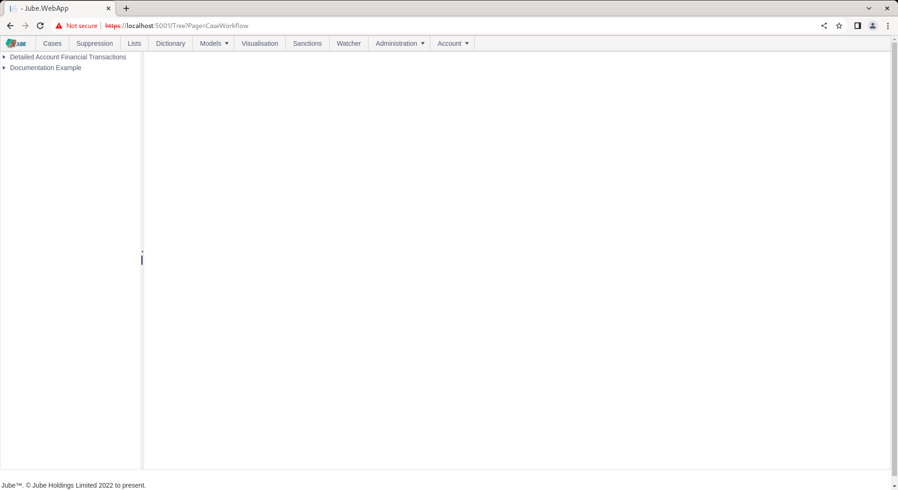
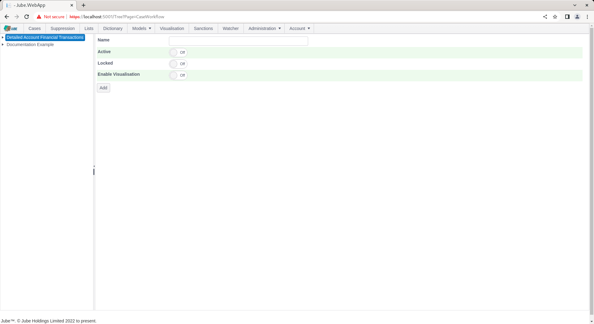
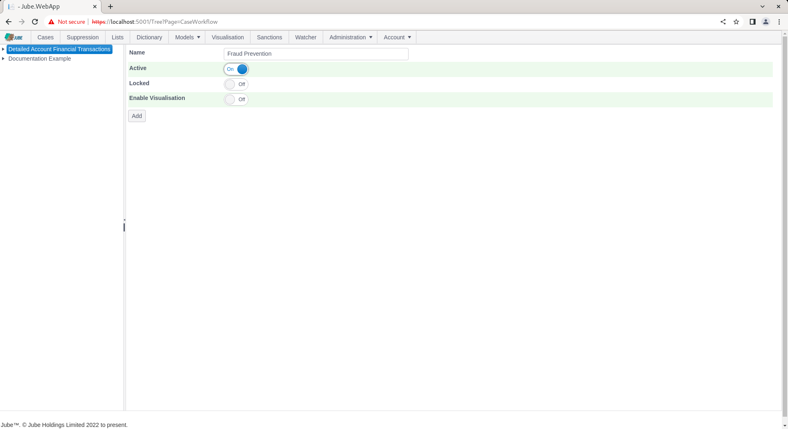
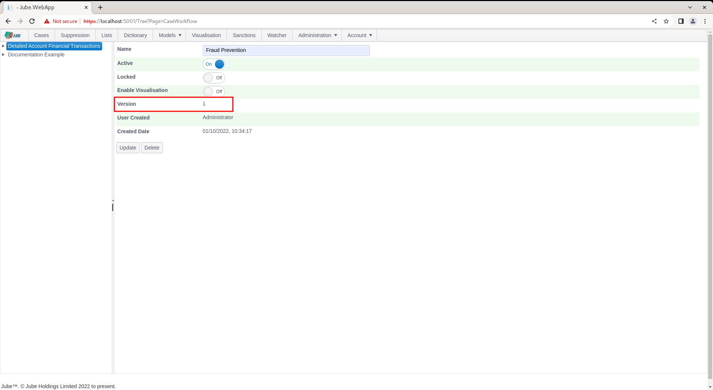
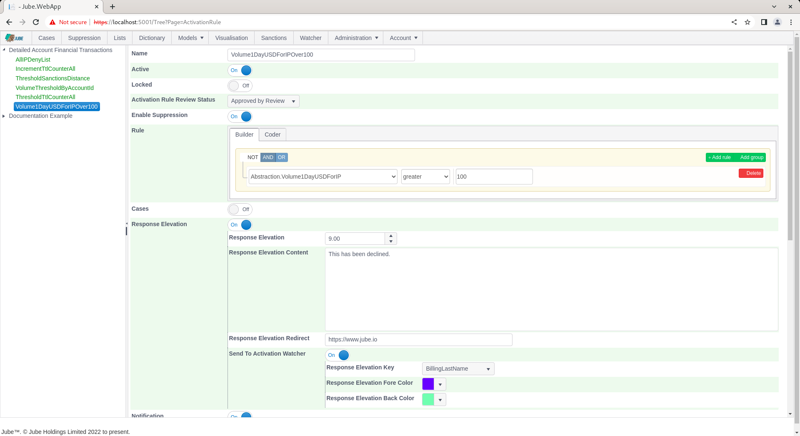
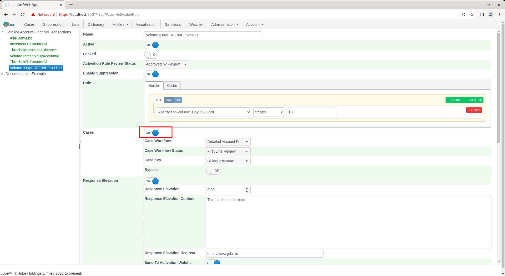
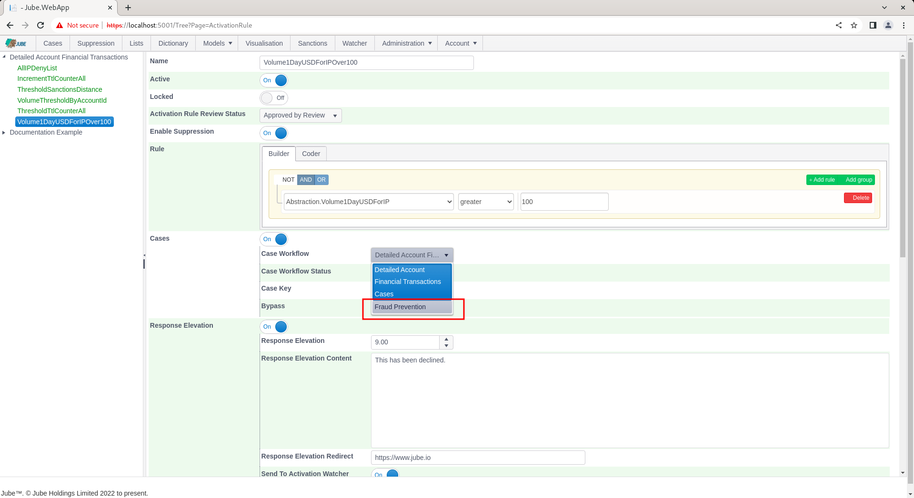
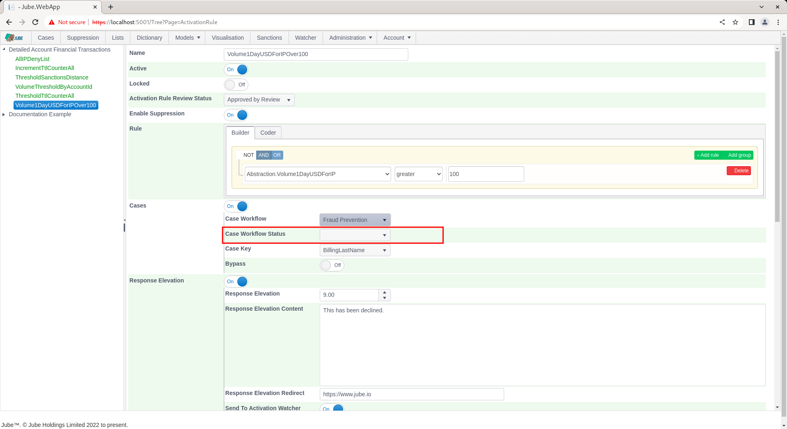

# Creating Case Workflows
A case workflow is a logical stream of work that an agent will be allocated to.  For example,  transaction fraud for the purpose of evaluating stolen debit cards might be slightly different in treatment from an anti money laundering workflow.  Where work effort or agent teams are different,  it make sense to break this into different workflows.

Start by navigating to Models >> Cases Workflows >> Cases Workflows:

Cases Workflows are subordinate to models given that the meta data has been constructed at the model level, henceforth a case workflow can only be a child of a model such that the payload created by the model can reliably be presented by the cases page.

Click on the top of the tree to create a new Cases Workflow for the Detailed Financial Transaction Model:

The parameters available are described as follows:

| Value                | Description                                                                                                                                        | Example               |
|----------------------|----------------------------------------------------------------------------------------------------------------------------------------------------|-----------------------|
| Name                 | The name of the workflow for end user navigation.                                                                                                  | Fraud Prevention      | 
| Enable Visualisation | A flag indicating if this case should present a visualisation taking its parameters from the case payload.  Visualisation is documented elsewhere. | True                  |
| Visualisation        | The visualisation to present subject to Enable Visualisation being selected.                                                                       | Example Visualisation |

Complete the page with the parameters as above and as follows:

Scroll down the page and click the Add button to create a version of the Cases Workflow:

For confirmatory purposes, navigate to the Activation Rule definition for Volume1DayUSDForIPOver100 in the main menu:

Scroll down to Cases switch, and toggle to true:

Click on the Case Workflow drop down,  which will expose the available Case Workflow for which entries can be made:

Clicking on the new Cases Workflow will reveal it to be incomplete for the purposes of case creation,  requiring also a Cases Workflow Status:

## Case ranking

The Cases page orders work by a ranking the engine computes for every open case: how likely the case is to be confirmed (likelihood), how much it would matter (impact), the urgency lane and a Priority from 0 to 100. The engine worker behind it is switched on by `EnableCaseRisk`, and its defaults come from the `CaseRisk*` environment variables. Each Case Workflow can override any of them, so that an anti money laundering workflow and a card fraud workflow are ranked on their own terms. Leave a value empty to use the environment default.

### What the ranking needs before it learns

Likelihood starts from a prior and moves only as closed cases carry an outcome. Open the status configuration and mark at least one status as confirmed and one as not confirmed. Until then every case is ranked mostly on impact, age and value.

### Settings on the Case Workflow

| Value                         | Description                                                                                                                                                   | Default                         |
|-------------------------------|---------------------------------------------------------------------------------------------------------------------------------------------------------------|---------------------------------|
| Typology severity             | How severe cases of this workflow are by nature, from 1 Minimal to 5 Severe.                                                                                  | 3                               |
| Value field                   | The payload field holding the money involved, used to place a case in a money band.                                                                           | None                            |
| Damping (kappa)               | Above 0 and up to 1. Scales how far each piece of evidence moves the likelihood. Lower trusts the evidence less.                                              | 0.7                             |
| Overlapping evidence (rho)    | From 0 to 1. The weight given to evidence that shares inputs with stronger evidence in the same group. 1 counts it in full and 0 ignores it.                  | 0.3                             |
| Prior strength                | Above 0 and up to 10000. How many imaginary cases at the prior rate pull every estimate towards it. Higher is more cautious about few real cases.             | 20                              |
| Prior rate                    | From 0.001 to 0.999. The confirmed rate assumed before the workflow has closed cases with outcomes.                                                           | 0.08                            |
| Deadline window (days)        | From 0 to 365. How many days before a diary deadline a case moves into the deadline near lane.                                                                | 2                               |
| Key history half life (days)  | Above 0 and up to 3650. The age at which earlier closed cases on the same case key count for half as much.                                                    | 180                             |
| Impact weights                | Five positive, strictly increasing numbers separated by commas, one per impact band from Minimal to Severe. Expected harm is likelihood multiplied by the weight. | 1,3,10,30,100                   |
| Money bands                   | Four positive, strictly increasing numbers separated by commas that separate the five money bands of impact.                                                  | 5000,100000,1000000,10000000    |
| Quality review sample rate    | From 0 to 0.5. The share of this workflow's low-priority cases picked at random for a quality review. 0 turns sampling off. See Working Quality Review Samples.                | 0.05                            |

The page refuses values outside these ranges and reports every problem at once.

### When a setting changes

The Daily goal field, from 1 to 1000 and empty for no goal, is the number of cases each analyst aims to close in a UTC day. It sets the progress ring on the My day card of the Cases page and the streak of consecutive days on which the goal was met. With no goal the ring fills once anything is closed and a streak is a run of days with at least one case closed. The goal is a team norm held on the workflow, not a personal target, and it does not affect ranking, so saving it does not trigger reassessment.

Saving a Case Workflow with a different typology severity, value field or any ranking setting marks every open case of that workflow for reassessment. The worker picks them up on its next sweep, and each case whose ranking moves gains a new assessment recorded with the trigger Risk model changed, so that the history shows when and why the ranking shifted. Other workflows are not touched. Closed cases are never reassessed.

### Worked example

With the defaults, a rule whose cases were confirmed 3 times in 10 closed cases has a precision, after shrinking towards the 8 percent prior, of (3 + 20 × 0.08) / (10 + 20) = 15.3 percent. That lifts the log odds by 0.73, damped by kappa to 0.51, for a likelihood of 12.7 percent. With a typology severity of 3 the impact weight is 10, so the expected harm is 1.27 and the Priority is 18. Raising the prior rate to 0.4 for the same workflow lifts every case in it, and raising the impact weights widens the gap between a Severe and a Minimal case.
