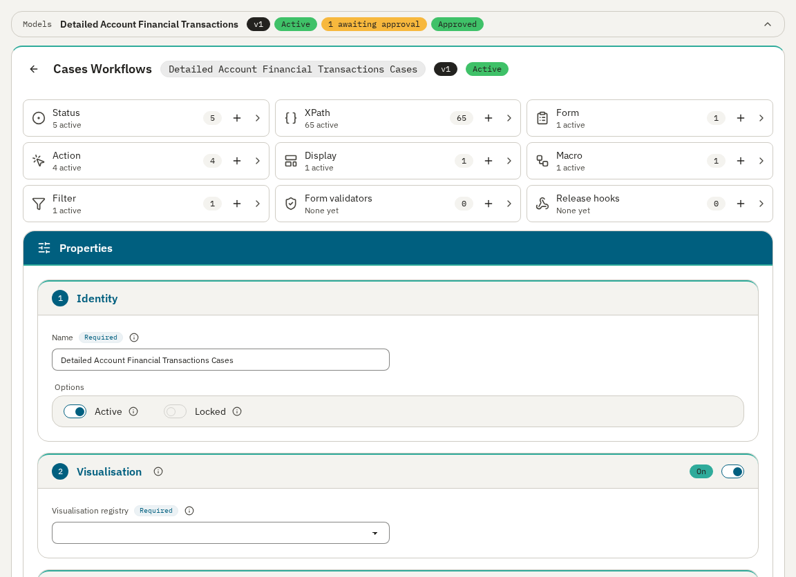

# Creating Case Workflows

A case workflow is a logical stream of work that an agent will be allocated to. For example, transaction fraud for the purpose of evaluating stolen debit cards might be slightly different in treatment from an anti money laundering workflow. Where work effort or agent teams are different, it makes sense to break this into different workflows.

Cases Workflows are subordinate to models given that the meta data has been constructed at the model level, henceforth a case workflow can only be a child of a model such that the payload created by the model can reliably be presented by the cases page. It follows that the parent model of a Case Workflow cannot be changed once the Case Workflow has been created, and an update naming a different model is ignored in that respect.

## Where it lives

Navigate through the menu to Models, open the model, then the Cases Workflows hub card. Creating, changing and deleting a Case Workflow follows the common manner described in [Child Objects](../../../Navigation/ChildObjects/index.html), with the exception that a Case Workflow, and the children of a Case Workflow, are not subject to approval by a second user, which is to say that a change takes effect upon being saved.

Upon opening a Case Workflow, a hub card is presented for each type of child that the Case Workflow may have, with the Properties form of the Case Workflow beneath, and the Roles panel beneath that:

| Hub card        | Description                                                                                                           | Documentation                                                              |
|-----------------|-----------------------------------------------------------------------------------------------------------------------|----------------------------------------------------------------------------|
| Status          | The statuses a case may be allocated to, each of which has a hub card of its own for Checklists.                      | [Cases Workflow Status](../CreatingCaseWorkflowStatus/index.html)          |
| XPath           | The fields extracted from the payload for presentation in the case page and the Case Key Journal.                     | [Case Workflow XPath](../CreatingCaseWorkflowXPath/index.html)             |
| Form            | Structured data capture in the case page.                                                                             | [Case Workflow Form](../CreatingCaseWorkflowForm/index.html)               |
| Action          | Action codes attached to case notes.                                                                                  | [Case Workflow Action](../CreatingCaseWorkflowAction/index.html)           |
| Display         | Custom presentations of the case.                                                                                     | [Case Workflow Display](../CreatingCaseWorkflowDisplay/index.html)         |
| Macro           | Buttons in the case page that fire a Notification or HTTP Endpoint.                                                   | [Case Workflow Macro](../CreatingCaseWorkflowMacro/index.html)             |
| Filter          | The queues through which cases are accessed in the Cases page.                                                        | [Case Workflow Filter](../CreatingCaseWorkflowFilter/index.html)           |
| Form validators | Rules that a submission of a Form must satisfy, as described below.                                                   |                                                                            |
| Release hooks   | The web hooks called to release or refuse a held payment.                                                             | [Case Workflow Release Hook](../CreatingCaseWorkflowReleaseHook/index.html) |

SHOT id=case-management-case-workflow-hub-cards
     route=/models
     steps=open-default-model, open-hub:Cases Workflows, open-first-row
     frame=page
     state=a Case Workflow of the default model opened, showing the collapsed Models and model steps, the hub cards for Status, XPath, Form, Action, Display, Macro, Filter, Form validators and Release hooks with their counts, and the top of the Properties form
     conveys=a Case Workflow is a child of a model and the parent of its own children, each reached from a hub card
     alt=A Case Workflow opened beneath its model, with one hub card for each type of child of the Case Workflow and the Properties form beneath

Two of the children are described in pages of their own:

* Checklists are created beneath a Status rather than beneath the Case Workflow, in the Checklists hub card of the Status, with the Items of a Checklist in a hub card beneath that. The items showing for the status of a case must be ticked in the Decide pane of the case page before the case can be moved to another status, escalated or closed. See [Creating Case Workflow Checklist](../CreatingCaseWorkflowChecklist/index.html).
* Form validators name a Form, a field of that Form and a rule, being one of Required, Required when another field equals a value, Range (numbers or dates), Length (characters), Pattern (regular expression), Compare with another field, In a model list, In a model dictionary or SQL (must return true), such that a submission of the Form not satisfying the rule is refused with the message given. See [Creating Case Workflow Form Validator](../CreatingCaseWorkflowFormValidator/index.html).

## Fields

The fields are arranged in groups, all but Identity being collapsed at first. A switch upon which other fields depend is presented as a card titled for the feature (for example Visualisation), and the dependent fields are presented only once the switch is on. The groups are, in order, Identity, Visualisation, Graph, Risk, Ranking, Service level, Narrative and Audit, the last showing who created and last changed the Case Workflow, when, and its version. For a new Case Workflow every switch is off, Active included, the Typology severity is 3 Moderate, and every other field is empty, each empty setting of the Ranking group showing the default of the environment as its placeholder.

### Identity

| Value  | Description                                                                                                                             | Example          |
|--------|-----------------------------------------------------------------------------------------------------------------------------------------|------------------|
| Name   | The name of the workflow for end user navigation. Required, limited to 256 characters, and unique within the Model without regard to case. | Fraud Prevention |
| Active | Whether new cases can be raised against the Case Workflow.                                                                              | True             |
| Locked | Whether the Case Workflow is protected from change.                                                                                     | False            |

A locked Case Workflow cannot be changed or deleted, and there is no action in the user interface to unlock it.

TODO(verify): Locked is one way for a Case Workflow, there being no unlock action. Owner to confirm that this is intended.

### Visualisation and Graph

| Value                  | Description                                                                                                                                             | Example               |
|------------------------|---------------------------------------------------------------------------------------------------------------------------------------------------------|-----------------------|
| Enable visualisation   | A flag indicating if cases of this workflow should present a visualisation taking its parameters from the case payload. Visualisation is documented in [Visualisations](../../Visualisations/index.html). | True                  |
| Visualisation registry | The visualisation to present, subject to Enable visualisation being selected, in which case it is required and must exist.                               | Example Visualisation |
| Enable graph           | A flag indicating if cases of this workflow should present a Network section, being the graph of the chosen Graph Registry seeded by the case key.       | False                 |
| Graph registry         | The Graph Registry whose network is shown, subject to Enable graph being selected, in which case it is required and must exist.                          | Account Network       |

### Service level

| Value                     | Description                                                                                                                                              | Example |
|---------------------------|----------------------------------------------------------------------------------------------------------------------------------------------------------|---------|
| First view target minutes | The most minutes a new case may wait before anyone first looks at it, measured from creation to the first peek, skim or fetch. Empty for no target.      | 30      |
| Ownership target minutes  | The most minutes a new case may wait before someone takes ownership by locking it, measured from creation to the first lock. Empty for no target.        | 120     |
| Resolution target minutes | The most minutes a case may stay open, measured from creation to closure. Empty for no target.                                                           | 4320    |
| Daily goal                | The number of cases each analyst aims to close in a UTC day, from 1 to 1000. Empty for no goal.                                                          | 25      |

The Daily goal sets the progress ring on the My day card of the Cases page and the streak of consecutive days on which the goal was met. With no goal the ring fills once anything is closed, and a streak is a run of days with at least one case closed. The goal is a team norm held on the workflow, rather than a personal target, and it does not affect ranking, so saving it does not trigger reassessment.

The Risk, Ranking and Narrative groups are described in the sections that follow.

## Case ranking

The Cases page orders work by a ranking the engine computes for every open case: how likely the case is to be confirmed (likelihood), how much it would matter (impact), the urgency lane and a Priority from 0 to 100. The engine worker behind it is switched on by the EnableCaseRisk Environment Variable, and its defaults come from the Environment Variables prefixed CaseRisk, as listed in [Environment Variables](../../../Concepts/EnvironmentVariables/index.html). Each Case Workflow can override any of them, so that an anti money laundering workflow and a card fraud workflow are ranked on their own terms, and a value left empty takes the default of the environment.

### What the ranking needs before it learns

Likelihood starts from a prior and moves only as closed cases carry an outcome. It follows that at least one [Cases Workflow Status](../CreatingCaseWorkflowStatus/index.html) must be given an Outcome of Confirmed and one an Outcome of Not confirmed, as until then every case is ranked mostly on impact, age and value.

### Settings on the Case Workflow

The first two settings are in the Risk group, and the remainder in the Ranking group:

| Value                          | Description                                                                                                                                                                 | Default                      |
|--------------------------------|-----------------------------------------------------------------------------------------------------------------------------------------------------------------------------|------------------------------|
| Value field                    | The name of the field in the case payload holding the money involved, such as Amount, used to place a case in a money band. Empty where the workflow has no money measure, in which case impact rests on typology alone. | None                         |
| Typology severity              | How severe cases of this workflow are by nature, from 1 Minimal, through 2 Low, 3 Moderate and 4 High, to 5 Severe.                                                         | 3                            |
| Risk kappa                     | Damping, above 0 and up to 1. Scales how far each piece of evidence moves the likelihood. Lower trusts the evidence less.                                                   | 0.7                          |
| Risk rho                       | Overlapping evidence, from 0 to 1. The weight given to evidence that shares inputs with stronger evidence in the same group. 1 counts it in full and 0 ignores it.          | 0.3                          |
| Risk prior strength            | Above 0 and up to 10000. How many imaginary cases at the prior rate pull every estimate towards it. Higher is more cautious about few real cases.                           | 20                           |
| Risk base rate prior           | The prior rate, from 0.001 to 0.999. The confirmed rate assumed before the workflow has closed cases with outcomes.                                                         | 0.08                         |
| Risk deadline lane days        | From 0 to 365. How many days before a diary deadline a case moves into the deadline near lane.                                                                              | 2                            |
| Risk key history half life days | Above 0 and up to 3650. The age at which earlier closed cases on the same case key count for half as much.                                                                 | 180                          |
| Risk impact weights            | Five positive, strictly increasing numbers separated by commas, one per impact band from Minimal to Severe. Expected harm is likelihood multiplied by the weight.           | 1,3,10,30,100                |
| Risk money bands               | Four positive, strictly increasing numbers separated by commas that separate the five money bands of impact.                                                                | 5000,100000,1000000,10000000 |
| Risk qa sample rate            | From 0 to 0.5. The share of the low priority cases of this workflow picked at random for a quality review. 0 turns sampling off. See [Working Quality Review Samples](../WorkingQualityReviewSamples/index.html). | 0.05                         |

SHOT id=case-management-case-workflow-ranking-groups
     route=/models
     steps=open-default-model, open-hub:Cases Workflows, open-first-row, open-section:Risk, open-section:Ranking, scroll-to:Risk
     frame=record
     state=the Properties form of the demonstration Case Workflow scrolled to the Risk group, opened to show an empty Value field and a Typology severity of Moderate, with the Ranking group opened beneath it, each of its settings, from Risk kappa to Risk qa sample rate, left unset and showing its default as a greyed hint, and the Service level, Narrative and Audit groups collapsed beneath
     conveys=the ranking of cases is governed by settings held on the Case Workflow itself, each of which falls back to a default until it is set
     alt=The Properties form of a Case Workflow scrolled to its Risk group, showing a Typology severity of Moderate, with the Ranking group opened beneath, its nine settings unset and showing their defaults as greyed hints, above the collapsed Service level, Narrative and Audit groups

### When a setting changes

Saving a Case Workflow with a different Typology severity, Value field or any setting of the Ranking group marks every open case of that workflow for reassessment. The worker picks them up on its next sweep, and each case whose ranking moves gains a new assessment recorded with its trigger, shown in the Risk history of the case as Typology where the Typology severity was among the changes and as Ranking settings changed otherwise, so that the history shows when and why the ranking shifted. The Risk qa sample rate is the exception among the settings of the Ranking group, as it takes no part in the score and a change to it alone marks nothing. Other workflows are not touched, and closed cases are never reassessed.

### Worked example

With the defaults, a rule whose cases were confirmed 3 times in 10 closed cases has a precision, after shrinking towards the 8 percent prior, of (3 + 20 × 0.08) / (10 + 20) = 15.3 percent. That lifts the log odds by 0.73, damped by kappa to 0.51, for a likelihood of 12.7 percent. With a Typology severity of 3 the impact weight is 10, so the expected harm is 1.27 and the Priority is 18. Raising the prior rate to 0.4 for the same workflow lifts every case in it, and raising the impact weights widens the gap between a Severe and a Minimal case.

## Enable Narrative

The Narrative group has one switch, Enable narrative. When it is on, a background job writes an AskJooby narrative note for each open case in the workflow, about hourly, whenever the facts of the case (activations, journal transactions, notes and status) have changed since the last one. Each narrative is a new version of the one before and never replaces anything an analyst wrote. It needs AskJooby, and a system user named in the CaseNarrativeUsers Environment Variable. Narrative notes are presented alongside the notes of the case, as described in [Working Case Note](../WorkingCaseNote/index.html).

## Validation

Validation takes place in the server, and every problem is reported at once rather than one at a time. A Case Workflow is refused where:

* The Name is empty, longer than 256 characters, or already in use by another Case Workflow of the same Model, without regard to case.
* The Model does not exist.
* Enable visualisation is on and the Visualisation registry is not chosen or does not exist, and likewise for Enable graph and the Graph registry.
* A setting of the Ranking group is outside the range given in the table above, or Risk impact weights or Risk money bands is longer than 200 characters.
* The Daily goal is given and is not from 1 to 1000.

The messages returned are as follows, each against the field to which it belongs:

| Condition                                                   | Message                                                                                   |
|-------------------------------------------------------------|-------------------------------------------------------------------------------------------|
| Name empty                                                  | The name is required.                                                                     |
| Name longer than 256 characters                             | The name cannot exceed 256 characters.                                                    |
| Name already in use in the Model                            | This name already exists.                                                                 |
| Model missing                                               | The referenced model was not found in your tenant.                                        |
| Enable visualisation on, Visualisation registry not chosen  | A visualisation is required when visualisation is enabled.                                |
| Visualisation registry does not exist                       | The visualisation could not be found.                                                     |
| Enable graph on, Graph registry not chosen                  | A graph registry is required when the graph is enabled.                                   |
| Graph registry does not exist                               | The graph registry could not be found.                                                    |
| Risk kappa not above 0 and up to 1                          | The ranking damping must be above 0 and no more than 1.                                   |
| Risk rho not from 0 to 1                                    | The ranking weight for overlapping evidence must be between 0 and 1.                      |
| Risk prior strength not above 0 and up to 10000             | The ranking prior strength must be above 0 and no more than 10000.                        |
| Risk base rate prior not from 0.001 to 0.999                | The ranking prior rate must be between 0.001 and 0.999.                                   |
| Risk deadline lane days not from 0 to 365                   | The ranking deadline window must be between 0 and 365 days.                               |
| Risk key history half life days not above 0 and up to 3650  | The ranking key history half life must be above 0 and no more than 3650 days.             |
| Risk impact weights not five increasing positive numbers    | The ranking impact weights must be five positive numbers, increasing, separated by commas. |
| Risk impact weights longer than 200 characters              | The ranking impact weights must be 200 characters or fewer.                               |
| Risk money bands not four increasing positive numbers       | The ranking money bands must be four positive numbers, increasing, separated by commas.   |
| Risk money bands longer than 200 characters                 | The ranking money bands must be 200 characters or fewer.                                  |
| Risk qa sample rate not from 0 to 0.5                       | The quality review sample rate must be between 0 and 0.5.                                 |
| Daily goal not from 1 to 1000                               | The daily goal must be between 1 and 1000 cases.                                          |
| A Service level target given and not from 1 to 525600       | A service level target must be between 1 and 525600 minutes, or left empty for no target. |

Each of the three targets of the Service level group, where given, is limited to between 1 and 525600 minutes, which is a year, and is left empty where there is to be no target. The Value field is not checked against the payload: a Value field naming an element that the payload does not have leaves a case without a money measure, exactly as an empty Value field does.

## Example

A Case Workflow named Fraud Prevention, with Active switched on and all else left as the default, is adequate to begin. For confirmatory purposes, open an [Activation Rule](../../Models/BasicActivationRules/index.html) of the same model, for example Volume1DayUSDForIPOver100, and in the Case Workflow group switch on Cases. The new Case Workflow is offered in the Case workflow selection, yet upon selecting it the Case workflow status selection is found to be empty. It can be seen that the Case Workflow is incomplete for the purposes of case creation, requiring also a [Cases Workflow Status](../CreatingCaseWorkflowStatus/index.html).

## Permissions and security

Creating, changing and deleting a Case Workflow, and the allocation of roles to it, requires permission 18, Read Write Case Workflow. The list of the Case Workflows of a model, as it is offered to an Activation Rule, is also available to a user holding permission 17, Read Write Activation Rule, and the active Case Workflows are available to a user holding permission 1, Read Write Case, for the purposes of the Cases page.

Each type of child has a permission of its own, which also governs the allocation of roles to that child: 19, Read Write Cases Workflows Status, which extends to Checklists; 20, Read Write Case Workflow XPath; 21, Read Write Cases Workflow Form, which extends to Form validators; 22, Read Write Cases Workflow Action; 23, Read Write Cases Workflow Display; 24, Read Write Cases Workflow Macro; 25, Read Write Cases Workflow Filter; and 69, Author Case Workflow Release Hooks. Writing or changing SQL on any of them requires in addition permission 67, Author Case Workflow SQL.

A Case Workflow is available in the Cases page only to the roles allocated to it in the Roles panel, as described in [Case Management Security Policy](../SecurityPolicy/index.html).
