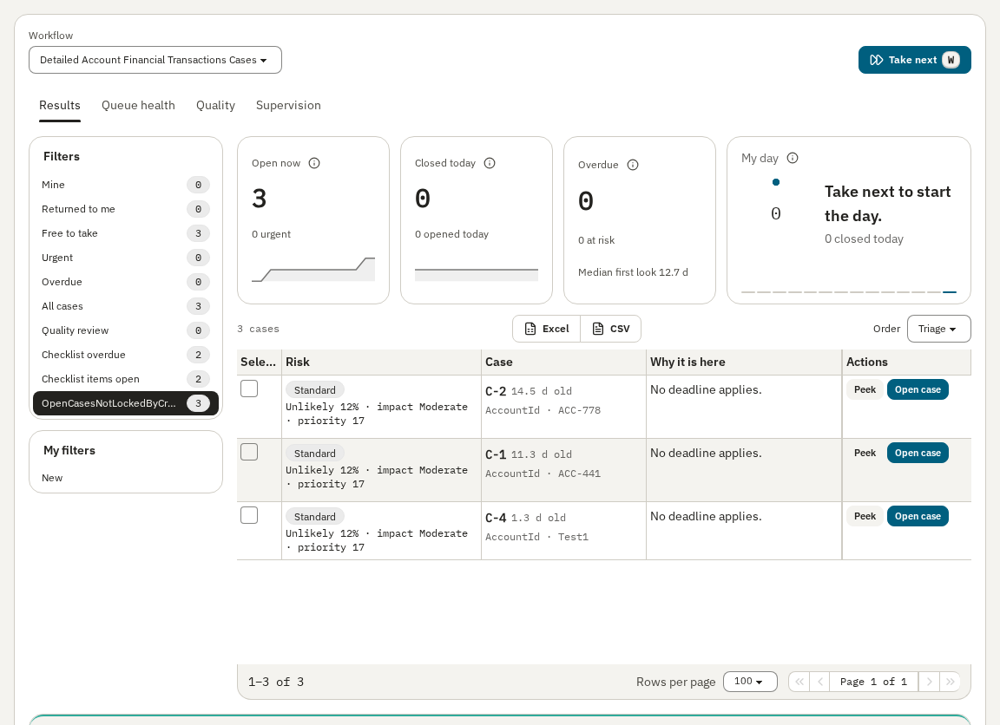

# Creating Status Elevation

Consider the scenario where a rule creates a case having allocated a status of FLD (First Line Defence) as a consequence of a velocity rule having matched. Thereafter, suppose a transaction occurs in a sanctioned country, which is of course a much higher risk event than a velocity having been breached. Status elevation is able to change the status in an upward, more severe direction, on rule match, yet not allow for the status to be changed to a less severe, downward direction.

If the case exists in all but a closed status, another case may never be created for a Case Key Value combination. However, it is possible to raise the status priority based on subsequent rule matches.

## Where it lives

There is no switch for status elevation, it being a consequence of two things configured elsewhere:

* The Priority of each [Cases Workflow Status](../CreatingCaseWorkflowStatus/index.html), found by navigating through the menu to Models, opening the model, then the Cases Workflows hub card, opening the Case Workflow, then the Status hub card.
* The Case workflow status selected in the Case Workflow group of an [Activation Rule](../CreatingCaseEntryWithActivationRule/index.html), found in the Activation Rules hub card of the same model.

## Behaviour

Upon an Activation Rule creating a case, where a case already exists for the Case Key and Case Key Value in the Case Workflow, and is in all but a closed status, the Priority of the status selected in the Activation Rule is compared with the Priority of the status in which the case currently stands:

| Comparison                                                         | Outcome                                                                                                     |
|--------------------------------------------------------------------|-------------------------------------------------------------------------------------------------------------|
| The status of the Activation Rule is of a stronger priority.       | The case is moved to the status of the Activation Rule, which is to say that it is elevated.                |
| The status of the Activation Rule is of an equal or weaker priority. | The case remains in the status in which it stands.                                                        |

Priority is strongest at Ultra high and weakest at Ultra low. Upon elevation, any lock held on the case is released such that the case is free to be taken afresh, the stay in the old status is closed and a stay in the new status opened, recorded with the reason Escalated, and checklist items still open in the old status do not hold back the move. The Notification and HTTP Endpoint of the new status are dispatched as for any case arriving in that status, as described in [Creating Automation](../CreatingAutomation/index.html).

Moving a case onwards on account of time or urgency, rather than a subsequent rule match, is the purpose of [Creating Automatic Escalation](../CreatingAutomaticEscalation/index.html).

## Example

In the default model, open the Cases Workflow Status named First Line Review, noting the Priority as being Ultra low. Open thereafter the Cases Workflow Status named Reported, noting the Priority as being Ultra high.

To demonstrate the status elevation, identify a Case Key and Case Key Value that is currently open in the status First Line Review, by navigating to the Cases page, choosing the Case Workflow and selecting the Cases Workflow Filter All Open. Open a case, for example the case with an id of 1, and make a note of the Case Key Value from the heading of the case, in this case AccountId = Test1.

Open the existing Activation Rule named Case Creation, and in the Case Workflow group change the Case workflow status to Reported. The change to the Activation Rule is subject to approval, as described in [Child Objects](../../../Navigation/ChildObjects/index.html), and is taken up by the engine at its next cycle thereafter.

Repeat the HTTP POST to endpoint [https://localhost:5001/api/invoke/EntityAnalysisModel/90c425fd-101a-420b-91d1-cb7a24a969cc](https://localhost:5001/api/invoke/EntityAnalysisModel/90c425fd-101a-420b-91d1-cb7a24a969cc), noting AccountId to be Test1.

Return to the Cases page and select the Cases Workflow Filter All Open once more. Notice in the grid of cases that the case has been elevated to the Reported status from its original default status, as identified by a change in colour and the upward classification of the Priority, which can be seen also on opening the case.

SHOT id=status-elevation-cases-grid
     route=/cases
     steps=click:OpenCasesNotLockedByCreatedDate
     frame=page
     state=the Results grid of the Cases page for the All Open filter, with one case in the Reported status shown in the colours of that status among cases remaining in First Line Review
     conveys=an elevated case is told apart in the queue by the colours and priority of its new status
     alt=The grid of open cases with one case shown in the colours of the Reported status and the remainder in First Line Review

## Permissions and security

Setting the Priority of a status requires permission 19, Read Write Cases Workflows Status, and selecting the status in an Activation Rule requires permission 17, Read Write Activation Rule. The elevation itself is made by the engine upon the transaction being processed, and does not depend on the permissions of any user.

Keep in mind that a case elevated to a status allocated to fewer roles is thereafter isolated from the remaining roles, as described in [Case Management Security Policy](../SecurityPolicy/index.html).
