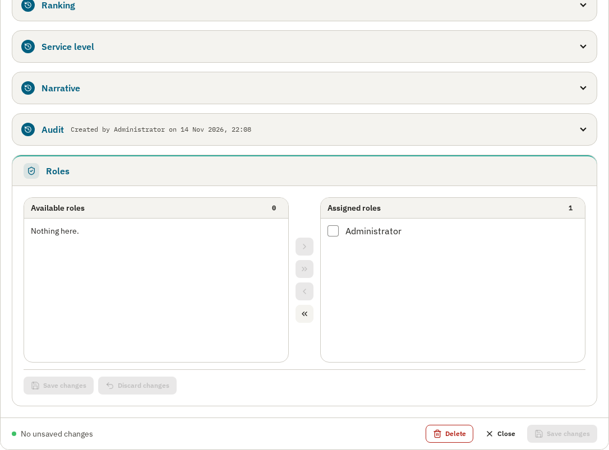

# Case Management Security Policy

Entities relating to case management allow for the allocation of roles for the isolation of Case data by that entity. In a practical sense, it allows for the hiding of data which has been escalated in a Case, or the removal of certain actions or data availability upon that Case. Consider the scenario where a Case has been created on one status, yet the analyst deems it at that stage appropriate to escalate it to the next level of review. Should that Case then be further escalated, it might arrive at a level of concern where the Case is no longer appropriate to be accessed by junior analysts, which would be true of not only the Case, but other supporting material for the Case including Case Notes, Case Uploads, Case Journal and Case Audit. Case data isolation represents an important regulatory requirement.

Every Case entity that carries the Roles panel supports the allocation of roles and therefore isolation of data where that entity is apportioned.

The role allocations are joined upon recall in the Cases page and the case page, having the effect of that data not being in existence unless it is possible to join back to the user, through the role, through the allocation and to that Case entity.

## Where it lives

Role allocation is made in the record of the Case entity itself. Taking the Case Workflow entity, navigate through the menu to Models, open the model, then the Cases Workflows hub card, and open the Case Workflow. Beneath the Properties form of the record is a panel titled Roles. The panel is presented for a record that exists, hence a new Case entity is created first and its roles allocated thereafter.

The Roles panel is common to the following Case entities, each being reached from its hub card beneath the Case Workflow:

* Case Workflows.
* Case Workflow Status.
* Case Workflow XPath.
* Case Workflow Form.
* Case Workflow Action.
* Case Workflow Display.
* Case Workflow Macro.
* Case Workflow Filter.

Release hooks, Form validators and the Checklists of a status do not carry a Roles panel.

The Role allocations have different implications to data Case entity isolation, as is explained in the sections below.

## The Roles panel

The panel presents two lists, with controls between them to move roles from one to the other:

| Element            | Description                                                                                         |
|--------------------|-----------------------------------------------------------------------------------------------------|
| Available roles    | The roles of the tenant not allocated to the Case entity.                                           |
| Assigned roles     | The roles having been allocated to the Case entity.                                                 |
| Assign selected    | Moves the roles selected in Available roles to Assigned roles.                                      |
| Assign all         | Moves every role to Assigned roles.                                                                 |
| Unassign selected  | Moves the roles selected in Assigned roles back to Available roles.                                 |
| Unassign all       | Moves every role back to Available roles.                                                           |
| Save changes       | Stores the allocation, the number of changes not yet saved being stated alongside.                  |
| Discard changes    | Restores the lists to the allocation as it is stored.                                               |

Nothing is stored until Save changes is clicked, upon which confirmation is returned as Roles saved. The allocation is saved separately from the Properties form of the record, and is not subject to approval. The number of changes not yet saved is stated in the form 2 unsaved, a list having nothing in it states Nothing here., and while the roles are being read the panel states Loading roles, or, should they fail to be read, The roles could not be loaded. Refresh the page to try again.

A Case entity having nothing in Assigned roles is available to nobody in the Cases page and the case page, the Administrator included, there being no role that stands outside of the allocation. It follows that the allocation of roles is as much a step in creating a Case Workflow, a status or a filter as is switching it to Active, and a newly created Case Workflow that cannot be found in the Workflow selection of the Cases page is most commonly one whose roles, or the roles of whose statuses, have yet to be allocated.

In the default installation, the Administrator role is allocated to each Case entity. This happens in migrations for the Administrator role in the Landlord Tenant only, and otherwise allocations need to be manually created.

SHOT id=case-security-policy-roles-panel
     route=/models
     steps=open-default-model, open-hub:Cases Workflows, open-first-row, scroll-to:Roles
     frame=record
     state=a Case Workflow of the default model opened and scrolled to the Roles panel, with Administrator in Assigned roles and at least one further role in Available roles
     conveys=roles are allocated to a Case entity in a panel beneath its form, and only allocated roles can reach the data
     alt=The Roles panel of a Case Workflow record showing a list of available roles, a list of assigned roles containing Administrator, and the controls to move roles between them



## Audit and Preservation

In the database, Role allocations are logically deleted (which is to say that an allocation removed is marked as deleted, and one in force has "Deleted" = 0), and there remains a full audit of role allocations:

```sql
select * from "CaseWorkflowRole"
```

The allocations of the other Case entities are held in tables named in the same manner, for example "CaseWorkflowStatusRole" and "CaseWorkflowXPathRole".

The Role allocations are fully supported in [Preservation](../../Preservation/index.html), which ensures that Role allocations are available for the Import and Export of a tenant environment.

## Cases Page Isolation

Cases Page refers to the searching of cases based upon a given criteria, for example, all Open cases for a given Case Workflow Status and not Locked. Escalation is performed by upwardly moving Case Workflow Status allocations via the case page.

Cases Page isolation exhibits the following behaviours:

| Recall                                              | Role Allocation Isolation               | Description                                                                                                                                                                                                                                                                                                                                                                                                                                    |
|-----------------------------------------------------|-----------------------------------------|------------------------------------------------------------------------------------------------------------------------------------------------------------------------------------------------------------------------------------------------------------------------------------------------------------------------------------------------------------------------------------------------------------------------------------------------|
| Available Case Workflows                            | Case Workflow.                          | The Case Workflow will only be available in the Workflow selection of the rail given Case Workflow Role Allocation. Where no Case Workflow is allocated, the page states that no case workflow is available to the role.                                                                                                                                                                                                                      |
| Available Case Workflow Filter                      | Case Workflow and Case Workflow Filter. | The Case Workflow Filter will only be available in the Filters of the rail given Case Workflow Role Allocation and Case Workflow Filter Role Allocation. The Case Workflow Filter Role Allocation is largely cosmetic, as the same isolation is enforced in the Cases Session Query (which is to say Peek and Skim).                                                                                                                         |
| Cases Session Query (Peek and Skim)                 | Case Workflow and Case Workflow Status. | On Peek or Skim a query is composed on the basis of configuration made in the Columns and order and Filter parts of the Case Workflow Filter selected in the rail. The Case Session Query will join through the Role Allocations for Case Workflows and Case Workflow Status, and only on a successful join of both Case Workflow and Case Workflow Status will the data be returned. The same Case Session Query is used across both Peek and Skim functionality. |
| Completions \ Query Builder Completion Availability | Case Workflow XPath.                    | Specific fields can be hidden from the Payload fields and the Case Key Journal in the case page, and this is represented also in the availability of those fields in the Completions \ Query Builder Completion Availability and the Cases Session Query (Peek and Skim). Some care needs to be taken not to create a conflict with the availability of fields in Case Workflow Filters Role allocations and Case Workflow XPath Role allocations. |

## Case Page Isolation

Case Page isolation exhibits the following behaviours:

| Recall                         | Role Allocation Isolation                                     | Description                                                                                                                                                                                                                                                                                                                                                                                                                                                                                                               |
|--------------------------------|---------------------------------------------------------------|---------------------------------------------------------------------------------------------------------------------------------------------------------------------------------------------------------------------------------------------------------------------------------------------------------------------------------------------------------------------------------------------------------------------------------------------------------------------------------------------------------------------------|
| Case Key Journal               | Case Workflow XPath.                                          | The Case Key Journal fetches Archive records on the basis of the Case Key and Case Key Value combination in the JSON payload data in the Postgres database. It will return all data matching. The actual fields presented can be restricted using the Case Workflow XPath, which is useful for hiding sensitive or otherwise encrypted data.                                                                                                                                                                            |
| Case Workflow Display          | Case Workflow Display and Case Workflow XPath.                | The Case Workflow Display restricts a formal presentation of the data returned in the Case Key Journal, extracting the transaction payload information for the matching transaction guid only and presenting that as Case context. On Case Workflow Display Role Allocation being available the option to render will be in the View selection of the case page, otherwise unavailable.                                                                                                                              |
| Case Journal                   | Case Workflow and Case Workflow Status.                       | The Case Journal is an audit of all Cases opened, and then closed, on a Case Key and Case Key Value combination. The Case Journal will only return records given Case Workflow Allocation and Case Workflow Status Allocation matching via the Case Id.                                                                                                                                                                                                                                                                 |
| Case Notes                     | Case Workflow, Case Workflow Status and Case Workflow Action. | The Case Notes returns all notes created under a Case Key and Case Key Value combination. The Case Notes will only return records given Case Workflow Allocation and Case Workflow Status Allocation matching via the Case Id. Furthermore, the Case Notes are isolated by Case Workflow Action Role Allocation, which allows for the more general hiding of notes based on Case Workflow Actions available to a given role.                                                                                           |
| Case Events Journal            | Case Workflow and Case Workflow Status.                       | The Case Events Journal is a granular record of Case access and maintenance by a user or background engine. The Case Events Journal will only return records given Case Workflow Allocation and Case Workflow Status Allocation matching via the Case Id. Granular isolation of the audit entry type is not supported, henceforth, if a case is deemed sensitive, it needs to be moved to a Case Workflow Status to have the effect of isolating the full audit.                                                       |
| Case Forms Journal             | Case Workflow, Case Workflow Status and Case Workflow Form.   | The Case Forms Journal is a granular record of invocations of the Case Workflow Forms functionality, including a capture of all data submitted via the form, alongside the Case context. The Case Forms Journal will only return records given Case Workflow Allocation and Case Workflow Status Allocation matching via the Case Id, and entries of forms not allocated to the role are left out. Case Workflow XPath Role Allocation is not supported at this time, henceforth, if a case is deemed sensitive, it needs to be moved to a Case Workflow Status to have the effect of isolating the full audit. |
| Case Uploads                   | Case Workflow and Case Workflow Status.                       | The Case Uploads is a container of all documents brought together for a Case Key and Case Key Value combination. The Case Uploads will only return records given Case Workflow Allocation and Case Workflow Status Allocation matching via the Case Id.                                                                                                                                                                                                                                                                 |
| Case Visualisation             | Delegated to Visualisation, as documented elsewhere.          | The Case Visualisation is configured in the Case Workflow to pair to a Visualisation, but otherwise, it is functionality that is entirely delegated to the Visualisation Role Allocation functionality of the system. Refer to [Security Policy for Visualisation](../../Visualisations/SecurityPolicy/index.html).                                                                                                                                                                                                     |
| Case Workflow Macro Invocation | Case Workflow Macro and Case Workflow.                        | Putting aside that in the absence of Role Allocation, the Case Workflow Macro will not be displayed, a Case Workflow Macro invocation verifies Case Workflow Macro Role Allocation and Case Workflow Role Allocation before allowing for execution, and runs only against a case of the Case Workflow to which the macro belongs. The full Case context is made available for Case Workflow Macro invocation. Not found is returned in the case of the macro or the case not being available on invocation.              |
| Case Form Invocation           | Case Workflow and Case Workflow Form.                         | Putting aside that in the absence of Role Allocation, the Case Workflow Form will not be displayed, a Case Workflow Form invocation verifies Case Workflow Form Role Allocation and Case Workflow Allocation. The full Case context is made available for Case Workflow Form invocation. Not found is returned in the case of the form, the status or the case not being available on invocation.                                                                                                                       |
| Case Update                    | Case Workflow and Case Workflow Status.                       | Case update validates the Case Workflow Status Allocations and Case Workflow Roles Allocations, refusing an update that is requested without appropriate allocation.                                                                                                                                                                                                                                                                                                                                                      |
| Case Fetch                     | Case Workflow and Case Workflow Status.                       | Returning not found in the case of Case Workflow and Case Workflow Status not being allocated.                                                                                                                                                                                                                                                                                                                                                                                                                            |

TODO(verify): this page formerly stated that Case Update, and the invocation of a Macro or a Form, return Bad Request in the event of the roles not being allocated. From the code the Macro and Form invocations answer not found (CaseWorkflowMacroExecutionService, CaseWorkflowFormEntryService); confirm on a running system the status returned by a Case Update made without the Case Workflow or Case Workflow Status being allocated, and state it in the Case Update row.

## Permissions and security

Role allocation is the second of two controls, the first being the permissions granted to the role, as described in [Permissions](../../Administration/Permissions/index.html). A user works cases given permission 1, Read Write Case, yet sees only that which the roles of the user have been allocated in the manner of this page.

The allocation of roles to a Case entity requires the permission to maintain that entity:

| Case entity           | Permission                                 |
|-----------------------|--------------------------------------------|
| Case Workflows        | 18, Read Write Case Workflow               |
| Case Workflow Status  | 19, Read Write Cases Workflows Status      |
| Case Workflow XPath   | 20, Read Write Case Workflow XPath         |
| Case Workflow Form    | 21, Read Write Cases Workflow Form         |
| Case Workflow Action  | 22, Read Write Cases Workflow Action       |
| Case Workflow Display | 23, Read Write Cases Workflow Display      |
| Case Workflow Macro   | 24, Read Write Cases Workflow Macro        |
| Case Workflow Filter  | 25, Read Write Cases Workflow Filter       |

Keep in mind that the SQL for the case, which a Form, Display, Macro, Action or Status may carry, runs with the access of its author rather than that of the user opening the case, and it follows that the tables it reads are not isolated by the allocations of this page, as described in [Case Workflow Display](../CreatingCaseWorkflowDisplay/index.html).
