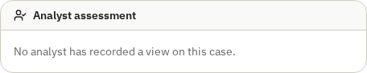

# Working Analyst Assessment

The likelihood presented on a case is computed from evidence. An analyst having read the case may well see it differently, and that difference is worth keeping, as it is the only record of human judgement made before the case is decided. The analyst assessment exists for the purposes of recording the analyst's own view of how likely the case is to be confirmed, as Low, Medium or High, together with a reason.

The view is kept beside the computed likelihood, which is to say that it never replaces the computed value, it never changes the priority, the lane or the order of the case in a queue, and it is not used to train a model. Only the outcome with which a case is closed does that.

## Where it lives

Navigate to a case record from the Cases page. The assessment is presented in two places, in keeping with the canvas of the case page being read only and all actions being taken in the Decide pane:

* The card titled Your assessment in the Decide pane, under On this case, is where a view is recorded and withdrawn.
* The panel titled Analyst assessment, at the foot of the Case detail views section, is where the views recorded on the case are read.

SHOT id=case-analyst-assessment-panel
     route=/cases
     steps=open-demo-case, scroll-to:Analyst assessment
     frame=section:Analyst assessment
     state=a demonstration case with a High view recorded by the signed in analyst, the Analyst assessment panel in the Case detail views section showing the view, who recorded it and when, the reason, the computed likelihood at the time and one earlier view marked Withdrawn, with the Your assessment card visible in the Decide pane carrying a High badge
     conveys=the view of the analyst is recorded in the Decide pane and read in the canvas, beside the computed likelihood and never in place of it
     alt=A case page with the Analyst assessment panel showing a High view with its reason and the computed likelihood at the time, an earlier withdrawn view beneath it, and the Your assessment card in the Decide pane



## Recording a view

The Your assessment card takes the following:

| Value                       | Description                                                                               | Example                                             |
|-----------------------------|-------------------------------------------------------------------------------------------|-----------------------------------------------------|
| Your view of the likelihood | The view of the analyst, being one of Low, Medium or High.                                | High                                                |
| Why you hold this view      | The reason for the view. Required, and limited to 1,000 characters.                       | Third new device in a week, payee never seen before. |

The view is chosen from three buttons side by side, reading Low, Medium and High, none of which is chosen upon the card being drawn, and the reason is typed beneath, in a box that will not accept more than 1,000 characters. The help mark beside the title reads "Record your own view of how likely this case is to be confirmed. It is kept beside the computed likelihood, never replaces it and never changes where the case is ranked. Only you can withdraw a view you recorded."

Record assessment is not available until a view has been chosen and a reason given, a reason of spaces alone not being counted. It is not necessary to hold the case to record a view, keeping in mind that the view changes nothing about the case itself, and for the same reason a view may be recorded on a case that is closed.

The three views are deliberately coarse. Low is to be read as the analyst expecting the case to be closed as not confirmed, High as expecting it to be confirmed, and Medium as being unable to say either way. The computed likelihood is a percentage, and the view is not asked for as one, as the purpose is to capture which way the judgement of a person leans and not to have a person imitate a model.

Upon being recorded, the message Assessment recorded is shown, the buttons and the reason are cleared ready for another, and the view is shown in the Analyst assessment panel with the analyst having recorded it and the time, the reason, and the computed likelihood in force at that moment, presented as Computed likelihood at the time. The Likelihood figure at the top of the Case detail views section gains a line, for example "Analyst view: High", so that the two can be read together. The Your assessment card carries the analyst's own view as a badge for as long as it is the current view.

Recording another view makes the new one current. The earlier views stay listed in the panel under Earlier views, and the 20 most recent views on the case are presented.

A case has one current view at a time, being the most recent view that has not been withdrawn, whoever recorded it. It follows that where a second analyst records a view, theirs becomes the current view of the case and the view of the first analyst moves to Earlier views, where it remains to be read. The badge on the Your assessment card, and the Withdraw button, are shown only to the analyst whose view is the current one.

## Reading the panel

The Analyst assessment panel is read only and presents the following:

| Value                           | Description                                                                                                      | Example                                   |
|---------------------------------|------------------------------------------------------------------------------------------------------------------|-------------------------------------------|
| The view                        | The current view, as a badge.                                                                                    | High                                      |
| The analyst and the time        | Who recorded the current view, and when.                                                                         | Administrator, 16 Nov 2026 10:42          |
| The reason                      | The reason given, in full.                                                                                       | Third new device in a week.               |
| Computed likelihood at the time | The computed likelihood of the case at the moment the view was recorded, as a percentage. Omitted where the case had not yet been assessed. | Computed likelihood at the time: 62% |
| Earlier views                   | Each earlier view, newest first, with its analyst, time and reason, and marked Withdrawn where it was withdrawn. | Low, Withdrawn                            |

Before any view has been recorded, the panel states No analyst has recorded a view on this case. Where every view has been withdrawn, that same sentence is shown above the Earlier views.

The point of placing the computed likelihood beside the view is the comparison. A view of High recorded against a computed likelihood of 20% is a disagreement between the person and the evidence as the system weighed it, and it is those disagreements, once the case has been decided, that say whether the scoring or the analyst was the better guide.

By way of illustration, an analyst reading the demonstration case on AccountId ACC-441 notices the purchase in London forty minutes after one in Cairo, chooses High, types "Card present in two countries within the hour", and selects Record assessment. The Your assessment card then carries a High badge, the panel shows High with the name, the time, the reason and the computed likelihood at the time, the Likelihood figure gains the line "Analyst view: High", and the Events of the case gain Analyst assessment recorded. The priority of the case, and its place in the queue, are exactly as they were.

## Withdrawing a view

The analyst having recorded the current view is offered Withdraw in the Your assessment card, for example upon having recorded it on the wrong case. Withdraw acts at once, without asking for confirmation, and the message Assessment withdrawn is shown. A withdrawn view stays in Earlier views, marked Withdrawn, and the view before it becomes current again.

It is not possible to withdraw a view recorded by someone else, and a request to do so is refused by the server with the message Only the analyst who recorded an assessment can withdraw it. An analyst holding a different view records their own instead. A view cannot be edited, the manner of correcting one being to record another, or to withdraw it.

## In the Events timeline

Recording a view writes an Analyst assessment recorded event to the case, showing the view that stood before and the new one. Withdrawing writes an Analyst assessment withdrawn event showing the view withdrawn. The events hold the views only, and the reason stays in the panel.

## Validation

A view is validated in the server, and is rejected where:

* The view is not one of Low, Medium or High.
* The reason is empty.
* The reason is longer than 1,000 characters.
* The case does not exist, or is not visible to the user.

The messages and statuses returned are as follows:

| Circumstance                                         | Message                                                      | Status |
|------------------------------------------------------|--------------------------------------------------------------|--------|
| No case given                                        | The case is required.                                        | 400    |
| The view is not 1, 2 or 3                            | The likelihood must be 1, 2 or 3.                            | 400    |
| The reason is empty                                  | A reason is required.                                        | 400    |
| The reason is over 1,000 characters                  | The reason must be at most 1000 characters.                  | 400    |
| Withdrawing a view recorded by someone else          | Only the analyst who recorded an assessment can withdraw it. | 409    |
| The case or the view does not exist, or is not visible |                                                            | 404    |
| The user lacks the permission                        |                                                              | 403    |

The reason is trimmed of leading and trailing spaces before it is stored. Withdrawing a view that is already withdrawn is accepted and changes nothing.

## What is stored

Each view is a row of the `CaseAnalystAssessment` table holding the case, the view, the reason, the analyst, the time, and the sequence and value of the computed likelihood in force when it was recorded. Rows are never changed except to mark a withdrawal, and it follows that the views can later be compared with how the cases were decided.

The comparison of the views with outcomes, and with the computed likelihood, is recorded but is not at present reported anywhere. A view is not shown in the columns of the Cases page, it is not included in exports, and Ask Jooby has no tool to read or record one.

## Example

The API underlying the card is as follows:

```http
GET /api/CaseAnalystAssessment/ByCaseId/{caseId}
POST /api/CaseAnalystAssessment/Record
POST /api/CaseAnalystAssessment/Withdraw
```

A view is recorded with the case, the view (1 for Low, 2 for Medium and 3 for High) and the reason:

```json
{
  "caseId": 1,
  "likelihoodId": 3,
  "reason": "Third new device in a week, payee never seen before."
}
```

A view is withdrawn by its identifier, as returned upon recording and in the list for the case:

```json
{
  "guid": "5f0b6f0e-2f0c-4a57-9c1e-0d7f3a1b2c3d"
}
```

## Permissions and security

Recording, withdrawing and reading views requires permission 1, Read Write Case, and the case must be visible to the user, which is to say that a role of the user is granted the Case Workflow and the status the case is in. Every analyst able to see the case sees every view recorded on it, alongside the reason and the analyst having recorded it.
