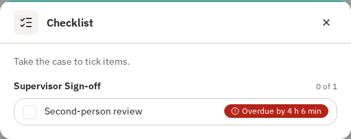
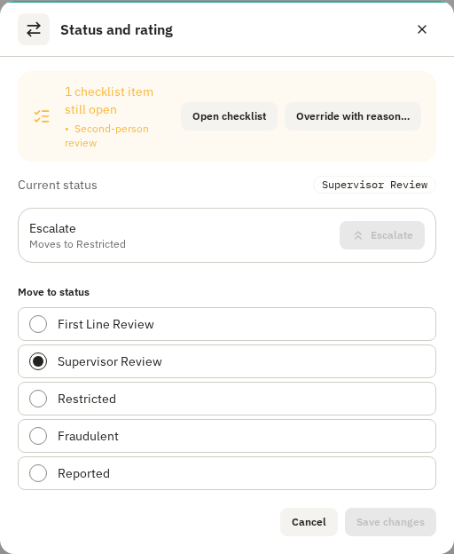

# Working Case Checklists

A checklist is the procedure for the status a case is in, set out as steps to be ticked: review the transactions, record a note, contact the customer. It exists for the purposes of answering, at a glance, what remains to be done on this case before it may be moved on, and of ensuring that a case does not leave a status, nor close, with a step outstanding.

The checklists are configured against a Cases Workflow Status as described in [Creating Case Workflow Checklist](../CreatingCaseWorkflowChecklist/index.html). This page describes the checklist as it is met on a case. The terms used are as follows:

| Term          | Meaning                                                                                                                                             |
|---------------|-----------------------------------------------------------------------------------------------------------------------------------------------------|
| Item          | One step of a checklist, presented as a box to be ticked.                                                                                           |
| Open item     | An item that is showing on the case and has not been ticked.                                                                                        |
| Holder        | The user to whom the case is locked, as described in [Working Lock, Allocation and Unlock](../WorkingLockAllocationUnlock/index.html).              |
| Service level | The time allowed for an item, counted from the moment it was first shown on the case, abbreviated to SLA in the user interface.                    |
| Gate          | The refusal to move, escalate or close a case while it has an open item.                                                                            |
| Override      | Permission, granted once by a second person with a reason, for a case to pass the gate with items still open.                                      |

## Where it lives

Navigate to a case record from the Cases page. The checklist is the tile titled Checklist under Actions in the Decide pane, which opens a lightbox over the page. The tile is presented only where the case has at least one item showing, hence a case in a status having no checklist, or none of whose items apply, has no tile.

The tile carries a hint of the progress, for example 1 of 2 done. Where an open item has passed its service level the tile is coloured red and the hint states as much, for example 1 of 2 done, 1 overdue.

SHOT id=case-management-working-case-checklists-lightbox
     route=/cases
     steps=open-demo-case, open-decide-tile:Checklist
     frame=dialog
     state=the Checklist lightbox of a demonstration case in First Line Review held by the signed in user, showing the Initial Triage checklist with its count, one item ticked with who ticked it and when, and one item unticked with a Due in chip
     conveys=the checklist is a short list of boxes grouped by checklist, each with its service level, ticked by the holder of the case
     alt=The Checklist lightbox showing the Initial Triage checklist with one item ticked, stating who ticked it and when, and one item unticked with the time remaining



## Which items show

The items presented are those of the active checklists of the status the case is in at present, and no others. An item having a show condition is presented only where that condition holds for the case, so two cases in the same status may be presented with different items. The demonstration checklist Initial Triage, for example, presents Contact the customer only where the amount of the transaction is 1,000 or more, and Check related cases on the case key only where there is more than one case for the Case Key Value.

The checklist is brought up to date upon the case page being opened, and again whenever something has happened to the case, such that an item may appear or disappear as the case develops:

* An item appears where its condition has come to hold.
* An unticked item disappears where its condition no longer holds, or where it has been withdrawn from the configuration.
* A ticked item is never removed.

Upon the case moving to another status, the items of the former status are no longer presented and those of the new status take their place. The items of the former status are kept, and should the case return to that status they are presented as they were left, ticked or otherwise.

Within the lightbox the checklists are presented in order of their priority then name, each under its name as a heading with a count of the form 1 of 2, and the items within each in order of their priority then name. Where the case has no items showing, the lightbox states No checklist items are showing for this case.

## Ticking and unticking

An item is ticked by its box, and the change is committed at once, there being no save. A ticked item remains in the list, with the line Done by, followed by the user and the date and time. An item can be unticked by the same box, which returns it to being open.

Only the holder of the case can tick or untick, and only while the case is open. For anyone else the boxes are disabled and the lightbox states the reason at its head, being one of:

| Circumstance                    | Statement                                              |
|---------------------------------|--------------------------------------------------------|
| The case is closed.             | The case is closed, so items cannot be changed.        |
| The case is not held by anyone. | Take the case to tick items.                           |
| The case is held by another.    | Held by, followed by the user, then Only the holder can tick items. |

The box of an item is disabled also for the moment its tick is being committed.

## A refused tick

An item may carry a validation condition, which is to say something that must be true of the case before the step can be claimed as done. Upon ticking such an item the condition is checked in the server, and where it does not hold the tick is refused: the box returns to unticked, and the message configured for the item is presented beneath it in red. In the absence of a configured message, The condition for ticking this item is not met. is presented.

Taking the demonstration item Record an investigation note, ticking it on a case having no note presents Add at least one note to the case before ticking this item. Upon a note being added by the Note tile, and the box being ticked again, the tick is accepted. A condition that cannot be checked, or takes longer than three seconds to check, refuses the tick in the same manner.

A tick is refused for other reasons, the message again being presented beneath the item:

| Circumstance                                                         | Message                                                                       |
|----------------------------------------------------------------------|-------------------------------------------------------------------------------|
| The case was released or taken by another since the page was read.   | Only the user who holds the case can tick or untick its checklist items.      |
| The case was closed since the page was read.                         | The case is closed, so its checklist can no longer be changed.                |
| The item was ticked elsewhere since the page was read.               | This item has already been ticked.                                            |
| The item is no longer shown on the case.                             | This item is not currently shown on the case, so it cannot be ticked.         |
| The item is not ticked, upon unticking.                              | This item has not been ticked, so there is nothing to untick.                 |
| The item does not belong to the case.                                | The checklist item was not found on this case.                                |

Where the server gives no reason, This item could not be ticked. is presented. After any refusal the checklist is read again, so that the list reflects the true position.

## Service level

An item having a service level carries a chip to the right of its name, read as follows:

| Chip        | Meaning                                                                                              | Appearance             |
|-------------|------------------------------------------------------------------------------------------------------|------------------------|
| Due in      | The item is open and within its time, followed by the time remaining.                                | Outlined, with a clock |
| Overdue by  | The item is open and past its time, followed by the time by which it is late. This should prompt action. | Solid red, with a warning |
| Done on time | The item was ticked before it fell due.                                                             | Outlined, with a clock |
| Done late   | The item was ticked after it fell due.                                                               | Outlined, with a clock |

An item having no service level carries no chip. The time is given in at most two units, of days, hours and minutes, for example 2 h 5 min or 1 d 3 h.

The clock of an item starts when the item is first shown on the case, not when the case is opened by an analyst nor when it is taken, so an item with 60 minutes allowed that first showed at 09:00 falls due at 10:00 whoever holds the case. The clock is not restarted by unticking the item, nor by the item disappearing and appearing again. It follows that an item ticked on time, then unticked after its time, is at once Overdue.

The time remaining is that at the moment the checklist was read. It is refreshed upon the lightbox or the page being returned to, rather than counting down in view.

An open item passing its time is recorded as a breach, once, against the case, and this takes place in the background within about a minute, whether or not anybody has the case open. An item ticked late is recorded as a breach at the moment of the tick, had it not been recorded already.

## The gate

A case cannot be moved to another status, escalated, or closed while it has an open item. The gate is presented in the two places from which such a move is made.

In the lightbox of the Status tile, and in the confirmation presented by Close, a banner states the number of items outstanding, as 1 checklist item still open or, for example, 3 checklist items still open, followed by the names of up to five of them and, where there are more, a count of the remainder in the form +2 more. The banner carries Open checklist, which moves directly to the Checklist lightbox. For as long as the banner is presented, the controls that would move the case, being Escalate and the saving of a changed status in the Status lightbox and the confirming button of the Close confirmation, are disabled.

SHOT id=case-management-working-case-checklists-gate
     route=/cases
     steps=open-demo-case, open-decide-tile:Status
     frame=dialog
     state=the Status lightbox of a demonstration case held by the signed in user with two checklist items open, showing the banner 2 checklist items still open with the two names and Open checklist, above the current status and a disabled Escalate
     conveys=a case with open checklist items cannot be moved, and the banner names what is outstanding
     alt=The Status lightbox with a warning banner stating that two checklist items are still open, naming them, with an Open checklist button and the Escalate button disabled



The same rule is enforced in the server, which brings the checklist up to date beforehand. A move attempted regardless, for example where an item appeared after the page was read, is refused with HTTP status 409 and the code ChecklistIncomplete. The message of the server is presented as an error, taking the following form with the names of up to five items, the checklist is read again, and where the move was a close the confirmation remains open:

```text
2 checklist item(s) must be completed before the case can leave this status or be closed: Review the triggering transactions, Record an investigation note.
```

Where the server refuses the move without a message of its own, The checklist is not complete, so the case cannot move yet. is presented in its place. Each move refused in the server is recorded against the case as Move blocked, with the names of the items that were open.

The gate does not apply to reopening a closed case, nor to changes that leave the status as it is, such as a diary, a rating or a note.

## Overriding the gate

There are circumstances in which a case must move with a step outstanding, for example where a customer cannot be contacted. For the purposes of allowing this without weakening the procedure, a second person may grant an override, with a reason, after which the holder makes the move.

The banner carries a further control, Override with reason…, for a user who holds permission 71, Override Case Checklist Gate, and who is not the holder of the case. The holder is never presented with it, as the user doing the work is not to waive their own steps. The control opens the lightbox Override the checklist, which states Allow this case to move or close once, with checklist items still open. It does not tick any item, and the holder makes the move. The lightbox takes:

| Value  | Description                                                                                                                                         | Example                                                |
|--------|-----------------------------------------------------------------------------------------------------------------------------------------------------|--------------------------------------------------------|
| Reason | Why the case is to move with items open. Required, limited to 1000 characters, with a count of the characters used. Recorded with the name of the user against the case. | Customer unreachable after three attempts, see notes. |

Grant override is disabled until a reason has been entered. Upon the override being granted the lightbox closes with the message Override granted. The holder can now move or close the case.

Thereafter, for everyone viewing the case, the banner is replaced by a statement of the form An override is in place. Robert allowed this case to move with items still open: Customer unreachable after three attempts, see notes. and the controls that move the case are once more available to the holder. Where the holder is the user who granted the override, the statement reads instead You granted the override on this case, so another user must make the move: followed by the reason, and the controls remain disabled, as the server would refuse the move. The items remain unticked and continue to be counted as open by the tile.

The following is to be kept in mind:

* An override is granted for the case in the status it is in, and is spent by the first move or close made under it. It does not carry to the next status.
* The move must be made by a user other than the one who granted the override. A move by the grantor is refused as though no override existed.
* One override at a time may be in place for a case in a status.
* An override is not required, and cannot be granted, where nothing is open.

A grant is refused, with the message presented in the lightbox, where:

| Circumstance                                              | Message                                                                                   |
|-----------------------------------------------------------|-------------------------------------------------------------------------------------------|
| The user does not hold permission 71.                     | You do not have permission to override the checklist gate.                                |
| The reason is blank.                                      | A reason is required to override the checklist gate.                                      |
| The reason is longer than 1000 characters.                | The reason must be no more than 1000 characters.                                          |
| The user is the holder of the case.                       | The user who holds the case cannot override its checklist gate; a supervisor must.        |
| The case is closed.                                       | The case is closed, so its checklist can no longer be changed.                            |
| The case has no open items.                               | There are no open checklist items, so there is nothing to override.                       |
| An override is already in place.                          | An override has already been granted for the status the case is in.                       |

## Moves made without the analyst

The gate governs moves made by a person. Moves made by the system on a schedule are not held back by it, as a case that could not be escalated or expired for want of a tick would defeat the purpose of both:

* An [Automatic Escalation](../CreatingAutomaticEscalation/index.html), and an escalation of the status by a further activation as described in [Creating Status Elevation](../CreatingStatusElevation/index.html), moves the case with its items open.
* The expiry of a case, closing it, does likewise.

In each circumstance, where items were open, the fact is recorded against the case as Bypassed by automation, with the names of the items and the actor given as Case escalation or Case expiry.

Closing several cases at once from the Cases page does respect the gate: a case with open items is passed over and reported with the reason Checklist incomplete.

## What is recorded

Everything that happens to the checklist of a case is recorded, and is presented in the section of the case page titled Events, in the grid titled Checklist history, beneath the events of the key. The grid is read upon the section being opened, shows the most recent 200 entries with the newest first, and is paged at 25 to a page. Before anything has been recorded it states Nothing has been recorded yet., and where it cannot be read, The history could not be loaded.

| Column | Description                                                                                                             |
|--------|-------------------------------------------------------------------------------------------------------------------------|
| Action | What happened, as per the table below.                                                                                  |
| Item   | The name of the item, or Whole checklist where the entry concerns the gate rather than one item.                        |
| User   | The user responsible, or System where the entry was made by bringing the checklist up to date or by the background sweep. |
| Detail | A sentence of explanation, for example who had ticked an item that was then unticked, or the reason given for an override. |
| When   | The date and time.                                                                                                      |

| Action                 | Recorded when                                                                                             |
|------------------------|-----------------------------------------------------------------------------------------------------------|
| Shown                  | An item first appeared, or appeared again, stating whether it has a show condition.                       |
| Hidden                 | An unticked item disappeared, stating whether its condition ceased to hold or it was withdrawn.           |
| Ticked                 | An item was ticked, stating whether a validation condition was passed.                                    |
| Unticked               | An item was unticked, stating who had ticked it.                                                          |
| Tick refused           | A tick was refused by the validation condition, stating whether it returned false, timed out or could not be evaluated. |
| Move blocked           | A move or close was refused in the server, naming the open items.                                         |
| Override granted       | An override was granted, naming the open items and the reason.                                            |
| Bypassed by automation | An escalation or expiry moved the case with items open.                                                   |
| SLA breached           | An item passed its service level while open, or was ticked late.                                          |

Where a validation condition cannot be evaluated, the Tick refused entry states only that fact; the text of the database error is written to the server log and is never carried into the history.

With the exception of Tick refused, each of the above is also an event of the case, presented in the grid Events on this key described in [Working Case Event Journal](../WorkingCaseEventJournal/index.html), as Checklist item shown, Checklist item hidden, Checklist item ticked, Checklist item unticked, Checklist blocked a move, Checklist overridden by a supervisor, Checklist bypassed by automation and Checklist item breached its SLA.

## On the Cases page

The position of the checklist is visible without opening a case, as described in [Working the Cases Page](../WorkingCaseQueueAndTabs/index.html):

* In the list of cases, beneath the status of a case, a red badge Checklist overdue is presented where an open item has passed its service level, the number of such items being given upon hovering. Where items are open and none is overdue, a quiet line of the form 2 open is presented instead, and where nothing is open, nothing is presented.
* The filters of the rail include Checklist overdue and Checklist items open.
* The Peek of a case carries a line of the form Checklist 1 of 2 done, in red with the number overdue where there is any.

These are taken from what is stored for open cases in their present status, and do not bring the checklist up to date, so an item that would appear on the next reading of a case is not yet counted.

## Example

The API underlying the tile is as follows:

```http
GET /api/CaseChecklist/{caseId}
GET /api/CaseChecklist/{caseId}/History
POST /api/CaseChecklist/{caseId}/Check/{itemId}
POST /api/CaseChecklist/{caseId}/Uncheck/{itemId}
POST /api/CaseChecklist/{caseId}/Override
```

The itemId is the identifier of the item on the case, as returned by the first request, rather than that of the configured item. An override is granted with its reason:

```json
{
  "reason": "Customer unreachable after three attempts, see notes."
}
```

Reading, ticking and unticking are available to Ask Jooby as the operations CaseChecklistGet, CaseChecklistCheck and CaseChecklistUncheck, subject to the same rules. Granting an override is not.

## Permissions and security

Reading the checklist and its history, ticking and unticking require permission 1, Read Write Case, and the case must be visible to the user. In the absence of the permission the request is refused with HTTP status 403, and a case that does not exist or is not visible is reported as not found with status 404.

Ticking and unticking require, further, that the user is the holder of the case and that the case is open, a request otherwise being refused with status 409. A tick refused by its validation condition is returned with status 400 and the message of the item.

Granting an override requires permission 71, Override Case Checklist Gate, in addition to permission 1, and is refused to the holder of the case. In the absence of permission 71 the Override with reason… control is not presented, and the request is refused with status 403.
