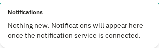

# Working the Case Digest

A supervisor should not have to open the queue to know whether it is healthy. The Case Digest exists to tell each supervisor, once a day, how each Case Workflow they supervise stands, as four counts delivered in a notification and, optionally, by email.

## Where it lives

The digest has no page of its own and nothing to configure in the user interface. It is switched on by Environment Variables, as described in [Environment Variables](../../../Concepts/EnvironmentVariables/index.html), and is produced by a background task of the engine. Each supervisor receives the digest in the Notifications panel, opened from the bell at the top of every page, as one line for each Case Workflow.

SHOT id=case-digest-notification
     route=/cases
     steps=open-menu:Notifications
     frame=popover
     state=the Notifications panel open for a supervisor, showing two case digest lines for two Case Workflows, one of them with cases past a service level and so marked as a warning
     conveys=the digest arrives as one line of counts for each Case Workflow, and never as a list of cases
     alt=The Notifications panel listing a case digest line for each of two Case Workflows, each giving the number of cases open, unheld, past a service level and closed in the last day



## What is sent

At the hour set by CaseDigestHourUtc, on the days set by CaseDigestDays, the engine sends the supervisors of each Case Workflow one notification, carrying four counts:

| Count                | Description                                                                                         |
|----------------------|-----------------------------------------------------------------------------------------------------|
| Open                 | Open cases in the Case Workflow.                                                                    |
| Unheld               | Open cases that nobody holds.                                                                       |
| Past a service level | Open cases that the service level sweep has found to be in breach of any of the four targets.      |
| Closed               | Cases closed in the last day.                                                                       |

The notification reads in the manner of the following:

```text
Card Fraud: 42 open, 9 unheld, 3 past a service level, 17 closed in the last day
```

A supervisor, for the purposes of the digest, is an active user whose role holds permission 18, Read Write Case Workflow, and is granted the Case Workflow. A Case Workflow with nothing open, and nothing closed in the last day, is not reported. The notification is of high priority, and so presented as a warning, where anything is past a service level, and is otherwise of low priority.

The line is information only, which is to say that it carries no link and selecting it does no more than mark it as read. It is written in the language of the reader, the counts being the same for every supervisor of the Case Workflow.

The four counts are best read together. In the example above, 42 open against 17 closed in the last day says that the queue holds roughly two and a half days of work at the present rate. The 9 unheld are the cases nobody has yet taken, a figure that should be small in proportion to those open where the team is keeping up, and that grows first when it is not. The 3 past a service level are the reason the line is presented as a warning, and are the cases to go and find, through the Overdue filter of the Cases page. A line presented without the warning says that nothing in that Case Workflow has missed a target.

Keep in mind that the Past a service level count is read from the breaches recorded by the service level sweep. It follows that the count is zero unless EnableCaseServiceLevelSweep is also True.

## Email

Where CaseDigestEmail is also True, each supervisor having an email address is sent the same counts by email, using the SMTP Environment Variables. The subject is Jube case digest followed by the name of the Case Workflow, and the body is HTML.

The email never carries a case key or value: it states how many, and tells the reader to sign in to see the cases. There is no means for a user to unsubscribe from the email, henceforth a supervisor not wanting it must have their email address cleared, or the Environment Variable must be set to False for all.

## Environment Variables

| Value             | Description                                                                                     | Example   |
|-------------------|-------------------------------------------------------------------------------------------------|-----------|
| EnableCaseDigest  | Whether the engine produces the digest. False by default.                                       | True      |
| CaseDigestHourUtc | The hour of the day, in UTC, in which the digest is sent. 7 by default.                         | 7         |
| CaseDigestDays    | The days of the week on which the digest is sent, comma separated, where 0 is Sunday. Monday to Friday by default. | 1,2,3,4,5 |
| CaseDigestEmail   | Whether the counts are also sent by email. False by default.                                    | False     |

The hour and the days are a single setting for the whole deployment, expressed in UTC. They are not set for each tenant, nor in the time zone of a tenant.

## Once a day, on any number of nodes

The digest is sent once for each Case Workflow, for each supervisor, for each day, however many nodes run the engine. The notification is created with a key made of the Case Workflow and the date, and only the node that creates the notification sends the email, the remaining nodes finding the notification already in place.

The engine checks each minute whether the digest is due, and it is due only during the hour set. It follows that where the engine is not running for the whole of that hour, the digest for that day is missed and is not caught up afterwards.

## Permissions and security

There is no permission to receive the digest as such. It is sent to the users holding permission 18, Read Write Case Workflow, through a role granted the Case Workflow, being the same users presented with the Supervision tab described in [Working Case Supervision](../WorkingCaseSupervision/index.html). The counts are of a single Case Workflow within the tenant of the supervisor, and neither the notification nor the email identifies a case.
