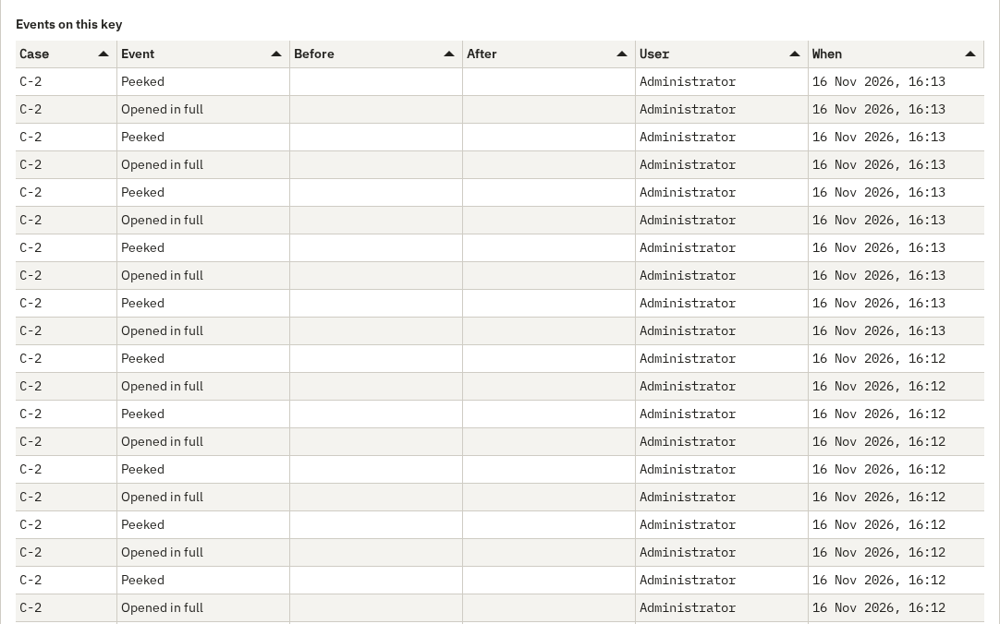

# Working Case Event Journal

The Case Note relies on specific intervention by an end user or analyst to create an audit trail.

The elective Case Note approach to an audit trail is risky for the purposes of maintaining audit integrity. To assure audit integrity, Jube maintains a very detailed audit trail of all interactions for a case record, written by the server as each interaction takes place, and without any intervention by the user.

## Where it lives

Navigate to a case record from the Cases page, as described in [Navigating Case Record](../WorkingNavigatingCaseRecord/index.html). The Case Events Journal tab of earlier versions is now the grid titled Events on this key, in the section of the case page titled Events, which is described there as Everything that happened to this case and key. It is presented beneath Cases on this key, described in [Working Case Journal](../WorkingCaseJournal/index.html).

SHOT id=case-management-working-case-event-journal-events
     route=/cases
     steps=open-demo-case, click:Hide the sections, click:Hide the decide panel, open-section:Events, scroll-to:Events on this key
     frame=section:Events
     state=the Events on this key grid of a case that has been skimmed, moved between two statuses, given a diary and closed, showing the Case, Event, Before, After, User and When columns with the status names and dates resolved
     conveys=every interaction with the cases of a key is recorded with who did it, when, and the value before and after
     alt=The Events on this key grid listing events such as Skimmed, Status changed and Closed, each with the value before and after, the user and the date and time

## Behaviour

Case events are displayed in a grid form, from newest to oldest, at 25 to a page. As the events are retrieved based on the Case Key Value combination, the events of every case of the key are listed together, and the Case column states the case to which each belongs. Case events are comprised of the following information:

| Value  | Description                                                                      | Example             |
|--------|----------------------------------------------------------------------------------|---------------------|
| Case   | The Case Id to which the event belongs, prefixed with C.                         | C-1234              |
| Event  | As described below, the event that took place.                                   | Status changed      |
| Before | The data as before update.                                                       | DAMLCO              |
| After  | The data as after update.                                                        | AMLCO               |
| User   | The user that initiated the event.                                               | Administrator       |
| When   | The date and time stamp of the event.                                            | 2026-11-16 09:30    |

The Before and After values are presented in a readable form rather than as stored. A status is shown by its name (or as Status no longer available where the status has since been removed), a date is shown in the local time of the user, and a diary type, a closed status, a triage outcome and an analyst assessment are each shown by their label.

In earlier versions the Case Id was a link which would load that case into the case page. The Case Id is not a link in the grid at present, as described in [Working Case Journal](../WorkingCaseJournal/index.html).

While the events are being read a placeholder is drawn, where they cannot be read the section states The history could not be loaded, and where the key has no events visible to the user the grid states No events on this key. The grid is read only, and an event cannot be changed or removed from the page. An event of a kind the page has no label for is shown by the name under which it was stored.

By way of illustration, an analyst who takes the demonstration case on ACC-441 with Take next, moves it from First Line Review to Supervisor Review and closes it, leaves among the rows at the head of the grid, read from the bottom upwards, the following: Skimmed, in the name of the analyst; Status changed, with First Line Review under Before and Supervisor Review under After; and Closed, with the date and time of closing under After. Nothing was asked of the analyst for any of them to be recorded.

## Events

The events recorded are as follows:

| Event                                 | Description                                                                                                         |
|---------------------------------------|---------------------------------------------------------------------------------------------------------------------|
| Unlocked automatically                | The case has been unlocked by an automated background process.                                                      |
| Skimmed                               | The case was taken with Take next or Next case, formerly Skim.                                                      |
| Locked automatically                  | The case was locked automatically as part of the automated Skim functionality.                                      |
| Opened in full                        | The case was opened in the case page, formerly a fetch.                                                             |
| Closed                                | The case was closed. After holds the date and time of closing.                                                      |
| Locked                                | The case was manually locked, with Take.                                                                            |
| Diary entry                           | The case was given a diary. Before and After hold the type of diary.                                                |
| Workflow changed                      | The Case Workflow of the case was changed.                                                                          |
| Status changed                        | The case was given a new status. Before and After hold the status.                                                  |
| Diary date changed                    | The case was given a new diary date. Before and After hold the date.                                                |
| Rating changed                        | The case was given a new case rating. Before and After hold the rating.                                             |
| Suspended and closed                  | The case was given a suspend closed status.                                                                         |
| Suspended and open                    | The case was given a suspend open status.                                                                           |
| Allocated                             | The lock was handed from one user to another. Before and After hold the user.                                       |
| Expired by process                    | The diary date of a suspended case lapsed and the Closed Status was moved on by the engine. Before and After hold the Closed Status. |
| Peeked                                | The summary of the case was looked at from the queue without opening it.                                            |
| Escalated automatically               | The case was moved to another status by an escalation rule. Before and After hold the status.                       |
| Lock broken                           | A supervisor broke the lock. Before holds the user who held it and After the reason given.                          |
| Diary cleared                         | The diary was cleared. Before holds the type that was cleared.                                                      |
| Picked for quality review             | The case was picked for the quality review sample.                                                                  |
| Checklist item shown                  | A checklist item became applicable to the case.                                                                     |
| Checklist item hidden                 | A checklist item ceased to be applicable to the case.                                                               |
| Checklist item ticked                 | A checklist item was ticked.                                                                                        |
| Checklist item unticked               | A checklist item was unticked.                                                                                      |
| Checklist blocked a move              | A change of status, or a close, was refused as required checklist items were open.                                  |
| Checklist overridden by a supervisor  | A supervisor allowed the case to move with checklist items still open.                                              |
| Checklist bypassed by automation      | Automation moved or closed the case with checklist items still open.                                                |
| Checklist item breached its SLA       | A checklist item passed the time allowed for it.                                                                    |
| Triage recommendation made            | The triage agent recommended an outcome. After holds the outcome.                                                   |
| Triage recommendation accepted        | A user accepted the triage recommendation. Before holds the outcome recommended.                                    |
| Triage recommendation overridden      | A user overrode the triage recommendation. Before holds the outcome recommended and After the reason.               |
| Legal hold placed                     | The case was placed under legal hold.                                                                               |
| Legal hold lifted                     | The legal hold was lifted.                                                                                          |
| Analyst assessment recorded           | An analyst recorded their view of the likelihood. Before and After hold the view.                                   |
| Analyst assessment withdrawn          | An analyst withdrew their view. Before holds the view withdrawn.                                                    |

## The remainder of the Events section

Beneath the two grids, the Events section presents further history that is recorded automatically:

* Checklist history, being each action upon the checklist of the case, with the Action, the Item, the User, the Detail and When. Before anything has been recorded it states Nothing has been recorded yet, and where it cannot be read, The history could not be loaded.
* Time in each status, drawn as a bar of the stays of the case in each Cases Workflow Status in time order.
* Risk history, shown where the ranking of the case has changed, as a timeline of each change and what triggered it.

## Permissions and security

The Events section requires permission 1, Read Write Case. An event is listed only where the role of the user is granted both the Case Workflow and the Cases Workflow Status of the case to which it belongs.
