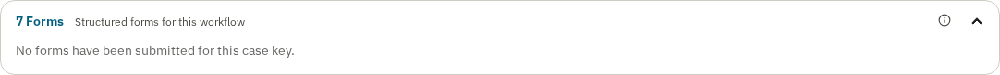

# Working Case Form Journal

Forms are used to capture structured data and invoke certain automations using the HTTP Endpoint and Notification functionality. The data captured during form invocation, which is documented in [Cases Workflow Form](../CreatingCaseWorkflowForm/index.html), is available for end user review in its entirety.

## Where it lives

Navigate to a case record from the Cases page, as described in [Navigating Case Record](../WorkingNavigatingCaseRecord/index.html). The Case Forms Journal tab of earlier versions is now the section of the case page titled Forms, which is described there as Structured forms for this workflow. The section is collapsed upon the case page being opened, and is expanded by clicking its title or its entry in the index of sections.

In keeping with the story of the case page being read only, a form is not filled in from the section. Each active Cases Workflow Form of the workflow is presented as a tile in the Decide pane, under Actions, titled with the name of the form, and clicking the tile opens the form in a lightbox to be completed and committed with Submit form.

SHOT id=case-management-working-case-form-journal-forms
     route=/cases
     steps=open-demo-case, click:Hide the sections, click:Hide the decide panel, open-section:Forms
     frame=section:Forms
     state=the Forms section of a case for which one form has been submitted, drawn read only with its values in place, headed by the name of the form and the user and date of submission
     conveys=a submitted form is reviewed as the form itself, with the values captured, rather than as a list of names and values
     alt=The Forms section showing a submitted form drawn read only with the values that were captured, the name of the form, and who submitted it and when

## Behaviour

Every form submitted for the Case Key Value combination is listed, newest first, each headed by the name of the form and by the user and the date and time of submission. Where no form has been submitted, the section states No forms have been submitted for this case key. The heading of each submission reads the name of the form followed by, for example, "Administrator on 16 Nov 2026 09:30". While the submissions are being read a placeholder is drawn, and where they cannot be read the section states The submitted forms could not be loaded.

As with notes, the submissions roll up to the Case Key Value combination, so a form submitted on an earlier case of the key is read on every later case of it. Upon a form being submitted from the Decide pane, the message Form submitted is shown and the submission joins the head of the section, which must be expanded to see it.

In earlier versions the journal was a hierarchical grid, in which a row was expanded to reveal the form element entries and values. The entries are no longer presented in that manner. Each submission is instead drawn as the form itself, read only, from the present layout of the form with the values captured in place. As the layout of a form may be changed after a submission has been made, the following applies:

* Values captured for which the present layout no longer has a field are listed beneath the form, under Values the form has no field for, such that nothing captured is lost from view.
* Where the form can no longer be drawn, the reason is stated, in the sentence This form can no longer be drawn, followed by the reason and The values it holds are listed below, and the values held are listed instead.

During the submission of the form the values captured are stored, each by the name of its element, before any Notification or HTTP Endpoint invocation, and the elements of the form are made available alongside the case creation payload, such that all these elements are available for tokenization for those processes. Whatever was sent as a consequence of a submission is listed in the Messages section of the case page. Given the structured nature of the data capture, it is simple to produce rich reporting based on the data submissions, although the most powerful use case for Cases Workflows Forms is for the purposes of integration and automation via HTTP Endpoint.

## Validation

A form cannot be submitted for a case that is locked to another user, and the form must be an active form of the Case Workflow of the case. Where the form declares validation of its elements, a submission failing it is refused, and the message is presented against the element concerned in the lightbox.

## Permissions and security

Reading the Forms section and submitting a form require permission 1, Read Write Case.
