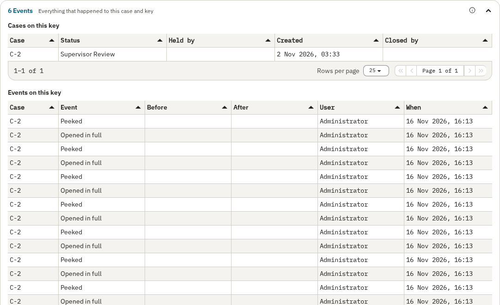

# Working Case Journal

Only a single case record may exist for a Case Key Value combination, for a given case workflow. Only upon a case being non existent or in Closed status, for that Case Key Value, for a cases workflow, may a new case be created.

Given creation it is quite possible that there can be many cases for a Case Key Value combination, for the case workflow, created over time as cases move from open to closed in response to different events \ transactions.

The Case Journal shows the case records in grid form, and will contain all cases for a Case Key Value combination ever created.

The presentation of data by Case Key Value combinations is of profound importance to ensure that a true history rolling up to a Case Key Value combination is maintained.

## Where it lives

Navigate to a case record from the Cases page, as described in [Navigating Case Record](../WorkingNavigatingCaseRecord/index.html). The Case Journal tab of earlier versions is now the grid titled Cases on this key, the first part of the section of the case page titled Events, which is described there as Everything that happened to this case and key. The same section presents the events of the key beneath, as described in [Working Case Event Journal](../WorkingCaseEventJournal/index.html).

The Case Journal is not to be confused with the Journal section of the case page, which is the [Case Key Journal](../WorkingCaseKeyJournal/index.html) of transactions.

SHOT id=case-management-working-case-journal-cases-on-key
     route=/cases
     steps=open-demo-case, click:Hide the sections, click:Hide the decide panel, open-section:Events
     frame=section:Events
     state=the Events section of a case whose key has had two earlier cases, showing the Cases on this key grid with three rows, two of them closed by a named user, above the top of the Events on this key grid
     conveys=every case ever raised for the key is listed together, so it can be seen whether the key has been reviewed before
     alt=The Cases on this key grid listing three cases for the same key with their status, holder, created date and the user who closed them

## Behaviour

Cases on this key is the header of each case in grid row form, and given the grid nature, it follows that there can be many entries. The columns are as follows:

| Column    | Description                                                    | Example          |
|-----------|----------------------------------------------------------------|------------------|
| Case      | The Case Id, prefixed with C.                                  | C-1234           |
| Status    | The Cases Workflow Status of the case.                         | Reported         |
| Held by   | The user to whom the case is locked, if any.                   | Robert           |
| Created   | The date and time at which the case was created.               | 2026-11-16 09:30 |
| Closed by | The user who closed the case, where it has been closed.        | Administrator    |

The cases are listed from newest to oldest, at 25 cases to a page. The cases are matched on the Case Key and Case Key Value alone, henceforth where the same Case Key Value combination has had cases in more than one Case Workflow, all are listed, subject to the role of the user being granted the Case Workflow and the Cases Workflow Status of each case.

In earlier versions the Case Id was a link which, upon click, would load that case into the case page, allowing for the navigation through the history of the Case Key Value combination where there are several cases. The Case Id is not a link in the grid at present, and to navigate to another case of the key its Case Id is placed in the address of the browser, taking the form `/cases/1234`.

TODO(verify): the Case column of Cases on this key is plain text on this branch (Jube.App/Vue/src/cases/detail/CaseHistorySection.vue); confirm with the owner whether it is to link to the case, as the Razor grid did, and restore the sentence describing the link if so

As the sections of the case page retrieve their information based on the Case Key Value combination, only the case record contents will change between one case of the key and another, such as the event \ transaction payload.

While the history is being read a placeholder is drawn in place of both grids of the section, and where it cannot be read the section states The history could not be loaded. Where no case of the key is visible to the user, the grid states No other cases on this key. The case in view is itself listed among the cases of the key, so on a key having had only the one case the grid has a single row.

The grid is read to answer whether the key has been before the team previously, and what became of it. On the demonstration data each of the accounts ACC-441, ACC-778 and ACC-915 has had one case, so each grid has one row. Were the case on ACC-915, closed as Fraudulent, to be followed by a second case on the same account, the grid of the second would list both, the earlier with Fraudulent under Status and the user having closed it under Closed by, which is the reader's cue that the account has been confirmed as fraud before.

The Case Journal serves to provide a reliable low level audit of the Case Key Value combination.

## Permissions and security

The Events section requires permission 1, Read Write Case. A case of the key is listed only where the role of the user is granted both its Case Workflow and its Cases Workflow Status.
