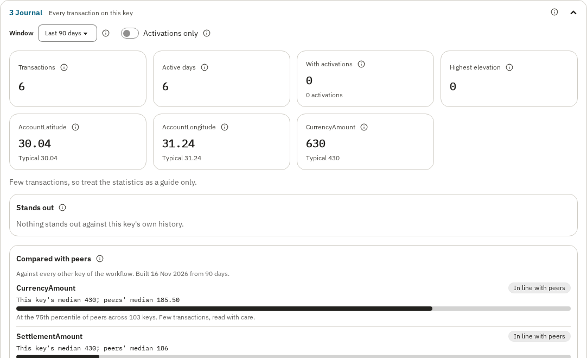
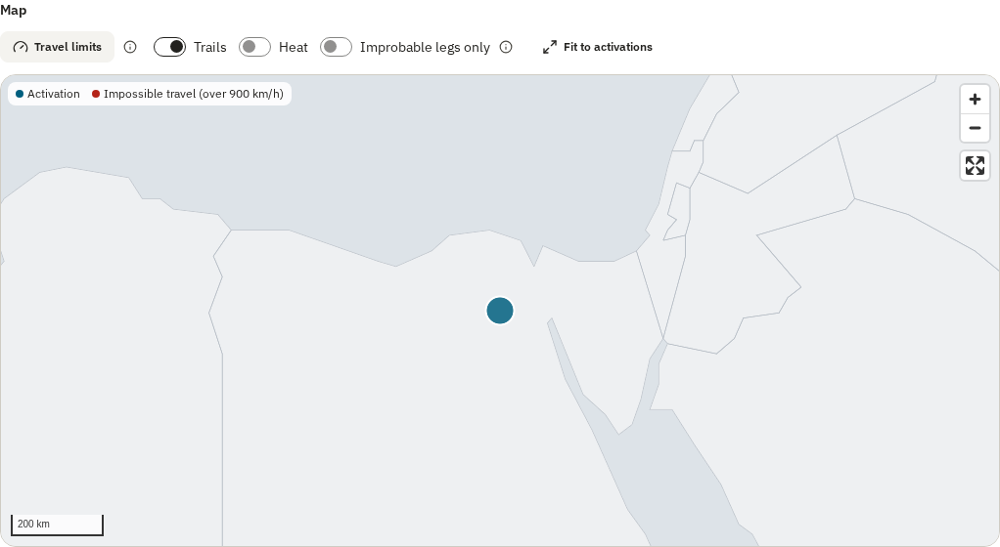
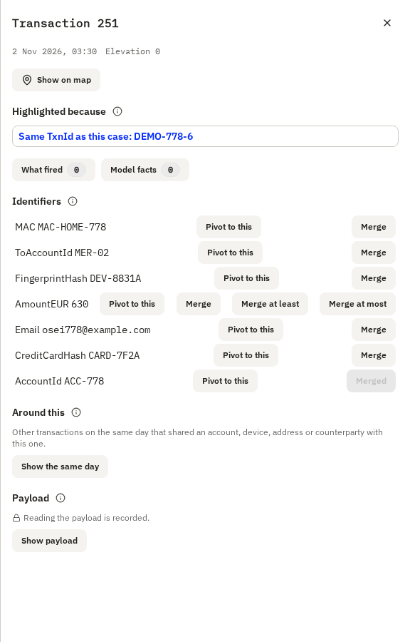

# Working Case Key Journal

The case record maintains a copy of the event \ transaction that caused the case to be created. To underwrite and perform analysis on a case it is generally important to have a wider picture of the transaction or event history for the Case Key Value combination having caused case record creation.

The Case Key Journal exists to return the full model event history, matching the Case Key Value combination for the case, and to present that history in several ways at once: as summary statistics, as charts, as the activations that fired, as a grid of transactions and, where the model carries a location, as a map.

The question it answers is what this account, card or customer has been doing, and whether the transaction that raised the case is in keeping with it. A case is raised on one transaction, yet it is decided on the history, and the journal is that history laid out so that the unusual can be told from the usual. The terms used on this page are as follows:

| Term        | Meaning                                                                                                                                                         |
|-------------|-----------------------------------------------------------------------------------------------------------------------------------------------------------------|
| Case key    | The field upon which the case was raised, and its value, for example AccountId with the value ACC-441.                                                          |
| Window      | How far back from today the journal reads.                                                                                                                      |
| Lane        | One key whose history is being read. The case key is lane A, and further keys, such as a device the account used, may be added as lanes B to D and merged in.   |
| Scope       | The window, the lanes and the filter taken together, which is to say exactly which transactions are in view.                                                    |
| Lens        | A choice of columns through which the same transactions are read, for example their own fields, or the rules that fired on them.                                |
| Elevation   | The Response Elevation the model returned for a transaction, being the weight the rules gave it. The higher it is, the more urgent the response.                |
| Stands out  | Said of a transaction, or a field, that is far from what is normal for this key by the measure of the key's own history.                                        |
| Peers       | The other keys of the same Case Workflow, against which this key is compared.                                                                                   |
| Leg         | On the map, the journey between two consecutive transactions of a lane.                                                                                         |
| Pin         | A mark placed on a transaction to keep it at the head of the journal for everyone working the case.                                                             |

The demonstration data serves well to follow this page. The case on AccountId ACC-441 carries, among its other transactions, nine card purchases made over the last three days across Cairo, Giza, Alexandria, London and Dubai, among them a purchase in London forty minutes after one in Cairo, and it is referred to at each stage below.

## Where it lives

Navigate to a case record from the Cases page. The journal is the section of the case page titled Journal, described there as Every transaction on this key, and it is open by default. A case having no key has no journal, and the section states as much.

The controls that act upon the journal (tagging, the progress of tag jobs, and saved views) are not in the section itself. They are presented in a card titled Journal in the Decide pane, under On this case, for as long as the journal is shown.

The journal opens on the Payload lens with a Window of Last 90 days, Activations only off, no further keys and no filter. Everything chosen thereafter, being the lens, the window, the keys, the filter, Activations only, Pinned only, the options of the map and the transaction or drawer that is open, is held in the address of the page, so that the address can be copied to a colleague who will see the same journal. Each choice replaces the address in place, so the back button of the browser leaves the case and does not step back through the choices. Nothing of it is remembered once the case is left, other than what has been stored as a saved view.

Where the key has no transactions in the window, the journal states No transactions for this key in this window, to which the usual remedy is a longer Window. Where it cannot be read at all, it states The journal could not be loaded. For ACC-441 the journal opens with the transactions of the account, the most recent first, the nine card purchases being those of the last three days.

SHOT id=case-key-journal-overview
     route=/cases
     steps=open-demo-case, click:Hide the sections, click:Hide the decide panel, open-section:3 Journal, open-tab:Rules
     frame=section:3 Journal
     state=the journal of a demonstration case, the Rules lens selected, showing the scope bar, the statistics strip, the Activations band and the first rows of the grid with highlighting
     conveys=the journal is one section stacking scope, statistics, activations and transactions, all answering to the same scope
     alt=The Journal section of a case showing the scope bar with its key lane, the lens tabs with counts, activation cards and the transactions grid with highlighted rows

## The Archive Key requirement

The journal reads the transaction history through the Archive Key index only. It follows that the case key must be a field flagged as Archive Key, a switch in the Behaviour group of the [Request XPath](../../Models/RequestXPath/index.html) for the model. Where the case key is not flagged, the journal cannot be read and an error is returned stating that the case key is not a field flagged Archive Key.

Flagging a field as Archive Key takes effect for transactions processed from that point onwards. For the history already stored, the script `Jube.Migrations/Scripts/MigrateCaseKeyJournalIndexesToArchiveKey.sql` is run against the database with psql as the migration role, requiring PostgreSQL 16 or later.

## Scope

The scope decides which transactions the journal is concerned with, and is made up of a window, keys and a filter:

| Value            | Description                                                                                                                                                                                                                                                                                 | Example           |
|------------------|---------------------------------------------------------------------------------------------------------------------------------------------------------------------------------------------------------------------------------------------------------------------------------------------|-------------------|
| Window           | How far back the history is read, as the last 7, 30, 90 or 365 days.                                                                                                                                                                                                                        | Last 90 days      |
| Activations only | A record must have had at least one Activation Rule match to be returned.                                                                                                                                                                                                                   | False             |
| Keys             | The case key, which is always lane A and cannot be removed, and up to three further keys as lanes B to D.                                                                                                                                                                                   | AccountId = Test1 |
| Filter           | Conditions on the fields of the model, applied in the Archive before any limit on the number of records.                                                                                                                                                                                    | AmountUSD > 1000  |

### Keys

Add key presents a small form taking the Key, the manner of Match, and the Value. The keys offered are the drill fields of the Case Workflow, and where none are set this is stated. For a key of a numeric, date or location data type, the match may be equals, at least, greater than, at most, less than or between, the latter taking a second value. For other data types the match is equality.

Each key added is a lane, and the lanes are merged into a single history in date order. Where more than one lane is in use, the grid includes a Lane column showing the lane each transaction arrived by, and the map draws a trail for each lane.

The purpose of a second lane is to read two histories as one. Were the device DEV-8831A, which ACC-441 used and which is held in the field FingerprintHash, added as lane B, the journal would show every transaction of the account and every transaction made on that device by any other account, in one timeline, which is how a device shared between accounts comes to light. The case key is shown as a chip that cannot be removed, described as The case key, always part of the scope, each further key is a chip with its lane letter and a control to remove it, and Add key is no longer offered once three further keys are in place. Where the Case Workflow has no drill fields, the form states No drill fields are set on this workflow.

### Filter

Add condition opens the dialog Filter the transactions. A condition takes a field of the model, an operator (equal, not equal, less, less or equal, greater, greater or equal, like, not like) and a value, and conditions can be combined with AND and OR in nested groups. Each condition is shown thereafter as a chip that can be removed, alongside the number of transactions matching out of the total, and Clear keys and filter restores the scope to the case key alone.

The dialog offers Add condition, Apply filter, Clear filter and Cancel, and nothing changes until Apply filter is selected. Like and not like take the percent sign as a wildcard. While the fields of the model are being read the dialog states Loading the fields of the model, and it states The model has no fields that can be filtered, or The fields of the model could not be loaded, where that is the case. The count beside the chips reads, for example, "3 of 9 match", being the transactions of the key in the window that satisfy the filter out of all of them.

Keep in mind that the filter narrows the transactions grid and the map. The statistics, charts and comparison with peers continue to describe the whole history of the key, as it is that history against which a transaction stands out. Activations only is different in this respect, as it narrows the statistics and the charts as well as the grid.

## Lenses

The same transactions can be viewed through five lenses, selected as tabs above the grid, each showing a count. A lens decides the columns of the grid and of an export:

| Lens      | Shows                                                                                   |
|-----------|-----------------------------------------------------------------------------------------|
| Payload   | The fields of the transaction, limited to those the roles of the user may see.          |
| Rules     | The Activation Rules that fired, marked as Fired, Forced or Shadow.                     |
| Features  | The values the rules saw: TTL Counters, Abstraction Calculations and Dictionaries.      |
| Models    | The scores of Exhaustive and Advanced Analytics models.                                 |
| Sanctions | Sanction distances and HTTP Adaptation responses.                                       |

The number on each tab is the number of transactions having something to show in that lens, so a lens reading 0 has nothing for this key and window. Changing the lens changes the columns only, the transactions, their order, the pins and the selection for tagging being the same in every lens. In the Rules lens a rule that matched reads Fired, one recorded as forced reads Forced, and one that matched as a shadow activation, which is to say was recorded without taking effect, reads Shadow.

## Statistics, peers and charts

Above the grid, the history of the key is summarised:

* **Statistics.** The number of Transactions, the Active days, the number With activations and the Highest elevation, followed by the typical value of the numeric fields, and a list of up to five transactions under Stands out.
* **Compared with peers.** How this key compares with the distribution of other keys. The distributions are built in the background by the jobs server, and the card is empty until that has taken place.
* **Charts.** Drawn in the server for a chosen Field: the field over time, the distribution of the field, when transactions happen, the time between transactions, how the measures move together, the drift between earlier and recent history, and counterparties.

### Reading the statistics

The figures of the strip are read as follows:

| Figure            | How to read it                                                                                                                                                                             |
|-------------------|--------------------------------------------------------------------------------------------------------------------------------------------------------------------------------------------|
| Transactions      | The number of transactions of the key in the window. Where the key has more than the 2,000 the statistics are calculated over, the strip states Showing the newest 2,000.                  |
| Active days       | The number of different days, in UTC, on which there was at least one transaction. Many transactions on few days is activity in bursts, few across many days is steady use.                |
| With activations  | The number of transactions on which at least one rule matched, followed by the number of activations in all, which may be the larger as one transaction can match several rules.           |
| Highest elevation | The highest Response Elevation of any transaction in the window.                                                                                                                           |
| Typical           | For each of the first three numeric fields of the key, the latest value and, as Typical, the median over the window. A Stands out badge is added where the latest values are far from that median. |

A median is used throughout in place of an average, so that a single very large transaction does not move what is called typical.

Stands out lists up to five transactions, each on a line such as "AmountEUR was 2,200, against a typical 65", and selecting a line opens the transaction. A transaction is listed where one of its numeric fields is three or more of the key's usual spreads away from the key's median, the spread being measured in a manner that unusual values cannot inflate. A field with fewer than five values is not judged. Where nothing qualifies, the card states Nothing stands out against this key's own history, and below twenty transactions the strip adds Few transactions, so treat the statistics as a guide only. Where the statistics cannot be calculated, The statistics could not be worked out is stated.

### Reading the comparison with peers

Stands out compares the key with itself, whereas Compared with peers compares it with the other keys of the Case Workflow, field by field. Each field states the median of this key against the median of its peers, as "This key's median 950; peers' median 140", places the key At the 97th percentile of peers, meaning that its median is higher than that of 97 in 100 keys, and calls it Above peers, Below peers or In line with peers, the first two being used where the key is three or more spreads from the median of its peers.

Where the Case Workflow has a segment field, the comparison is made against the keys of the same segment and the card says so, falling back upon every key where the segment has none. The card also states when the distributions were built and from how many days. Until the jobs server has built them, the card states Peer comparison appears once the peer distributions for this workflow have been built, and where they exist but hold none of the fields of this key, None of this key's numeric fields has a peer distribution yet.

SHOT id=case-key-journal-compared-with-peers
     route=/cases
     steps=open-demo-case, click:Hide the sections, click:Hide the decide panel, open-section:3 Journal, scroll-to:Compared with peers
     frame=section:3 Journal
     state=the Journal of a demonstration case scrolled to Compared with peers, stating when the comparison was built and over how many days, and for each measure, CurrencyAmount first, the median of this key against the median of its peers, a bar marking the percentile at which the key stands, and a badge reading In line with peers, with the Field selector and the first of the charts of the chosen field beneath
     conveys=the comparison with peers places the key on a bar for each measure, so that an unusual key is seen at a glance
     alt=The Compared with peers panel of the Case Key Journal, giving for each of four measures the median of the key against the median of its peers, a bar marking its percentile and a badge reading In line with peers, above the Field selector and two charts of the chosen field

### Reading the charts

The Field selection decides which numeric field the first two charts draw, and has no effect upon the others. Each chart carries a help mark explaining it at length, and each is empty, without that being a fault, where its condition is not met:

| Chart                                   | What to look for                                                                                         | Empty when                                                                     |
|-----------------------------------------|----------------------------------------------------------------------------------------------------------|--------------------------------------------------------------------------------|
| The chosen field over time              | Steps, ramps and gaps. Each point is the median of an hour, a day or a week, according to the span.      | No transaction in the window has the field.                                    |
| Distribution of the chosen field        | A long tail to the right is a few large transactions, two humps are two kinds of behaviour.              | No transaction has the field.                                                  |
| When transactions happen                | A dark cell in a pale area, for example 03:00 on a Sunday. Rows are weekdays, columns are hours in UTC.  | The window has no transactions.                                                |
| Time between transactions               | Tall bars to the left are bursts, bars to the far right are activity after long dormancy.                | The key has fewer than two transactions.                                       |
| How the measures move together          | Fields that rise and fall together, as a correlation between -1 and 1.                                   | No pair of fields reaches 0.8, or the key has fewer than ten transactions.     |
| Drift between earlier and recent history | A field whose first bar exceeds its second has changed its behaviour between the two halves of the window. | Fewer than 40 transactions, fewer than 20 on either side, or nothing drifted. |
| Counterparties                          | Many one-off counterparties, or a sudden rush of new ones.                                               | The Case Workflow marks no field as a counterparty, or the key has none.       |

It follows that for a key with only a handful of transactions the last three charts are empty, and that this is to be expected.

## Activations

The Activations band presents a card for each rule or model that fired within the scope, which can be sorted by Score, Times fired, Most recent or Name, and narrowed to This case's activations. Each card states the number of transactions it fired on. A card for a model shows the score as a gauge against its threshold alongside the largest contributions to that score, and a card for a rule shows the inputs the rule read. Inputs the user is not permitted to see are counted and never named.

Details on a card opens What fired, and Model facts opens the facts declared for the model: Identity, Score, Training, Performance, Inputs, Health and Changes. Anything a model does not declare is shown as Not declared by the model, rather than being left out.

The band follows the scope of the journal, which is to say the window, the filter and the merged keys. Where nothing fired it states Nothing fired in this view, where This case's activations is on and none of them fired, None of this case's activations fired in this view, and where it cannot be read, The activations could not be loaded. A score on a model card is read against its threshold, a gauge past the threshold being the model activating. Only a score that has been calibrated is called a probability, in which circumstance it is placed in a band of Unlikely, Possible, Likely or Very likely, with a line such as "In this band, 62% of 140 validated cases were true positive." stating what that band has meant in practice. The cards and drawers are described fully in [Working Activations](../WorkingActivations/index.html).

SHOT id=case-key-journal-what-fired
     route=/cases
     steps=open-demo-case, click:Hide the sections, click:Hide the decide panel, open-section:3 Journal, scroll-to:Activations, click:Details
     frame=drawer
     state=the What fired drawer for a transaction where both a rule and a model fired, showing the rule, the model gauge against its threshold, and the contributions
     conveys=why a transaction activated is explained in place, for rules and models alike
     alt=The What fired drawer listing the rules that matched a transaction and a model score shown as a gauge with its largest contributions

## Transactions

The grid returns the transaction history in descending, most recent first order. The most recent 1,000 transactions matching the scope are returned, then paged in the browser at 100 to a page by default, with 10, 25 and 50 also available.

Alongside the columns of the lens, the grid carries:

| Column              | Description                                                                                                  |
|---------------------|--------------------------------------------------------------------------------------------------------------|
| Select              | Ticks the transaction for tagging.                                                                           |
| Pin                 | Pins the transaction, as described below.                                                                    |
| When                | The date and time of the transaction.                                                                        |
| Elevation           | The Response Elevation returned for the transaction.                                                         |
| Activations         | The number of Activation Rules that matched.                                                                 |
| Payment             | The state of any payment hold.                                                                               |
| Lane                | The key lane the transaction arrived by, where more than one lane is in use.                                 |
| Stands out          | Whether the transaction is unusual against the history of the key.                                           |
| New                 | Whether a value is seen on this key for the first time.                                                      |
| Highlighted because | The reasons for any highlighting.                                                                            |
| Actions             | Open, for the detail of the transaction, and Map, to locate it on the map.                                   |

### Highlighting

Rows are emboldened and coloured according to the Bold Line Matching and Conditional Formatting set against the [Case Workflow XPath](../CreatingCaseWorkflowXPath/index.html), with the reasons written to the Highlighted because column, so that the highlighting need not be inferred from colour alone.

### Columns

The Columns control shows or hides columns. To move a column, drag its heading, and to alter its width, drag the edge of its heading. The layout is saved a moment after each change, without a save button, and is stored for the user by Case Workflow and by lens, so the time spent organising the columns will not be redundant upon a new session being established. Reset layout restores the default.

TODO(verify): confirm on a running system that clicking a column heading sorts the loaded rows, then state it here; pinned rows are expected to stay first

### Exporting

The Export control offers Excel and CSV. The export is of the transactions loaded, in the columns of the lens in view, and paging is ignored. Highlighting is not exported.

## Map

The map is shown only where the model has active Request XPath for latitude and longitude, and those fields are visible in the Case Workflow. Transactions are plotted in date order, which serves as the replay of the movement of the key over the window.

The options of the map are:

| Value                                  | Description                                                                                                    | Example |
|----------------------------------------|----------------------------------------------------------------------------------------------------------------|---------|
| Speed limit                            | The speed in kilometres per hour above which travel between two transactions is taken to be improbable.        | 900     |
| Shortest leg                           | The distance in kilometres below which a leg is not considered, however quickly it was covered.                | 50      |
| Improbable legs only                   | Shows only the legs exceeding the limits.                                                                      | False   |
| Show everything, pick out the matches  | Keeps all transactions on the map, picking out those matching the filter, rather than removing the remainder.  | False   |
| Trails                                 | Joins the transactions of each lane in date order.                                                             | True    |
| Heat                                   | Shows the density of transactions.                                                                             | False   |
| Fit to activations                     | Moves the map to the transactions having activations.                                                          |         |

Selecting a point on the map offers Open transaction, beneath a line stating when the transaction took place and the lane it belongs to.

A leg is marked as improbable where it is at least as long as Shortest leg and the speed needed to cover it in the time between its two transactions exceeds Speed limit. The defaults are 900 kilometres per hour, being about the speed of an airliner, and 50 kilometres, so that a short hop between two nearby positions is never marked however quickly it happened. The speed may be set up to 10,000 and the distance up to 20,000, a value outside those bounds being read as the default, and Reset limits returns both to their defaults. Trails is on and Heat is off upon the journal being opened.

For ACC-441 the map draws the nine card purchases joined by a trail through Cairo, Giza, Alexandria, London and Dubai. Cairo to London is some 3,500 kilometres, and to cover it in forty minutes would need a speed above 5,000 kilometres per hour, so that leg is marked as improbable at the defaults, and with Improbable legs only on it is the leg that remains. Where Improbable legs only leaves nothing, no leg breaks the limits set, which is itself an answer.

Show everything, pick out the matches does something only while a filter is set, in which circumstance the transactions matching the filter are drawn in full colour and joined by trails, and the remainder are drawn faint and grey. Where the map cannot be read it states The map could not be loaded, and where more transactions matched than could be read, More transactions matched than could be read, so the oldest are left out.

SHOT id=case-key-journal-map
     route=/cases
     steps=open-demo-case, click:Hide the sections, click:Hide the decide panel, open-section:3 Journal, scroll-to:Map
     frame=section:Map
     state=the journal map for a key with transactions in several cities, trails on, with at least one improbable leg picked out
     conveys=the map is the replay of a key's movement, and improbable travel is visible at a glance
     alt=The journal map plotting the transactions of a key across several cities, joined by trails, with an improbable leg picked out

## The detail of a transaction

Open on a row presents the transaction in a drawer, titled with the identifier of the transaction, and showing the date, the Response Elevation and the model:

* **Highlighted because** and **Payment hold**, where they apply.
* **What fired** and **Model facts**, as described under Activations.
* **What the rules saw.** The values available to the rules for this transaction, grouped as Abstraction, Calculation, Counter, Dictionary, Sanction, HTTP, Graph and Svirfd.
* **Identifiers.** The key values of the transaction. Pivot to this shows the journal for that value instead, with a control to return, and Merge adds the value to the scope as a further lane. For an IP address, Svirfd presents the IP intelligence where it is enabled.
* **Around this.** Show the same day lists, on request, the other transactions of the same day sharing an identifier.
* **Payload.** The payload is not fetched until Show payload is clicked. Reading the payload is recorded for audit, and the payload returned is limited to the fields the roles of the user may see.

The values under What the rules saw are those of the moment the transaction was processed, and so may differ from what the same counter would read now. Pivot to this replaces the case key with the chosen value for as long as it is in force, the journal stating for example "Showing FingerprintHash DEV-8831A" with a control reading Back to AccountId, whereas Merge keeps the case key and adds the value beside it. Only identifiers that are drill fields of the Case Workflow offer either. Show the same day lists, for each identifier, up to 25 other transactions of the same day in UTC, newest first, and states Nothing else shared a key with this transaction that day where there are none. The drawer states The transaction could not be loaded, The payload could not be loaded or The same-day activity could not be loaded where a part of it fails, the remainder being unaffected.

SHOT id=case-key-journal-transaction-drawer
     route=/cases
     steps=open-demo-case, click:Hide the sections, click:Hide the decide panel, open-section:3 Journal, scroll-to:Transactions, open-first-row
     frame=drawer
     state=the transaction drawer for a highlighted transaction, showing Highlighted because, What the rules saw and the Identifiers with their Pivot and Merge controls
     conveys=a transaction opens beside the journal without leaving the case
     alt=The transaction drawer showing why a transaction was highlighted, the values the rules saw and its identifiers with Pivot and Merge controls

## Pins and saved views

A transaction is pinned with the star in its row. Pins belong to the case and are shared by everyone working it, to a limit of 50. Pinned transactions are always first in the grid, and Pinned only reduces the grid to them.

Save view stores the present scope under a name, and Saved views lists those stored, each of which can be opened or deleted. A saved view holds the window, the keys, the filter, the lens and the limits of the map. It does not hold Activations only, Trails or Heat. Saved views belong to the case and are shared, to a limit of 10.

Pinned only is labelled with the number of pins, as Pinned only (2), and a pinned transaction is shown at the head of the grid in every lens even where it falls outside the window. Pins cannot be changed on a case held by another user. Save view asks for a Name of up to 100 characters under the heading Save this view, and is confirmed by the message View saved. Deleting a view is confirmed by View deleted, and before any has been stored the list states No views are saved on this case. Opening a saved view reads the Archive afresh, a view being a stored scope and never a stored set of transactions.

## Tagging Records in the Case Key Journal

Transactions are tagged with the Tags configured for the model (see [Tags](../../Models/Tags/index.html)), without leaving the case. Only Tags already created for the model on the Tags page, and active, are offered. If the Tag needed is not offered, it must first be created on the Tags page.

To tag some transactions, tick them in the Select column. The Journal card in the Decide pane shows the number selected, with controls to select all or clear the selection. Tag opens a form to choose the tags to add and the tags to remove, and nothing is changed until Apply is clicked, after which Undo is offered. Up to 500 transactions can be tagged in this manner at once.

To tag everything matching the scope, including transactions beyond those loaded in the grid, use Tag all matching. The number of transactions is shown for confirmation beforehand, then the work is carried out in the background by the jobs server, to a limit of 100,000 transactions, with the progress shown in the Journal card alongside Stop and Undo. Tag all matching is not available while Pinned only is on.

The messages met while tagging are as follows:

| Circumstance                                           | Message                                                                                                    |
|--------------------------------------------------------|------------------------------------------------------------------------------------------------------------|
| A selection has been tagged                            | Tagged 12 transactions.                                                                                    |
| Some belonged to a case held by another user           | 2 were left alone because their case is locked to another user.                                            |
| Some were not of the model of the Case Workflow        | 1 were not changed because they are not in this workflow's model.                                          |
| Undo was selected                                      | The tagging was undone.                                                                                    |
| The model has no Tags                                  | This model has no tags to add.                                                                             |
| Nothing selected carries a Tag to remove               | None of the selected transactions carry a tag.                                                             |
| Tag all matching, counting                             | Counting the transactions…, then for example 340 transactions match this view.                             |
| Tag all matching, over the limit                       | More than 100,000 transactions match. Narrow the view first, with a shorter window or Activations only.    |
| Tag all matching, nothing in view                      | No transaction matches this view.                                                                          |
| A job awaiting the jobs server                         | Waiting for the jobs server to pick up the tagging.                                                        |
| A job in progress                                      | Tagging 120 of 340…                                                                                        |
| A job complete                                         | Tagged 338 of 340 transactions.                                                                            |
| A job stopped with Stop                                | The tagging was stopped after 120 of 340.                                                                  |
| A job being undone, and undone                         | Restoring 120 of 338…, then Restored 338 of 338 transactions.                                              |

Where a filter is set, the confirmation for Tag all matching adds Only transactions that match your filter are counted and tagged.

Because the same underlying transaction record can be reached both directly (via the Case Key Journal, or the API for tagging retrospectively from an external system) and indirectly (as the copy of the record stored against a Case), tagging a record from the Case Key Journal also updates the copy of that record's JSON stored on any Case it is already associated with, so both views stay consistent rather than only the Archive table row being updated. Transactions belonging to a locked case are passed over, and counted.

The retrospective tagging API for external systems is `PUT api/Invoke/Archive/Tag`. The route is reachable without interactive login, subject to the EnablePublicInvokeController Environment Variable, for systems that want to feed an outcome, such as a confirmed-fraud disposition, back into Jube programmatically.

## Limits

| Limit                                              | Value   |
|----------------------------------------------------|---------|
| Transactions loaded into the grid                  | 1,000   |
| Transactions the statistics are calculated over    | 2,000   |
| Transactions counted for the total                 | 100,000 |
| Key lanes, including the case key                  | 4       |
| Transactions tagged from a selection               | 500     |
| Transactions tagged by Tag all matching            | 100,000 |
| Tag jobs active at once                            | 3       |
| Pins on a case                                     | 50      |
| Saved views on a case                              | 10      |

The window is one of the fixed periods, and a custom range of dates is not available. The text of the charts follows the language of the user interface, whereas numbers and dates within the charts are formatted alike in all languages.

## Permissions and security

Reading the journal, and every change made from it (tags, tag jobs, pins, saved views and the column layout), requires permission 1, Read Write Case.

The fields shown in the Payload lens and returned by Show payload are limited to the Request XPath that the roles of the user are permitted to see, and each reading of a payload is recorded.
