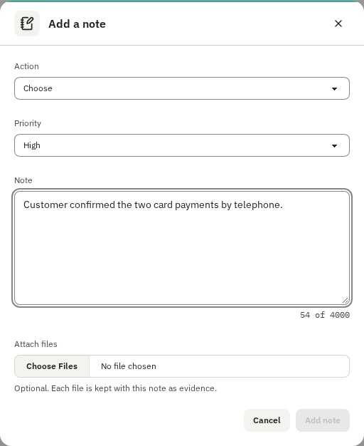
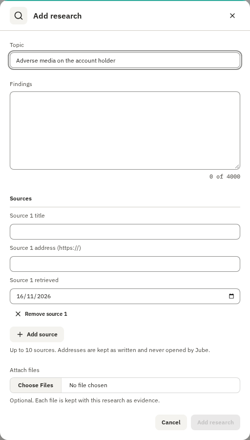
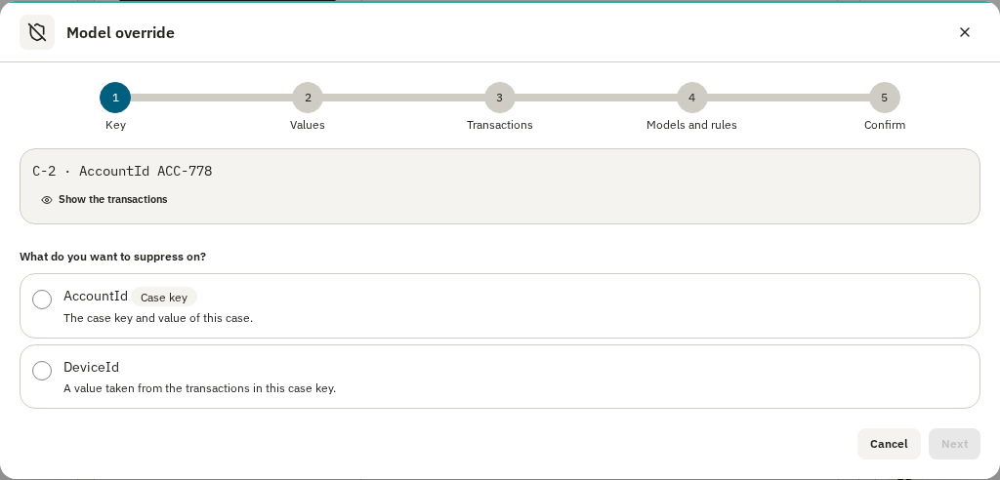
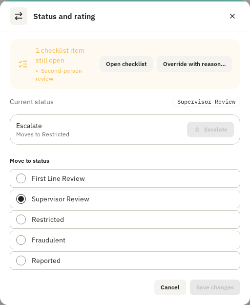
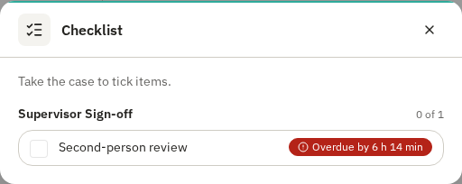
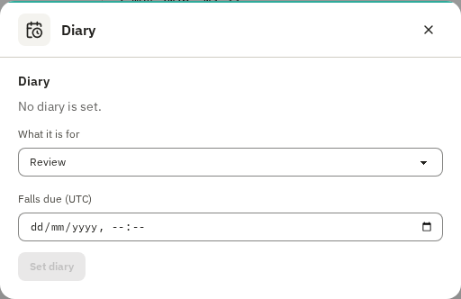
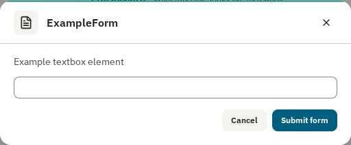
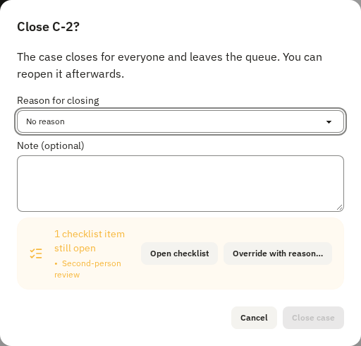

# Working Case Lightboxes

Having read a case, an analyst must do something about it: write down what was found, move it to another status, set a reminder, ask for a rule to be silenced, or close it. Everything that is done to a case is done from the Decide pane of the case page, and nowhere else, for the purposes of keeping the story of the case, described in [Working Case Story Points](../WorkingCaseStoryPoints/index.html), a place that can be read without consequence.

The Decide pane is small, being a column at the right of the page, and what an analyst does varies a great deal in size. Marking a note as a finding is one button, whereas asking for a model override is five steps and a grid. The pane therefore presents each thing that can be done in one of two forms, and this page describes both, with every lightbox in turn.

## Terms

| Term      | Meaning                                                                                                                                                                                                                                              |
|-----------|------------------------------------------------------------------------------------------------------------------------------------------------------------------------------------------------------------------------------------------------------|
| Decide    | The pane on the right of the case page, titled Decide, in which everything that changes the case is done.                                                                                                                                            |
| Tile      | A button of the pane, listed under the heading Actions, having an icon, a name and, for some, a line beneath stating the present position, for example the status of the case. A tile opens a lightbox.                                              |
| Card      | A panel of the pane, listed under the heading On this case, which holds its own controls and is acted upon where it stands, without anything being opened.                                                                                           |
| Lightbox  | A dialog drawn over the centre of the case page, with the page dimmed behind it, which holds the fields and controls of one tile and is dismissed upon the work being committed or abandoned. The word does not appear on the page, each lightbox being known by its own title. |
| Holder    | The user to whom the case is locked, shown at the head of the pane as Held by you or Held by followed by the user.                                                                                                                                   |
| Message   | A short notice drawn at the foot of the page for a few moments, in green where something was done and in red where it was not.                                                                                                                       |

## Where it lives

Navigate through the menu to Cases and open a case, as described in [Navigating Case Record](../WorkingNavigatingCaseRecord/index.html). The Decide pane is the right hand column of the case page. Upon Hide the decide panel being selected the pane is presented instead as the first card of the story, with the same tiles, cards and lightboxes.

The pane is arranged, from top to bottom, as the holder of the case with Take or Release, the tiles under Actions, the cards under On this case and, at its foot beneath a rule, Close or Reopen. The help mark beside its title reads "Everything you can do to this case. Taking a case locks it to you, so nobody else can change it. A supervisor can break the lock. Release the case if you stop working on it so it returns to the queue. Close and reopen sit lower down."

## Why cards and tiles

A card is used wherever the whole of an interaction fits within the width of the pane: a choice of three, a line of text and a button. The analyst acts upon it in place, with the story still in view beside it, and so can tag a case or record a view of it while reading the evidence for doing so.

A tile is used where the interaction does not fit in a card, which is to say where it needs room (a note of several paragraphs, a list of sources, a form laid out by an administrator, a grid of rules) or where it deserves the whole attention of the analyst before it is committed (a change of status, the release of a held payment, the closing of the case). Such an interaction is given a lightbox.

The lightbox is used as the manner of working only on the case page. Elsewhere in Jube a record is edited in the page on which it is listed, as described in [Child Objects](../../../Navigation/ChildObjects/index.html), and a dialog is met only where a confirmation or a single entry is asked for. The case page is the exception as it is the one page upon which a great many unrelated things may be done to one record, none of which should displace the story being read.

## The whole pane

The tiles under Actions, in the order of the pane, are as follows. A tile is drawn only where its condition is met, hence the pane of one case may differ from that of another.

| Tile               | Line beneath the name                      | Shown                                                                                             | Opens                                                                  |
|--------------------|--------------------------------------------|---------------------------------------------------------------------------------------------------|------------------------------------------------------------------------|
| Note               |                                            | Always.                                                                                           | [Add a note](#note)                                                    |
| Research           |                                            | Always.                                                                                           | [Add research](#research)                                              |
| Model override     |                                            | To a user having permission 2, Read Write Suppression.                                            | [Model override](#model-override)                                      |
| Override approvals | The number of requests, for example 2 requests. | Where the case has model override requests that the user can decide, retract or resubmit.    | [Model override request](#override-approvals)                          |
| Status             | The present status of the case.            | Always.                                                                                           | [Status](#status)                                                      |
| Checklist          | The progress, for example 0 of 1 done, 1 overdue. The tile is red where an item is overdue. | Where the case has at least one required checklist item showing. | [Checklist](#checklist)                                                |
| Diary              |                                            | Once the summary of the case has been read.                                                       | [Diary](#diary)                                                        |
| Held payment       | The number held, for example 1 held.       | Where the case has at least one payment in the Held state.                                        | [Held payments](#held-payment)                                         |
| A form             |                                            | One tile for each active form of the Case Workflow, bearing the name of the form.                 | [The form](#forms)                                                     |
| A macro            | The description of the macro.              | One tile for each active macro of the Case Workflow, bearing the name of the macro.               | Nothing. See [Macros](#macros).                                        |
| Close              |                                            | At the foot of the pane, in red, on a case that is not closed.                                    | [The confirmation of the close](#close)                                |
| Reopen             |                                            | At the foot of the pane, in place of Close, on a case that is closed.                             | Nothing. See [Close](#close).                                          |

Resting the pointer upon a tile presents a sentence stating what the tile does, which is quoted under each tile below.

The cards under On this case, in the order of the pane, are as follows:

| Card                  | What is done in it                                                                                                                                                             | Shown                                                                                              | Described in                                                                                          |
|-----------------------|--------------------------------------------------------------------------------------------------------------------------------------------------------------------------------|----------------------------------------------------------------------------------------------------|-------------------------------------------------------------------------------------------------------|
| Triage recommendation | The outcome recommended by the triage agent is read with its rationale, and is accepted with Accept or overridden with Override and a reason of up to 500 characters.         | Where the triage agent has made a recommendation for the case.                                     | [Working the Triage Recommendation](../WorkingTriageRecommendation/index.html)                        |
| Your assessment       | The view of the analyst as to the likelihood is recorded as Low, Medium or High with a reason, by Record assessment, and withdrawn with Withdraw.                              | Once the assessments of the case have been read.                                                   | [Working Analyst Assessment](../WorkingAnalystAssessment/index.html)                                  |
| Findings              | Each note written by the user on the key is marked with Mark as finding, or unmarked with Clear finding. The number marked is shown beside the title.                         | Where the user has written at least one note on the key.                                           | [Working Case Note](../WorkingCaseNote/index.html)                                                    |
| Journal               | The transactions selected in the Journal are tagged, the progress of a tag job is followed, and the saved views of the journal are loaded, saved and removed.                 | For as long as the Journal story point is expanded and has a key to read.                          | [Working Case Key Journal](../WorkingCaseKeyJournal/index.html)                                       |
| Tags                  | Tags are added to the case from the vocabulary of the model, and removed, the change being committed with Save tags.                                                           | Always.                                                                                            | [Tags](../../Models/Tags/index.html) and [Graph on a Case](../../Graph/GraphOnACase/index.html)      |
| Linked cases          | Another case is linked by its Case number with an optional reason, by Link, and a link is removed with the cross beside it.                                                    | Always.                                                                                            | [Working Linked Cases](../WorkingLinkedCases/index.html)                                              |
| Quality review        | A reviewer records Pass, Fail or Not applicable upon the handling of the case and upon the recommendation of the triage agent, with a comment, by Record review.              | Where the case was picked for the quality review sample and may be reviewed, or has been reviewed. | [Working Quality Review Samples](../WorkingQualityReviewSamples/index.html)                           |
| Regulatory reports    | A report to a financial intelligence unit is started, edited, validated, sent for approval, approved or rejected, downloaded and recorded as filed.                            | To a user having one of permissions 75, File Case Reports, 76, Approve Case Reports, or 77, View Case Reports. | [Working Regulatory Reports](../WorkingRegulatoryReports/index.html)                      |
| Legal hold            | The case is placed under legal hold with a reason of up to 500 characters, by Place legal hold, and the hold is removed by Lift legal hold.                                    | To a user having permission 18, Read Write Case Workflow.                                          | [Data Retention and Legal Hold](../../../Concepts/Retention/index.html)                               |

Take and Release, at the head of the pane, are neither tiles nor cards. They act at once, being confirmed by the message Case updated, as described in [Working Lock, Allocation and Unlock](../WorkingLockAllocationUnlock/index.html).

Three controls of the Journal card open a small dialog of their own, being Tag, which opens Tag followed by the number of transactions, Tag all matching, which opens Tag every matching transaction, and Save view, which opens Save this view. These belong to the journal and are described in [Working Case Key Journal](../WorkingCaseKeyJournal/index.html).

## Behaviour common to every lightbox

Every lightbox opened by a tile behaves in the same manner, as follows:

| Matter                | Behaviour                                                                                                                                                                                                                                                                                                                                 |
|-----------------------|-------------------------------------------------------------------------------------------------------------------------------------------------------------------------------------------------------------------------------------------------------------------------------------------------------------------------------------------|
| Opening               | Selecting the tile opens the lightbox at once, in the centre of the page. Only one lightbox is open at a time, and where one lightbox leads to another, as the Status lightbox does to the Checklist, the first gives way to the second.                                                                                                |
| Appearance            | A panel having a heading with the icon of the tile, the title of the lightbox and a cross, and beneath it the fields. The Model override and Model override request lightboxes are wide, taking most of the width of the page, the remainder being narrow.                                                                              |
| The case behind       | The page is dimmed and cannot be scrolled, selected or typed into for as long as the lightbox is open. What was in view behind the lightbox remains in view, dimmed, yet the story cannot be consulted, hence whatever is to be referred to should be read, or copied, beforehand.                                                       |
| Focus                 | Focus moves into the lightbox upon it being opened and is kept within it, the Tab key moving between its controls only. Upon being closed, focus returns to the tile.                                                                                                                                                                    |
| Closing without committing | Cancel closes the lightbox at once. The cross, the Escape key and a click upon the dimmed page outside the panel close it likewise, save that where text has been typed confirmation is first sought under Discard unsaved changes?.                                                                                                                                                                 |
| Unsaved input         | Whatever was typed and not committed is discarded upon the lightbox being closed by any of those means, and the lightbox starts afresh upon being opened again. It is to be kept in mind that a click outside the panel is sufficient to lose a long note. The confirmation of the close is the exception, as stated under [Close](#close). |
| Committing            | Upon the work being committed and accepted, a message in green states as much, the lightbox closes of its own accord and the case is read again, so that the story and the pane reflect the change. The Checklist, Diary and Held payments lightboxes remain open, as more than one thing may be done in each.                          |
| Double submission     | The committing button is disabled from the moment it is selected until the server has answered.                                                                                                                                                                                                                                          |
| Refusal               | Where the server refuses, the lightbox stays open with everything that was typed, such that nothing is lost and the matter can be corrected or abandoned.                                                                                                                                                                                |

A refusal is presented in one of two ways. Several lightboxes state the reason given by the server within the lightbox itself, against the field or item concerned, and these are stated under each below. The remainder present a message in red, worded by the status of the refusal and not by its reason, as follows:

| Status of the refusal                          | Message                                                 |
|------------------------------------------------|---------------------------------------------------------|
| 403, the user is not permitted                 | You are not permitted to do that.                       |
| 404, the record is not found or not visible    | That record could not be found.                         |
| 409, a conflict for which the server gives no reason   | That record changed. Reload it and try again.   |
| The server could not be reached                | The server could not be reached. Check your connection. |
| Anything else, including 400                   | The server could not complete the request.              |

Where the server gives a reason of its own with a conflict, as it does for a note, research, a file, a form or a held payment refused because the case is held by another user, that reason is shown in place of the general wording, for example The case is locked by another user. A change of the case record itself that is refused for the lock is answered in the same manner, with The case is locked to another user. The messages are drawn above an open lightbox.

It is not necessary to hold a case to use most lightboxes. The server requires only that nobody else holds it, with the exception of the Checklist, which only the holder may tick, and of a model override, which is not subject to the lock at all.

## Note

The Note tile, described as "Write a note on this case. It is kept on the case timeline and can carry evidence files.", opens the lightbox Add a note. It is the means by which an analyst records what was done and found, and a note, once added, can be neither changed nor removed.

SHOT id=case-lightbox-note
     route=/cases
     steps=open-demo-case, open-decide-tile:Note, fill:Note=Customer confirmed the two card payments by telephone.
     frame=dialog
     state=the Add a note lightbox on the demonstration case C-2, opened from the Note tile and not submitted, with Action reading Choose, Priority carrying the first priority of the workflow, a sentence typed in Note with the count of characters beneath, and Attach files empty, above Cancel and a disabled Add note
     conveys=a note is written in a lightbox over the case, with an action and a priority giving it structure
     alt=The Add a note lightbox with the Action, Priority, Note and Attach files fields, a sentence typed as the note, and the Cancel and Add note buttons

| Value        | Description                                                                                                                                              | Limit and default                                                    |
|--------------|----------------------------------------------------------------------------------------------------------------------------------------------------------|----------------------------------------------------------------------|
| Action       | The [Case Workflow Action](../CreatingCaseWorkflowAction/index.html) the note is recorded under.                                                         | Required. Reads Choose, with nothing selected, upon opening.         |
| Priority     | The priority of the note.                                                                                                                                | Required. The first priority of the Case Workflow upon opening.      |
| Note         | The text of the note, as plain text.                                                                                                                     | Required. 4,000 characters, which the box will not exceed, with a count beneath in the form 0 of 4000. |
| Attach files | One or more files to be kept with the note as evidence, with the reminder Optional. Each file is kept with this note as evidence.                        | Optional.                                                            |
| Cancel       | Closes the lightbox, saving nothing.                                                                                                                     |                                                                      |
| Add note     | Commits the note.                                                                                                                                        | Disabled until an Action is chosen, a Priority is selected and the Note is not blank. |

Upon Add note the note is saved, then each file is attached to it in turn. The message Note added is shown, the lightbox closes, the note is presented at the head of Notes in the Notes and research story point, and it joins the Findings card of the user. Where a file could not be attached the note stays and the message reads, in red, for example Note added, but 1 file(s) could not be attached. Where the Action has a Notification or HTTP Endpoint configured they are dispatched, and are thereafter listed in the Messages story point. No user is notified by the note itself.

A refusal is presented as the message of its status, as tabulated above: 409 where the case is held by another user, and otherwise The server could not complete the request. The rules applied in the server, and the sanitising of the text, are described in [Working Case Note](../WorkingCaseNote/index.html), and the limits upon files in [Working Uploading and Recalling Files](../WorkingUploadingRecallingFiles/index.html). The lightbox requires permission 1, Read Write Case.

## Research

The Research tile, described as "Record research findings with topic and sources. Addresses are stored as written and never opened by Jube.", opens the lightbox Add research. Research differs from a note in that it records what was found outside the system, and where, such that a reviewer can return to the same sources.

SHOT id=case-lightbox-research
     route=/cases
     steps=open-demo-case, open-decide-tile:Research, fill:Topic=Adverse media on the account holder
     frame=dialog
     state=the Add research lightbox on the demonstration case C-2, opened from the Research tile and not submitted, with a Topic typed, Findings empty with its count, one empty source under Sources with its title, address and date retrieved, Add source and the statement of the limit of ten, and Attach files
     conveys=research is recorded with the sources it relies upon, each with an address and the date it was retrieved
     alt=The Add research lightbox with a Topic typed, the Findings box, one source with its title, address and retrieved date, the Add source button and the Attach files field

| Value                    | Description                                                                                                                                                   | Limit and default                                                                          |
|--------------------------|---------------------------------------------------------------------------------------------------------------------------------------------------------------|--------------------------------------------------------------------------------------------|
| Topic                    | What was researched.                                                                                                                                          | Required. 500 characters.                                                                  |
| Findings                 | What was found.                                                                                                                                               | Required. 4,000 characters, with a count beneath.                                          |
| Source 1 title           | The title of a source, numbered in the order of the sources.                                                                                                  | Optional. 300 characters.                                                                  |
| Source 1 address (https://) | The address of the source.                                                                                                                                 | A full http or https address without spaces, of 2,000 characters at most.                  |
| Source 1 retrieved       | The date upon which the source was read.                                                                                                                      | Today upon the source being added.                                                         |
| Remove source 1          | Removes that source.                                                                                                                                          |                                                                                            |
| Add source               | Adds a further source, beside the statement Up to 10 sources. Addresses are kept as written and never opened by Jube.                                        | Disabled once ten sources are in place. One empty source is in place upon opening.         |
| Attach files             | Files to be kept with the research, with the reminder Optional. Each file is kept with this research as evidence.                                             | Optional.                                                                                  |
| Cancel                   | Closes the lightbox, saving nothing.                                                                                                                          |                                                                                            |
| Add research             | Commits the research.                                                                                                                                         | Disabled until a Topic and the Findings are typed and every source that is not blank is acceptable. |

A source of which both the title and the address are blank is disregarded, so the empty source in place upon opening need not be removed. A source having an address that is not acceptable is marked beneath with Enter a full http or https address with no spaces.

Upon Add research the message Research added is shown, the lightbox closes, and the record is presented at the head of Research in the Notes and research story point with its count increased. Nothing is dispatched, no event is written and no user is notified. A refusal is presented as the message of its status. The rules of the server are tabulated in [Working Case Research and Dashboard](../WorkingCaseResearchNetworkAndDashboard/index.html). The lightbox requires permission 1, Read Write Case.

## Model override

The Model override tile, described as "Ask to suppress or force a model rule for a key value. It applies to every case carrying that value and takes effect once approved.", opens the wide lightbox Model override. It is the means by which an analyst, having concluded that a rule ought not to be acting upon a customer for the time being, asks for that rule to be silenced for the value, the request taking effect only upon a second person approving it.

SHOT id=case-lightbox-model-override
     route=/cases
     steps=open-demo-case, open-decide-tile:Model override
     frame=dialog
     state=the Model override lightbox on the demonstration case C-2, opened from the Model override tile on its first step and not submitted, showing the five steps across its top with Key picked out, the context strip stating C-2 and AccountId ACC-778, and the question What do you want to suppress on with AccountId, marked Case key, and DeviceId listed beneath, above Cancel and a disabled Next
     conveys=the largest of the lightboxes is a sequence of steps with the case kept in view in a strip throughout
     alt=The Model override lightbox on its Key step, with the steps across the top, a strip naming the case and its key value, and the list of keys to suppress on

The lightbox is a sequence of steps, shown across its top, being Key, Models and rules and Confirm where the case key is chosen, and Key, Values, Transactions, Models and rules and Confirm for any other key, the five being shown until a key has been chosen. Beneath the steps a context strip states the case and, as the steps proceed, the key, the value and how widely the value is carried. At the foot are Cancel, Back on every step but the first, Next, which is disabled until the step is complete, and on the last step Request model override. On the Confirm step the lightbox takes Expires, which is required, must be in the future and is set to thirty days hence, and a Reason, which is required and is drafted from the facts for the analyst to amend.

Upon Request model override the message Model override requested. It takes effect once approved. is shown, the lightbox closes, and the request is listed in the Model overrides panel beneath the Journal story point as Awaiting approval. Nothing changes in the engine until it is approved. A refusal is stated within the lightbox, above its buttons, in the words of the server, and where the server gives none, The suppression could not be requested.

Every step, field, limit and refusal is described in [Working Case Suppression](../WorkingCaseSuppression/index.html). The tile requires permission 2, Read Write Suppression, and Force is offered only to a user having permission 62, Apply Force Override. The lightbox is not subject to the lock.

## Override approvals

The Override approvals tile, described as "Model override requests on this case that are waiting for your decision.", opens the wide lightbox Model override request, in which a request made from the case is decided by a second person, or retracted or resubmitted by the person who made it. The tile is drawn only where there is such a request, and the lightbox is also opened directly by an address carrying `suppression` followed by the identifier of a request, which is how the Approvals panel of the Cases page arrives at it. Upon the lightbox being closed that part of the address is removed.

The lightbox presents the following, from top to bottom:

| Part                  | Description                                                                                                                                                                                                             |
|-----------------------|-------------------------------------------------------------------------------------------------------------------------------------------------------------------------------------------------------------------------|
| Request               | A choice of request, shown only where more than one awaits the user, each named by its key and value.                                                                                                                   |
| Summary               | The key and value, the standing of the request, who requested it and when, the number of approvals recorded of those required, and the counts When requested beside those Now.                                         |
| What will change      | One sentence for each target, for example Suppress Foreign IP for IP 8.8.8.8 until the date of expiry.                                                                                                                  |
| Reason                | The reason given by the person who asked.                                                                                                                                                                               |
| Evidence transactions | Up to thirty of the transactions given as evidence, each of which closes the lightbox and opens that transaction in the Journal.                                                                                        |
| Decisions             | Each decision already recorded, with the user, the date and the note.                                                                                                                                                   |
| Note (optional)       | A note recorded with the decision, of up to 1,000 characters.                                                                                                                                                           |
| New expiry            | Shown only where the request may be resubmitted. It is set to thirty days hence and must be in the future, The expiry must be in the future. being stated otherwise and Resubmit disabled.                             |
| Buttons               | Cancel, and whichever of Retract, Resubmit, Reject and Approve the user may use.                                                                                                                                        |

Approve is confirmed by Approval recorded, Reject by Suppression rejected, Retract by Suppression request retracted and Resubmit by Suppression request resubmitted, upon each of which the lightbox closes. A user who may not decide a request awaiting approval is told "You cannot approve this request: you made it, you have already approved it, or you do not hold the approval permission." While the request is being read a placeholder is drawn, and where it cannot be read, The suppression request could not be loaded. A refusal is stated within the lightbox in the words of the server.

Approval requires permission 70, Approve Case Suppressions, and is described in full in [Working Case Suppression](../WorkingCaseSuppression/index.html).

## Status

The Status tile, described as "Change the workflow status or escalate the case. A move is blocked while required checklist items are open.", opens the lightbox Status. The tile states the present status beneath its name.

SHOT id=case-lightbox-status
     route=/cases
     steps=open-demo-case, open-decide-tile:Status
     frame=dialog
     state=the Status lightbox on the demonstration case C-2, opened from the Status tile and not submitted, with a banner stating 1 checklist item still open, naming Second-person review, beside Open checklist and Override with reason, Current status reading Supervisor Review, Escalate stating Moves to Restricted and disabled on account of the checklist, and the five statuses of the workflow under Move to status with Supervisor Review selected, above Cancel and a disabled Save changes
     conveys=a change of status is given a lightbox of its own, which states at its head anything standing in the way of the move
     alt=The Status lightbox with a banner of open checklist items, the current status, an Escalate control and the list of statuses to move to

| Value          | Description                                                                                                                                                                                             | Limit and default                                                                 |
|----------------|---------------------------------------------------------------------------------------------------------------------------------------------------------------------------------------------------------|-----------------------------------------------------------------------------------|
| Banner         | Where required checklist items are open, the number and the names of up to five of them, with Open checklist, which replaces this lightbox with the Checklist, and for a permitted user Override with reason…, which replaces it with Override the checklist. Where an override has been granted the banner states who granted it and why. | Absent where nothing stands in the way, and on a closed case.                     |
| Current status | The status of the case.                                                                                                                                                                                 |                                                                                   |
| Escalate       | Moves the case in one step to the status named beneath, as Moves to followed by the status, acting at once without further confirmation. Where there is none, No stronger status to escalate to.       | Disabled where there is no stronger status, the case is closed, or the checklist stands in the way. |
| Move to status | The active statuses of the Case Workflow, of which one is selected.                                                                                                                                     | The present status is selected upon opening. Disabled on a closed case.           |
| Cancel         | Closes the lightbox, changing nothing.                                                                                                                                                                  |                                                                                   |
| Save changes   | Commits the status selected.                                                                                                                                                                            | Disabled until a different status is selected, and while the checklist stands in the way. |

Notwithstanding its title, and the description of the tile, the lightbox has no control for the rating of the case, as stated in [Working Case Rating](../WorkingCaseRating/index.html).

Upon the status being changed the message Case updated is shown, the lightbox closes, and the badge in the header, the line beneath the Status tile and the Checklist, which belongs to the status, follow. The change is recorded in the Events story point as Status changed, with the status before and after. Where the status entered has a Notification or HTTP Endpoint configured they are dispatched and listed in the Messages story point.

Where the server refuses the move on account of the checklist, with status 409, the message names the items or reads The checklist is not complete, so the case cannot move yet., and the checklist is read again. Any other refusal is presented as the message of its status. The lightbox requires permission 1, Read Write Case, and is described in [Working Case Status](../WorkingCaseStatus/index.html).

## Checklist

The Checklist tile, described as "Work through the required checklist items for this status. Required items must be done before the case can move or close.", opens the lightbox Checklist. The tile states the progress beneath its name, and is drawn in red where an item is overdue.

SHOT id=case-lightbox-checklist
     route=/cases
     steps=open-demo-case, open-decide-tile:Checklist
     frame=dialog
     state=the Checklist lightbox on the demonstration case C-2, which is not held, opened from the Checklist tile, stating Take the case to tick items at its head, with the checklist Supervisor Sign-off beneath and its count of 0 of 1, and its one item, Second-person review, unticked, disabled and carrying a red Overdue by chip
     conveys=the checklist of the status is worked in a lightbox, and only the holder of the case can tick it
     alt=The Checklist lightbox stating that the case must be taken to tick items, above a checklist with its count and one unticked item marked overdue

The lightbox has no committing button. Each checklist of the status is presented under its name with a count in the form 0 of 1, and each item as a tick box with its name, a chip of its service level, and beneath a ticked item Done by followed by the user and the date. A tick is committed upon the box being selected, and an untick likewise, the box being disabled for the moment in which it is committed. The lightbox is closed with the cross.

Only the holder of an open case may tick. For anyone else the boxes are disabled and the head of the lightbox states one of The case is closed, so items cannot be changed., Take the case to tick items. or Held by followed by the user and Only the holder can tick items. Where no item is showing, No checklist items are showing for this case.

A tick that is refused returns the box to its former state and states the reason of the server beneath the item, in red, for example the message of the validation condition of the item, or This item could not be ticked. where the server gives none. Each tick and untick is recorded in the Checklist history of the Events story point, and in the events of the case as Checklist item ticked or Checklist item unticked. The lightbox requires permission 1, Read Write Case, and is described in [Working Case Checklists](../WorkingCaseChecklists/index.html).

### Override the checklist

Override the checklist is a lightbox without a tile of its own. It is opened by Override with reason… in the banner of the Status lightbox or of the confirmation of the close, by a user having permission 71, Override Case Checklist Gate, who is not the holder of the case. It states "Allow this case to move or close once, with checklist items still open. It does not tick any item, and the holder makes the move." and takes a Reason, required and limited to 1,000 characters, with the reminder Recorded with your name against the case. and a count. Grant override is disabled until a reason is typed.

Upon the override being granted the message Override granted. The holder can now move or close the case. is shown and the lightbox closes. A refusal is stated within the lightbox, in red, in the words of the server. See [Working Case Checklists](../WorkingCaseChecklists/index.html).

## Diary

The Diary tile, described as "Set a reminder to come back to this case on a date.", opens the lightbox Diary. A diary is the date upon which the case is to be looked at again, and its type decides the lane in which the case is ranked.

SHOT id=case-lightbox-diary
     route=/cases
     steps=open-demo-case, open-decide-tile:Diary
     frame=dialog
     state=the Diary lightbox on the demonstration case C-2, opened from the Diary tile and not submitted, stating No diary is set, with What it is for reading Review, Falls due (UTC) empty, and Set diary disabled
     conveys=the diary of a case is set, changed and cleared in a lightbox, the date being in UTC
     alt=The Diary lightbox stating that no diary is set, with the What it is for selection reading Review, an empty Falls due date and time in UTC, and a disabled Set diary button

| Value           | Description                                                                                                                                                 | Limit and default                                                              |
|-----------------|-------------------------------------------------------------------------------------------------------------------------------------------------------------|--------------------------------------------------------------------------------|
| Present diary   | The diary the case carries, as its type, its date and the time remaining or overdue, or No diary is set.                                                    |                                                                                |
| What it is for  | The type, being Review, Customer response, Regulatory deadline or Payment hold.                                                                             | Review where no diary is set, otherwise the type of the diary.                 |
| Falls due (UTC) | The date and time at which the diary falls due, entered and shown in UTC.                                                                                   | Empty where no diary is set, otherwise the date of the diary.                  |
| Set diary       | Commits a new diary. It reads Update diary where the case already carries one.                                                                              | Disabled until a date and time are entered.                                    |
| Clear diary     | Removes the diary, at once and without confirmation.                                                                                                        | Offered only where the case carries a diary.                                   |

The Diary lightbox has no Cancel, and does not close upon the diary being saved, being closed with the cross. A diary saved is confirmed by the message Diary saved and one cleared by Diary cleared, the line stating the present diary following. On a case that is not open the fields are replaced by "Only an open case can carry a diary. A suspended case uses its diary to decide when it reopens."

Setting a diary is recorded in the events of the case as Diary entry and Diary date changed, and clearing it as Diary cleared, and the Due column and the lane of the case on the Cases page follow at the next ranking. A refusal is presented as the message of its status. The lightbox requires permission 1, Read Write Case, and is described in [Working Typed Diaries](../WorkingTypedDiaries/index.html).

## Held payment

The Held payment tile, described as "Review payments held by this case and release or reject them.", opens the lightbox Held payments. A payment is held where the model returned a Response Elevation falling in a range set to Hold, as described in [Response Elevation Ranges](../../Models/ResponseElevationRanges/index.html), and it is from this lightbox that a person decides whether the money is to move. The tile is drawn only while at least one payment of the case is in the Held state, and states their number.

The lightbox opens with "These payments were held when their response elevation fell in a hold range. Releasing one calls the payment system, and only an answer of 200 counts as released." and lists every payment of the case that is, or has been, held, those still Held first and then the most recent first. Each states the following:

| Part           | Description                                                                                                                                                                                                 |
|----------------|-------------------------------------------------------------------------------------------------------------------------------------------------------------------------------------------------------------|
| State          | Held, Declined, Released or Refused.                                                                                                                                                                        |
| Range          | The name of the range, the Elevation returned and the bounds of the range, with the key value of the payment at the right.                                                                                  |
| Held since     | The date and time the payment was held.                                                                                                                                                                     |
| Due by         | For a payment still Held having a deadline, the deadline, which reads Overdue since, in red, once it has passed and should prompt action.                                                                   |
| Release hook   | For a payment still Held, the name of the [Case Workflow Release Hook](../CreatingCaseWorkflowReleaseHook/index.html) that would release it, or None handles this payment.                                 |
| Decision       | For a payment decided, the state, the user and the date, with Reason followed by the reason given.                                                                                                          |
| Messages       | Each message sent about the payment, with its kind, its outcome and the answer received.                                                                                                                    |
| Release        | Begins the release. It is disabled where no hook handles the payment, the lightbox stating "No active release hook of the case workflow handles this payment, so it cannot be released. Refusing is still possible." |
| Refuse         | Begins the refusal.                                                                                                                                                                                         |

Release and Refuse are offered only to a user having permission 68, Release Held Payments. Anyone else reads the list and is told Releasing or refusing a payment needs the release permission.

Release or Refuse replaces the two buttons of that payment with a second step, titled Release this payment or Refuse this payment, which states the consequence: for a release, "This calls the release hook and moves money. Only an answer of 200 records the payment as released."; for a refusal, either "This calls the refuse address of the release hook, and only an answer of 200 records the refusal." or "The refusal is recorded here only; nothing is sent to the payment system." according to whether the hook has a Refuse URL. It takes a Reason, required and limited to 1,000 characters, with the reminder Recorded with the decision and sent to the payment system. Back returns to the two buttons, and Release payment, or Refuse payment in red, is disabled until a reason is typed.

Upon the decision being accepted the message Payment released. or Payment refused. is shown, the payment changes state in the list with its decision beneath, and the lightbox remains open. The decision is recorded against the transaction and every call made is listed in the Messages story point as a message of kind Release hook. The server refuses a decision as follows, the lightbox presenting the message of the status and reading the list again:

| Circumstance                                                         | Status | Reason given by the server                                                                      |
|----------------------------------------------------------------------|--------|-------------------------------------------------------------------------------------------------|
| No reason, or a reason over 1,000 characters, through the API        | 400    | A reason is required. The reason must be 1000 characters or fewer.                              |
| The user does not hold permission 68                                 | 403    |                                                                                                 |
| The case or the payment is not found or not visible                  | 404    |                                                                                                 |
| The case is held by another user                                     | 409    | The case is locked by another user.                                                             |
| The payment is no longer Held                                        | 409    | The payment is not held, so it cannot be released or refused.                                   |
| No active release hook handles the payment, upon release             | 409    | No active release hook of the case workflow handles this payment, so it cannot be released.     |
| The hook was refused, could not be called or answered other than 200 | 502    | The reason for the failure, the payment remaining Held.                                         |

Reading the list requires permission 1, Read Write Case.

## Forms

Each active [Case Workflow Form](../CreatingCaseWorkflowForm/index.html) of the Case Workflow is a tile bearing the name of the form, described as, for example, "Open the ExampleForm form to complete it for this case.", which opens a lightbox titled with the name of the form. A form captures structured data, and its submission may send a Notification or call an HTTP Endpoint.

SHOT id=case-lightbox-form
     route=/cases
     steps=open-demo-case, open-decide-tile:ExampleForm
     frame=dialog
     state=the lightbox of the demonstration form ExampleForm on the demonstration case C-2, opened from its tile and not submitted, titled ExampleForm and showing its one field, Example textbox element, empty, above Cancel and Submit form
     conveys=each form of the workflow is its own tile and opens in a lightbox, laid out as its author designed it
     alt=The lightbox of the form ExampleForm showing its one field, Example textbox element, above the Cancel and Submit form buttons

The fields are those of the form, as laid out by its author, and are empty upon the lightbox being opened. As values are entered the form is drawn again by the server, a moment after the typing pauses, such that fields which are conditional upon others appear and disappear. Cancel closes the lightbox, saving nothing, and Submit form commits it.

While the form is first being drawn a placeholder is presented. Where it cannot be drawn the lightbox presents, in red, This form could not be drawn. and neither the fields nor the buttons, the lightbox being closed with the cross.

Upon Submit form the message Form submitted is shown, the lightbox closes, and the submission joins the head of the Forms story point, which is collapsed and must be expanded to see it. What was sent as a consequence is listed in the Messages story point. Where the form declares validation of its elements and a value fails it, the lightbox stays open and the message is presented against the element concerned, the messages being cleared upon the next change to any value. Any other refusal, including that of a case held by another user, is presented as the message of its status. The lightbox requires permission 1, Read Write Case, and what is stored is described in [Working Case Form Journal](../WorkingCaseFormJournal/index.html).

## Macros

Each active [Case Workflow Macro](../CreatingCaseWorkflowMacro/index.html) of the Case Workflow is a tile bearing the name of the macro, with its description beneath. A macro is listed among the tiles yet has no lightbox, there being nothing to enter: it is run upon the tile being selected, at once and without confirmation, and is confirmed by the message Macro ran. Every macro tile is disabled for the moment in which one is running. The Notification and HTTP Endpoint of the macro are dispatched for the case and listed in the Messages story point, and a refusal is presented as the message of its status.

It is to be kept in mind that, as a macro tile acts at once, it is the one tile under Actions that should not be selected merely to see what it does.

## Close

The Close tile, drawn in red at the foot of the pane and described as "Close the case for everyone and remove it from the queue. It can be reopened.", opens a confirmation titled Close followed by the case, for example Close C-2?. It is a lightbox of a plainer kind, having no cross, and reads "The case closes for everyone and leaves the queue. You can reopen it afterwards."

SHOT id=case-lightbox-close
     route=/cases
     steps=open-demo-case, open-decide-tile:Close
     frame=dialog
     state=the confirmation of the close on the demonstration case C-2, opened from the Close tile and not confirmed, titled Close C-2?, with Reason for closing reading No reason, an empty Note (optional), a banner stating 1 checklist item still open, naming Second-person review, with Open checklist and Override with reason, and Cancel beside a disabled Close case
     conveys=closing a case asks for a reason and is withheld while the checklist of the status is incomplete
     alt=The Close C-2? confirmation with the Reason for closing selection, an optional note, a banner of open checklist items, and the Cancel and Close case buttons

| Value              | Description                                                                                                                                                                         | Limit and default                                                    |
|--------------------|-------------------------------------------------------------------------------------------------------------------------------------------------------------------------------------|----------------------------------------------------------------------|
| Reason for closing | One of No reason, False positive: known customer activity, False positive: rule too broad, Duplicate of another case, Insufficient evidence, Suspicion confirmed and reported, Fraud confirmed, loss prevented, Customer contacted and explained, or Other. | No reason.                                                           |
| Note (optional)    | A note upon the closing.                                                                                                                                                            | 1,000 characters, which the box will not exceed.                     |
| Banner             | Where required checklist items are open, their number and names with Open checklist and, for a permitted user, Override with reason…, as in the Status lightbox.                    | Absent where nothing stands in the way.                              |
| Cancel             | Dismisses the confirmation, as do the Escape key and a click outside it.                                                                                                            |                                                                      |
| Close case         | Closes the case.                                                                                                                                                                    | Disabled while required checklist items are open and no override stands. |

Unlike the other lightboxes, the confirmation keeps what was chosen and typed should it be dismissed and opened again, for as long as the case page remains open. Accepting a triage recommendation, in the Triage recommendation card, opens this confirmation on an open case with the Note carrying the recommendation where the Note was empty.

Upon Close case the message Case updated is shown, the Closed badge appears in the header, the Close tile gives way to Reopen, and a Closed event is recorded. Where the server refuses the close on account of the checklist, the confirmation is presented again with the message of the server. Any other refusal is presented as the message of its status. Reopen, on a closed case, has no lightbox and acts at once, being confirmed by Case updated. Both require permission 1, Read Write Case, and are described in [Working Closed, Diary Date and Suspend](../WorkingClosedDiarySuspend/index.html).

## A worked example

By way of illustration, an analyst has read the demonstration case C-2, on AccountId ACC-778 in Supervisor Review, and has spoken to the customer. The case is not held, so the analyst first selects Take, upon which the head of the pane reads Held by you. The analyst then selects the Note tile, chooses an Action, types what the customer said and selects Add note, the lightbox closing and the note appearing at the head of the Notes and research story point. Selecting the Checklist tile, the analyst ticks the item of the status, which is accepted now that the case is held and is recorded beneath the item as Done by the analyst, and closes the lightbox with the cross, the tile now reading 1 of 1 done.

In the Your assessment card, without opening anything, the analyst selects Low, types a reason and selects Record assessment. Finally the analyst selects Close, chooses Customer contacted and explained, and selects Close case, which is now available as the checklist is complete. Three lightboxes and one card have been used, the story has not been left, and each step is to be found in the Events story point of the case.

## Permissions and security

The Decide pane is part of the case page, and requires permission 1, Read Write Case. The further permissions are as follows:

| Permission                            | What it changes                                                                                                           |
|---------------------------------------|---------------------------------------------------------------------------------------------------------------------------|
| 2, Read Write Suppression             | The Model override tile is drawn. Without it the tile is absent.                                                          |
| 62, Apply Force Override              | Force is offered as a Kind in the Model override lightbox.                                                                |
| 70, Approve Case Suppressions         | A model override request made by another may be approved or rejected in the Model override request lightbox.              |
| 68, Release Held Payments             | Release and Refuse are offered in the Held payments lightbox. Without it the list is read only and the server answers 403. |
| 71, Override Case Checklist Gate      | Override with reason… is offered in the banner of the Status lightbox and of the confirmation of the close, other than to the holder. |
| 75, 76 and 77, the report permissions | The Regulatory reports card is drawn.                                                                                     |
| 18, Read Write Case Workflow          | The Legal hold card is drawn.                                                                                             |

A tile or card that is withheld by the page is refused by the server also, a request made without the permission being answered with status 403. Beyond the permissions, every lightbox acts only upon a case that is visible to the user, which is to say that a role of the user is granted the Case Workflow and the status the case is in, as described in [Case Management Security Policy](../SecurityPolicy/index.html).
