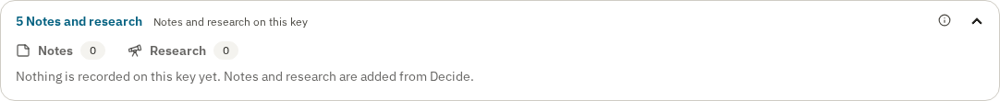

# Working Case Note

The ability to add notes to a case is intrinsic to the functioning of most case management tools, and crucial for audit.

Notes roll up to the Case Key Value combination and are therefore available across all historic case records.

The presentation of data by Case Key and Case Key Value is of profound importance to ensure that a true history is maintained and evidential, rather than on a Case Id (as a case may cycle a number of times over the life of a Case Key and Case Key Value, thus having several Case Id).

## Where it lives

Navigate to a case record from the Cases page, as described in [Navigating Case Record](../WorkingNavigatingCaseRecord/index.html). Notes are read in the section of the case page titled Notes and research, which replaces the Case Notes tab of earlier versions, and which is divided into Notes and Research, each with a count. Where nothing has been recorded, the section states that nothing is recorded on this key yet.

In keeping with the story of the case page being read only, a note is not added in the section. It is added from the Note tile of the Decide pane, which opens a lightbox titled Add a note.

SHOT id=case-management-working-case-note-section
     route=/cases
     steps=open-demo-case, click:Hide the sections, click:Hide the decide panel, open-section:Notes and research
     frame=section:Notes and research
     state=the Notes and research section of a case having an AskJooby narrative card, several analyst notes of which one is marked as a finding and one carries two files, and one research record with sources
     conveys=notes, the narrative, files and research on a key are read in one section, each stating who wrote it and when
     alt=The Notes and research section listing notes with their author, date, action and priority, a note marked as a finding, a note with attached files, and a research record with its sources

## Behaviour

Case Notes are displayed from newest to oldest, by their creation. Each note shows the text of the note, any files attached to it, and a line stating who wrote it (Analyst, System or AskJooby), whether it is a Finding, the user, the date and time, the Action and the Priority.

To assure a reliable audit, it is not possible to update or delete a Case Note. Upon an error being made, a new Case Note must be created annotating a correction to a previous entry. It is of course possible for a note to be deleted at the database level, but this is STRONGLY discouraged as it compromises audit integrity of the case management system.

Upon a note being added, where the Cases Workflow Action selected has Notification or HTTP Endpoint configured, they are dispatched, and are thereafter listed in the Messages section of the case page.

## Fields

The Add a note lightbox takes the following:

| Value        | Description                                                                                                                                                                                                                                                                              | Example      |
|--------------|------------------------------------------------------------------------------------------------------------------------------------------------------------------------------------------------------------------------------------------------------------------------------------------|--------------|
| Action       | As created in [Cases Workflow Action](../CreatingCaseWorkflowAction/index.html). Actions provide for an element of structure in otherwise unstructured data while also providing automation capability via the Notification and HTTP Endpoint functionality. An Action must be chosen. | Request KYC  |
| Priority     | The allocated priority for the note. Priority provides for an element of structure in otherwise unstructured, free text, data for the purpose of reporting. The first priority of the workflow is selected upon the lightbox being opened.                                               | High         |
| Note         | A free text note or memo, of up to 4,000 characters, with a count of the characters used shown beneath.                                                                                                                                                                                  | Ask for kyc. |
| Attach files | Optionally, one or more files to be kept with the note as evidence. See [Working Uploading and Recalling Files](../WorkingUploadingRecallingFiles/index.html).                                                                                                                          |              |

## Validation

Add note is not available until an Action has been chosen, a Priority is selected and the Note has been typed. The server further requires that the Action belongs to the Case Workflow of the case, and refuses a note on a case that is locked to another user. Through the API a note may be up to 100,000 characters in length.

Where files were chosen, the note is saved first and each file is then attached to it. If a file cannot be attached the note stays, and a message states how many files could not be attached.

Upon the lightbox being opened, Action reads Choose and nothing is selected, Priority carries the first priority of the Case Workflow, and the Note is empty with the count beneath it reading 0 of 4000. The Note will not accept more than 4,000 characters. Add note saves the note, shows the message Note added, closes the lightbox and adds the note to the head of the Notes and research section, whereas Cancel closes the lightbox and saves nothing. Where a file could not be attached the message reads, for example, Note added, but 1 file(s) could not be attached.

The refusals of the server, each shown as a message on the page, are as follows:

| Circumstance                                              | Message                                    |
|-----------------------------------------------------------|--------------------------------------------|
| The case is held by another user                          | The case is locked by another user.        |
| The case does not exist, or is not visible                | The case was not found or is not visible.  |
| The Action is not one of the Case Workflow                | The case workflow action was not found.    |
| No note is given, through the API                         | A note is required.                        |
| No Action, or no Priority, is given, through the API      | A valid action is required, or A valid priority is required. |
| The note is over 100,000 characters, through the API      | A note must be 100000 characters or fewer. |

It is not necessary to hold the case to add a note, only that nobody else holds it.

By way of illustration, the demonstration case on ACC-441 carries four notes, the most recent recording that the card was present in London forty minutes after a purchase in Cairo and that the matter was escalated for supervisor review. As notes roll up to the Case Key Value, those same four notes are read on every case, past and future, raised on ACC-441.

## Note Formatting and Sanitising

In earlier versions the note was written in a rich text editor, and so was stored as HTML. The Add a note lightbox takes plain text, and the case page shows a note as plain text, but a note arriving through the API may still carry HTML, as may notes stored by earlier versions. Before a note is stored, and again when it is read back, the HTML is rebuilt from an allow-list, and a note is never returned to a browser as it was typed. The rules are:

| Part of the note   | What is kept                                                                                                                                                                                      | What happens to the rest                                                                                         |
|--------------------|---------------------------------------------------------------------------------------------------------------------------------------------------------------------------------------------------|------------------------------------------------------------------------------------------------------------------|
| Tags               | Paragraphs, line breaks, headings (h1 to h6), bold, italic, underline, strike, sub and superscript, lists, tables, block quotes, preformatted text and code, rules, spans, divs, links and images | Any other tag (script, iframe, style, form and so on) is dropped, its text stays as plain text                   |
| Attributes         | Only the attributes each allowed tag needs: link target, image source, size, span counts, and a limited style                                                                                     | Event handlers such as onclick, and every other attribute, are removed                                           |
| Style              | Colour, background colour, font, size, weight, alignment, width, height, border, padding and margin                                                                                               | A style value that could carry a URL, an expression or a CSS escape is removed                                   |
| Links              | http, https, mailto, or a path within the application                                                                                                                                             | Anything else, including script URLs, is removed                                                                 |
| Images             | An inline image (png, jpeg, gif or webp), an https URL, or a file in the application's own image folders                                                                                          | A path to any other page of the application is refused, so a stored note cannot make a reader's browser call one |
| Stray brackets     | Shown as text (a lone less-than or greater-than sign is encoded)                                                                                                                                  | -                                                                                                                |
| Control characters | Tab and line breaks                                                                                                                                                                               | Removed, including the NUL character                                                                             |

Text that only looks like markup, such as `` typed as a note, is therefore stored and shown as inert text, not executed. Keeping in mind that a Case Note cannot be updated or deleted, the sanitising applies when the note is added and again on every read.

## Source, findings, attachments and the AskJooby narrative

A note states who wrote it, being an analyst, the system or AskJooby, and an analyst can mark their own note as a finding. This is done from the Findings card of the Decide pane, under On this case, which lists the notes written by the user on the key, each with Mark as finding or Clear finding. It is the only change that a note allows.

The Findings card is drawn only where the user has written at least one note on the key, and carries, beside its title, the number of those notes presently marked as findings. Each note is shown by its first two lines. Mark as finding acts at once, with no message, the button turning to Clear finding and the note gaining the word Finding in its line in the Notes and research section. A finding is the means by which an analyst states that a note is a conclusion and not merely a record of something done, and it is read by the ranking of the case as evidence, under the trigger Analyst finding. The notes of other users cannot be marked, and are not listed in the card.

Files are attached to a note, in the same lightbox, rather than to the case, and every file uploaded before this arrangement was moved under a note titled `Migrated Document`.

Where a Case Workflow has Enable Narrative on, a background job also keeps a read only AskJooby narrative of the case up to date as the facts change. The narrative is presented as a card at the head of the notes, stating its version, when it was written and the run it came from, with the earlier versions available beneath it. It cannot be edited, and a new version is written when the facts change.

## Research

Research is a separate record, not a kind of note. Notes and research is a single section of the case page having two subsections, and Research is its own tile in the Decide pane, opening a lightbox titled Add research which takes a Topic, the Findings, the Sources they rely on (a title, an http or https address and a date retrieved for each, ten at most) and files. The addresses are kept as written and are never opened by Jube.

The Topic is limited to 500 characters, the Findings to 4,000 with a count beneath, and the title of a source to 300. Add research is not available until a Topic and the Findings have been typed and every source given is acceptable, an address that is not a full http or https address without spaces being marked with Enter a full http or https address with no spaces. Add source is disabled once ten sources are in place, each source has a control to remove it, and the lightbox states Up to 10 sources. Addresses are kept as written and never opened by Jube. Upon being saved the message Research added is shown and the record joins the Research subsection, with its sources listed under Sources, each stating the date it was retrieved.

## Permissions and security

Reading and adding notes and research requires permission 1, Read Write Case. A note can be added only to a case that is visible to the roles of the user and not locked to another user, and a note whose Action is not granted to the roles of the user is not shown.
