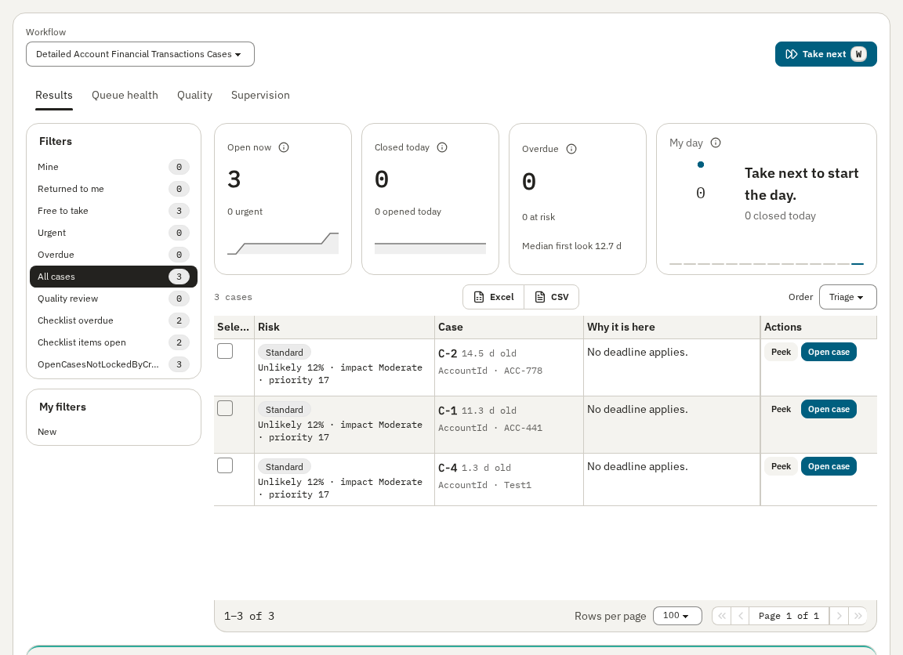
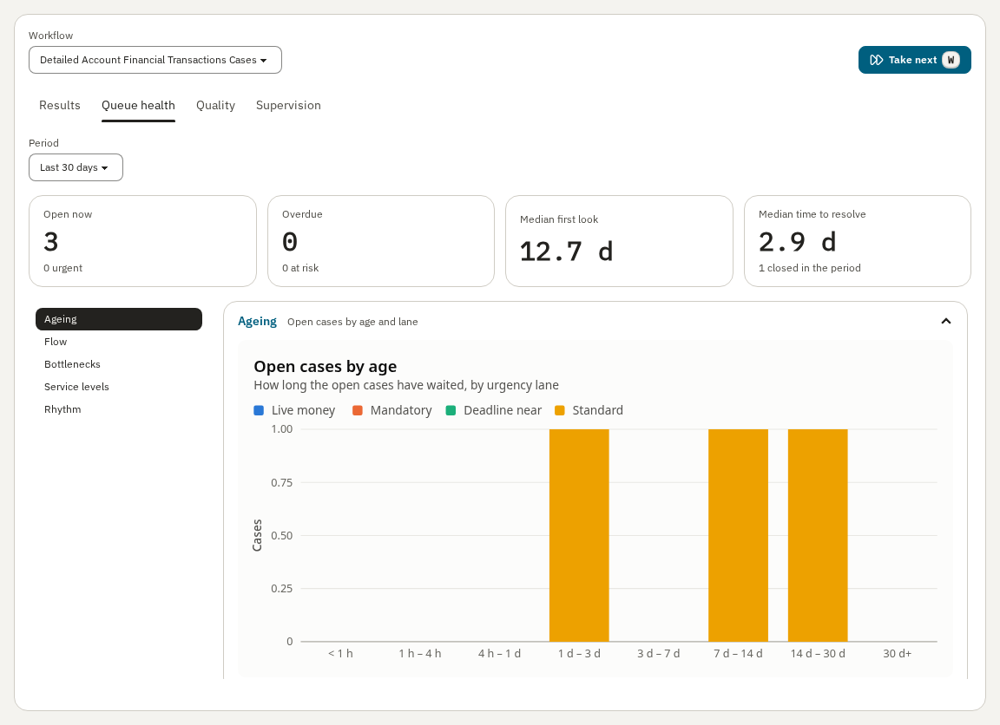
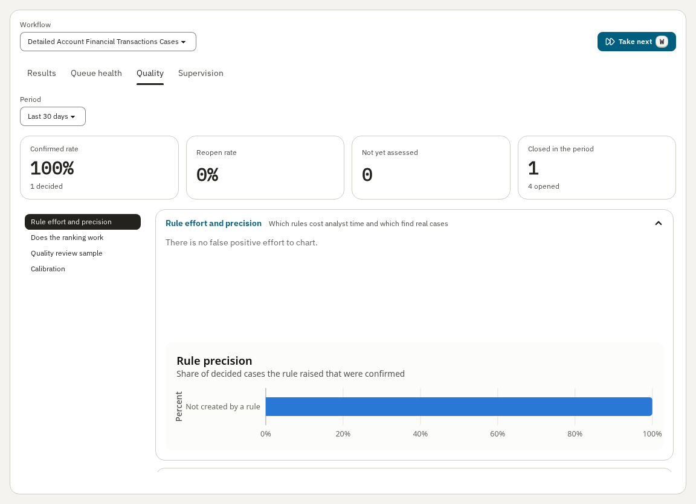
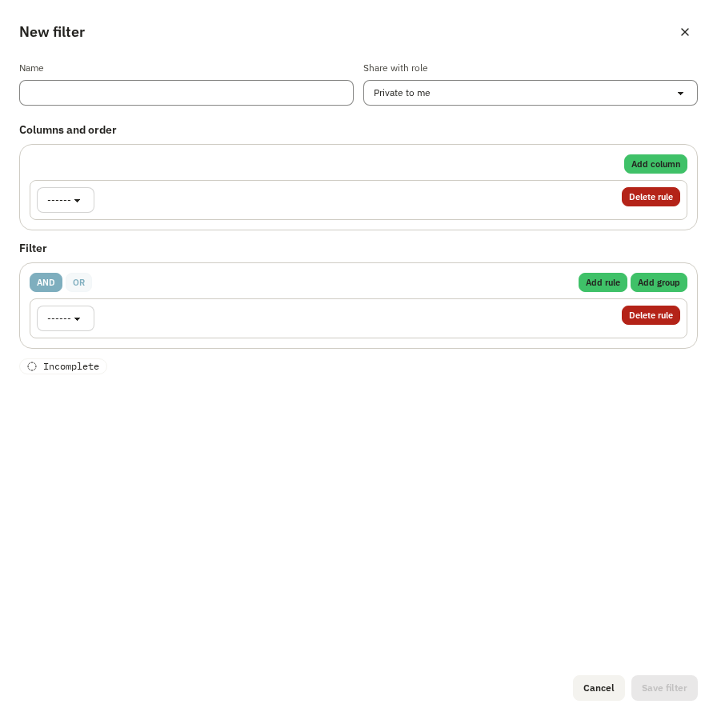

# Working the Cases Page

The Cases page answers three questions for three kinds of reader. An analyst asks what should be worked next and how the day is going. A supervisor asks whether the queue is healthy, which is to say whether cases are being looked at, owned and resolved in good time, and where they wait. Whoever tunes the rules and the ranking asks whether the cases being raised are worth the time spent upon them, and whether the order in which they are presented finds the real ones first.

The queue itself, Take next, Peek and the lock are described in [Working Skim, Lock and Next](../WorkingSkimLockNext/index.html), which should be read first. This page describes everything else upon the Cases page: the tabs, the pulse panel with My day, the analytics of the Queue health and Quality tabs, the Approvals panel, closing and reassigning several cases at once, and the filters an analyst keeps for their own use.

For the purposes of illustration, this page follows a Case Workflow having a Daily goal of 25, an analyst, Robert, who by the middle of the afternoon has closed 18 cases, and a supervisor reviewing the same workflow at the end of the week.

## Where it lives

Navigate through the menu to Cases. At the top of the page are the Workflow to be worked and Take next, beneath which is a row of tabs:

| Tab          | Shown to                                                   | Description                                                                                                                                                       |
|--------------|------------------------------------------------------------|-------------------------------------------------------------------------------------------------------------------------------------------------------------------|
| Results      | Everyone permitted to work cases.                          | The rail of filters, the pulse panel and the list of cases, with the Approvals panel beneath for a role granted permission 70, Approve Case Suppressions.         |
| Queue health | Everyone permitted to work cases.                          | Analytics of how cases move: Ageing, Flow, Bottlenecks, Service levels and Rhythm.                                                                                |
| Quality      | Everyone permitted to work cases.                          | Analytics of what the cases turned out to be: Rule effort and precision, Does the ranking work, Quality review sample and Calibration.                            |
| Supervision  | A role granted permission 18, Read Write Case Workflow.    | The workload by analyst and the stuck locks, described in [Working Case Supervision](../WorkingCaseSupervision/index.html).                                       |

Results is the default. The tabs can be moved between with the left and right arrow keys once a tab has the focus, the direction being reversed in a right to left language. Every tab describes the Workflow chosen at the top of the page, and changing the Workflow changes all of them.

SHOT id=case-management-cases-page-results
     route=/cases
     steps=wait-for:Open now
     frame=page
     state=the Cases page on the Results tab for the demonstration workflow, showing the Workflow selector and Take next, the four tabs, the rail with Filters and My filters, the pulse panel with Open now, Closed today, Overdue and My day with its ring part filled, and the first rows of the list
     conveys=the Results tab is the rail, the pulse and the list, and the other tabs describe the same workflow
     alt=The Cases page on the Results tab with the Workflow selector, Take next, the tabs Results, Queue health, Quality and Supervision, the rail of filters, the pulse panel with My day and the list of cases



### What the page remembers

The state of the page is held in the address in the browser, such that a queue or a chart can be linked to, or kept as a bookmark:

| Parameter | Holds                                                                                           | Left out when                    |
|-----------|-------------------------------------------------------------------------------------------------|----------------------------------|
| `wf`      | The Workflow.                                                                                   | Never, once a Workflow is chosen |
| `view`    | A built in filter, as a number from 1 to 9.                                                     | The filter is All cases          |
| `filter`  | A Case Workflow Filter.                                                                         | Another kind of filter is chosen |
| `mine`    | A filter under My filters.                                                                      | Another kind of filter is chosen |
| `sort`    | The Order, as a number from 0 to 6.                                                             | The Order is Triage              |
| `case`    | The case open in the Peek.                                                                      | No case is being peeked at       |
| `tab`     | The tab, being `health`, `quality` or `supervision`.                                            | The tab is Results               |
| `days`    | The Period of the Queue health and Quality tabs, being 7, 30 or 90.                             | The Period has not been changed  |

A value that is not recognised is ignored in favour of the default, and an address naming the Supervision tab presents Results to a user not granted permission 18. The addresses `/cases/queue-health`, `/cases/quality` and `/cases/supervision` lead to the respective tab.

In addition, the Workflow, the filter and the Order last used are kept in the browser for the user and tenant, and are restored upon arriving at the Cases page with no Workflow in the address. The tab, the Peek and the Period are not restored in this manner, henceforth the page opens upon Results. Where nothing was kept, or the Workflow kept is no longer available to the role of the user, the first Workflow available is chosen.

### States of the page

| State                                             | What is shown                                                                                     |
|---------------------------------------------------|---------------------------------------------------------------------------------------------------|
| The user is not granted permission 1              | Your role is not permitted to work cases. Nothing else of the page is presented.                 |
| No Case Workflow is granted to the role           | No case workflow is available to your role.                                                       |
| The list cannot be read                           | The cases could not be loaded.                                                                    |
| The filter matches nothing                        | No cases in this view, beneath a count of 0 cases.                                                |
| Take next finds nothing                           | Nothing left to take in this queue.                                                               |
| Take next fails                                   | The next case could not be taken.                                                                 |

## The pulse and My day

The pulse panel sits above the list of cases in the Results tab and is made of four cards. It describes the whole of the Workflow chosen, limited to the cases the roles of the user may see, and it does not narrow with the filter chosen in the rail. It follows that the figure for Open now will ordinarily agree with the count beside All cases, and not with the count of the list where a narrower filter is in view. The figures are read again at most once a minute, and each card carries a help control explaining it. Where the figures cannot be read the panel is omitted, the rail and the list being unaffected.

| Card         | Headline figure                                                                 | Beneath it                                                                                                                                                                                                 | How to read it                                                                                                                                         |
|--------------|---------------------------------------------------------------------------------|------------------------------------------------------------------------------------------------------------------------------------------------------------------------------------------------------------|--------------------------------------------------------------------------------------------------------------------------------------------------------|
| Open now     | The number of cases open at this moment.                                        | The number urgent, being those in the lanes Live money, Mandatory and Deadline near, which is the same test as the Urgent filter. A small line draws the open cases at the end of each of the last 14 days. | A line that rises is a backlog that is growing. A large share of urgent cases is the prompt to work from the top with Take next.                       |
| Closed today | The number of cases closed today by anyone.                                     | The number opened today, and a small line drawing the cases closed on each of the last 14 days.                                                                                                            | Closed above opened means the backlog is falling.                                                                                                      |
| Overdue      | The number of open cases having passed a service level deadline.                | The number at risk, being open cases with 80 percent or more of a target elapsed and none yet passed, and Median first look, the median time from a case being created to anyone first looking at it.      | Anything other than zero overdue warrants the Overdue filter. A lengthening first look shows that work is being picked up more slowly.                  |
| My day       | A ring holding the number of cases the user has closed today.                   | Described below.                                                                                                                                                                                           |                                                                                                                                                        |

Today, and each day of the small lines, is a calendar day in UTC rather than in the time zone of the user. Median first look is taken over the cases created in the last 30 days, and is omitted where none of them has yet been looked at. The service level targets, and the meaning of at risk and overdue, are described in [Working Case Risk and Service Levels](../WorkingCaseRiskAndServiceLevels/index.html).

TODO(verify): the help text of the Open now card (cases.help.open in en.json) states that the urgent figure is the number of cases overdue or at risk of their deadline, whereas CaseAnalyticsService.Headline counts open cases in lanes 1 to 3 (Live money, Mandatory, Deadline near). Owner to decide which is intended, then correct the help text or the count.

### My day

My day is the day of the user alone, set against the Daily goal of the Case Workflow, which is a value in the Service level group described in [Creating Case Workflows](../CreatingCaseWorkflows/index.html). The intent is that an analyst can see their own progress without it being a comparison with a colleague, and nothing upon the card refers to anyone else. Only cases of the Workflow chosen, closed by the user, are counted.

| Element    | Description                                                                                                                                                                                                                                                              |
|------------|--------------------------------------------------------------------------------------------------------------------------------------------------------------------------------------------------------------------------------------------------------------------------|
| Ring       | The cases closed today as a share of the goal, to a maximum of a full ring, which turns to the success colour once the goal is met. With no goal set, the ring is empty until a case is closed and full thereafter.                                                      |
| Message    | Take next to start the day, where nothing has been closed. Thereafter the number remaining as, for example, 7 to go, and Goal met. Anything more is a bonus, once the goal is reached. With no goal set and at least one case closed, Streak is alive. Keep going.       |
| Progress   | With a goal, the number closed of the goal, for example 18 of 25 closed. With no goal, the number closed today.                                                                                                                                                          |
| Streak     | A badge, for example 4-day streak, counting the consecutive days upon which the goal was met, or with no goal, upon which at least one case was closed. Today is counted once the goal is met, and until then the streak stands as it was at the end of yesterday.       |
| Goal met   | A badge shown once the goal for today is met.                                                                                                                                                                                                                            |
| Bars       | The cases closed by the user on each of the last 14 days, today being the last bar.                                                                                                                                                                                      |
| Comparison | The cases closed today against a typical day, shown as above a typical day, below a typical day or A typical day. A typical day is the median of the 13 days before today, counting the days upon which nothing was closed.                                              |
| Best       | The highest number closed in any one of the 14 days.                                                                                                                                                                                                                     |

The Comparison and Best are shown only once the user has closed a case within the 14 days. As the streak is counted within the same 14 days, it cannot exceed 14.

To follow the example, Robert, having closed 18 of a goal of 25, sees a ring nearly three quarters full, the message 7 to go and the progress 18 of 25 closed. Had he met the goal on each of the four preceding days, the badge reads 4-day streak, and it becomes 5-day streak upon the twenty fifth case being closed, at which point the ring changes colour and Goal met is shown. If his typical day is 22, the comparison reads 4 below a typical day.

## Queue health and Quality

The two analytics tabs share an arrangement. At the top is the Period, being Last 7 days, Last 30 days or Last 90 days, with Last 30 days the default. Beneath are four headline figures for the period, then an index of sections on the left and the sections themselves on the right, each of which can be collapsed and expanded, and to each of which the index moves upon being clicked. All sections are open upon arrival, with the exception of Rhythm, which is collapsed.

The period begins at midnight UTC the chosen number of days ago and runs to the present. Only the cases the roles of the user may see are counted, and the figures are read again at most once a minute. Where a Workflow holds more than 50,000 cases in scope, the most recent 50,000 are analysed and the oldest are left out.

Each chart is drawn in the server and follows the language and the light or dark theme of the user interface. A chart having nothing to draw states as much in its place, for example There is no flow to chart, rather than presenting an empty chart, and a chart that fails presents The chart could not be drawn alongside Try again.

TODO(verify): the wording shown in place of a chart with nothing to draw ("There is no flow to chart." and its siblings) is composed in English by CaseAnalyticsChartRenderer.Require and returned as the body of a 400, so it is not translated in the other eight locales although the chart titles are. Owner to decide whether it should be localised.

### Queue health

Queue health is for the supervisor asking whether the queue is being kept up with. The headline figures are as follows:

| Figure                 | Description                                                                                                                              |
|------------------------|------------------------------------------------------------------------------------------------------------------------------------------|
| Open now               | The cases open at this moment, with the number urgent, as in the pulse.                                                                  |
| Overdue                | The open cases past a service level deadline, with the number at risk.                                                                   |
| Median first look      | The median time from creation to the first look, over cases created in the period. None yet where no case has been looked at.            |
| Median time to resolve | The median time from creation to closure, over cases created in the period that have closed, with the number closed in the period.       |

The sections are as follows:

| Section        | Described in the page as                                    | Charts                                                                                                         | How to read it                                                                                                                                                                                                                                              |
|----------------|-------------------------------------------------------------|----------------------------------------------------------------------------------------------------------------|-------------------------------------------------------------------------------------------------------------------------------------------------------------------------------------------------------------------------------------------------------------|
| Ageing         | Open cases by age and lane                                  | Open cases by age, stacked by lane, in bands from under one hour to 30 days and more.                          | Weight to the right is old work. Live money, Mandatory or Deadline near in the older bands should prompt action first, as those are the lanes with something at stake.                                                                                      |
| Flow           | Opened, closed and backlog each day                         | Columns for the cases opened and closed each day, with a line for the cases still open at the end of the day.  | Where the opened columns persistently exceed the closed, the line climbs, and the team is not keeping up with arrivals.                                                                                                                                     |
| Bottlenecks    | Where cases wait longest                                    | Time in each status, as the median and the slowest tenth of completed stays, in hours, for up to 15 statuses.  | The status with the longest bars is where cases wait. A slowest tenth far beyond the median means that most cases pass through quickly and a few are left.                                                                                                  |
| Service levels | Time to first look and to resolution against target         | Time to first look, Time to resolution, and Service level attainment by week.                                  | The first two count cases by how long they waited. The third is the share of the cases created in each week that met each target (First look, Ownership, Resolution and Time in status), where 100 is every case and a falling line is a worsening service. |
| Rhythm         | When cases arrive and when they are first looked at         | When cases arrive, by weekday and hour, Median first look by hour of arrival, and How often cases change hands. | A busy cell with a long first look at the same hour is an hour that is understaffed. Many cases with two, or three or more, changes of owner suggest that cases are being passed around rather than decided.                                                |

The hours of the Rhythm charts are in UTC. A change of hands is counted from the lock being taken manually or allocated to another user, and the chart of changes of hands also states how many cases were reopened after closing.

In the example, the supervisor, upon selecting Last 7 days, finds the backlog line of Flow rising through the week and, under Bottlenecks, one status having a median of 30 hours where the others are under two. The conclusion is that the queue is not short of analysts so much as waiting upon whatever that status awaits, and the maximum dwell of the status, described in [Working Case Risk and Service Levels](../WorkingCaseRiskAndServiceLevels/index.html), is the means to have such cases surfaced.

SHOT id=case-management-cases-page-queue-health
     route=/cases
     steps=open-tab:Queue health, wait-for:Ageing
     frame=page
     state=the Queue health tab for the demonstration workflow over the last 30 days, showing the Period, the four headline figures, the index of sections and the Ageing and Flow charts drawn
     conveys=queue health is a period, four headline figures and a column of charted sections reached from an index
     alt=The Queue health tab showing the Period selector, the figures Open now, Overdue, Median first look and Median time to resolve, the index of sections and the charts of open cases by age and of opened, closed and backlog by day



### Quality

Quality is for whoever tunes the rules and the ranking, and it depends upon outcomes. An outcome is the verdict carried by the status in which a case is closed, being Confirmed or Not confirmed, as set on the [Cases Workflow Status](../CreatingCaseWorkflowStatus/index.html). A case closed in a status carrying neither is not decided, and takes no part in the figures below. It follows that until at least one status is set as Confirmed and one as Not confirmed, and cases have been closed in them, this tab has little to say.

| Figure               | Description                                                                                                                                  |
|----------------------|----------------------------------------------------------------------------------------------------------------------------------------------|
| Confirmed rate       | The share of the cases decided in the period that were Confirmed, with the number decided. None yet where nothing has been decided.          |
| Reopen rate          | The share of the cases created in the period that have been reopened at least once.                                                          |
| Not yet assessed     | The open cases to which the ranking has not yet given a lane.                                                                                |
| Closed in the period | The cases closed in the period, with the number opened.                                                                                      |

| Section                   | Described in the page as                                                        | Shows                                                                                                                                                                                                                             | How to read it                                                                                                                                                                                                                           |
|---------------------------|---------------------------------------------------------------------------------|-----------------------------------------------------------------------------------------------------------------------------------------------------------------------------------------------------------------------------------|------------------------------------------------------------------------------------------------------------------------------------------------------------------------------------------------------------------------------------------|
| Rule effort and precision | Which rules cost analyst time and which find real cases                         | Analyst time lost to false positives by rule, in hours, for the 12 rules costing most, and Rule precision, being the share of the decided cases each rule raised that were Confirmed.                                             | A rule with many hours and a low precision is the first candidate for tightening. The hours are the time from creation to closure of the cases the rule raised that were Not confirmed, so they include waiting as well as working.     |
| Does the ranking work     | Confirmed cases found as cases are worked, against oldest first and random      | A line for the share of Confirmed cases found as a share of the cases is worked in Priority order, in Likelihood order and Oldest first, against a diagonal for Random.                                                           | The further the Priority line bows above the diagonal and above Oldest first, the more the ranking is earning its keep. A line upon the diagonal is a ranking no better than chance.                                                     |
| Quality review sample     | What randomly picked low-priority cases turn out to be                          | The number Picked, Still open, Closed with an outcome and the share Confirmed, compared with the share among all closed cases with an outcome. See [Working Quality Review Samples](../WorkingQualityReviewSamples/index.html).   | A Confirmed share in the sample approaching that of all cases means the ranking is leaving real cases at the bottom of the queue.                                                                                                        |
| Calibration               | Predicted likelihood against what happened                                      | The likelihood predicted for decided cases, in bands, against the share of each band that was Confirmed.                                                                                                                          | Points upon the diagonal mean that a likelihood of 70 percent is right about seven times in ten. Points beneath it mean the likelihood is overstated.                                                                                    |

The ranking and calibration charts state the number of decided cases in their subtitle, and where there are fewer than 30, or fewer than 5 of either verdict, the subtitle reads Only, followed by the number, then decided cases, too few to rely on. The Quality review sample states No case has been picked for quality review in this workflow yet where that is so, and warns that the share is not yet reliable where fewer than ten sampled cases have closed with an outcome.

It should be kept in mind that analysts work the top of the list first, so the outcomes available lean towards the cases the ranking already favoured, and the ranking chart flatters the ranking somewhat. The Quality review sample exists as the correction for exactly this.

SHOT id=case-management-cases-page-quality
     route=/cases
     steps=open-tab:Quality, wait-for:Period
     frame=page
     state=the Cases page with the Quality tab open for the demonstration Case Workflow over the last 30 days, showing a Confirmed rate of 100% from 1 decided, a Reopen rate of 0%, 0 Not yet assessed and 1 Closed in the period of 4 opened, and beneath them the index of sections, Rule effort and precision, Does the ranking work, Quality review sample and Calibration, with the first open on the Rule precision chart
     conveys=Quality is a tab of the Cases page that reads the outcomes of closed cases back against the rules and the ranking
     alt=The Quality tab of the Cases page showing a Confirmed rate of 100%, a Reopen rate of 0%, 0 not yet assessed and 1 closed in the period, above an index of four sections and the Rule effort and precision section with its Rule precision chart



## Approvals

A role granted permission 70, Approve Case Suppressions, is presented with a panel titled Approvals beneath the queue in the Results tab, described there as Requests waiting for someone other than the person who made them. It lists the model override requests awaiting a decision, as raised from a case in the manner described in [Working Case Suppression](../WorkingCaseSuppression/index.html), so that an approver need not know which case to open.

| Column           | Description                                                                                     | Example                          |
|------------------|-------------------------------------------------------------------------------------------------|----------------------------------|
| Kind             | The kind of request, which is Model override.                                                   | Model override                   |
| Request          | The key and the key value for which the override is asked.                                      | AccountId = Test1                |
| Models and rules | The model, and the rule where the request names one, for each target of the request.            | Detailed Account / High Velocity |
| Requested by     | The user having made the request.                                                               | Robert                           |
| Case             | The case from which the request was made.                                                       | C-1234                           |
| Requested        | The date and time of the request.                                                               |                                  |
| Waiting          | Today, or the number of whole days since the request was made.                                  | 2 days                           |
| Actions          | Review, which opens the case with the request presented for a decision.                         |                                  |

The requests are listed oldest first, to a limit of 100, and are those still pending, not expired and not lapsed. The panel is not narrowed by the Workflow chosen at the top of the page, nor by the filter. It is read again at most every 15 seconds. Where there is nothing to decide it states Nothing is waiting for approval, and where it cannot be read, The approvals could not be loaded. A user not granted permission 70 is not presented with the panel at all, and the request to list is refused with a status of 403.

## Closing and reassigning several cases at once

Each row of the list has a tick box, titled Select case. Upon one or more being ticked a bar is presented above the list stating the number selected, alongside Close, Reassign and Clear selection. The selection is dropped for any case that leaves the list, as happens upon the filter or the Order being changed, and it does not survive leaving the page. The rules applied to each case, the reasons for which a case is skipped and the underlying API are set out in [Working Lock, Allocation and Unlock](../WorkingLockAllocationUnlock/index.html), and the two dialogs are as follows.

Close presents a dialog titled Close, followed by the number, then cases?, which explains that every selected case that the user can close is closed with the reason and note given, and that cases held by someone else, already closed or blocked by an incomplete checklist are skipped and reported:

| Value              | Description                                                                                                                                             | Example                    |
|--------------------|---------------------------------------------------------------------------------------------------------------------------------------------------------|----------------------------|
| Reason for closing | Optional, with No reason as the default. The reasons are those of a single close, described in [Working Closed, Diary Date and Suspend](../WorkingClosedDiarySuspend/index.html). | Duplicate of another case |
| Note (optional)    | Free text of up to 1,000 characters, recorded against every case closed.                                                                                | Covered by C-1201          |

Reassign presents a dialog titled Reassign, followed by the number, then cases?, which explains that every selected open case is locked to the analyst named, if they are eligible for it, the others being skipped and reported:

| Value             | Description                                                                                                                 | Example |
|-------------------|-----------------------------------------------------------------------------------------------------------------------------|---------|
| Analyst user name | The user name of the analyst to receive the cases, typed rather than chosen. Required, and Reassign is disabled without it. | Robert  |

Either dialog is dismissed with Cancel, which leaves the selection as it was. Upon confirmation the cases are worked through one at a time, the selection is cleared, the list, the counts in the rail and the pulse are read afresh, and a message reports the result:

* Where every case was done, the number followed by cases updated.
* Where some were skipped, the number updated and the number skipped, followed by each reason with its count in brackets. The reasons are Not found or not visible, Already closed, Held by another user or changed meanwhile, Not valid for this case or analyst not eligible, and Checklist incomplete.

The server accepts between 1 and 500 cases in a request, and refuses a request outside of that range, a reason for closing that is not recognised, a note longer than 1,000 characters or an empty analyst, with a status of 400. As the list presents the first 100 cases only, no more than 100 can be selected from it at once.

Close requires permission 1, Read Write Case, and Reassign requires permission 18, Read Write Case Workflow. The Reassign control is presented in the bar only to a user granted permission 18, the server refusing the request of any other user with a status of 403.

TODO(verify): the message "At most 500 cases can be selected at once." (cases.bulk.limit) cannot be reached while the list is capped at the first 100 cases.

## My filters

The built in filters and the Case Workflow Filters are provided for the analyst. My filters are those the analyst makes for themselves, without recourse to an administrator: a filter for the cases of a single branch, perhaps, or for cases above a value that the analyst has been asked to keep an eye on. A filter of this kind is a saved view of the queue, in that it is kept under a name, appears in the rail with a count as any other filter does, and can be linked to through the `mine` parameter of the address.

### The rail

The rail presents two cards. Filters holds the built in filters followed by the [Case Workflow Filters](../CreatingCaseWorkflowFilter/index.html), and My filters holds the filters visible to the user, in order of name, followed by New. A filter is visible to a user where the user created it, or where it is shared with a role of the user.

Each entry carries the count of cases matching. Where a Case Workflow Filter or a filter under My filters can no longer be counted, most often because a field upon which it relies is no longer available, the count is replaced by the word Failed, and the remaining entries are unaffected. On a narrow screen the two cards are replaced by a single selector titled Filter, with New beside it.

### The editor

New, under My filters, opens the editor from the side of the page under the heading New filter. Where the filter in view belongs to the user, Edit this filter is presented above the list and opens the same editor under the heading Edit filter. A filter shared by another user is used as it is, and Edit this filter is not offered for it.

| Value             | Description                                                                                                                                                                                              | Example             |
|-------------------|----------------------------------------------------------------------------------------------------------------------------------------------------------------------------------------------------------|---------------------|
| Name              | The name shown in the rail. Required.                                                                                                                                                                    | High value, my branch          |
| Share with role   | Private to me, the default, or a role, every member of which is then presented with the filter under their own My filters.                                                                               | Private to me                  |
| Columns and order | The first part of the query builder, adding columns with Add column.                                                                                                                                     |                                |
| Filter            | The second part of the query builder, taking conditions on the fields of the case and of the payload configured for the Case Workflow, combined with AND and OR in nested groups.                        | Closed Status is equal to Open |

The query builder is the one used for a Case Workflow Filter, and its fields and operators are described in [Case Workflow Filter](../CreatingCaseWorkflowFilter/index.html). What is built is stored as the description of the filter and is translated to SQL in the server each time the filter is used, with the values passed as parameters. SQL is never typed by the user nor accepted from the browser. As with every filter, the cases returned are further limited to the Cases Workflow Statuses granted to the roles of the user, such that sharing a filter grants nothing.

The list of the Cases page has fixed columns and takes its order from the Order control. It follows that it is the Filter part that decides which cases a filter under My filters returns, and what is set under Columns and order is stored with the filter without altering the columns of the list.

TODO(verify): CaseSearchService.CompileScopeAsync uses only the WhereSql of a compiled filter, and CasesList.vue has fixed columns, so "Columns and order" in the editor has no visible effect on the Cases page for My filters or for Case Workflow Filters. Owner to decide whether that part of the builder should be hidden in this editor or honoured by the list.

The state of the builder is shown beneath it. Save filter is disabled until a Name is given and the builder has no problems, and a problem can be clicked to move to the condition at fault. Where a filter being edited relies upon fields no longer available, those conditions are removed and the editor states These fields are no longer available and were removed from the filter, followed by the fields and Review this filter. Where the filter cannot be restored at all, it states The saved filter could not be restored. Review this filter.

Upon Save filter the message Filter saved is shown, the editor closes, the rail is read afresh and the filter saved becomes the filter in view. Cancel, the cross and the Escape key close the editor without saving. While a filter is being fetched for editing, the editor shows a placeholder, and where it cannot be fetched, The filter could not be loaded.

Delete filter is offered when editing. Confirmation is sought under the heading Delete this filter?, stating that the filter will be removed for you and for anyone it is shared with. Upon confirmation the message Filter deleted is shown and the page returns to All cases. A filter is deleted outright, and there is no means of restoring it.

SHOT id=case-management-cases-page-filter-editor
     route=/cases
     steps=wait-for:My filters, click:New
     frame=dialog
     state=the New filter editor open from the side of the Cases page, with an empty Name, Share with role reading Private to me, and the query builder showing Columns and order and Filter with one condition row
     conveys=an analyst builds their own filter with a name, an optional role to share with and the same query builder as a Case Workflow Filter
     alt=The New filter editor with the Name and Share with role boxes above the query builder parts Columns and order and Filter, and Cancel and Save filter at the foot



### Validation

A filter is validated in the server upon being saved, and is rejected with a status of 400 where:

* The Name is empty, for which the message is 'Name' must not be empty.
* The Name is longer than 256 characters. The editor accepts no more than 200.
* The user already has a filter of that name for the Case Workflow, without regard to case, for which the message is You already have a saved search with that name for this Case Workflow. Two users may each have a filter of the same name.
* The Case Workflow does not exist or is not granted to the role of the user, for which the message is The Case Workflow was not found or you do not have access to it.
* The role to share with does not exist, for which the message is The role to share the search with was not found.
* Either part of the builder is absent, is not valid JSON, or is larger than 1,000,000 characters.
* The filter is being moved to another Case Workflow, which an update does not allow.

Only the user having created a filter may change or delete it, and an attempt upon the filter of another user is reported as not found, with a status of 404, as is a filter that no longer exists. Where the filter was changed elsewhere between being opened and being saved, the save is refused with a status of 409, and the editor should be reopened to take the present version.

### Example

The API underlying the editor is as follows:

```http
GET /api/CaseSearchFilter/ByGuid/{guid}
POST /api/CaseSearchFilter
PUT /api/CaseSearchFilter
DELETE /api/CaseSearchFilter/{guid}
```

A filter private to the user, returning open cases, is created thus, where `filterJson` and `selectJson` hold what the query builder produced:

```json
{
  "caseWorkflowGuid": "5a1c0f3e-0000-0000-0000-000000000000",
  "name": "High value, my branch",
  "filterJson": "{\"condition\":\"AND\",\"rules\":[]}",
  "selectJson": "{\"condition\":\"AND\",\"rules\":[]}",
  "sharedRoleRegistryGuid": null
}
```

## Exporting the list

The list is exported to CSV or Excel from the controls above it, which are disabled while the list is empty or an export is under way. The export is of the cases matching the filter in the Order chosen, rather than of the 100 listed, to a limit of 5,000, beyond which the page states Exported the first 5000 cases. Narrow the filter to export the rest. Where the export cannot be completed it states The export failed. Try again. The file is named `cases-` followed by the date, and the Excel sheet is named Cases.

The columns exported are Case, Case key value, Workflow, Status, Held by, Created, Age (minutes), Lane, Likelihood, Impact, Priority, Value, Why it is here, Service level, Due, Diary, Diary date, QA sample, First viewed, First viewed by, First owned and First owned by.

## Limits

| Limit                                                        | Value   |
|--------------------------------------------------------------|---------|
| Cases listed                                                 | 100     |
| Cases exported                                               | 5,000   |
| Cases accepted by a bulk close or reassign                   | 500     |
| Note on a bulk close, in characters                          | 1,000   |
| Requests listed in Approvals                                 | 100     |
| Periods of the analytics tabs, in days                       | 7, 30, 90 |
| Cases analysed for the pulse and the analytics tabs          | 50,000  |
| Days drawn in the pulse and My day                           | 14      |
| Decided cases before the ranking charts are relied upon      | 30, with 5 of each verdict |
| Sampled cases decided before the sample share is relied upon | 10      |
| Name of a filter, in characters                              | 256     |

## Permissions and security

The Cases page, the pulse, the Queue health and Quality tabs, bulk close, the export and My filters require permission 1, Read Write Case. A user not so granted is presented with Your role is not permitted to work cases, and the underlying requests are refused with a status of 403.

The Supervision tab and bulk reassign require permission 18, Read Write Case Workflow. The Approvals panel requires permission 70, Approve Case Suppressions.

Every figure, chart and list of the page is limited to the Case Workflows and the Cases Workflow Statuses granted to the roles of the user, in the same manner as the queue. It follows that two users looking at the same Workflow may be shown different totals, each being correct for what that user is permitted to see.

The roles offered under Share with role are read from the role registry, which requires permission 34, Read Write Security Role. A user not granted that permission is offered Private to me alone, and may still use the filters that others have shared with their role.

TODO(verify): Share with role in CaseSearchEditor.vue lists roles from GET /api/RoleRegistry, which RoleRegistryService gates on permission 34, so an analyst holding only permission 1 cannot share a filter although CaseSearchFilterService would accept it. Owner to decide whether the editor should be given a list of roles that needs only permission 1.
