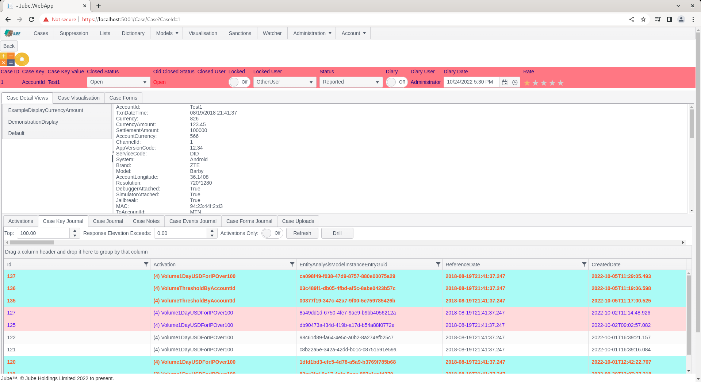
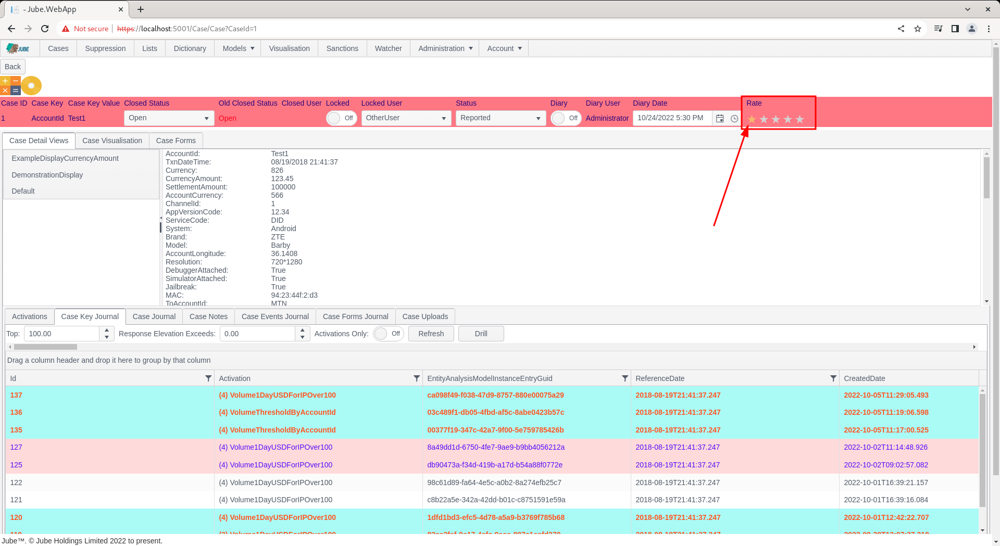
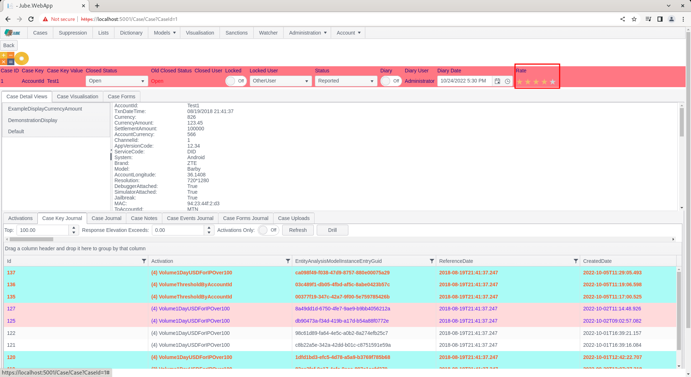

# Working Case Rating

To obtain case quality feedback from the end user there exists a star rating which is intended to capture the subjective
judgement as to the quality of the case. Case evaluation is a grading rather than a strict binary outcome.

Navigate to a case record via either Fetch or Skim:

Take note of the rating in the status bar, that includes a default of one star:

Suppose that the quality of a case - the rules or machine learning that caused the case creation record - is of
reasonable (but not exceptional) quality, then it would be judged to be four stars. To set a star rating, float over the
star rating:

After floating, click to commit. The case record will be updated to four stars.

## Vue case page (case-record review)

<!-- TODO(docs): the screenshots and tab names above are from the Razor UI and are stale; the case page is now one scrolling story with sections 1 Dashboard, 2 Summary, 3 Journal, 4 Network, 5 Notes and research, 6 Events, 7 Forms, 8 Messages and a Decide column on the right -->
<!-- TODO(screenshot): file=case-record-rating.png route=/cases/:caseId state="Case page showing the rating area as described on this page" -->
