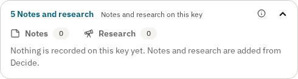
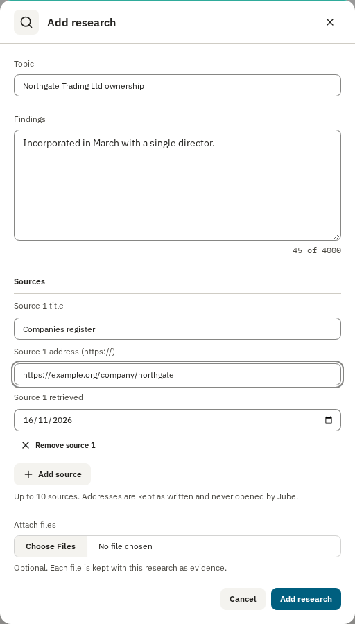
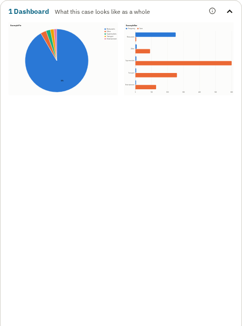

# Working Case Research and Dashboard

An analyst deciding a case is, in the main, answering two questions that the transactions alone do not answer. The first is what is known about the subject outside of Jube: the adverse media, the company register, the sanctions notice, the court record. The second is what the case looks like taken as a whole, drawn in the manner that the designers of the Case Workflow judged most telling for that kind of case. Research exists for the purposes of the first, being a record of what was looked for, what was found, and the sources upon which the finding relies. The Dashboard exists for the purposes of the second, being a Visualisation drawn for the case in view.

The two have nothing in common beyond being sections of the case page, and they are described here one after the other. The Network section of the case page, which draws the entities and links around the Case Key Value, is described in [Graph on a Case](../../Graph/GraphOnACase/index.html).

The terms used on this page are as follows:

| Term       | Meaning                                                                                                                                                             |
|------------|---------------------------------------------------------------------------------------------------------------------------------------------------------------------|
| Research   | A record having a Topic, the Findings and, optionally, Sources and files. It is not a kind of note, and is kept and listed apart from notes.                        |
| Topic      | The subject or question that was researched.                                                                                                                        |
| Findings   | What the research established, in free text.                                                                                                                        |
| Source     | A citation supporting the Findings: a title, a web address and the date upon which the address was retrieved.                                                       |
| Dashboard  | A Visualisation, as described in [Visualisations](../../Visualisations/index.html), embedded in the case page and drawn for the case in view.                       |
| Tile       | One Datasource of the Visualisation as drawn in the Dashboard, being a chart, a grid, a template or a map.                                                          |
| `@Id`      | The SQL parameter by which a Datasource of the Dashboard is told which case is in view, carrying the Case Id.                                                       |

A single scenario is carried through the page. A case, C-1042, has been raised on the Case Key AccountId with the Case Key Value Test1, on account of several large transfers to a company named Northgate Trading Ltd. The analyst wishes to record what the company register and the press say of that company, and the Case Workflow has been given a Dashboard that totals the transfers of the account by day.

## Where it lives

Navigate to a case record from the Cases page, as described in [Navigating Case Record](../WorkingNavigatingCaseRecord/index.html).

Research is read in the section of the case page titled Notes and research, described there as Notes and research on this key, which is divided into Notes and Research. In keeping with the story of the case page being read only, research is not added in the section: it is added from the Research tile under Actions in the Decide pane, which opens a lightbox titled Add research.

The Dashboard is the section of the case page titled Dashboard, described there as What this case looks like as a whole. It is the first section of the story, and it is present only where the Case Workflow has a Visualisation enabled. As the sections are numbered in the order present, a case page having no Dashboard is numbered from Case detail views.

Both sections are open upon the page being opened, each can be collapsed and expanded, and the index titled Case sections moves to either. The section last chosen from the index is kept in the address of the browser, as `?section=notes` or `?section=dashboard`, henceforth a link to a case can open at that section.

## Research

### Reading research

The Research subsection is headed by the word Research and a count of the records. The records are those captured against the Case Key Value combination, rather than the Case Id, and it follows that research recorded on an earlier case for AccountId Test1 is presented on C-1042 also, in the manner of notes. The records are listed from newest to oldest and there is no paging, which is to say that every record on the key is listed.

Each record shows the following:

| Element  | Description                                                                                                                                                                                                                                                              | Example                                   |
|----------|--------------------------------------------------------------------------------------------------------------------------------------------------------------------------------------------------------------------------------------------------------------------------|-------------------------------------------|
| Avatar   | A mark for the author, being that of the analyst, or that of AskJooby where the record was captured through the chat.                                                                                                                                                   |                                           |
| Topic    | The Topic, as a heading.                                                                                                                                                                                                                                                 | Northgate Trading Ltd, ownership          |
| Findings | The Findings, as plain text, with line breaks kept as typed.                                                                                                                                                                                                             | Incorporated in March, a single director. |
| Sources  | Under the label Sources, a line for each Source: its title (or its address where no title was given) as a link, the host of the address, and the word retrieved followed by the date.                                                                                    | Companies register, example.org           |
| Files    | The files kept with the research, each with its name, size in kilobytes, content type, the user having uploaded it, the date and time, and a download control. See [Working Uploading and Recalling Files](../WorkingUploadingRecallingFiles/index.html).                |                                           |
| Author   | A line stating Analyst or AskJooby, the user, and the date and time the record was created.                                                                                                                                                                              | Analyst Robert                            |

A Source link opens the address in a new tab of the browser, and it is opened by the browser of the reader only: Jube stores an address as it was written and never opens it. A stored address that is not an http or https address is not returned at all, and should one reach the page it is shown as text rather than as a link.

The subsection can be in the following states:

| State     | What is shown                                                                                                                                                                                         |
|-----------|-------------------------------------------------------------------------------------------------------------------------------------------------------------------------------------------------------|
| Loading   | An animation beside the word Research, in place of the count.                                                                                                                                         |
| Empty     | The word Research, greyed, with a count of 0 and no list. Where there are no notes either, the section states: Nothing is recorded on this key yet. Notes and research are added from Decide.        |
| Populated | The count and the list of records. A subsection having records takes the full width of the section, whereas an empty one sits beside its neighbour.                                                   |
| Failed    | The research could not be loaded. The Notes subsection is not affected, each being fetched on its own.                                                                                                |

SHOT id=case-management-working-case-research-section
     route=/cases
     steps=open-demo-case, scroll-to:Notes and research
     frame=section:Notes and research
     state=the Notes and research section of a demonstration case, the Notes subsection with two notes and the Research subsection with a count of one, the record showing a topic, findings, two sources each with its host and retrieved date, one attached file and the line Analyst with the user and date
     conveys=research is read apart from notes, each record stating its topic, its findings and the sources it relies upon
     alt=The Notes and research section of a case, with the Research subsection listing one record having a topic, findings, two sources with their hosts and retrieved dates, an attached file and its author



### Recording research

The Research tile carries the hint Record research findings with topic and sources. Addresses are stored as written and never opened by Jube. The tile is presented on every case, whatever its status and whether or not it is closed. Upon the tile being clicked, the Add research lightbox is opened empty, with a single blank Source whose retrieved date is the present day.

In the scenario, the analyst opens Add research on C-1042, types the Topic Northgate Trading Ltd, ownership, sets out in Findings that the company was incorporated in March with a single director, gives the company register as Source 1 with its address, and attaches the extract downloaded from the register.

SHOT id=case-management-working-case-research-lightbox
     route=/cases
     steps=open-demo-case, open-decide-tile:Research, fill:Topic=Northgate Trading Ltd ownership, fill:Findings=Incorporated in March with a single director., fill:Source 1 title=Companies register, fill:Source 1 address (https://)=https://example.org/company/northgate
     frame=dialog
     state=the Add research lightbox with a Topic, the Findings with the count of characters beneath, one Source having a title, an address and today as the retrieved date, Add source with the limit of sources stated beside it, Attach files, and Cancel and Add research at the foot
     conveys=research is a topic, the findings and the sources the findings rely upon, taken in one lightbox
     alt=The Add research lightbox showing the Topic, the Findings, one Source with its title, address and retrieved date, the Add source control, Attach files and the Add research button



### Fields

The Add research lightbox takes the following:

| Value                        | Description                                                                                                                                                                                                                           | Example                                |
|------------------------------|---------------------------------------------------------------------------------------------------------------------------------------------------------------------------------------------------------------------------------------|----------------------------------------|
| Topic                        | What was researched, of up to 500 characters. Required.                                                                                                                                                                               | Northgate Trading Ltd, ownership       |
| Findings                     | What was found, of up to 4,000 characters in the lightbox, with a count of the characters used shown beneath in the form 120 of 4000. Required.                                                                                       | Incorporated in March, one director.   |
| Source 1 title               | Optionally, a title for the Source, of up to 300 characters. Where it is left blank the address is shown in its place.                                                                                                                | Companies register                     |
| Source 1 address (https://)  | The http or https address of the Source, of up to 2,000 characters.                                                                                                                                                                   | https://example.org/company/northgate  |
| Source 1 retrieved           | The date upon which the address was retrieved, being the present day unless changed. The date is stored as midnight UTC of the day chosen.                                                                                            | 16/11/2026                             |
| Attach files                 | Optionally, one or more files, with the hint Optional. Each file is kept with this research as evidence.                                                                                                                              |                                        |

The Sources are numbered as they are presented, hence Source 2 title, Source 2 address (https://) and so on. The controls of the lightbox are as follows:

| Control         | Description                                                                                                                                                                                                 |
|-----------------|-------------------------------------------------------------------------------------------------------------------------------------------------------------------------------------------------------------|
| Add source      | Adds a further blank Source, to a limit of ten, beyond which the control is not available. The limit is stated beside it as Up to 10 sources. Addresses are kept as written and never opened by Jube.      |
| Remove source 1 | Removes that Source. Every Source can be removed, as research need not cite any.                                                                                                                            |
| Cancel          | Closes the lightbox without recording anything. What was typed is not kept, the lightbox being empty upon it being opened again.                                                                            |
| Add research    | Records the research, as described below.                                                                                                                                                                   |

A Source in which both the title and the address are blank is ignored, and is not stored. It follows that the blank Source presented upon the lightbox being opened need not be removed.

### What happens upon Add research

The Topic and Findings are trimmed of leading and trailing space, and the research is written together with its Sources as a single unit, such that there is never research stored without the Sources it was submitted with. Where files were chosen, the research is saved first and each file is then uploaded and attached to it, one at a time.

Upon success the message Research added is shown, the lightbox closes, and the record is presented at the head of the Research subsection with the count increased. If a file cannot be attached the research stays, and the message reads, for example, Research added, but 1 file(s) could not be attached.

Research is evidence and not a step of the workflow. It carries no Action and no Priority, it follows that nothing is dispatched upon it being recorded, and the Messages section is unaffected. Neither does recording research write an event of the case, hence the Events section does not show that research was added. The record itself, stating who recorded it and when, is the audit.

To assure a reliable audit it is not possible to update or delete research, in the manner of a Case Note. Upon an error being made, further research is recorded annotating the correction.

## Validation

Add research is not available until a Topic and the Findings have been typed, and for as long as any Source that is not blank has an address that would be refused. Such a Source is marked with the message Enter a full http or https address with no spaces.

The rules, which are applied again in the server, are as follows:

| Rule                                                                                                                                                              | Message returned by the server                                                                                             |
|-------------------------------------------------------------------------------------------------------------------------------------------------------------------|----------------------------------------------------------------------------------------------------------------------------|
| A Topic is given.                                                                                                                                                 | Research needs a topic.                                                                                                    |
| The Topic is of 500 characters or fewer.                                                                                                                          | A research topic must be 500 characters or fewer.                                                                          |
| The Findings are given.                                                                                                                                           | Research needs its findings.                                                                                               |
| The Findings are of 100,000 characters or fewer. The lightbox allows 4,000, the larger limit being that of the API.                                               | Findings must be 100000 characters or fewer.                                                                               |
| A case is named.                                                                                                                                                  | The case id is required.                                                                                                   |
| There are ten Sources at most.                                                                                                                                    | Research can cite at most 10 sources.                                                                                      |
| Each Source has an address that is http or https, names a host, is of 2,000 characters or fewer, and has no spaces, control characters, credentials, quotation marks, backslashes or angle brackets. | Every source needs an http or https address of at most 2000 characters, with no spaces, credentials or angle brackets.     |
| The title of a Source is of 300 characters or fewer.                                                                                                              | A source title must be 300 characters or fewer.                                                                            |

A failure of any rule refuses the whole record with status 400 and nothing is stored. The refusal never returns the value that was submitted, such that a mistyped address containing a credential is not repeated back.

Beyond the rules of the fields, the server refuses research as follows:

| Circumstance                                                                                    | Status | What the lightbox shows                             |
|-------------------------------------------------------------------------------------------------|--------|-----------------------------------------------------|
| The case does not exist, or is not visible to the user. The two are not distinguished.          | 400    | The server could not complete the request.          |
| The case is locked to another user. A case that is not held, or is held by the user, is accepted. | 409    | The case is locked by another user.                 |
| The user does not hold permission 1.                                                            | 403    | You are not permitted to do that.                   |

In each circumstance the lightbox stays open with what was typed, such that the research is not lost.

The Topic, the Findings and the titles of Sources are sanitised before being stored and again upon being read, as described for notes in [Working Case Note](../WorkingCaseNote/index.html), and the case page shows them as plain text. A file is subject to the limits described in [Working Uploading and Recalling Files](../WorkingUploadingRecallingFiles/index.html), and can be attached only to research that the user recorded on that case.

## Research from Ask Jooby

Ask Jooby reaches the same record through the chat, where it has been asked to research a case. Research captured in that manner is authored by the user for whom it acted, is marked AskJooby in place of Analyst, and is shown with the AskJooby avatar. Its Sources are validated exactly as those of an analyst are. The marking is set by the server alone, and cannot be claimed or avoided in a request. Files cannot be attached to research captured by Ask Jooby.

The Add research lightbox makes no reference to Ask Jooby, and there is no control on the case page to ask for research: it is asked for in the chat.

## Dashboard

### What the Dashboard is

A Visualisation is ordinarily recalled on its own, from the Visualisation directory, with the user supplying its parameters. A Dashboard is the same thing drawn inside a case, with the case itself standing in for the parameters, such that each analyst opening a case of that Case Workflow is presented with the same picture for the case in view without asking for it.

The Dashboard is drawn as soon as the section is presented. There is no title, no parameter bar and no Run control, and the tiles are arranged in the columns and rows configured for the Visualisation Registry, in the order of their priority.

In the scenario, the Dashboard of C-1042 has a single tile charting the total transferred from AccountId Test1 on each day, and the days of the large transfers to Northgate Trading Ltd stand out without the journal having been read.

SHOT id=case-management-working-case-dashboard-section
     route=/cases
     steps=open-demo-case, scroll-to:Dashboard
     frame=section:Dashboard
     state=the Dashboard section of a demonstration case, numbered 1, showing two tiles drawn for the case, one a chart of transaction value by day and one a grid, with no parameter bar
     conveys=the Dashboard is a Visualisation drawn for the case in view, as the first section of the case page
     alt=The Dashboard section of a case showing a chart of transaction value by day and a grid, drawn for the case without any parameters being asked for



### Enabling a Dashboard

A Dashboard is enabled in the [Case Workflow](../CreatingCaseWorkflows/index.html), in the Visualisation group, by switching on Enable visualisation and choosing the Visualisation registry. The section is present for a case only where the switch is on and a registry is chosen.

For the Visualisation to be drawn, the following must also be so:

* The [Visualisation Registry](../../Visualisations/Registry/index.html) has Shown in set to Case. It is this setting that causes `@Id` to be supplied. A Visualisation Registry shown in the Directory is not given `@Id`, such that a Datasource referring to it fails rather than running with an empty value.
* The Visualisation Registry is active.
* The Visualisation Registry is allocated to a role of the user, as described in [Visualisations Security Policy](../../Visualisations/SecurityPolicy/index.html).

The list from which the Visualisation registry of a Case Workflow is chosen offers every Visualisation Registry of the model, whether shown in the Directory or in a Case. It is for the administrator to choose one shown in a Case.

### How the case reaches the SQL

Every Datasource of a Visualisation Registry shown in a Case receives one built-in SQL parameter, `@Id`, being the Case Id of the case in view. Nothing else about the case is supplied. Whatever the Datasource needs (the Case Key, the Case Key Value, the transactions of the key) is traced from the Case Id in its SQL, through the tables that the Datasource is permitted to read:

```sql
select a."Json" -> 'payload' ->> 'Amount' as "Amount", a."CreatedDate"
from "Case" c
join "Archive" a on a."Json" -> 'payload' ->> c."CaseKey" = c."CaseKeyValue"
where c."Id" = @Id
```

Before the Case Id is bound, the server checks that the case belongs to the tenant of the user. Where it does not, `@Id` is bound as null and the Datasource returns nothing, rather than an error. A built-in `@Id` takes the place of any declared parameter of the same name.

A Visualisation Registry may still declare parameters of its own, as described in [Visualisation Parameters](../../Visualisations/Parameters/index.html). In the Dashboard they are not presented, and each is run with its default value. A parameter marked as required and having no default is run empty, as there is nowhere in the Dashboard to supply it.

### States of the Dashboard

| State                         | What is shown                                                                                                                                                         |
|-------------------------------|-----------------------------------------------------------------------------------------------------------------------------------------------------------------------|
| Not enabled                   | No Dashboard section, and no entry for it in the index.                                                                                                               |
| Loading                       | A placeholder in place of the tiles, then each tile showing its own progress as its Datasource runs.                                                                  |
| Drawn                         | A tile for each active Datasource, showing the name of the Datasource (a chart carrying its name within itself), then its chart, template or map and, where the Datasource includes one, its grid at 10 rows to a page. |
| No Datasources                | This visualisation has no active datasources.                                                                                                                         |
| Not permitted                 | You are not permitted to see this visualisation. Shown where the user holds none of the permissions stated below.                                                     |
| Not found                     | That visualisation could not be found, or it is not active.                                                                                                           |
| Could not be loaded           | The visualisation could not be loaded. Try again.                                                                                                                     |
| A tile having no rows         | A grid states No rows to show, and a message is shown in the tile where the Datasource supplies one. This is what a case with no matching history looks like, and what is shown where `@Id` was bound null. |
| A tile truncated              | The tile is marked Truncated, a Datasource returning 5,000 rows at most.                                                                                              |
| A tile whose SQL failed       | The reason is shown in the tile as an error, in place of the chart. The other tiles are not affected.                                                                 |
| A tile refused                | The name of the tile with the reasons returned, or This tile could not be drawn, and a Retry control that runs that tile again.                                       |
| A tile no longer available    | This datasource is no longer available, with Retry.                                                                                                                   |

TODO(verify): where the Visualisation Registry chosen in the Case Workflow is inactive, or is not allocated to a role of the user, GET /api/VisualisationRegistry/GetByGuidActiveOnly/{guid} returns 200 with an empty body rather than 404 (VisualisationRegistryEndpoints.cs, VisualisationRegistryRepository.GetByGuidActiveOnlyAsync). Confirm on a running system what the Dashboard section then shows: the Not found wording, the Could not be loaded wording, or an empty section. The description of Shown in on the Visualisation Registry states that a Case registry is seen by whoever can see the case, whereas the code requires the role allocation; owner to decide which is intended.

The tiles are fetched once upon the section being presented and are not refreshed thereafter. To draw the Dashboard afresh, the case page is reloaded.

## Example

The API underlying research is as follows:

```http
GET /api/CaseResearch/ByCaseKeyValue?key=AccountId&value=Test1
POST /api/CaseResearch
POST /api/CaseFile/Upload
```

Research is recorded with the Case Id, the Topic, the Findings and the Sources. Where the date retrieved is omitted for a Source, it is taken to be the moment of recording:

```json
{
  "caseId": 1042,
  "topic": "Northgate Trading Ltd, ownership",
  "findings": "Incorporated in March with a single director, who is also the account holder.",
  "sources": [
    {
      "title": "Companies register",
      "url": "https://example.org/company/northgate",
      "retrievedDate": "2026-11-16T00:00:00Z"
    }
  ]
}
```

The response is the record as stored, with its identifier, the Case Key and Case Key Value taken from the case, the Sources, and `sourceId` being 1 for a user and 2 for AskJooby. A file is then attached by naming that identifier as `caseResearchId` in the upload. The body of a request to record research is limited to 1 MB.

## Permissions and security

Reading and recording research requires permission 1, Read Write Case, in the absence of which the request is refused with 403. Research is returned only for cases in the tenant of the user, in a Case Workflow and a Cases Workflow Status each granted to a role of the user. It follows that research recorded on an earlier case of the key, in a status the user is not granted, is not listed, and that a user of wider access may see more research on the same key. Research can be recorded only on a case that is visible to the user and is not locked to another user.

The Dashboard is drawn for a user holding permission 1, Read Write Case, or permission 28, View Visualisation Directory, either of which is sufficient to read the Visualisation Registry, its parameters and its Datasources, and to run each tile. An analyst holding permission 1 therefore needs none of the Visualisation permissions to see the Dashboard of a case, though the Visualisation Registry must be allocated to a role of that analyst. The SQL of a Datasource is run under the same restrictions as in the Visualisation directory, and the Case Id is honoured only for a case in the tenant of the user.
