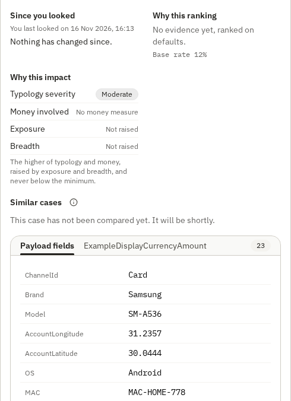
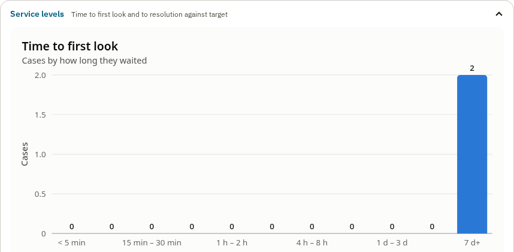

# Working Case Risk and Service Levels

A queue of cases poses two questions to whoever must work it. The first is which case to open next, as there are invariably more cases than there is time, and a case taken in the order it arrived is as likely to be a trifle as it is to be the one that matters. The second is whether the queue is being worked quickly enough, which is to say whether cases are being looked at, taken and closed inside the time the organisation has promised itself.

Case risk answers the first question. For every open case the engine estimates how likely the case is to be confirmed, how much it would matter if it were, and whether a deadline is pressing, then reduces the whole to a single Priority from 0 to 100 by which the queue is ordered. Service levels answer the second question, by measuring each case against up to four targets of time and stating whether each is met, on track, at risk or breached.

Neither changes a case, and neither decides anything. Both exist for the purposes of putting the right case in front of an analyst, and of showing a supervisor where the queue is falling behind.

## Terms

The page uses the terms as follows, each of which is explained more fully where it is first put to use:

| Term              | Meaning                                                                                                                                                                                             |
|-------------------|-----------------------------------------------------------------------------------------------------------------------------------------------------------------------------------------------------|
| Assessment        | One calculation of the risk of a case, stored with the date and the reason it was made. A case accumulates assessments over its life, and the most recent is the one shown.                       |
| Outcome           | What closing a case in a given status says about the alert, being Confirmed (a true positive) or Not confirmed (a false positive). Outcomes are what the likelihood learns from.                   |
| Likelihood        | The estimated probability, shown as a percentage, that the case will be closed as Confirmed.                                                                                                        |
| Base rate         | The share of the closed cases of the Case Workflow that were Confirmed. It is the likelihood of a case about which nothing else is known.                                                           |
| Prior             | The confirmed rate assumed before the workflow has any closed cases, 8 percent by default.                                                                                                          |
| Evidence          | A fact about the case for which a history of outcomes exists, such as the Activation Rule that created it. Each piece of evidence moves the likelihood up or down from the base rate.              |
| Log odds          | The scale upon which evidence is added together. A probability p has log odds of ln(p / (1 − p)), such that 50 percent is 0, anything likelier is positive and anything less likely is negative.   |
| Half-life         | The age at which a piece of evidence counts for half as much. Evidence twice that age counts for a quarter, and so on.                                                                              |
| Impact            | How much the case would matter were it confirmed, as one of five bands: Minimal, Low, Moderate, High and Severe.                                                                                   |
| Contribution      | The amount, in log odds, by which one piece of evidence moved the likelihood of this case, after damping, decay and overlap have been applied. It is the number shown beside each piece of evidence. |
| Typology          | The kind of wrongdoing a Case Workflow is concerned with. Its severity, from Minimal to Severe, is set once on the workflow and applies to every case of it.                                        |
| Money band        | One of the same five bands, arrived at from the amount of money read from the payload of the case rather than from the typology.                                                                    |
| Expected harm     | Likelihood multiplied by the weight of the impact band. It is the quantity the Priority is derived from.                                                                                            |
| Priority          | Expected harm compressed onto a scale of 0 to 100. Higher is worked first.                                                                                                                          |
| Lane              | The urgency of the case arising from a deadline rather than from risk: Live money, Mandatory, Deadline near or Standard. The lane is considered before the Priority when the queue is ordered.     |
| Trigger           | The reason an assessment was made, such as Created, Diary or Scheduled sweep.                                                                                                                       |
| Service level     | A target of time, in minutes, set on the Case Workflow or on a Cases Workflow Status.                                                                                                               |
| Breach            | A service level whose time has run out.                                                                                                                                                             |

## Where it lives

Case risk is not a page of its own, rather it is presented wherever a case is:

* In the list of cases on the Cases page, in the Risk and Due columns, and in the Peek beside the list. The queue is described in [Working Skim, Lock and Next](../WorkingSkimLockNext/index.html) and the remainder of that page in [Working the Cases Page](../WorkingCaseQueueAndTabs/index.html).
* In the header of the case page, as the lane followed by Priority and its number.
* In the section of the case page titled Case detail views, which opens with the reason the case is in the queue, the Likelihood, the Impact and the value At stake, followed by Since you looked, Why this ranking and Why this impact.
* In the section of the case page titled Events, at its foot, as Time in each status and Risk history.

The settings are on the Case Workflow, in the groups Risk, Ranking and Service level, and on the Cases Workflow Status, in the groups Outcome and Service level. See [Creating Case Workflows](../CreatingCaseWorkflows/index.html) and [Creating Case Workflow Status](../CreatingCaseWorkflowStatus/index.html).

SHOT id=case-management-case-risk-why-this-ranking
     route=/cases
     steps=open-demo-case, scroll-to:Why this ranking
     frame=section:Case detail views
     state=the Case detail views section of a demonstration case that has been assessed with at least two pieces of evidence, showing the Likelihood, Impact and At stake figures, then Why this ranking with the waterfall chart, the list of evidence with its confirmed counts and log odds, the Base rate line, and Why this impact
     conveys=the ranking of a case is explained in place, as a base rate moved by named pieces of evidence, and an impact built from typology and money
     alt=The Case detail views section of a case showing its likelihood, impact and value at stake, a waterfall chart from the base rate to the likelihood, the evidence behind it and the working of the impact



## How the score is built

The score is built in four steps, each of which is simple taken alone: a likelihood, an impact, the two multiplied into a Priority, and a lane decided separately from all three. The engine carries this out in the background, hence there is nothing to press.

A single scenario is carried through this section. A Case Workflow for card fraud has a Typology severity of Moderate and a Value field of Amount, and is otherwise on the defaults. A case, C-1042, is created for AccountId Test1 by the Activation Rule Velocity over 5 in 1 hour, for a transaction having an Amount of 1,250,000.

### Step one: the base rate

The likelihood starts from the base rate, being the share of the closed cases of the workflow that were Confirmed. Only cases with a Closed Status of Closed are counted, and only where the status they were closed in carries an Outcome of Confirmed or Not confirmed. A closure by Suspend Bypass is never counted, nor is a case closed in a status having an Outcome of Not an outcome.

A new workflow has no closed cases, and a rate calculated from a handful would swing wildly, so the rate is pulled towards a prior as though a number of imaginary cases at the prior rate had already been closed. By default there are 20 such cases (the prior strength) at a rate of 8 percent (the prior rate):

```text
base rate = (confirmed + prior strength × prior rate) / (closed + prior strength)
```

It follows that on the first day of a workflow the base rate is the prior, 8 percent, and that the imaginary cases matter less and less as real ones accumulate. In the scenario the workflow has closed 180 cases with an outcome, of which 27 were Confirmed:

```text
base rate = (27 + 20 × 0.08) / (180 + 20) = 28.6 / 200 = 14.3 percent
```

Until a status has been given an Outcome, nothing is ever counted and every case of the workflow sits at the prior. This is the most common reason for every case showing the same likelihood.

### Step two: the evidence

A piece of evidence is a fact about the case for which there is a record of how similar cases ended. For each, a precision is calculated in the same manner as the base rate, pulled towards the base rate rather than towards the prior:

```text
precision = (confirmed + prior strength × base rate) / (closed + prior strength)
```

The evidence is then worth the distance between the precision and the base rate, measured in log odds. Evidence that was confirmed more often than the workflow as a whole is positive and raises the likelihood, and evidence confirmed less often is negative and lowers it. That distance is multiplied by three factors before it is added:

| Factor   | Default | Description                                                                                                                                                                                                                                                                              |
|----------|---------|------------------------------------------------------------------------------------------------------------------------------------------------------------------------------------------------------------------------------------------------------------------------------------------|
| Damping  | 0.7     | Applied to every piece of evidence, on the reasoning that past outcomes are an imperfect guide and should not be trusted in full.                                                                                                                                                        |
| Decay    | 1       | 0.5 raised to the power of the age of the evidence divided by its half-life. Evidence having no half-life does not decay.                                                                                                                                                                |
| Overlap  | 0.3     | Where several pieces of evidence belong to the same group they are largely telling the same story, so only the strongest counts in full and each of the others is multiplied by this weight. At present the two kinds of Network evidence are the only ones that share a group.         |

The evidence the engine draws upon is as follows:

| Evidence    | What is counted                                                                                                                                                                                                             | Half-life                |
|-------------|-----------------------------------------------------------------------------------------------------------------------------------------------------------------------------------------------------------------------------|--------------------------|
| Rule        | The closed cases, in the same workflow, created by the Activation Rule that created this case. It is labelled with the name of the rule.                                                                                   | None                     |
| Key history | The earlier closed cases, in the same workflow, for the same Case Key and Case Key Value, the case itself excepted. Its age is taken from the most recently closed of them.                                                | 180 days                 |
| Network     | Where the Case Key Value is a node of the graph and stands one, two or three hops from a confirmed case: the closed cases of the workflow whose keys stood at the same distance. Its age is taken from when the graph was last computed. | 90 days  |
| Network     | Where the node belongs to a community of the graph: the confirmed and closed cases among the members of that community.                                                                                                     | 90 days                  |

Evidence having no closed cases behind it is left out altogether, as it says nothing. The graph, its hops and its communities are described in [Graph on a Case](../../Graph/GraphOnACase/index.html).

In the scenario four pieces of evidence exist. The rule has created 40 closed cases of which 16 were Confirmed. The account has 2 earlier closed cases of which 1 was Confirmed, the more recent having been closed 90 days ago. The account belongs to a community with 6 confirmed of 12 closed cases, and stands two hops from a confirmed case, a distance at which 5 of 10 closed cases were Confirmed, the graph having been computed the same day.

| Evidence                               | Confirmed of closed | Precision | Distance from the base rate | Decay | Overlap | After damping of 0.7 |
|----------------------------------------|---------------------|-----------|-----------------------------|-------|---------|----------------------|
| Velocity over 5 in 1 hour              | 16 of 40            | 31.4%     | +1.01                       | 1     | 1       | +0.71                |
| Community: 6 confirmed of 12           | 6 of 12             | 27.7%     | +0.83                       | 1     | 1       | +0.58                |
| 2 hop(s) from a confirmed true positive | 5 of 10            | 26.2%     | +0.75                       | 1     | 0.3     | +0.16                |
| AccountId Test1: 2 earlier closed cases | 1 of 2             | 17.5%     | +0.24                       | 0.71  | 1       | +0.12                |

Taking the rule as the example, the precision is (16 + 20 × 0.143) / (40 + 20) = 31.4 percent, which in log odds is −0.78, against −1.79 for the base rate of 14.3 percent, a distance of +1.01, and 0.7 of that is +0.71. Three things can be seen in the table. The key history is worth little, as two cases barely move an estimate held by twenty imaginary ones, and that little is reduced further by being 90 days old, half of its half-life, for a decay of 0.71. The two pieces of Network evidence share a group, hence the weaker of them is counted at 0.3. All four are positive, as each was confirmed more often than the 14.3 percent of the workflow.

### Step three: the likelihood

The contributions are added to the log odds of the base rate, and the sum is turned back into a probability:

```text
log odds   = −1.79 + 0.71 + 0.58 + 0.16 + 0.12 = −0.22
likelihood = 1 / (1 + e^0.22) = 44 percent
```

The likelihood is never allowed below 0.1 percent nor above 99.9 percent, as no quantity of history makes a case a certainty. It is given a band for the purposes of reading it at a glance:

| Band        | Likelihood                    |
|-------------|-------------------------------|
| Unlikely    | Below 25 percent              |
| Possible    | 25 percent to below 50 percent |
| Likely      | 50 percent to below 75 percent |
| Very likely | 75 percent and above          |

C-1042 is therefore Possible, at 44 percent, against the 14 percent it would have had on the base rate alone.

### Step four: impact, expected harm and Priority

Impact is the higher of two bands. The first is the Typology severity of the Case Workflow, which states how serious cases of that workflow are by nature. The second is the money band, found by reading the Value field from the payload of the case and counting how many of the four money band thresholds the value has reached:

| Value                              | Money band |
|------------------------------------|------------|
| Below 5,000                        | Minimal    |
| 5,000 to below 100,000             | Low        |
| 100,000 to below 1,000,000         | Moderate   |
| 1,000,000 to below 10,000,000      | High       |
| 10,000,000 and above               | Severe     |

Where the workflow has no Value field, or the payload has no such field, or the value is not a number or is not above zero, there is no money band and impact rests on typology alone. The name of the field is matched without regard to case.

Each impact band has a weight, by default 1, 3, 10, 30 and 100 from Minimal to Severe. The weights grow roughly threefold with each band so that a Severe case outranks a Moderate one even at a much lower likelihood. Expected harm is the likelihood multiplied by the weight, and the Priority compresses expected harm onto 0 to 100 on a logarithmic scale, so that the difference between a harm of 1 and of 3 is as visible as that between 30 and 90:

```text
expected harm = likelihood × weight of the impact band
Priority      = 100 × ln(1 + expected harm) / ln(1 + weight of Severe), rounded
```

In the scenario the typology is Moderate, and the Amount of 1,250,000 falls in the money band High. Impact is the higher of the two, High, having a weight of 30:

```text
expected harm = 0.445 × 30 = 13.3
Priority      = 100 × ln(14.3) / ln(101) = 58
```

For comparison, had the payload carried no Amount the impact would have been Moderate, the expected harm 4.4 and the Priority 37, and the very first case of a new workflow of Moderate typology, with a likelihood of 8 percent and no evidence, has a Priority of 13. The following gives a sense of the scale on the default weights:

| Likelihood | Impact   | Priority |
|------------|----------|----------|
| 8%         | Minimal  | 2        |
| 8%         | Moderate | 13       |
| 50%        | Low      | 20       |
| 50%        | Moderate | 39       |
| 8%         | Severe   | 48       |
| 50%        | High     | 60       |
| 50%        | Severe   | 85       |
| 90%        | Severe   | 98       |

It can be seen that an unlikely case of Severe impact outranks an even chance of Moderate impact. That is intended, as the Priority is a measure of harm expected rather than of how sure the system is.

### The lane

The lane is decided from the diary of the case and takes no account of likelihood or impact. It exists because a deadline is a different kind of urgency: a payment held awaiting a decision must be decided before it expires however unlikely the case. The type of the diary, described in [Working Typed Diaries](../WorkingTypedDiaries/index.html), decides the lane:

| Diary                                   | Lane                                                                                             | Reason shown                                                                                                              |
|-----------------------------------------|--------------------------------------------------------------------------------------------------|---------------------------------------------------------------------------------------------------------------------------|
| None, or a diary without a date         | Standard                                                                                         | No deadline applies.                                                                                                      |
| Payment hold                            | Live money, whenever the diary falls due                                                         | A payment hold is open and decides at its deadline.                                                                       |
| Regulatory deadline                     | Mandatory, whenever the diary falls due                                                          | A regulatory deadline applies.                                                                                            |
| Customer response                       | Deadline near where the diary is overdue or falls due within 2 days, otherwise Standard          | The customer response deadline is overdue. \ falls due within 2 days. \ is more than 2 days away.                         |
| Review                                  | Deadline near where the diary is overdue or falls due within 2 days, otherwise Standard          | The case diary is overdue. \ falls due within 2 days. \ is more than 2 days away.                                         |

The 2 days is the Risk deadline lane days of the Case Workflow, and the figure in the reason follows it. The date of the diary is kept alongside the lane as the next deadline of the case, and the assessment records whether that deadline has passed.

To continue the scenario, C-1042 is given a Review diary five days hence. The lane remains Standard, with the reason The case diary is more than 2 days away. Three days later, without anyone touching the case, the lane becomes Deadline near, with the reason The case diary falls due within 2 days. Were a payment then held against the case, the lane would become Live money and the case would move to the top of the queue, its Priority of 58 notwithstanding.

### When a case is assessed

The assessment is carried out by a background worker of the engine, enabled by the EnableCaseRisk Environment Variable, which is True by default. The worker wakes every 30 seconds (CaseRiskWait) and takes up to 200 cases (CaseRiskBatchSize), those never assessed or marked for reassessment first, then those whose last assessment is more than 15 minutes old (CaseRiskSweepMinutes). Only cases with a Closed Status of Open or Suspended, open are assessed, and a closed case keeps the last assessment it had.

It follows that a new case is shown as Not yet assessed for up to half a minute or so, during which it is placed in the Standard lane with no Priority, and that a change brought about only by the passing of time, such as a diary coming within 2 days, is reflected within about a quarter of an hour.

A case is marked for reassessment straight away, rather than waiting its turn, upon any of the following, and the trigger is recorded with the assessment that results:

| Trigger                  | Raised when                                                                                                                                    |
|--------------------------|------------------------------------------------------------------------------------------------------------------------------------------------|
| Created                  | The case is assessed for the first time.                                                                                                       |
| New activation           | A further activation is attached to the case, it being already open for the Case Key Value.                                                    |
| Linked key               | Another case for the same Case Key Value in the same workflow is closed, the key history having changed. Every other open case of that key is marked. |
| Neighbour outcome        | The distances of the graph are recomputed and the distance of the node from a confirmed case has changed.                                      |
| Diary                    | The diary of the case is set, changed or cleared.                                                                                              |
| Payment hold             | A held payment of the case is released or refused.                                                                                             |
| Analyst finding          | A note of the case is recorded as a finding.                                                                                                   |
| Typology                 | The Typology severity of the Case Workflow is changed. Every open case of the workflow is marked.                                              |
| Ranking settings changed | The Value field or any setting of the Ranking group of the Case Workflow, other than Risk qa sample rate, is changed. Every open case of the workflow is marked. |
| Scheduled sweep          | None of the above, the case having come round on the 15 minute cycle.                                                                          |

An assessment is stored only where it differs from the one before, which is to say where the lane, the impact band, the likelihood band, the Priority, the next deadline or whether it has passed has changed, or the likelihood has moved by half a percentage point or more. A case that is assessed every quarter of an hour for a month with nothing changing therefore has one assessment, not three thousand.

TODO(verify): recording a finding marks the case for reassessment (CaseNoteService.SetFinding raises the trigger FindingRecorded), yet the assessor (Jube.Engine/CaseRisk/CaseRiskAssessor.cs) takes no input from findings, so the reassessment cannot change the result on that account. Owner to confirm whether findings are intended to be evidence.

## Reading the score

### In the list of cases

The Risk column of the list shows the lane as a badge, then a line in the following form:

```text
Possible 44% · impact High · priority 58
```

The lane badge is red for Live money and Mandatory, amber for Deadline near and plain for Standard, and resting the pointer upon it gives the reason for the lane. The line is emboldened where the likelihood band is Likely or Very likely. A case not yet assessed shows Not yet assessed in muted text. The column headed Why it is here gives the label of the strongest piece of evidence, or where there is none the reason for the lane, or failing both No driver recorded. The Value column shows the value read from the Value field, or a dash.

The default order of the list, Triage, takes the lane first and the Priority second: Live money, then Mandatory, then the cases returned to the attention of the user, then Deadline near, then the Standard cases sampled for quality review, then the remaining Standard cases, and within each of these the highest Priority first and the oldest first thereafter. The other orders offered are Highest priority, Oldest first, Due soonest (by the next deadline), Highest value, Most likely first and Newest first. The filter titled Urgent lists the open cases in any lane other than Standard.

A case the user has looked at before is returned to attention where its Priority has risen by 10 or more since, in which circumstance it carries the badge Returned and the text Priority has risen by, followed by the amount, since you last looked.

### On the case page

The header of the case states the lane and Priority followed by the number, once the case has been assessed. The Case detail views section then explains the score from the top down:

| Element          | What is shown                                                                                                                                                                                                                                                                                                                  |
|------------------|--------------------------------------------------------------------------------------------------------------------------------------------------------------------------------------------------------------------------------------------------------------------------------------------------------------------------------|
| Why              | The reasons the case was returned to attention, or otherwise the reason for the lane. Where there is neither, Nothing beyond its place in the queue has been flagged yet.                                                                                                                                                    |
| Likelihood       | The percentage, in red where the band is Likely or Very likely, with the band beneath. Not yet assessed where the worker has not reached the case. Where an analyst has recorded a view it is stated beneath also, as described in [Working Analyst Assessment](../WorkingAnalystAssessment/index.html).                      |
| Impact           | The impact band. Shown once the case is assessed.                                                                                                                                                                                                                                                                              |
| At stake         | The value read from the Value field. Shown only where there is one.                                                                                                                                                                                                                                                            |
| Similar cases    | Described in [Working Similar Cases](../WorkingSimilarCases/index.html), with the key history stated beneath as the number of earlier cases on this key that were confirmed, or No earlier closed cases on this key.                                                                                                          |
| Since you looked | You have not looked at this case before. or otherwise You last looked on followed by the date, then Priority and the two numbers in the form Priority 37 to 58 where it has moved, then up to 50 changes made since, oldest first, each with the user and the date, or Nothing has changed since.                              |
| Why this ranking | A waterfall chart from the base rate to the likelihood in log odds, then each piece of evidence with its label, the history behind it in the form 16 of 40 confirmed, and its contribution in log odds to two decimal places, strongest first, then Base rate and its percentage. With no evidence there is no chart, and No evidence yet, ranked on defaults. is stated in its place. |
| Why this impact  | Typology severity and its band, Money involved with the value and its band or No money measure, Exposure and Breadth each as Raised one band or Not raised, and the rule stated in words: The higher of typology and money, raised by exposure and breadth, and never below the minimum. It is shown only once the case has been assessed. |

For C-1042 the reader would see a Likelihood of 44% with Possible beneath, an Impact of High, 1,250,000 At stake, four rows under Why this ranking carrying 0.71, 0.58, 0.16 and 0.12 with 16 of 40 confirmed and so on beneath each label, the line Base rate 14%, and under Why this impact a Typology severity of Moderate and Money involved of 1,250,000 High.

A contribution is read as follows. A positive number means the evidence was confirmed more often than the workflow at large and raised the likelihood, and a negative number that it lowered it. As a rule of thumb, a contribution of 0.7 doubles the odds and one of 0.1 is barely felt, so the eye should go to the first row or two. The confirmed of closed beneath states how much history stands behind the number, and a large contribution on a count of 3 of 4 deserves less trust than a modest one on 300 of 900, notwithstanding that the prior strength has already tempered it.

TODO(verify): Why this impact shows Exposure and Breadth, and a Minimum set by a rule row where a floor above Minimal applies, yet the assessor (Jube.Engine/CaseRisk/CaseRiskAssessor.cs) passes only the typology and the value to ImpactInputs, so Exposure and Breadth always read Not raised and the minimum row never appears. Owner to decide whether these inputs are to be supplied or the rows removed.

The Peek on the Cases page presents the same elements in a single column, opening with the lane, the line of the Risk column, the reason for the lane and the Case Key Value, and closing with Time in each status and Risk history. Keep in mind that opening the Peek or the case is recorded as an event of the case, and resets what Since you looked compares against.

### The risk timeline

Risk history, at the foot of the Events section and of the Peek, draws the assessments of the case along an axis of time, so that it can be seen when the ranking moved and why. It is shown only where the case has more than one assessment, and it is drawn from the ten most recent.

SHOT id=case-management-case-risk-timeline
     route=/cases
     steps=open-demo-case, open-section:Events, scroll-to:Risk history
     frame=section:Events
     state=the foot of the Events section of a demonstration case having several risk assessments in more than one lane, showing Time in each status with one stay over its limit, and Risk history with markers along a time axis, the most recent selected and its detail beneath
     conveys=the history of a case's ranking is a timeline of markers coloured by lane, each of which states what triggered it and what the score became
     alt=The Risk history timeline of a case with markers labelled by lane and date along a time axis, the selected marker detailed beneath with its trigger, likelihood, impact and priority, below a bar of the time spent in each status

Each assessment is a marker, being a dot on the axis with a label beneath stating the lane and the date and time. The dot is red for Live money and Mandatory, amber for Deadline near and plain for Standard. Where labels would overlap they are stacked on lower rows, joined to their dots by a line. The axis and the labels of the markers are both given in the time zone of the browser. The axis is marked in hours where the history spans up to 40 hours, in days up to 40 days, in weeks up to 40 weeks and in months beyond, and it scrolls sideways where it is wider than the page.

Clicking a marker, or moving to it with the keyboard, selects it, and the most recent is selected to begin with. Beneath the timeline the selected assessment is detailed as follows:

| Line                 | Example                    |
|----------------------|----------------------------|
| The lane and trigger | Deadline near Diary        |
| The date and time    | 12 Nov 2026, 09:14         |
| Likelihood, impact band and Priority | 44% · High · 58 |
| The change in Priority from the marker before, where it changed | Priority 37 to 58 |

Assessments triggered by the Scheduled sweep are left off the timeline unless the lane changed from that of the assessment before it, a sweep being the oldest of the ten having nothing to be compared with and so being left off, as otherwise the picture would be crowded with small drifts in likelihood upon which nobody acts. The selection is not kept, and the timeline opens upon the most recent marker each time.

Read against the scenario, the timeline of C-1042 would show a first marker Standard with the trigger Created at 44% · High · 58, a marker Standard with the trigger Diary upon the diary being set, a marker Deadline near three days later, and, were the payment held, a marker Live money. The Priority is 58 throughout, which is the point to take from it: the lane moved the case up the queue while the risk stood still.

## Risk settings

The settings are held on the Case Workflow, and a setting left empty takes the default of the environment, given by the Environment Variable of the same purpose. The form, its validation and the common manner of saving are described in [Creating Case Workflows](../CreatingCaseWorkflows/index.html), and the settings are summarised here by what each does to the score:

| Value                           | Group   | Effect upon the score                                                                                                                                         | Default                      | Range                                   |
|---------------------------------|---------|---------------------------------------------------------------------------------------------------------------------------------------------------------------|------------------------------|-----------------------------------------|
| Value field                     | Risk    | Names the payload field read for the money band and for At stake.                                                                                             | Empty                        |                                         |
| Typology severity               | Risk    | The typology band of impact.                                                                                                                                  | Moderate                     | Minimal to Severe                       |
| Risk kappa                      | Ranking | The damping. Lower flattens the likelihoods towards the base rate.                                                                                            | 0.7                          | Above 0, up to 1                        |
| Risk rho                        | Ranking | The overlap weight. 1 counts overlapping evidence in full and 0 ignores it.                                                                                   | 0.3                          | 0 to 1                                  |
| Risk prior strength             | Ranking | The number of imaginary cases. Higher demands more history before an estimate moves.                                                                          | 20                           | Above 0, up to 10000                    |
| Risk base rate prior            | Ranking | The prior rate. Raises or lowers every case of a workflow having little history.                                                                              | 0.08                         | 0.001 to 0.999                          |
| Risk deadline lane days         | Ranking | How close a Review or Customer response diary must be for the Deadline near lane.                                                                             | 2                            | 0 to 365                                |
| Risk key history half life days | Ranking | The half-life of Key history evidence.                                                                                                                        | 180                          | Above 0, up to 3650                     |
| Risk impact weights             | Ranking | The five weights of the impact bands.                                                                                                                         | 1,3,10,30,100                | Five positive numbers, increasing       |
| Risk money bands                | Ranking | The four thresholds between the money bands.                                                                                                                  | 5000,100000,1000000,10000000 | Four positive numbers, increasing       |
| Risk qa sample rate             | Ranking | Takes no part in the score. The share of Standard lane cases with a Priority below 25 picked for quality review, as described in [Working Quality Review Samples](../WorkingQualityReviewSamples/index.html). | 0.05 | 0 to 0.5 |

The half-life of Network evidence, 90 days, and the Priority below which a case may be sampled for quality review, 25, are set for the environment only, by the CaseRiskNetworkHalfLifeDays and CaseRiskQaMaxPriority Environment Variables. See [Environment Variables](../../../Concepts/EnvironmentVariables/index.html).

A setting outside its range is refused upon saving the Case Workflow, with a message stating the range, for example The ranking damping must be above 0 and no more than 1, or The ranking impact weights must be five positive numbers, increasing, separated by commas. Saving a change to any of these, the Risk qa sample rate excepted as it takes no part in the score, marks every open case of the workflow for reassessment as described above.

## Service levels

A service level is a promise about time. Four can be set, each in minutes and each optional, and a target left empty is not measured:

| Target                    | Set on                         | Shown as        | Measured from                           | Reached when                                                                                                         |
|---------------------------|--------------------------------|-----------------|-----------------------------------------|----------------------------------------------------------------------------------------------------------------------|
| First view target minutes | Case Workflow, Service level   | First look      | The creation of the case                | Anyone first looks at the case, by Peek, by Take next or by Open case.                                               |
| Ownership target minutes  | Case Workflow, Service level   | Ownership       | The creation of the case                | The case is first locked to someone, by Take next, by Take, by allocation or automatically.                          |
| Resolution target minutes | Case Workflow, Service level   | Resolution      | The creation of the case                | The case is closed.                                                                                                  |
| Max dwell minutes         | Cases Workflow Status, Service level | Time in status | The case entering its present status | The case leaves the status. It is measured only while the case is open, and afresh each time the status is entered. |

The first three follow a case through its life in the order one would expect: somebody looks, somebody takes it, somebody closes it. The fourth is of a different kind, as it is concerned with a case resting too long at one stage, for example awaiting a customer, whatever its age.

### The state of a target

Each target that is set has a state:

| State    | Meaning                                                                                                    | Colour |
|----------|------------------------------------------------------------------------------------------------------------|--------|
| Met      | The thing was done within the target.                                                                      | Plain  |
| On track | Not yet done, and less than 80 percent of the target has elapsed.                                          | Plain  |
| At risk  | Not yet done, and 80 percent or more of the target has elapsed.                                            | Amber  |
| Breached | Not yet done and the target has elapsed in full, or done after the target had elapsed.                     | Red    |

Keep in mind that a target that was missed stays Breached once the thing is eventually done. A case first looked at after 45 minutes against a target of 30 remains Breached for First look for the rest of its life, as the promise was broken and looking later does not mend it. Where a case is closed without ever having been looked at or taken, First look and Ownership are no longer measured for it.

To take the scenario further, the workflow has a First view target of 30 minutes, an Ownership target of 120 minutes and a Resolution target of 4,320 minutes, being three days. C-1042 is created at 09:00:

| Time                     | What has happened               | First look           | Ownership             | Resolution          |
|--------------------------|---------------------------------|----------------------|-----------------------|---------------------|
| 09:10                    | Nothing                         | On track (33%)       | On track (8%)         | On track            |
| 09:24                    | Nothing                         | At risk (80%)        | On track (20%)        | On track            |
| 09:31                    | Nothing                         | Breached             | On track              | On track            |
| 09:40                    | An analyst opens the Peek       | Breached, looked at late | On track          | On track            |
| 10:30                    | The analyst takes the case      | Breached             | Met, after 90 minutes | On track            |

### Where the state is shown

The Due column of the list of cases shows the worst of the targets of a case, being the one in the gravest state and, between two in the same state, the one furthest through its time. It is shown as a badge of the state and a line naming the target and the time remaining or overrun, for example At risk above First look · in 6 min, or Breached above Resolution · 1.5 d overdue. Times are given in minutes below an hour, in hours to one decimal place below a day, and in days to one decimal place beyond.

Where every target of the case has been Met, or no target is set, the column instead shows the next deadline of the case from its diary, preceded by the type of the diary where it is other than Review, or failing that No deadline.

On the case page and in the Peek, Time in each status draws the life of the case as a bar divided by status in the order they were entered, each part as wide as its share of the time, to a minimum so that a brief stay remains visible. The present status is underlined, and a stay that exceeded the Max dwell minutes of its status is red. Beneath the bar each stay is listed with the time spent, when it was entered and by whom, how it was entered (Created, Status changed, Reopened or Escalated) and left (Moved on or Closed), the total over all visits where the status was entered more than once, and, where the status has a limit, a progress bar with the time used of the limit and the amount over limit where it was exceeded.

The filter titled Overdue on the Cases page lists the open cases presently past a target: the Resolution target has elapsed, or the First view or Ownership target has elapsed and the thing has still not been done, or the case has been in its present status beyond the Max dwell minutes. It follows that a case that was looked at late, and is otherwise inside its targets, shows Breached in the Due column while being absent from Overdue, as there is nothing left to be done about it. Attainment over time is charted on the Cases page, as described in [Working the Cases Page](../WorkingCaseQueueAndTabs/index.html).

SHOT id=case-management-case-risk-service-levels-section
     route=/cases
     steps=open-tab:Queue health, wait-for:Ageing, open-section:Service levels, scroll-to:Service levels
     frame=section:Service levels
     state=the Service levels section of the Queue health tab of the Cases page for the demonstration Case Workflow over the last 30 days, described as Time to first look and to resolution against target and opened on the chart Time to first look, counting the cases by how long they waited in bands from under 5 min to 7 d+, with 2 cases in the band 7 d+ and none in any other
     conveys=the service level targets are read for the queue as a whole in a section of the Queue health tab
     alt=The Service levels section of the Queue health tab of the Cases page, showing the chart Time to first look with the cases counted by how long they waited, 2 of them in the band of 7 days or more



### Breach notifications

A breach can also be brought to attention without anyone looking at the queue. A second background worker of the engine, enabled by the EnableCaseServiceLevelSweep Environment Variable, looks every 60 seconds (CaseServiceLevelSweepSeconds) for open cases that have newly breached a target, taking up to 200 for each of the four targets on each pass (CaseServiceLevelSweepBatchSize). The Environment Variable is False by default, hence no notification is raised until it is enabled. The states described above are calculated as the list is read and do not depend upon it.

For each breach found, the worker records it and raises a notification to:

* The user to whom the case is locked, if any.
* Every active user whose role is granted permission 18, Read Write Case Workflow, and is granted the Case Workflow of the case.

The notification reads Case C-1042 breached its service level, followed by the target as time to first view, time to ownership, time to resolution or time in status, and leads to the case. A breach of the Resolution target is raised at high priority and the others at normal priority. The bell and the inbox are described in [Working Notifications](../WorkingNotifications/index.html).

A breach is recorded once for a case and a target, and never again. It follows that a case notifies at most four times in its life, and that a case entering a status for the second time and resting there too long does not notify a second time for Time in status. Cases with a Closed Status other than Open, those suspended included, are passed over, as are cases that breached and were closed before the worker reached them.

## Limits

| Limit                                                            | Value                |
|------------------------------------------------------------------|----------------------|
| Likelihood                                                       | 0.1% to 99.9%        |
| Priority                                                         | 0 to 100             |
| Hops from a confirmed case counted as Network evidence           | 1 to 3               |
| Cases assessed on each pass of the risk worker                   | 200                  |
| Interval between passes of the risk worker                       | 30 seconds           |
| Age at which an unchanged case is assessed again                 | 15 minutes           |
| Movement in likelihood that, alone, stores a new assessment      | 0.5 percentage points |
| Rise in Priority that returns a case to attention                | 10                   |
| Assessments drawn on the risk timeline                           | The 10 most recent   |
| Changes listed under Since you looked                            | 50                   |
| Share of a service level target elapsed at which it is At risk   | 80%                  |
| Notifications for a case and a service level target              | 1                    |

## Permissions and security

Everything described here is read with permission 1, Read Write Case, being the permission required of the Cases page, the Peek, the case page and the waterfall chart. In the absence of the permission the Cases page states Your role is not permitted to work cases, and the underlying requests are refused with the status 403 Forbidden. A case is shown only where a role of the user is granted its Case Workflow.

The settings of risk and of service levels are part of the Case Workflow and the Cases Workflow Status, and changing them requires permission 18, Read Write Case Workflow, and permission 19, Read Write Cases Workflows Status, respectively. Permission 18 further decides who is notified of a breach, as described above.

No user can set or alter a likelihood, an impact, a Priority or a lane directly. The view of an analyst is recorded beside the computed likelihood, never in place of it, as described in [Working Analyst Assessment](../WorkingAnalystAssessment/index.html), and the lane is moved only by setting a diary.
