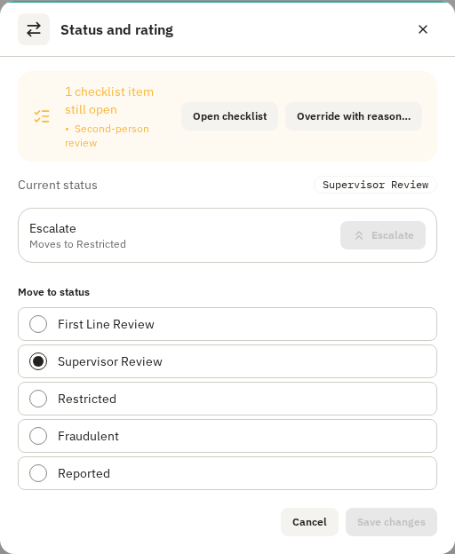

# Working Case Status

Several cases workflow statuses may be created and allocated at case creation or via upward reclassification. It is more common to set a case status manually, in performing an escalation.

## Where it lives

Navigate to a case record from the Cases page, as described in [Navigating Case Record](../WorkingNavigatingCaseRecord/index.html). The status of the case is shown in the header of the case page, as a badge in the colours configured for the [Cases Workflow Status](../CreatingCaseWorkflowStatus/index.html), and in the Status column of the list on the Cases page.

The status is changed from the Status tile of the Decide pane, which shows the present status beneath its label, and which opens a lightbox titled Status. The Status drop down in the status bar of earlier versions is replaced by this lightbox.

SHOT id=case-management-working-case-status-lightbox
     route=/cases
     steps=open-demo-case, open-decide-tile:Status
     frame=dialog
     state=the Status lightbox for an open case held by the signed in user, showing the Current status, Escalate with the status it moves to, and the list of statuses under Move to status with the current one selected
     conveys=a status is changed either by escalating to the next stronger status or by choosing any status of the workflow
     alt=The Status lightbox showing the current status of the case, an Escalate control naming the status it moves to, and the statuses of the workflow to move to

## Behaviour

The lightbox presents the Current status, and two ways of changing it:

| Value          | Description                                                                                                                                                                                                                                                                                                  | Example            |
|----------------|--------------------------------------------------------------------------------------------------------------------------------------------------------------------------------------------------------------------------------------------------------------------------------------------------------------|--------------------|
| Escalate       | Moves the case, in a single step, to the status configured as the escalation target of the current status or, where none is configured, to the status of the next higher Priority. The status to which the case would move is stated, and where there is none the lightbox states No stronger status to escalate to. | Moves to DAMLCO    |
| Move to status | The active statuses of the Case Workflow, of which one is selected, to be committed with Save changes.                                                                                                                                                                                                       | Restricted         |

Upon the lightbox being opened, the present status is selected under Move to status, and Save changes remains disabled until a different status has been selected. Escalate acts at once upon being selected, without a further confirmation, and is disabled where there is no stronger status, where the case is closed, and where the checklist stands in the way. Cancel closes the lightbox and changes nothing, a selection made and not saved being discarded.

Upon the status being changed, the message Case updated is shown, the lightbox closes, the case is reloaded and the badge in the header is coloured to reflect the new status having been allocated. The Status tile of the Decide pane, the Status column of the Cases page and the checklist, which belongs to the status, follow.

By way of illustration, the demonstration Case Workflow has the statuses First Line Review, Supervisor Review, Restricted, Fraudulent and Reported. The case on ACC-441 stands in First Line Review, so the lightbox reads First Line Review beside Current status, Escalate states the status to which the case would move, and the five statuses are listed beneath with First Line Review selected. Selecting Fraudulent and then Save changes moves the case there directly, and as Fraudulent carries the outcome Confirmed, the case, upon being closed in that status, is counted as confirmed in the analytics and among the similar cases of others.

It is to be kept in mind that a status and the Closed Status are separate things. Moving a case to Fraudulent does not close it, and closing a case does not change its status, as described in [Working Closed, Diary Date and Suspend](../WorkingClosedDiarySuspend/index.html).

The change of a case status by itself will not cause any specific action, except given Notification and HTTP Endpoint having been configured for the status, in which case they are dispatched upon the case entering it, and are thereafter listed in the Messages section of the case page.

The allocation of a given cases workflow status is often for the purpose of facilitating allocation via [Cases Workflow Filters](../CreatingCaseWorkflowFilter/index.html).

Each change of status is recorded in the events of the case as Status changed, with the status before and after, as described in [Working Case Event Journal](../WorkingCaseEventJournal/index.html). The time that the case spends in each status is recorded also, and is presented as Time in each status in the Events section and in the Peek.

## Validation

A change of status is refused in the following circumstances:

* The case is closed, in which case the lightbox is read only. The case must be reopened beforehand.
* The case is locked to another user. See [Working Lock, Allocation and Unlock](../WorkingLockAllocationUnlock/index.html).
* Required items of the checklist for the present status are still open. The lightbox names the items and offers Open checklist, and a role granted permission 71, Override Case Checklist Gate, may allow the case to move once with a reason.
* The status chosen is not an active status of the Case Workflow of the case.

Where the checklist stands in the way, both Escalate and Save changes are disabled and the lightbox lists the items still open at its head. Where the server refuses the move on account of the checklist notwithstanding, the message names the number of items and the items themselves, or reads The checklist is not complete, so the case cannot move yet. A move refused on account of the lock is answered with The case is locked to another user. It is not necessary to hold the case to change its status, only that nobody else holds it, although the checklist can be ticked only by the holder.

## Permissions and security

Changing the status of a case requires permission 1, Read Write Case, and a role granted the Case Workflow and the Cases Workflow Status of the case. Overriding an incomplete checklist requires permission 71, Override Case Checklist Gate.
