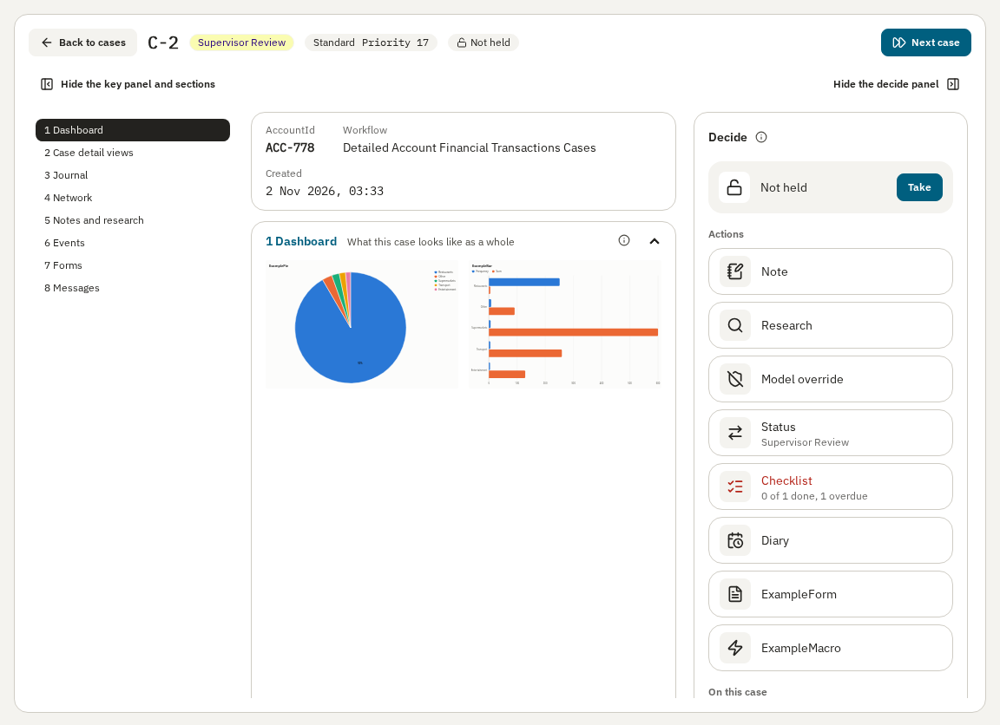
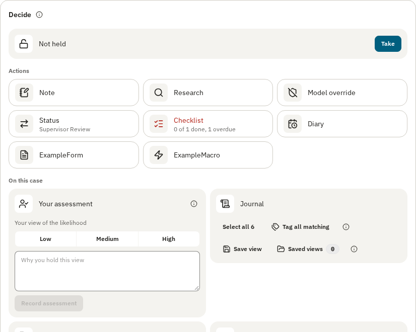
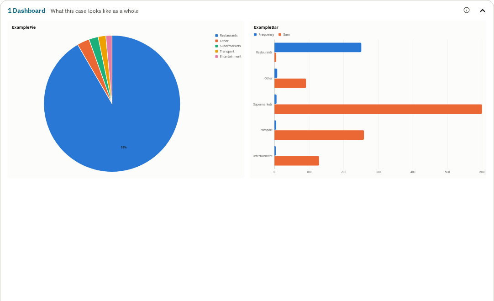
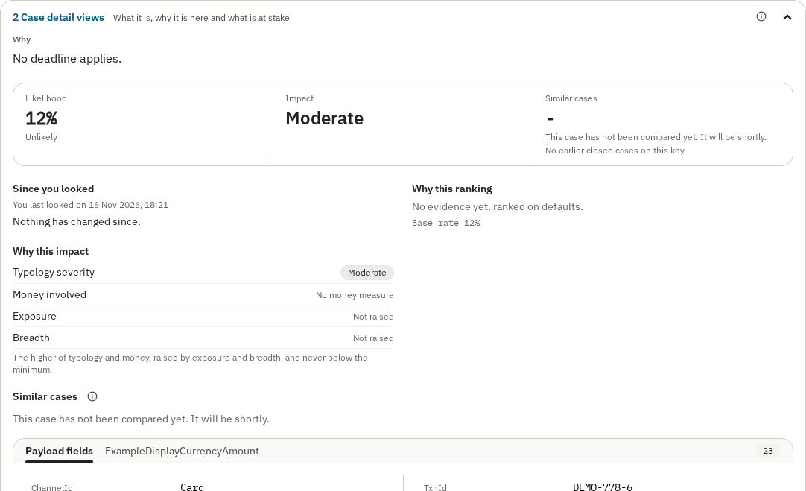
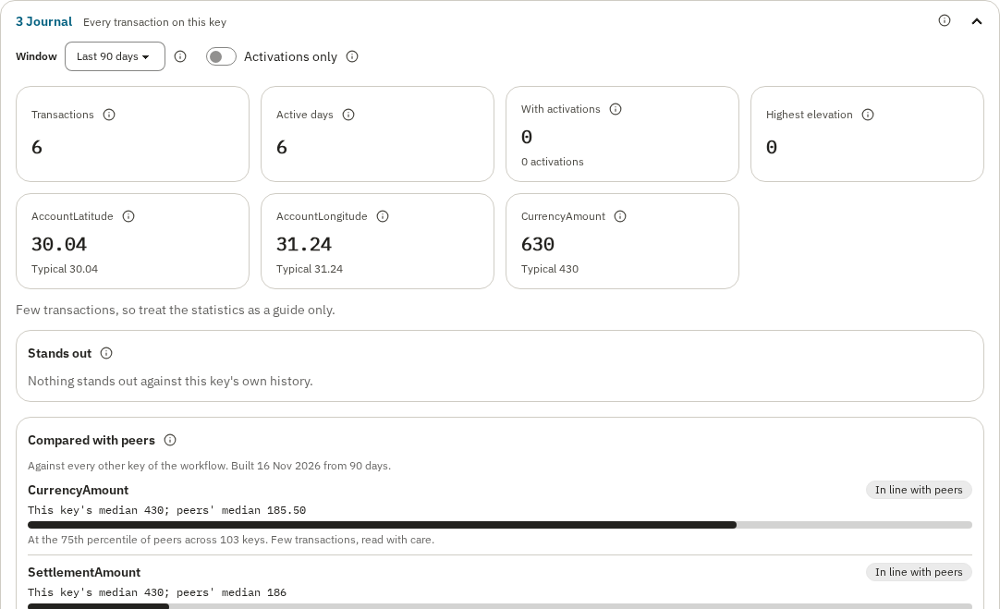
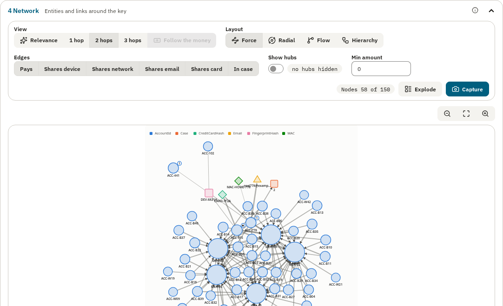
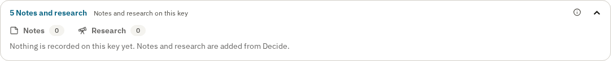
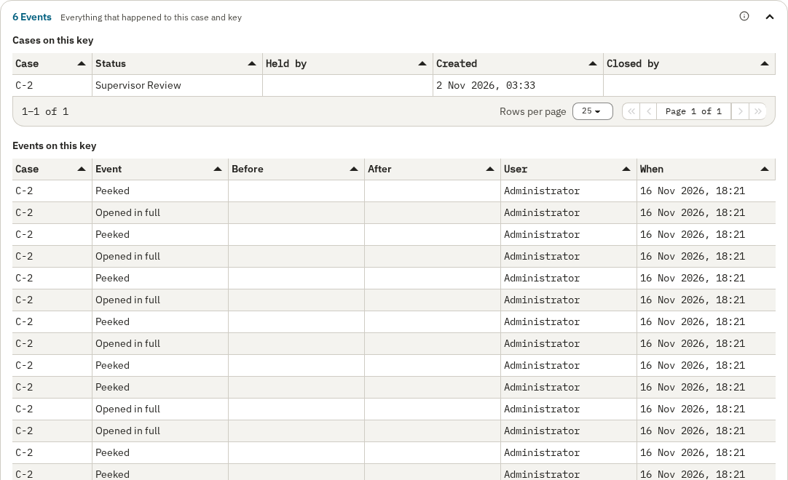
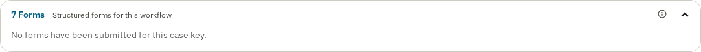
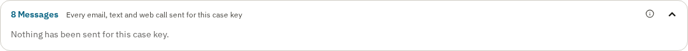

# Working Case Story Points

An analyst opening a case is trying to answer one question, being whether the suspicion that raised the case is borne out, and the answer is seldom found in one place: it is in the transaction that raised the case, in the history of the account, in who else is connected to it, in what colleagues have already written and in what has already been done. The case page lays these out as a story that is read from the top of the page to the bottom, in the order in which the question is ordinarily answered, and each part of that story is henceforth referred to as a story point.

This page describes every story point in the order of the page. It does not repeat the features presented inside each, which have pages of their own and are linked from each heading, and it does not describe what is done to a case, all of which takes place in the Decide pane and is described in [Working Case Lightboxes](../WorkingCaseLightboxes/index.html). The arrangement of the case page as a whole is described in [Navigating Case Record](../WorkingNavigatingCaseRecord/index.html).

## Terms

The page itself does not use the words story point. The terms, and what the page shows for each, are as follows:

| Term          | Meaning                                                                                                                                                                                                 |
|---------------|---------------------------------------------------------------------------------------------------------------------------------------------------------------------------------------------------------|
| Story         | The middle column of the case page, announced to a screen reader as Case story, being a single column that scrolls independently of the rest of the page.                                             |
| Story point   | One collapsible section of the story. The page calls these sections, and lists them in the index on the left under the name Case sections.                                                             |
| Title         | The number and name of a story point, for example 3 Journal, shown in the heading of the section and in the index.                                                                                     |
| Hint          | The short phrase beside the title stating what the section answers, for example Every transaction on this key.                                                                                         |
| Help mark     | The mark at the right of the heading which, upon being selected, explains the section at greater length.                                                                                               |
| Key panel     | The panel at the head of the story stating what the case is about. It is not numbered and cannot be collapsed.                                                                                         |
| Case Key      | The field upon which the case was raised together with its value, for example AccountId with the value ACC-778, the pair being referred to as the Case Key Value combination.                          |
| Decide        | The pane on the right in which everything that changes the case is done. Where the pane is hidden, Decide is presented as the first card of the story.                                                 |

## Where it lives

Navigate through the menu to Cases and open a case, as described in [Navigating Case Record](../WorkingNavigatingCaseRecord/index.html). The address takes the form `/cases/2`, and the story is the middle of the three columns beneath the header, with the index of Case sections on its left and the Decide pane on its right.

SHOT id=case-story-overview
     route=/cases
     steps=open-demo-case
     frame=page
     state=the case page of the demonstration case C-2 on AccountId ACC-778, not held, with the index of Case sections on the left listing eight numbered sections, the key panel and the first section in the middle, and the Decide pane on the right
     conveys=the story is a numbered column of sections, listed in the index on the left, read from top to bottom beside the Decide pane
     alt=The case page with the index of eight numbered case sections on the left, the key panel above the first section of the story in the middle, and the Decide pane on the right

## Why the page is arranged as a story

In earlier versions the same information was divided between tabs, which obliged the analyst to know in advance which tab held the answer and concealed everything on the tabs not selected. The story replaces the tabs with one column in a fixed order, which is the order of an investigation: what the case is and why it is here, what the key has been doing, who it is connected to, what has been written, what has happened, and what has been captured and sent. Reading downwards is therefore sufficient to have seen everything, and nothing is concealed behind a selection.

Two properties follow from the arrangement, and are relied upon throughout:

* The story is read only. No story point contains a control that changes the case, hence the story is a safe place to read, to scroll and to explore without consequence. The controls that are found within a story point change only what is in view, such as the lens of the Journal or the page of a grid. Everything that changes the case is done from Decide.
* The story points other than Case detail views are retrieved by the Case Key Value combination and not by the Case Id. It follows that they present the history of the key across every case that has been raised upon it, and that a note written on a case a year ago is read on the case raised today.

## What every story point has in common

Each story point is drawn as a bordered section having a heading, and beneath it the content. The following applies to every one of them:

| Matter                 | Behaviour                                                                                                                                                                                                                                                                                         |
|------------------------|---------------------------------------------------------------------------------------------------------------------------------------------------------------------------------------------------------------------------------------------------------------------------------------------------|
| Numbering              | The story points are numbered from 1 in the order of the page. Dashboard and Network are present only where configured, and the numbers follow the story points present, so a Case Workflow having neither numbers Case detail views as 1 and Journal as 2.                                   |
| Collapsing             | Selecting the heading collapses the section to its heading alone, and selecting it again expands it. The arrow at the right of the heading states which.                                                                                                                                         |
| Opening state          | Every story point is expanded upon the case being opened other than Forms and Messages, which are collapsed.                                                                                                                                                                                      |
| What is remembered     | Which story points are collapsed is not remembered. The page returns to the arrangement above each time a case is opened, including upon moving to the next case.                                                                                                                                |
| The index              | Selecting a story point in Case sections expands it where it was collapsed, moves the story to it, and writes it to the address, for example `/cases/2?section=notes`. The story point in view is picked out in the index as the story is scrolled.                                             |
| Linking                | A case opened from an address carrying `section` expands that story point and moves to it upon being drawn. The values are `dashboard`, `summary` (Case detail views), `journal`, `network`, `notes`, `events`, `forms` and `messages`. Any other value is ignored.                            |
| Reading on demand      | The content of a story point is read only once the section is expanded and has come near to the part of the story in view. Until then a placeholder is drawn in its place, such that a long case is not read in its entirety before the first section can be seen.                               |
| Help mark              | The text of the help mark is given under each story point below.                                                                                                                                                                                                                                  |
| Permission             | The case page requires permission 1, Read Write Case, without which the page states Your role is not permitted to work cases and no story point is drawn. Beyond the permission, each story point lists only what the roles of the user are granted, as stated under each.                       |

The two controls above the columns, Hide the sections and Hide the decide panel, give the story the width of the page. The former removes the index of Case sections, the key panel remaining at the head of the story, and the latter moves Decide into the story as described next. The choice is kept in the browser and applies to every case opened thereafter on that browser, whereas on a narrow screen the index is not drawn at all.

## The key panel

The key panel is the first thing in the story and states, in one line, what the case is about: the name of the Case Key as a label with the Case Key Value beneath it, the Workflow, and the date and time the case was Created. The Workflow is absent for the moment in which the list of workflows is being read.

The panel has no heading, is not numbered, cannot be collapsed, and has no entry in the index. Nothing in it can be followed. It is drawn from the case record itself, hence it is present whenever the case is.

## Decide, where the pane is hidden

Decide is ordinarily the pane on the right of the page. Upon Hide the decide panel being selected the pane is not lost: it is presented as the first card of the story, beneath the key panel and above the first numbered story point, with its tiles arranged in columns across the width of the story and its cards beside one another. It is the single exception to the story being read only, and it is in every respect the same Decide, with the same tiles, cards and lightboxes, as described in [Working Case Lightboxes](../WorkingCaseLightboxes/index.html).

Decide in the story has no number, cannot be collapsed and has no entry in the index. Show the decide panel returns it to the right of the page.

SHOT id=case-story-decide-card
     route=/cases
     steps=open-demo-case, click:Hide the decide panel
     frame=decide-pane
     state=the demonstration case C-2 with the decide panel hidden, so that Decide is drawn as the first card of the story with Not held and Take at its head, the Actions tiles Note, Research, Model override, Status, Checklist, Diary, ExampleForm and ExampleMacro laid out in three columns, and the On this case cards Your assessment and Journal side by side beneath
     conveys=hiding the Decide pane moves Decide into the story as its first card rather than removing it
     alt=Decide drawn as the first card of the story, with the holder of the case, the Actions tiles in columns and the On this case cards beneath

## Dashboard

Described on the page as What this case looks like as a whole, the Dashboard is a set of charts and tables drawn for the case by whoever configured the Case Workflow. It is the place to begin where the Case Workflow has one, as it is the view that the institution has decided is the most telling for cases of this kind, for example the spending of the account by category beside its incoming and outgoing money by month.

The Dashboard is a Visualisation, run for the Case Key and Case Key Value of the case without the analyst entering anything, and each of its tiles is read as it would be in the Visualisation directory. Nothing in it can be changed, and its parameters are not shown.

| Matter           | Behaviour                                                                                                                                                                                         |
|------------------|---------------------------------------------------------------------------------------------------------------------------------------------------------------------------------------------------|
| Present          | Only where the Case Workflow has a Visualisation enabled and one is chosen. Otherwise the story point is absent and the numbering begins at Case detail views.                                   |
| Opening state    | Expanded.                                                                                                                                                                                         |
| Address          | `?section=dashboard`                                                                                                                                                                              |
| Permission       | Permission 1, Read Write Case, is sufficient, though the Visualisation must be allocated to a role of the user.                                                                                   |
| Described in     | [Working Case Research and Dashboard](../WorkingCaseResearchNetworkAndDashboard/index.html), which states every state of the Dashboard and how the case reaches the SQL of each tile.           |

The help mark reads "A dashboard built for this kind of case by whoever configured the workflow. It can describe the whole case, not only its transactions, and it is given the case identifier alone: anything else it shows is worked out from that."

SHOT id=case-story-dashboard
     route=/cases
     steps=open-demo-case, click:Hide the sections, click:Hide the decide panel, open-section:Dashboard
     frame=section:Dashboard
     state=the Dashboard story point of the demonstration case C-2, expanded, with its heading 1 Dashboard and the hint What this case looks like as a whole, above the tiles of the Visualisation of the demonstration Case Workflow, being a pie chart and a bar chart
     conveys=the Dashboard is the first story point where a workflow has one, and is drawn for the case without anything being entered
     alt=The Dashboard section of a case, numbered 1, showing a pie chart and a bar chart drawn for the case key

## Case detail views

Described on the page as What it is, why it is here and what is at stake, this story point is the summary of the case, and the only one drawn from the case record rather than from the history of the key. Its identifier in the address is `summary`. It is read from top to bottom as follows:

| Part               | What it shows                                                                                                                                                                                                                                                                                                                                                                                 | Described in                                                                                         |
|--------------------|-----------------------------------------------------------------------------------------------------------------------------------------------------------------------------------------------------------------------------------------------------------------------------------------------------------------------------------------------------------------------------------------------|------------------------------------------------------------------------------------------------------|
| Why                | A sentence stating why the case stands where it does in the queue, being the reasons the ranking gives joined together, or the reason for its lane. Where there is neither, Nothing beyond its place in the queue has been flagged yet.                                                                                                                                                      | [Working Case Risk and Service Levels](../WorkingCaseRiskAndServiceLevels/index.html)                |
| Likelihood         | The computed likelihood that the case will be confirmed, as a percentage with its band beneath, shown in red where the band is alarming. Where the case has not been ranked it reads Not yet assessed. Where an analyst has recorded a view it is stated beneath, as Analyst view followed by Low, Medium or High.                                                                            | [Working Case Risk and Service Levels](../WorkingCaseRiskAndServiceLevels/index.html)                |
| Impact             | The impact band of the case, shown only once the case has been ranked.                                                                                                                                                                                                                                                                                                                        | [Working Case Risk and Service Levels](../WorkingCaseRiskAndServiceLevels/index.html)                |
| At stake           | The value at stake, shown only where the case carries one.                                                                                                                                                                                                                                                                                                                                    | [Working Case Risk and Service Levels](../WorkingCaseRiskAndServiceLevels/index.html)                |
| Similar cases      | A figure and two lines. Where enough similar cases are closed to judge by, the figure is the number confirmed over the number closed, otherwise the number of similar cases, or a dash before the case has been compared. Beneath are the same in words and the history of the key itself, for example No earlier closed cases on this key.                                               | [Working Similar Cases](../WorkingSimilarCases/index.html)                                           |
| Since you looked   | What has changed on the case since the user last looked at it, or You have not looked at this case before, or Nothing has changed since.                                                                                                                                                                                                                                                      | [Working Skim, Lock and Next](../WorkingSkimLockNext/index.html)                                     |
| Why this ranking   | A chart of how each piece of evidence moved the likelihood, with the evidence listed beneath, each stating how many of the closed cases carrying it were confirmed. Before there is evidence it reads No evidence yet, ranked on defaults.                                                                                                                                                    | [Working Case Risk and Service Levels](../WorkingCaseRiskAndServiceLevels/index.html)                |
| Why this impact    | The working of the impact band, being Typology severity, Money involved, Exposure and Breadth, and a Minimum set by a rule where there is one.                                                                                                                                                                                                                                                | [Working Case Risk and Service Levels](../WorkingCaseRiskAndServiceLevels/index.html)                |
| Similar cases list | The similar cases themselves, each with its case number, key value, the strength of the match, the facts shared and its outcome. The header of the page carries a badge such as 4 similar, which moves to this list.                                                                                                                                                                          | [Working Similar Cases](../WorkingSimilarCases/index.html)                                           |
| Payload fields     | The fields of the event \ transaction that created the case, as configured in [Case Workflow XPath](../CreatingCaseWorkflowXPath/index.html), with a count of the fields, and with the colours of a field applied where its conditional format is met. Where none is configured, No payload fields are configured for this workflow.                                                        | [Case Workflow XPath](../CreatingCaseWorkflowXPath/index.html)                                       |
| Views              | Where the Case Workflow has [Case Workflow Displays](../CreatingCaseWorkflowDisplay/index.html), a row of tabs offering Payload fields followed by each Display by name. A Display is drawn read only for the case, and where it cannot be drawn, This view could not be drawn.                                                                                                            | [Case Workflow Display](../CreatingCaseWorkflowDisplay/index.html)                                   |
| Analyst assessment | The view of the likelihood most recently recorded by an analyst, with who recorded it, when, the reason and the computed likelihood at the time, and the Earlier views beneath. Where there is none, No analyst has recorded a view on this case. The view is recorded from the Your assessment card of Decide and not here.                                                                | [Working Analyst Assessment](../WorkingAnalystAssessment/index.html)                                 |

What can be followed from this story point is as follows: the case number of a similar case opens that case, and a tab of the Views selects that view. The tab selected is written to the address as `display` followed by the identifier of the Display, such that a link can be made to a case with a given view in place, and Payload fields is selected where the address carries none.

The states of the story point are several, as each part is read separately. While the summary is being read a placeholder is drawn in place of the parts from Why to Why this impact, and where it cannot be read, The summary could not be loaded. The similar cases state This case has not been compared yet. It will be shortly. until the comparison has run, No similar cases were found. where it has and there are none, and Could not load the similar cases. upon failure. The Analyst assessment is absent until it has been read.

| Matter           | Behaviour                                                                                                                                                                             |
|------------------|---------------------------------------------------------------------------------------------------------------------------------------------------------------------------------------|
| Present          | Always.                                                                                                                                                                               |
| Opening state    | Expanded.                                                                                                                                                                             |
| Address          | `?section=summary`, and `display` for the view selected.                                                                                                                              |
| Permission       | Permission 1, Read Write Case. A similar case is listed, and counted, only where a role of the user is granted its status, and a Display only where it is active for the workflow.   |

The help mark reads "The case at a glance: what it is, why it was raised and what is at stake. The lede at the top is built from the case's own data: the key, the workflow, the status, how old it is, and how many activations and notes it has. The fields beneath are the ones the workflow chose to display. Nothing here changes the case, so it is a safe place to start reading."

SHOT id=case-story-case-detail-views
     route=/cases
     steps=open-demo-case, click:Hide the sections, click:Hide the decide panel, open-section:Case detail views
     frame=section:Case detail views
     state=the Case detail views story point of the demonstration case C-2, expanded, showing the Why sentence, the row of figures being a Likelihood of 12% in the band Unlikely, an Impact of Moderate and Similar cases not yet compared, the case carrying no value at stake, and beneath them Since you looked, Why this ranking, Why this impact, the Similar cases list not yet compared and the head of the Payload fields with a tab for a Display
     conveys=the summary of a case states why it is here and what is at stake before any history is read
     alt=The Case detail views section of a case showing why the case is in the queue, a likelihood of 12 percent, a moderate impact and similar cases not yet compared, with the working of the ranking and of the impact beneath and the payload fields at the foot

## Journal

Described on the page as Every transaction on this key, the Journal is the history of the Case Key Value combination: every transaction the model has processed for it, presented as statistics, as charts, as the activations that fired, as a grid of transactions and, where the model carries a location, as a map. A case is raised on one transaction yet decided on the history, and this is the story point in which the unusual is told from the usual.

Beneath the journal, within the same story point, a panel titled Model overrides lists the model override requests made from the case, under Set from this case, and the overrides already in force on the values in the journal, under Also in force on values in this journal, each with a count. It is read only, a request being made and decided from Decide.

| Matter           | Behaviour                                                                                                                                                                                                                                                                             |
|------------------|---------------------------------------------------------------------------------------------------------------------------------------------------------------------------------------------------------------------------------------------------------------------------------------|
| Present          | Always. A case having no Case Key has no journal, and the story point states This case has no key, so there is no journal to show, the Model overrides panel being absent also.                                                                                                      |
| Opening state    | Expanded.                                                                                                                                                                                                                                                                             |
| Empty and failed | No transactions for this key in this window, to which the usual remedy is a longer Window, and The journal could not be loaded.                                                                                                                                                       |
| What persists    | The lens, the window, the keys, the filter and whatever transaction or drawer is open are held in the address, so that the address can be given to a colleague. Nothing is remembered once the case is left, other than what has been stored as a saved view.                       |
| What opens       | A transaction, an activation and the facts of a model each open a drawer at the side of the page, which is closed again to return to the story. The Filter opens a dialog in which the filter is built.                                                                              |
| Elsewhere        | For as long as the Journal is expanded, a card titled Journal is presented in Decide, under On this case, carrying the tagging and the saved views of the journal. Upon the story point being collapsed the card is withdrawn.                                                       |
| Address          | `?section=journal`                                                                                                                                                                                                                                                                    |
| Permission       | Permission 1, Read Write Case. The fields shown are limited to those the roles of the user are permitted to see.                                                                                                                                                                      |
| Described in     | [Working Case Key Journal](../WorkingCaseKeyJournal/index.html), [Working Activations](../WorkingActivations/index.html) and, for the Model overrides panel, [Working Case Suppression](../WorkingCaseSuppression/index.html).                                                      |

The help mark reads "Every transaction on this case key, in one place, so you can read the story in order. The lens tabs show the same transactions as payload, rules, features, models and sanctions. The strip and the charts summarise the key's own history, the Stands out list shows transactions that are unusual for this key, and the peers card shows how the key compares with other keys. Select a transaction to open its full detail, and pin it to keep it on this case."

SHOT id=case-story-journal
     route=/cases
     steps=open-demo-case, click:Hide the sections, click:Hide the decide panel, open-section:3 Journal
     frame=section:3 Journal
     state=the Journal story point of the demonstration case C-2, expanded on the Payload lens with a window of the last 90 days, showing the Window and Activations only, the statistics strip of the six transactions of ACC-778, the Stands out list stating that nothing stands out, and the head of Compared with peers, the transactions lying further down the story point
     conveys=the Journal is one story point presenting the whole history of the key, from statistics down to the transactions
     alt=The Journal section of a case showing the window, the statistics strip of the key, the Stands out list and the comparison with peers

## Network

Described on the page as Entities and links around the key, the Network is the graph of what the Case Key Value is connected to: the devices, addresses, counterparties and other entities that its transactions share with other keys, drawn as nodes joined by links. It answers the question of who else is involved, which the Journal, being the history of one key, cannot.

| Matter           | Behaviour                                                                                                                                                                                                                                                         |
|------------------|-------------------------------------------------------------------------------------------------------------------------------------------------------------------------------------------------------------------------------------------------------------------|
| Present          | Only where the Case Workflow has a Graph enabled and one is chosen, and the case has a Case Key. Otherwise the story point is absent and the later story points are numbered one lower.                                                                          |
| Opening state    | Expanded.                                                                                                                                                                                                                                                         |
| What persists    | The Network shares its window with the Journal, which is held in the address. A transaction selected in either is selected in both.                                                                                                                              |
| What follows     | Selecting an edge filters the Journal to the transactions behind it and moves the story to the Journal. Pivoting upon a node reads the Journal for that node. A case shown in the graph opens that case at its own Network.                                      |
| Address          | `?section=network`                                                                                                                                                                                                                                                |
| Permission       | Permission 1, Read Write Case.                                                                                                                                                                                                                                    |
| Described in     | [Graph on a Case](../../Graph/GraphOnACase/index.html), which states every control and state of the Network.                                                                                                                                                      |

The help mark reads "The entities and links around this key, drawn from the report keys of every transaction: shared devices and addresses, payments and ownership. Pick a node to read its facts and expand its neighbourhood; pick an edge to filter the Journal to the transactions behind it. The time strip brushes the window shared with the Journal and plays the links in order. Explode lists the same network as lanes for the keyboard and for screen readers, and Capture saves the picture to the case as evidence."

SHOT id=case-story-network
     route=/cases
     steps=open-demo-case, click:Hide the sections, click:Hide the decide panel, open-section:Network
     frame=section:Network
     state=the Network story point of the demonstration case C-2, expanded, showing the controls of the graph, being View, Layout, Edges, Show hubs, Min amount, Explode and Capture, above the graph seeded on AccountId ACC-778 at two hops, with accounts, a device, a card, an email and a case drawn as nodes joined by links
     conveys=the Network shows who and what the key of the case is connected to
     alt=The Network section of a case showing the controls of the graph above a graph of accounts, a device, a card and a case joined by links around the case key

## Notes and research

Described on the page as Notes and research on this key, this story point is what colleagues, the system and Ask Jooby have written about the key. It is divided into Notes and Research, each with its count beside its name.

Notes lists, at its head, the AskJooby narrative where the Case Workflow keeps one, followed by the notes from newest to oldest, each with its author, whether it is a Finding, the date, the Action and Priority, and the files attached to it. Research lists each research record with its Topic, Findings, Sources and files.

| Matter           | Behaviour                                                                                                                                                                                                                                                           |
|------------------|---------------------------------------------------------------------------------------------------------------------------------------------------------------------------------------------------------------------------------------------------------------------|
| Present          | Always.                                                                                                                                                                                                                                                             |
| Opening state    | Expanded.                                                                                                                                                                                                                                                           |
| Empty            | Where there are neither notes nor research, the two headings are drawn side by side with a count of 0 and the story point states Nothing is recorded on this key yet. Notes and research are added from Decide. Where only one of the two is empty, its heading is drawn with a count of 0 and nothing beneath. |
| Loading          | Each heading carries a row of dots in place of its count while it is being read.                                                                                                                                                                                    |
| Failed           | The notes could not be loaded, or The research could not be loaded, each beneath its own heading, the other being unaffected.                                                                                                                                       |
| What opens       | A file is downloaded upon its name being selected, a source of research opens its address in a new tab, and Earlier versions beneath the narrative expands to the versions before the present one.                                                                 |
| Address          | `?section=notes`                                                                                                                                                                                                                                                    |
| Permission       | Permission 1, Read Write Case. A note is shown only where its Action is granted to a role of the user, and notes and research only for cases in a Case Workflow and status granted to the user.                                                                     |
| Described in     | [Working Case Note](../WorkingCaseNote/index.html), [Working Case Research and Dashboard](../WorkingCaseResearchNetworkAndDashboard/index.html) and [Working Uploading and Recalling Files](../WorkingUploadingRecallingFiles/index.html).                         |

Nothing is written in this story point. A note is added from the Note tile of Decide, research from the Research tile, and a note is marked as a finding from the Findings card, as described in [Working Case Lightboxes](../WorkingCaseLightboxes/index.html).

The help mark reads "The notes written on this key, newest first, including notes from other cases on the same key. Add a note from the Decide column. Notes are part of the audit trail and cannot be edited afterwards, so write them as you would for a reviewer who has never seen the case."

SHOT id=case-story-notes-and-research
     route=/cases
     steps=open-demo-case, click:Hide the sections, click:Hide the decide panel, open-section:Notes and research
     frame=section:Notes and research
     state=the Notes and research story point of the demonstration case C-2, expanded, in its empty state as nothing has been written on ACC-778, showing the Notes and Research headings side by side each with a count of 0, above the statement Nothing is recorded on this key yet. Notes and research are added from Decide.
     conveys=the story point is divided into notes and research, each with a count, and where the key has neither it says so and points to Decide
     alt=The Notes and research section of a case in its empty state, with Notes and Research each counting 0 and the statement that nothing is recorded on this key yet

## Events

Described on the page as Everything that happened to this case and key, this story point is the audit of the case: who looked at it, took it, moved it and closed it, and what was decided on the earlier cases of the same key. It is the place to establish whether the key has been reviewed before. It is made up of five parts, in this order:

| Part                 | What it shows                                                                                                                                                                                                             | Empty wording                     |
|----------------------|---------------------------------------------------------------------------------------------------------------------------------------------------------------------------------------------------------------------------|-----------------------------------|
| Cases on this key    | A grid of every case raised on the key, with Case, Status, Held by, Created and Closed by.                                                                                                                                | No other cases on this key.       |
| Events on this key   | A grid of every event of those cases, newest first, with Case, Event, Before, After, User and When.                                                                                                                       | No events on this key.            |
| Checklist history    | A grid of each action upon the checklist of the case, with Action, Item, User, Detail and When. It concerns the case in view alone.                                                                                       | Nothing has been recorded yet.    |
| Time in each status  | A bar of the stays of the case in each status in time order. It is drawn only where there is a stay to show.                                                                                                              | Absent.                           |
| Risk history         | A timeline of each change to the ranking of the case. It is drawn only where the ranking has changed at least once.                                                                                                       | Absent.                           |

Each grid presents 25 rows to a page. While the first two grids are being read a single placeholder is drawn in their place, and where they cannot be read, The history could not be loaded. The Checklist history has a placeholder of its own and, upon failure, also states The history could not be loaded. The Case column of the grids is not a link.

| Matter           | Behaviour                                                                                                                                                                              |
|------------------|----------------------------------------------------------------------------------------------------------------------------------------------------------------------------------------|
| Present          | Always. On a case having no Case Key the two grids are empty.                                                                                                                          |
| Opening state    | Expanded.                                                                                                                                                                              |
| Address          | `?section=events`                                                                                                                                                                      |
| Permission       | Permission 1, Read Write Case. A case, and an event, is listed only where a role of the user is granted both the Case Workflow and the status of the case to which it belongs.        |
| Described in     | [Working Case Journal](../WorkingCaseJournal/index.html) for the cases, [Working Case Event Journal](../WorkingCaseEventJournal/index.html) for the events and the remainder, and [Working Case Checklists](../WorkingCaseChecklists/index.html) for the Checklist history. |

Opening a case is itself an event, hence the Events of a case always carry at least the record of its having been Opened in full, or Peeked, by the user reading it.

The help mark reads "Everything that happened to this case and key, in time order. It joins the case's own history, such as taking, moving and closing, with earlier cases on the same key, so you can see whether it has been reviewed before and what was decided."

SHOT id=case-story-events
     route=/cases
     steps=open-demo-case, click:Hide the sections, click:Hide the decide panel, open-section:Events
     frame=section:Events
     state=the Events story point of the demonstration case C-2, expanded, showing the Cases on this key grid with the case in Supervisor Review, and beneath it the Events on this key grid listing events such as Peeked and Opened in full with the user and the date and time
     conveys=the Events story point is the audit of the case and of every other case on the same key
     alt=The Events section of a case showing a grid of the cases on the key above a grid of events, each with the value before and after, the user and when

## Forms

Described on the page as Structured forms for this workflow, this story point lists every form that has been submitted for the Case Key Value combination, newest first, each drawn as the form itself, read only, with the values captured in place and headed by the name of the form and who submitted it and when.

| Matter           | Behaviour                                                                                                                                                                                                                             |
|------------------|---------------------------------------------------------------------------------------------------------------------------------------------------------------------------------------------------------------------------------------|
| Present          | Always.                                                                                                                                                                                                                               |
| Opening state    | Collapsed. It is expanded from its heading or from the index, and its content is read only upon being expanded.                                                                                                                       |
| Empty            | No forms have been submitted for this case key.                                                                                                                                                                                       |
| Loading, failed  | A placeholder while being read, and The submitted forms could not be loaded.                                                                                                                                                          |
| Changed layout   | Values for which the form no longer has a field are listed under Values the form has no field for. A form that can no longer be drawn states This form can no longer be drawn, the reason, and The values it holds are listed below. |
| Address          | `?section=forms`                                                                                                                                                                                                                      |
| Permission       | Permission 1, Read Write Case.                                                                                                                                                                                                        |
| Described in     | [Working Case Form Journal](../WorkingCaseFormJournal/index.html).                                                                                                                                                                    |

A form is not filled in here. Each active form of the Case Workflow is a tile of Decide, as described in [Working Case Lightboxes](../WorkingCaseLightboxes/index.html), and upon a form being submitted it joins the head of this story point, which must be expanded to see it.

The help mark reads "Structured forms for this workflow, such as a suspicious activity report. Every form submitted on this case key is drawn here read only, newest first, from the form's current layout. Values the layout no longer has a field for are listed beneath it. Open a form from the Decide column to fill one in."

SHOT id=case-story-forms
     route=/cases
     steps=open-demo-case, click:Hide the sections, click:Hide the decide panel, open-section:Forms
     frame=section:Forms
     state=the Forms story point of the demonstration case C-2, expanded from its collapsed opening state, in its empty state as no form has been submitted for ACC-778, stating No forms have been submitted for this case key.
     conveys=the Forms story point is collapsed until asked for, and says so where nothing has been submitted for the key
     alt=The Forms section of a case, expanded, in its empty state, stating that no forms have been submitted for this case key

## Messages

Described on the page as Every email, text and web call sent for this case key, this story point is the record of everything the Case Workflow has sent on account of the key, whether fired by a Form, a Macro, an Action, a Status or a Release hook. It answers the question of whether the customer, a colleague or another system was in fact told, as distinct from whether it was intended that they be.

The messages are listed newest first. Each carries a badge of its outcome, being Sent in green, or Failed or Refused in red, a badge of its channel, being Email, Text, Web call (POST) or Web call (GET), and a heading stating what fired it and its name, for example Macro: ExampleMacro, with the user and the date and time. Beneath are To, Subject and Answer where there are any, and Drawn from, which reads The stored payload or The record's SQL. A failure states its detail in red. What was sent, and The SQL rows it was drawn from, are each expanded to read exactly what left.

Where the case has held payments, their messages are listed first under Messages about held payments, each stating the range and the value of the payment with every message sent about it.

| Matter           | Behaviour                                                                                                                                             |
|------------------|-------------------------------------------------------------------------------------------------------------------------------------------------------|
| Present          | Always.                                                                                                                                               |
| Opening state    | Collapsed. Its content is read only upon being expanded.                                                                                              |
| Empty            | Nothing has been sent for this case key.                                                                                                              |
| Loading, failed  | A placeholder while being read, and The messages could not be loaded.                                                                                 |
| Address          | `?section=messages`                                                                                                                                   |
| Permission       | Permission 1, Read Write Case.                                                                                                                        |
| Described in     | The pages of what sends: [Case Workflow Action](../CreatingCaseWorkflowAction/index.html), [Case Workflow Macro](../CreatingCaseWorkflowMacro/index.html), [Case Workflow Form](../CreatingCaseWorkflowForm/index.html), [Case Workflow Status](../CreatingCaseWorkflowStatus/index.html) and [Case Workflow Release Hook](../CreatingCaseWorkflowReleaseHook/index.html). |

A message is neither sent nor sent again from this story point. Refused is to be read as a message that was stopped before it left, for example on account of an address that the Outbound Host Policy does not admit, and Failed as one that left and was not accepted.

The help mark reads "Everything the case workflow sent for this case key, newest first: emails, texts and web calls fired by a form, a macro, an action or a status. Each one shows whether it was sent, failed or was refused before it left, where it went, what it said, and how it was drawn (from the stored payload or from the record's SQL, with the rows it used). Open the message or the rows to read exactly what was sent."

SHOT id=case-story-messages
     route=/cases
     steps=open-demo-case, click:Hide the sections, click:Hide the decide panel, open-section:Messages
     frame=section:Messages
     state=the Messages story point of the demonstration case C-2, expanded from its collapsed opening state, in its empty state as the workflow has sent nothing for ACC-778, stating Nothing has been sent for this case key.
     conveys=the Messages story point is collapsed until asked for, and says so where nothing has been sent for the key
     alt=The Messages section of a case, expanded, in its empty state, stating that nothing has been sent for this case key

## A case read from top to bottom

By way of illustration, the demonstration case C-2 was raised on AccountId ACC-778 in the Case Workflow Detailed Account Financial Transactions Cases, and stands in Supervisor Review. An analyst opening it reads the key panel, which states ACC-778, the workflow and the date of creation, then 1 Dashboard, which draws the spending of the account by category. 2 Case detail views states a Likelihood of 12%, in the band Unlikely, and an Impact of Moderate, there being no evidence as yet beyond the defaults, followed by the payload of the transaction that raised the case. 3 Journal presents the six transactions of ACC-778 in the last 90 days, of which none stands out, and 4 Network the device DEV-8831A that ACC-778 shares with ACC-441, the two cases being linked for that reason as described in [Working Linked Cases](../WorkingLinkedCases/index.html). 5 Notes and research states that nothing is recorded on the key yet, and 6 Events lists C-2 as the only case of ACC-778, with each occasion upon which it has been looked at. 7 Forms and 8 Messages are collapsed, and upon being expanded each states that there is nothing for the key.

At no point in that reading has the case been changed, other than that its having been opened is recorded in its Events. Having reached a view, the analyst turns to Decide.

## Permissions and security

The case page and every story point require permission 1, Read Write Case. A user without it is told Your role is not permitted to work cases, and the server refuses the requests of each story point regardless. Beyond the permission, a case is visible only to a role granted its Case Workflow and the status the case is in, a case that is not visible being reported as This case could not be loaded.

As the story points present the history of the key across cases, each lists only what the roles of the user are granted, as stated under each story point above. It follows that two users reading the same case may see different counts of notes, events and similar cases, and that the existence of a case that a user cannot see is not revealed by any story point.
