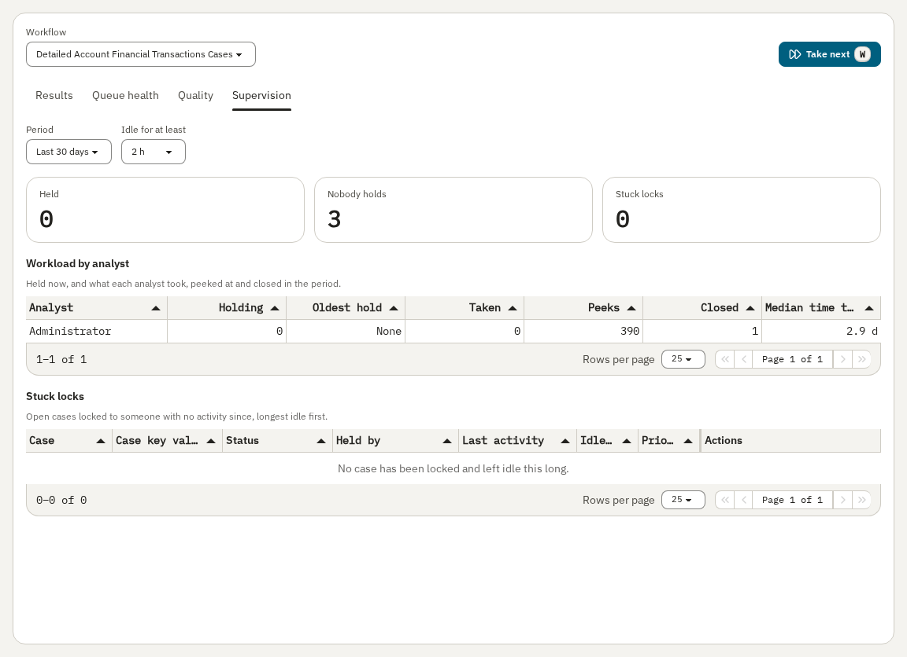

# Working Case Supervision

Case supervision gives a team lead a view over who is holding which cases, which locks have gone stale, and a means to hand a case from one analyst to another. Keeping in mind that assignment is the lock, a case left held by an analyst who is no longer working it is unavailable to everyone else, and supervision exists for the purposes of finding such cases and returning them to the queue or to another analyst.

The circumstance it is built for is an everyday one. An analyst takes a case at four in the afternoon, intending to finish it, and is then away for a week. The case is held, so nobody else may change it, and it does not appear to anyone as free. Nothing is wrong with the case and nothing will draw attention to it, other than its growing older. The Supervision tab is where a team lead sees that case listed as a stuck lock, and either breaks the lock, upon which the case is free for anyone to take, or reassigns it, upon which it is held by a named colleague.

Three terms are used. To hold a case is to have it locked to oneself, which is the same thing as its being assigned. A stuck lock is a held case on which nothing has happened for longer than a chosen idle time. A peek is a look at the summary of a case from the Cases page without taking it.

## Where it lives

Navigate through the menu to Cases, select the Case Workflow, then the Supervision tab, which is presented alongside Results, Queue health and Quality. The tab, the period and the idle time are held in the address of the page, for example `/cases?tab=supervision&days=30&idle=120`, so that a view can be linked to.

The tab is presented only to a user holding permission 18, Read Write Case Workflow, and the server refuses the request regardless of what the page presents.

SHOT id=case-supervision-tab
     route=/cases
     steps=open-tab:Supervision
     frame=page
     state=the Supervision tab for the demonstration Case Workflow with a period of the last 30 days and idle for at least 2 hours, the three headline counts, the Workload by analyst grid listing three analysts and the Stuck locks grid listing two cases with their actions
     conveys=supervision is one tab stacking the headline counts, the workload of each analyst and the locks gone stale
     alt=The Supervision tab of the Cases page showing counts of cases held, not held and stuck, a grid of workload by analyst and a grid of stuck locks with Open, Reassign and Break lock actions

## Period and idle time

Two selections above the grids decide what is shown:

| Value             | Description                                                                                                      | Example      |
|-------------------|------------------------------------------------------------------------------------------------------------------|--------------|
| Period            | The period over which the work of each analyst is counted, as the last 7, 30 or 90 days. The default is 30 days. | Last 30 days |
| Idle for at least | The time a lock must have been without activity to be listed as stuck, as one hour, two hours, four hours, eight hours or a day. The default is two hours. | 2 hours |

Beneath the selections, three headline counts are presented for the Case Workflow:

| Count        | Description                                               |
|--------------|-----------------------------------------------------------|
| Held         | The open cases held by someone at this moment.            |
| Nobody holds | The open cases that nobody holds.                         |
| Stuck locks  | The number of cases listed in the Stuck locks grid.       |

For the purposes of supervision an open case is one that is Open, or Suspended, open.

The idle times are offered as 1 h, 2 h, 4 h, 8 h and 1 d. Changing either selection redraws the grids at once and rewrites the address, and a value in the address that is not one of those offered is read as the default. The three counts appear once the workload has been read, and where either grid cannot be read it is replaced by the message This could not be loaded.

Held and Nobody holds together are every open case of the Case Workflow, and are the first thing to read: a large Nobody holds against a small Held says that work is waiting to be taken, whereas a Stuck locks count that is a large part of Held says that much of what appears to be in hand is in fact standing still.

## Workload by analyst

The grid presents one row for every analyst able to work the Case Workflow, which is to say an active user in the tenant whose role holds permission 1, Read Write Case, and is granted the Case Workflow. Anyone else having held, taken, peeked at or closed a case of the Case Workflow in the period is listed too. The analysts holding the most cases are first, then those having closed the most. The columns are as follows:

| Column               | Description                                                                              |
|----------------------|------------------------------------------------------------------------------------------|
| Analyst              | The name of the user.                                                                    |
| Holding              | Open cases locked to the analyst at this moment.                                         |
| Oldest hold          | How long the longest held case of the analyst has been locked.                           |
| Taken                | Cases the analyst took in the period, by skimming or by locking them.                    |
| Peeks                | Cases the analyst looked at in the period without taking them.                           |
| Closed               | Cases the analyst closed in the period.                                                  |
| Median time to close | The median time from creation to closure of the cases the analyst closed in the period.  |

The grid is headed by the sentence "Held now, and what each analyst took, peeked at and closed in the period.", it is paged at 25 rows, and it has no actions. Holding and Oldest hold describe this moment and do not change with the Period, whereas Taken, Peeks, Closed and Median time to close are counted over the Period. Times are presented in minutes below an hour, in hours to one decimal place below a day, and in days to one decimal place thereafter, for example 45 min, 3.5 h or 2.1 d, and None is shown where there is nothing to measure, such as the Oldest hold of an analyst holding nothing. Where no analyst is able to work the Case Workflow, the grid states No analyst can work this workflow.

An analyst with a high Holding and a long Oldest hold is the one to look at first, as cases are being collected and not finished. Many Peeks against few Taken suggests cases being looked over and left for others.

## Stuck locks

A stuck lock is an open case that is locked to someone and has had no activity for at least the idle time selected. Activity is any event recorded on the case, or the taking of the lock itself where nothing has happened since. The grid is presented longest idle first, to a limit of 200 cases, with the following columns:

| Column         | Description                                                             |
|----------------|-------------------------------------------------------------------------|
| Case           | The number of the case.                                                 |
| Case key value | The value of the case key.                                              |
| Status         | The status the case is in.                                              |
| Held by        | The analyst to whom the case is locked.                                 |
| Last activity  | The date and time of the last activity on the case.                     |
| Idle for       | The time elapsed since the last activity.                               |
| Priority       | The Priority of the case in its latest ranking assessment.              |
| Actions        | Open, Reassign and Break lock.                                          |

Open returns to the Results tab with the summary of the case presented, in the manner of Peek.

The grid is headed by the sentence "Open cases locked to someone with no activity since, longest idle first.", and is paged at 25 rows. Where nothing qualifies it states No case has been locked and left idle this long, which is the state to be hoped for. Break lock is presented in red, being the action that takes something away from a colleague.

Returning to the analyst who is away for a week: with Idle for at least set to 1 d, the case appears in this grid on the following afternoon, with Held by naming the analyst and Idle for reading 1 d, and it climbs the grid each day it is left.

## Break lock

Break lock releases the lock so that anyone may take the case. Confirmation is sought under the heading Break the lock?, with a Reason (optional) of up to 500 characters. A Lock broken event is written to the Events of the case in the name of the supervisor, with the previous holder as Before and the reason as After.

The dialog names the case and its holder, as "C-12 is locked to Analyst1. Breaking the lock lets anyone take it and is recorded in the case journal.", and offers Cancel and Break lock. Upon the lock being broken the message Lock broken is shown, the dialog closes, and the grids and counts are read again, so the case leaves the Stuck locks grid, Held falls by one and Nobody holds rises by one. The case itself is otherwise untouched, keeping its status, its diary and its notes, and on the case page it reads Not held.

The case must be open and locked, and the request is refused where the lock changed while the request was being made.

## Reassign

Reassign locks the case to another analyst, and writes an Allocated event to the Events of the case in the name of the supervisor, with the old holder as Before and the new holder as After. The dialog, headed Reassign the case, offers under Analyst the analysts listed in the Workload by analyst grid, other than the present holder.

The dialog reads, for example, "C-12 is locked to Analyst1. Choose who takes it; the handover is recorded in the case journal.", the Analyst selection begins at Choose an analyst, and Reassign remains disabled until an analyst has been chosen. No reason is asked for. Upon success the message Case reassigned is shown and the grids are read again. As the case has just had activity, it leaves the Stuck locks grid, and it is counted in the Holding of the analyst to whom it was handed, on whose case page it reads Held by you.

The analyst must be able to see the case, which means all of the following hold:

* They are an active user in the same tenant.
* Their role holds permission 1, Read Write Case.
* Their role is granted the Case Workflow.
* Their role is granted the status the case is in.

Otherwise the case would disappear from the view of the analyst the moment it was handed over, henceforth the request is refused. A closed case cannot be reassigned, and as with Break lock the request is refused where the lock changed while it was being made.

It can be seen that reassigning grants nothing. The analyst to whom a case is handed keeps their own privileges, and a case cannot be handed to anyone who could not already have taken it.

In the user interface Reassign is offered against a stuck lock, and so against a case that is held. Through the API and Ask Jooby, a case that nobody holds can be assigned in the same manner.

## Validation

The requests are validated in the server, and are refused where:

* The Case Workflow is not one granted to a role of the supervisor.
* The period starts on or after its end, or is longer than 366 days. The user interface offers only 7, 30 and 90 days, so this arises only through the API.
* The reason given upon breaking a lock is longer than 500 characters.
* The case is not visible to the supervisor, in which circumstance it is reported as not found.
* The case is not open, or for Break lock is not locked.
* The analyst to whom a case is to be reassigned is not able to see the case.

The messages returned, each shown on the page, are as follows:

| Circumstance                                              | Message                                                               |
|-----------------------------------------------------------|-----------------------------------------------------------------------|
| The user lacks permission 18                              | You do not have permission to supervise cases.                        |
| The Case Workflow is not granted to the supervisor        | The case workflow could not be found.                                 |
| The case is not visible to the supervisor                 | The case could not be found.                                          |
| The period is inverted or longer than 366 days            | 'From' must be before 'To', and the period at most 366 days.          |
| The reason is over 500 characters                         | The reason may be at most 500 characters.                             |
| The case is closed                                        | Only an open case can be reassigned or have its lock broken.          |
| Break lock on a case nobody holds                         | The case is not locked.                                               |
| The lock changed while the request was being made         | The case changed while the request was made. Check it and try again.  |
| Reassign with no analyst named                            | The analyst who takes the case is required.                           |
| The analyst named cannot see the case                     | That analyst cannot see this case, so it cannot be locked to them.    |

The message stating that the case changed arises where the holder released the case, or a second supervisor acted on it, in the moments between the grid being drawn and the action being confirmed, and the remedy is to look at the grid again.

## Case Supervision agent

The same four operations (workload, stuck locks, break lock and reassign) are available to [Ask Jooby](../../../AskJooby/index.html) through the Case Supervision specialist under the Case Investigation Desk, with a confirmation required before either change is carried out.

## Permissions and security

Case supervision requires permission 18, Read Write Case Workflow, and a role granted the Case Workflow being supervised, so a supervisor sees only the Case Workflows their role can already see. A user without the permission is not presented with the Supervision tab.

Break lock and Reassign further require that the role of the supervisor is granted the status the case is in, as well as the Case Workflow. Where it is not, the case is reported as not found, rather than as forbidden, so that the existence of the case is not revealed.

Both changes are recorded in the Events of the case in the name of the supervisor, as described above, for the purposes of audit.
