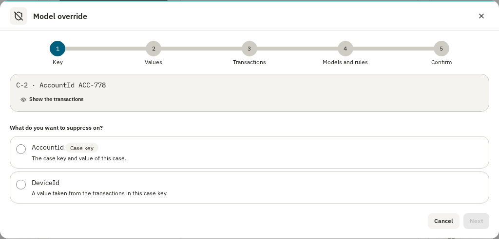
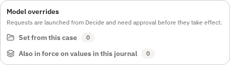

# Working Case Suppression

An analyst working a case will often reach the conclusion that the rule which raised it ought not to be acting upon this customer for the time being: the customer is on holiday and is being declined for foreign transactions, or a device shared by a household is raising a case for each member of it. The question the analyst is trying to answer is "how do I stop this happening again for this value, having seen the evidence, without leaving the case?", and the opposite question arises as readily, being "this value is known to be bad, how do I make the rule act upon it every time?".

The mechanism that answers both is the override, described in full in [Activation Rules Override](../../Models/ActivationRulesOverride/index.html), which either suppresses the consequences of Activation Rules for a value or forces an Activation Rule to be treated as matched for a value. This page describes the manner of asking for an override from a case, henceforth a model override request, and the manner of approving one. It does not repeat what an override does in the engine, which Activation Rules it reaches, or how the Override page is used, for which the page referred to is the authority.

The difference between the two surfaces is one of governance. The Override page is a direct control, in that a Suppress override made there takes effect at once. A request made from a case changes nothing until a second person approves it, it carries a reason and the transactions given as evidence, it always expires, and it remains on the case as a record of who asked, who decided and what became of it.

## Terms

| Term              | Meaning                                                                                                                                                                                                                         |
|-------------------|---------------------------------------------------------------------------------------------------------------------------------------------------------------------------------------------------------------------------------|
| Override key      | A payload element whose values may be overridden, being a Request XPath having Enable override switched on. For example IP.                                                                                                     |
| Override value    | The value of the override key that the override is held against. For example 8.8.8.8.                                                                                                                                           |
| Target            | A model, or one Activation Rule of a model, that the override is to apply to. A request names at least one target and at most 50.                                                                                               |
| Kind              | Suppress, which mutes the consequences of the rule for the value, or Force, which treats the rule as matched for the value.                                                                                                     |
| Evidence          | The transactions in the journal of the case that carry the value and that the analyst gives as the reason for the request.                                                                                                      |
| Maker             | The user having made the request.                                                                                                                                                                                               |
| Approver          | A user other than the maker, having the approval permission, who approves or rejects the request.                                                                                                                               |
| Standing          | What a request is now: Awaiting approval, Approved, Rejected, Retracted, Expired or Removed.                                                                                                                                    |
| Reach             | How widely the value is carried beyond the case, as the number of other Case Key Values and the number of transactions in the archive of the model. An override applies to all of them, hence the reach is shown before asking. |

## Where it lives

Navigate to a case record from the Cases page. Case suppression is found in four places:

| Place                                              | Shows                                                                                                                                                   |
|----------------------------------------------------|---------------------------------------------------------------------------------------------------------------------------------------------------------|
| Model override, a tile under Actions in the Decide pane | Opens the lightbox Model override, in which a request is made. The tile is presented only to a user having permission 2, Read Write Suppression.    |
| Override approvals, a tile under Actions in the Decide pane | Opens the lightbox Model override request, in which a request is decided, retracted or resubmitted. The tile is presented only where there are requests on the case that the user can act upon, and states their number, for example 2 requests. |
| Model overrides, beneath the Journal section of the case | Lists the requests made from the case and the overrides already in force on the values in its journal. It is read only.                           |
| Approvals, a panel on the Results tab of the Cases page | Lists every request awaiting a decision across the cases the user can see. It is presented only to a user having permission 70, Approve Case Suppressions. |

The tiles of the Decide pane are not subject to the lock, which is to say that a request can be made, and decided, on a case held by somebody else or by nobody.

SHOT id=case-suppression-request-key-step
     route=/cases
     steps=open-demo-case, open-decide-tile:Model override
     frame=dialog
     state=the Model override lightbox as first opened on a demonstration case whose case key is flagged Enable override, showing the steps Key, Models and rules and Confirm across the top, the context strip stating the case and its key value, and the Key step listing the case key marked Case key alongside the other override keys of the model
     conveys=a request starts by choosing what to suppress on, the case key or another override key, with the case kept in view throughout
     alt=The Model override lightbox on its first step, with the context strip naming the case and its key value above a list of keys to suppress on, the case key first



## A worked example

The remainder of this page follows one example. Case C-1041 was raised on the Case Key AccountId for the Case Key Value Test1, by an Activation Rule named Foreign IP on the model Card Fraud, which declined three transactions made from the IP 8.8.8.8 between the 2nd and the 4th of the month. The customer has confirmed being abroad. The analyst, Anna, wishes the Foreign IP rule to stop declining that IP for thirty days, and her supervisor, Robert, is to approve it.

Two matters of configuration must be in place beforehand, and each is stated in the lightbox where it is missing:

* The key must be offered as an override key, by Enable override in the Behaviour group of its [Request XPath](../../Models/RequestXPath/index.html), and the Activation Rule must admit being overridden, both as described in [Activation Rules Override](../../Models/ActivationRulesOverride/index.html).
* The key must also be flagged as Archive Key on the Request XPath, as the transactions carrying a value are found through that index, in the manner of the [Case Key Journal](../WorkingCaseKeyJournal/index.html).

## Requesting a model override

Model override opens a lightbox arranged as a sequence of steps, shown across its top with the step in hand and those before it picked out. Beneath the steps there is a context strip that remains in view throughout, and at the foot there are the controls Cancel, Back (on every step but the first), Next and, on the final step, Request model override. Next is disabled until the step is complete. Cancel, or closing the lightbox, discards everything entered, and the lightbox starts afresh upon being opened again.

The steps depend upon the key chosen:

| Key chosen             | Steps                                                  |
|------------------------|--------------------------------------------------------|
| The case key           | Key, Models and rules, Confirm                         |
| Any other override key | Key, Values, Transactions, Models and rules, Confirm   |

The value is never typed. For the case key it is the Case Key Value of the case, and for any other key it is picked from the values that the journal of the case carries, which the server confirms against the transactions given as evidence. It follows that an override cannot be requested from a case for a value that the case has nothing to do with.

### The context strip

The context strip states the case, its Case Key and Case Key Value, in the form C-1041 · AccountId Test1. Once a key has been chosen it states the key, and once a value is settled it states the value, the number of transactions in the case key carrying it with the dates of the first and last, and the reach, for example:

```text
C-1041 · AccountId Test1   IP = 8.8.8.8   3 transactions in this case key, 02/11/2026 to 04/11/2026   2 other case keys carry it (7 transactions in the model archive)
```

Where the reach cannot be counted, the strip states "The wider impact is unknown: the archive is not indexed for this key yet." in its place. The strip carries a control, Show the 3 transactions, which lists the transactions carrying the value beneath the strip without leaving the step, and which then reads Hide the transactions.

### Key

The Key step asks "What do you want to suppress on?" and lists the case key first, marked Case key, followed by every other override key of the model of the Case Workflow that is also flagged Archive Key, in alphabetical order, an override key that is not an Archive Key being left out as its transactions could not be looked up. One is chosen:

| Key                    | Stated beneath it                                                                                                                                                                                             |
|------------------------|---------------------------------------------------------------------------------------------------------------------------------------------------------------------------------------------------------------|
| The case key, enabled  | The case key and value of this case.                                                                                                                                                                          |
| Another override key   | A value taken from the transactions in this case key.                                                                                                                                                         |
| The case key, disabled | The case key AccountId is not flagged Enable Override on its request XPath, so it cannot be suppressed. Enable it on the model's request XPath first. The key is shown, yet cannot be chosen.                 |

In the example, Anna could choose AccountId, which would mute the rule for the account whatever IP it used. She chooses IP instead, as it is the IP that is the reason. Where the keys cannot be read, "The keys could not be loaded." is shown.

### Values

The Values step, which is presented only for a key other than the case key, lists the distinct values of the key across the whole journal of the case key, irrespective of any filter or window set in the Journal section. Where further keys have been merged into the journal as lanes, their transactions are included also. The columns are as follows:

| Column           | Description                                                                                                                                                                                                                                             |
|------------------|---------------------------------------------------------------------------------------------------------------------------------------------------------------------------------------------------------------------------------------------------------|
| The key          | The value, the column being titled with the name of the key.                                                                                                                                                                                            |
| In this case key | The number of transactions in the journal carrying the value.                                                                                                                                                                                           |
| First seen       | The date of the earliest of those transactions.                                                                                                                                                                                                         |
| Last seen        | The date of the latest.                                                                                                                                                                                                                                 |
| Merged key       | The merged lanes the value arrived by, where there are any.                                                                                                                                                                                             |
| More widely      | The reach of the value: No other case keys, 1 other case key, or the number of other case keys, or Not indexed yet where it cannot be counted.                                                                                                          |
| Actions          | Review, which settles upon the value and moves to the Transactions step. There is no Next on this step, as the value is chosen by Review.                                                                                                               |

The values are ordered with the most frequent first, then the most recently seen. Where a value is carried by ten or more other case keys, More widely is shown in amber and reads, for example, "14 other case keys. Suppressing applies to all of them.", which should prompt the analyst to consider whether an override on that value is too broad, and whether the case key would serve better. A count followed by a plus sign, such as 1,000+, means that the count stopped at its limit and the true figure is larger.

Where the journal has no values for the key, "No values for this key in this journal." is shown, and where the values cannot be read, "The values could not be loaded."

In the example, the step lists 8.8.8.8 with 3 in this case key and 2 other case keys, alongside the home IP of the customer with rather more transactions. Anna clicks Review against 8.8.8.8.

### Transactions

The Transactions step lists the transactions in the case key that carry the value, newest first, under the instruction "These transactions in this case key carry the value. Untick any that are not the reason." The columns are Use (a tick box), When, Elevation (the Response Elevation returned), What fired (the Activation Rules that matched, limited to those the user may see) and Merged key.

Every transaction is ticked upon arrival. Above the grid the number ticked is stated, as 3 of 3 ticked as evidence, alongside Tick all and Tick none. The transactions left ticked are stored with the request as its evidence, and at least one must be ticked for Next to be available. Where there are none, "No transactions." is shown, and upon failure "The transactions could not be loaded."

For the case key, this step is not presented and no evidence is stored, the case itself being the evidence.

### Models and rules

The Models and rules step presents the same grid as the Models step of the Override page, for the key and value in hand, under the instruction "Choose the models and rules to suppress or force for this value. Nothing is applied until it is approved." Each model offering the key has an Override switch, and expands to its Activation Rules, each with its own switch and a Kind. The switches in this lightbox do not change anything, as they only gather the targets of the request, hence the Delete expiry date, Approval and Review columns of the Override page are absent, and overrides already in force are not shown as switched on.

A model switched on is a target of kind Suppress for every Activation Rule of the model that admits it. A rule switched on is a target for that rule alone, of kind Suppress unless the Kind is changed to Force. Force is offered only against a rule having Enable force, and only to a user having permission 62, Apply Force Override. At least one target must be switched on for Next to be available.

In the example, Anna expands Card Fraud and switches on the rule Foreign IP, leaving the Kind as Suppress, as she has no wish to mute the remaining rules of the model for that IP.

### Confirm

The Confirm step states what is being asked for, under What you are asking for: the key and value following Applies to, each target with its kind, and the reminder "This applies to every case that carries this value on the models and rules above, not only this case." It then takes the following:

| Value   | Description                                                                                                                                                                                                                                                                                                              | Example                |
|---------|--------------------------------------------------------------------------------------------------------------------------------------------------------------------------------------------------------------------------------------------------------------------------------------------------------------------------|------------------------|
| Expires | The date and time at which the override lapses. Required, and set to thirty days hence upon the lightbox being opened. An override requested from a case cannot be without an expiry, for the reason that a suppression granted for a circumstance should end with it.                                                   | 16/12/2026 09:30       |
| Reason  | Why the override is asked for. Required, to a limit of 2,000 characters. It is drafted from the facts and can be edited, as described below.                                                                                                                                                                             | See the example below. |

The reason is drafted by the server from the facts of the request and from nothing else, which is to say that it is not written by a language model. While it is being drafted the hint beneath reads "Drafting the reason from the facts", and thereafter "Built from the facts and editable. Required." The draft is rebuilt should the expiry be altered, until such time as the analyst types in the reason, after which it is left alone. In the example it reads:

```text
Suppress Card Fraud / Foreign IP for IP 8.8.8.8: seen in 3 transactions on C-1041 (AccountId Test1), 2 Nov 2026 to 4 Nov 2026; 2 other case keys carry it (7 transactions in the model archive). Expires 16 Dec 2026.
```

Anna adds that the customer confirmed travel by telephone. Request model override is available once there is a reason, an expiry in the future and at least one target. An expiry in the past is reported at once as "The expiry must be in the future."

Upon the request being accepted, the lightbox closes, the message "Model override requested. It takes effect once approved." is shown, and the request appears in the Model overrides section of the case as Awaiting approval. Where the request is refused, the lightbox remains open with the reason for the refusal above its controls, as described under Validation.

## Approving a request

A request is decided in the lightbox Model override request, which is reached in three ways:

* The Override approvals tile in the Decide pane of the case, described there as "Model override requests on this case that are waiting for your decision."
* Review against a row of the Approvals panel on the Cases page, which opens the case with the lightbox already open on that request.
* An address of the form `/cases/1041?suppression=17`, where 17 is the identifier of the request, which can be passed to an approver. The parameter is removed from the address upon the lightbox being closed.

Where the case has more than one request that the user can act upon, a drop down titled Request, at the top of the lightbox, chooses between them, each shown as its key and value, for example IP = 8.8.8.8.

SHOT id=case-suppression-approval-dialog
     route=/cases
     steps=open-demo-case, open-decide-tile:Override approvals
     frame=dialog
     state=the Model override request lightbox for a request awaiting approval, opened by a user other than its maker who holds the approval permission, showing the key and value with the Awaiting approval badge, the counts When requested beside Now, What will change, the Reason, the Evidence transactions, and the Note box above Reject and Approve
     conveys=an approver sees what will change, why, on what evidence and how widely, before deciding
     alt=The Model override request lightbox showing a request awaiting approval, with its counts when requested and now, the change it would make, its reason, its evidence transactions and the Reject and Approve controls

The lightbox presents, from top to bottom:

| Part                  | Description                                                                                                                                                                                                                                                                                               |
|-----------------------|-----------------------------------------------------------------------------------------------------------------------------------------------------------------------------------------------------------------------------------------------------------------------------------------------------------|
| Heading               | The key and value, the standing as a badge, Requested by followed by the maker and the date and time, and, while the request is pending, the progress of approval, for example 0 of 1 approvals.                                                                                                          |
| When requested and Now | Two sets of counts side by side: the transactions in the case key carrying the value, with their dates, and the reach, firstly as they stood when the request was made and secondly as they stand at the moment of reading. A value that has spread since the request was made is thereby apparent to the approver. |
| What will change      | One line for each target, reading for example "Suppress Card Fraud / Foreign IP for IP 8.8.8.8 until 16/12/2026 09:30."                                                                                                                                                                                   |
| Reason                | The reason given by the maker.                                                                                                                                                                                                                                                                            |
| Evidence transactions | The identifiers of the transactions given as evidence, the first 30 being shown. Each closes the lightbox and opens that transaction in the Journal section of the case.                                                                                                                                  |
| Decisions             | Every decision recorded against the request thus far: Approved, Rejected, Retracted or Resubmitted, with the user, the date and time, and any note.                                                                                                                                                       |
| Note (optional)       | A note to accompany the decision, to a limit of 1,000 characters.                                                                                                                                                                                                                                         |

The controls offered depend upon who is reading:

| Control  | Offered to                                                                                              | Effect                                                                                                                                                                                                                                                       | Message                          |
|----------|---------------------------------------------------------------------------------------------------------|--------------------------------------------------------------------------------------------------------------------------------------------------------------------------------------------------------------------------------------------------------------|----------------------------------|
| Approve  | A user having permission 70 who is not the maker and has not already approved the present version.      | Records an approval. Upon the number of approvals required being reached, the overrides are created and the standing becomes Approved, otherwise the request continues to await approval with its progress advanced.                                         | Approval recorded.               |
| Reject   | As for Approve.                                                                                         | The standing becomes Rejected and nothing is created. A single rejection is sufficient.                                                                                                                                                                      | Suppression rejected.            |
| Retract  | The maker, while the request is pending.                                                                | The standing becomes Retracted and nothing is created.                                                                                                                                                                                                       | Suppression request retracted.   |
| Resubmit | The maker, once the request has been rejected or retracted.                                             | The request returns to Awaiting approval as a new version, with the approvals counted afresh. A New expiry is taken alongside, set to thirty days hence.                                                                                                     | Suppression request resubmitted. |

Upon any of the four succeeding, the lightbox closes and the message is shown. A user who can read a pending request yet can neither decide nor retract it is told "You cannot approve this request: you made it, you have already approved it, or you do not hold the approval permission." Where the request cannot be read, "The suppression request could not be loaded." is shown.

The number of approvals required is that of the ApprovalsRequired Environment Variable, which is 1 by default, as described in [Maker Checker](../../../Concepts/MakerChecker/index.html). Each approval must be by a different user, and none by the maker.

In the example, Robert opens the Approvals panel, sees the request for IP = 8.8.8.8 on C-1041 waiting since today, and clicks Review. He observes that the counts under Now match those under When requested, opens one of the evidence transactions to confirm that it is the Foreign IP rule that fired, returns, and clicks Approve. The request becomes Approved, and the Foreign IP rule is suppressed for 8.8.8.8 until the expiry.

### What approval does

Upon the final approval being recorded, an override is created for each target, in the name of the maker, with its Delete expiry date set to the expiry of the request. From that moment it is an ordinary override: it is listed on the Override page, it is synchronised to the engine as a matter of routine without an explicit synchronisation, it lapses of its own accord at the expiry, and it can be switched off on the Override page beforehand.

The following should be kept in mind:

* The overrides are created with the permissions of the maker, and not those of the approver. Should the maker no longer have permission 2 (or permission 62 for a Force target) at the moment of approval, the approval is refused and nothing is recorded.
* Where an override of the same kind is already in force for a target, key and value, it is adopted as it stands, a second not being created, and its existing Delete expiry date is left as it is. Where an override of the other kind is in force, the approval is refused, stating that a different override is already in force and is to be removed first.
* A target of kind Force creates a Force override, which is itself subject to the approval of Force overrides described in [Activation Rules Override](../../Models/ActivationRulesOverride/index.html). It follows that a Force requested from a case takes two approvals before the engine acts upon it: that of the request, by permission 70, and that of the Force override, by permission 44, Allow Approval. The same person may give both.
* The request is checked again at approval. Where the key has since ceased to be an override key, or a rule has since ceased to admit the override, the approval is refused and nothing is recorded.

### Standing

The standing of a request is shown as a badge wherever the request appears, and is to be read as follows:

| Standing          | Colour  | Meaning                                                                                                                                                                                                                                   |
|-------------------|---------|-------------------------------------------------------------------------------------------------------------------------------------------------------------------------------------------------------------------------------------------|
| Awaiting approval | Amber   | The request is pending. Nothing has reached the engine.                                                                                                                                                                                   |
| Approved          | Green   | The request was approved and its overrides are in place.                                                                                                                                                                                  |
| Rejected          | Red     | An approver rejected the request. The maker may resubmit it.                                                                                                                                                                              |
| Retracted         | Neutral | The maker withdrew the request. The maker may resubmit it.                                                                                                                                                                                |
| Expired           | Neutral | Either the overrides of an approved request have reached their expiry, or a pending request was not decided in time, as described below.                                                                                                  |
| Removed           | Red     | The request was approved, and one or more of its overrides has since been switched off on the Override page before its expiry. This is worth noticing, as the case states that a suppression was granted which is no longer in effect.     |

A pending request does not wait indefinitely. Where nobody decides it within 14 days of it being made, or of it last being resubmitted, or where its expiry passes while it waits, it is shown as Expired, it leaves the Approvals panel and it can no longer be approved, an attempt being refused with "The request lapsed without a decision. Ask the maker to retract and resubmit it." The maker retracts and resubmits to begin a new period.

## Model overrides on the case

The section titled Model overrides sits beneath the transactions of the Journal section, for every case having a Case Key, with the hint "Requests are launched from Decide and need approval before they take effect." It is made up of two lists, each headed by its title and a count, and a list having nothing in it shows its title and a count of 0 only.

SHOT id=case-suppression-model-overrides-section
     route=/cases
     steps=open-demo-case, scroll-to:Model overrides
     frame=section:Model overrides
     state=the Model overrides section beneath the journal of a demonstration case, with Set from this case holding one request card marked Approved, showing its key and value, the rule suppressed, the reason, the expiry, who requested and who decided it, the counts When requested and the evidence transactions, and Also in force on values in this journal holding one override set on the Override page
     conveys=the case keeps a record of every override asked for from it, and shows the overrides already acting upon the values in its journal
     alt=The Model overrides section of a case listing an approved request with its target, reason, expiry and evidence, above an override already in force on a value in the journal



Set from this case lists the requests made from the case, newest first, each as a card stating:

* The key and value, the standing, and Requested by AskJooby where the request was made through Ask Jooby.
* Each target with its kind.
* The reason.
* Until, followed by the expiry, Requested by with the maker and date, Decided by with the user who last decided it, and, while pending, the progress of approval.
* The counts under When requested.
* The number of evidence transactions, with the identifiers of the first 12, each of which opens that transaction in the journal.

Also in force on values in this journal lists the overrides presently in force for any value appearing in the journal of the case, on any override key, other than those arising from the case in view. Each states the key and value, the kind, the model and rule, the expiry (or No expiry), the user having created it, and its origin, being Set from case C- followed by the Case Id, or Set on the Override page or elsewhere. This list exists so that an analyst about to ask for an override can see that one is already in place, and so that the absence of an expected decline can be explained.

Where either list cannot be read, "Suppressions could not be loaded." is shown in its place.

## The Approvals panel

The Approvals panel is presented beneath the list of cases on the Results tab of the [Cases page](../WorkingSkimLockNext/index.html), to a user having permission 70, with the hint "Requests waiting for someone other than the person who made them." It lists the requests awaiting a decision, the longest waiting first, limited to the cases the user can see, and to 100 requests. Requests having lapsed or passed their expiry are left out. The columns are as follows:

| Column           | Description                                                                 | Example                 |
|------------------|-----------------------------------------------------------------------------|-------------------------|
| Kind             | The kind of approval, which is Model override.                              | Model override          |
| Request          | The key and value.                                                          | IP = 8.8.8.8            |
| Models and rules | The targets.                                                                | Card Fraud / Foreign IP |
| Requested by     | The maker.                                                                  | Anna                    |
| Case             | The case the request was made from.                                         | C-1041                  |
| Requested        | The date and time of the request.                                           | 16/11/2026 09:30        |
| Waiting          | How long the request has waited, as Today, 1 day or a number of days.       | 3 days                  |
| Actions          | Review, which opens the case with the request ready to be decided.          |                         |

Where there is nothing to decide, "Nothing is waiting for approval." is shown, and upon failure "The approvals could not be loaded." The panel lists the requests of the user also, should the user be both a maker and an approver, although the server will not allow a maker to decide their own.

## Validation

A request is validated in the server. The following are returned as a validation failure, with status 400, the first message being shown in the lightbox:

| Rule                                                                              | Message                                                    |
|-----------------------------------------------------------------------------------|------------------------------------------------------------|
| A reason is given.                                                                | A reason is required.                                      |
| The reason is no longer than 2,000 characters.                                    | A reason must be 2000 characters or fewer.                 |
| The expiry is given and is in the future.                                         | An expiry in the future is required.                       |
| The expiry is no further away than the maximum duration, which is 366 days.       | The expiry may be at most 366 days from now.               |
| At least one target is named.                                                     | Choose at least one model or rule.                         |
| No more than 50 targets are named.                                                | A request can name 50 models and rules at most.            |
| No more than 500 transactions are given as evidence.                              | At most 500 transactions can be ticked as evidence.        |
| The key, the value and the name of a rule are each no longer than 256 characters. | For example, A value must be 256 characters or fewer.      |
| A note on a decision is no longer than 1,000 characters.                          | A note must be 1000 characters or fewer.                   |

The following are refused, with status 409, and the message is shown in the lightbox:

| Circumstance                                                                                           | Message                                                                                                                 |
|--------------------------------------------------------------------------------------------------------|-------------------------------------------------------------------------------------------------------------------------|
| The key is not an override key.                                                                        | The key is not flagged Enable Override on the request XPath, so it cannot be suppressed.                                |
| The key is not an Archive Key.                                                                         | The key is not a field flagged Archive Key on the workflow's model, so its transactions cannot be looked up.            |
| The value is not that of the case key, or no value is given for another key.                           | The value is not in the journal of this case.                                                                           |
| No evidence is given for a key other than the case key.                                                | Tick at least one transaction that carries the value.                                                                   |
| A transaction given as evidence is not in the journal of the case, or does not carry the value.        | A ticked transaction is not in the journal of this case or does not carry the value.                                    |
| A Force target is named by a user without permission 62.                                               | Forcing needs the Apply Force Override permission.                                                                      |
| A target is not valid for the key, for example a rule that does not admit the override.                | A model or rule is not valid for this key, followed by the target and the reason.                                       |
| A decision is made on a request that is not pending.                                                   | Only a pending request can be decided.                                                                                  |
| The maker attempts to approve or reject.                                                               | You cannot decide your own request. Retract it instead.                                                                 |
| An approver approves the same version twice.                                                           | You have already approved this version.                                                                                 |
| A user other than the maker retracts or resubmits.                                                     | Only the person who made the request can do this.                                                                       |
| A request is resubmitted that is neither rejected nor retracted.                                       | Only a rejected or retracted request can be resubmitted.                                                                |
| The expiry has passed at approval or resubmission.                                                     | The expiry has passed.                                                                                                  |
| The expiry is beyond the maximum duration at approval or resubmission.                                 | The expiry may be at most 366 days from now.                                                                            |
| The request lapsed before being decided.                                                               | The request lapsed without a decision. Ask the maker to retract and resubmit it.                                        |
| The maker no longer has the permission needed at approval.                                             | The person who made the request no longer holds the permission needed to apply it.                                      |
| An override of the other kind is in force for a target.                                                | A different override is already in force for the target; remove it first.                                               |
| A request that is not pending is retracted.                                                            | Only a pending request can be retracted.                                                                                |
| The value cannot be read as the data type of the field of the key, for example text where a number is held. | The value cannot be read as the data type of the key's field.                                                      |
| The Case Key Value is longer than can be held against an override.                                     | The case key value is too long to suppress on.                                                                          |
| An override could not be created at the final approval for a reason other than those above.            | The request could not be applied, followed by the reason.                                                               |

A case that does not exist, or is not visible to the user, is returned as not found with status 404, as is a request on such a case. Where a refusal carries no message that can be shown, the lightbox states "The suppression could not be requested."

## Limits

| Limit                                                                     | Value  |
|---------------------------------------------------------------------------|--------|
| Targets in a request                                                      | 50     |
| Transactions given as evidence                                            | 500    |
| Transactions listed for a value, for the case key and for each merged lane | 200    |
| Distinct values listed for a key                                          | 500    |
| Most recent transactions of each lane read to find the values             | 5,000  |
| Values for which the reach is counted, the remainder reading Not indexed yet | 100    |
| Transactions counted towards the reach, beyond which a plus sign is shown | 1,000  |
| Other case keys at which the reach is shown in amber                      | 10     |
| Requests listed in the Approvals panel                                    | 100    |
| Overrides listed as already in force                                      | 200    |
| Default expiry                                                            | 30 days |

Two Environment Variables govern the periods:

| Environment Variable            | Description                                                                                                                                                                                             | Default |
|---------------------------------|---------------------------------------------------------------------------------------------------------------------------------------------------------------------------------------------------------|---------|
| CaseSuppressionMaxDurationDays  | The furthest into the future that an expiry may be set, in days. It is applied at request, at resubmission and at approval, hence lowering it stops a waiting request whose expiry is now too distant. | 366     |
| CaseSuppressionPendingLapseDays | The number of days a pending request may wait before it lapses.                                                                                                                                         | 14      |

## What is recorded

A request, its targets, its evidence, the counts at the time it was made and every decision upon it are stored against the case and are never removed by a decision, such that the Model overrides section is the lasting record of what was asked and what became of it. Each change of state is kept as a version of the request, and every operation is written to the audit log with the user and the outcome, including those refused.

The overrides created by an approval are recorded to their own audit history, in the manner of every other override.

A request does not write to the Events of the case, and neither the maker nor the approvers receive a notification. An approver learns of a request from the Approvals panel, or by being sent the address of the request.

TODO(verify): owner to decide whether making, approving, rejecting, retracting and resubmitting a model override request should write a Case Event and raise a notification to the approvers and the maker. At present CaseSuppressionService writes neither, and a request is found only through the Approvals panel, the Override approvals tile or the address.

## Ask Jooby

Ask Jooby can list the requests of a case, list the candidate values of a key and the transactions carrying a value, and make a request, subject to the same permissions and the same validation, the evidence being confirmed by the server in the same manner. A request made through Ask Jooby is marked Requested by AskJooby on its card. Ask Jooby has no tool to approve, reject, retract or resubmit, as a decision is reserved to a person.

## Example

The API underlying the lightboxes is as follows:

```http
GET  /api/CaseSuppressionCandidates/Keys?caseId=1041
GET  /api/CaseSuppressionCandidates/Values?caseId=1041&key=IP
GET  /api/CaseSuppressionCandidates/Transactions?caseId=1041&key=IP&value=8.8.8.8
GET  /api/CaseSuppressionCandidates/InForce?caseId=1041
POST /api/CaseSuppressionCandidates/ReasonDraft
POST /api/CaseSuppression
GET  /api/CaseSuppression/ByCase/1041
GET  /api/CaseSuppression/Awaiting?limit=100
GET  /api/CaseSuppression/17
GET  /api/CaseSuppression/17/Versions
POST /api/CaseSuppression/Approve
POST /api/CaseSuppression/Reject
POST /api/CaseSuppression/Retract
POST /api/CaseSuppression/Resubmit
```

The request of the example is made as follows, where `pathId` is 1 for the case key (in which circumstance `overrideKeyValue` is null and `archiveIds` may be empty) and 2 for any other key, and `overrideKindId` is 0 for Suppress and 1 for Force:

```json
{
  "caseId": 1041,
  "pathId": 2,
  "overrideKey": "IP",
  "overrideKeyValue": "8.8.8.8",
  "reason": "Suppress Card Fraud / Foreign IP for IP 8.8.8.8: seen in 3 transactions on C-1041 (AccountId Test1), 2 Nov 2026 to 4 Nov 2026; 2 other case keys carry it (7 transactions in the model archive). Expires 16 Dec 2026. Customer confirmed travel by telephone.",
  "expiryDate": "2026-12-16T09:30:00Z",
  "targets": [
    {
      "entityAnalysisModelGuid": "90c425fd-101a-420b-91d1-cb7a24a969cc",
      "ruleName": "Foreign IP",
      "overrideKindId": 0
    }
  ],
  "archiveIds": [58211, 58240, 58302],
  "merge": null
}
```

A decision takes the identifier of the request and, optionally, a note. The `expiryDate` is read upon Resubmit only, and where it is absent the expiry of the request is kept:

```json
{
  "id": 17,
  "note": "Travel confirmed, agreed for thirty days.",
  "expiryDate": null
}
```

## Permissions and security

| Permission                    | Allows                                                                                                                                                                                                                     |
|-------------------------------|----------------------------------------------------------------------------------------------------------------------------------------------------------------------------------------------------------------------------|
| 1, Read Write Case            | Reading the Model overrides section of a case, the candidate keys, values and transactions, and a request. Retracting a request, by its maker.                                                                             |
| 2, Read Write Suppression     | Together with permission 1, making and resubmitting a request. The Model override tile is hidden from a user without it, and the server refuses a request with status 403.                                                |
| 62, Apply Force Override      | In addition, naming a target of kind Force. Without it, Force is not offered in the Kind of a rule, and a request naming one is refused with status 409.                                                                   |
| 70, Approve Case Suppressions | Approving and rejecting a request made by another user, and reading the Approvals panel, which is hidden from a user without it. Approval does not require permission 2, as the overrides are created as the maker.       |

Every reading and every decision is limited to the cases visible to the user, which is to say that a role of the user is granted the Case Workflow and the current status of the case. A request on a case that the user cannot see is reported as not found, and does not appear in the Approvals panel, whatever the permissions held. Requests are scoped to the tenant of the user.

The Activation Rules shown under What fired are limited to those visible to the user, and the reason and notes are sanitised before being stored.
