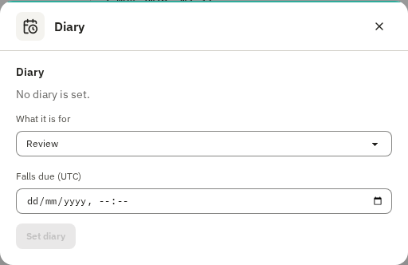

# Working Closed, Diary Date and Suspend

Separate from the Cases Workflow Status, each case has a Closed Status, which states where the case stands in the cycle of open and closed. The Closed Status has the following dispositions:

| Name           | Description                                                                                                                                                                                                                                                           |
|----------------|-----------------------------------------------------------------------------------------------------------------------------------------------------------------------------------------------------------------------------------------------------------------------|
| Open           | The case is open and ready to be worked. No other case can be created for the Case Key and Case Key Value for this case workflow.                                                                                                                                     |
| Suspend Open   | The case has been set to a pending status and on Diary Date expiration, the case status will change to Open. No other case can be created for the Case Key and Case Key Value for this case workflow.                                                                 |
| Suspend Closed | The case has been set to a pending status and on Diary Date expiration, the case status will change to Closed. No other case can be created for the Case Key and Case Key Value for this case workflow.                                                               |
| Closed         | The case has been closed and a new case can be created for the Case Key and Case Key Value for this case workflow.                                                                                                                                                    |
| Suspend Bypass | The case has been set to a pending status and on Diary Date expiration, the case status will be changed to closed. The Suspend Bypass status is akin to an invisibility status and is used to sample out case records that would have otherwise caused case creation. |

Only Closed is closed, which is to say that a case in any of the other dispositions is still outstanding, and it is only upon becoming Closed that the user and the date and time of closing are recorded.

## Where it lives

Navigate to a case record from the Cases page, as described in [Navigating Case Record](../WorkingNavigatingCaseRecord/index.html). The Closed Status drop down, the Diary Date picker and the Diary toggle of earlier versions, which were presented in the status bar, are replaced by tiles in the Decide pane:

| Tile   | Description                                                                                                                                                                              |
|--------|------------------------------------------------------------------------------------------------------------------------------------------------------------------------------------------|
| Close  | At the foot of the Decide pane for a case that is not Closed. Asks for confirmation, with a reason and a note, then closes the case for everyone, upon which it leaves the queue.        |
| Reopen | Takes the place of Close for a case that is Closed.                                                                                                                                      |
| Diary  | Under Actions. Opens a lightbox titled Diary, showing the diary the case has, if any, and taking What it is for and when it Falls due (UTC). See [Working Typed Diaries](../WorkingTypedDiaries/index.html). |

The header of the case page shows a Closed badge where the Closed Status is other than Open. The diary can also be set from the Peek on the Cases page, and a diary falling due is shown in the Due column of the queue.

SHOT id=case-management-closed-diary-suspend-diary
     route=/cases
     steps=open-demo-case, open-decide-tile:Diary
     frame=dialog
     state=the Diary lightbox of an open case that already carries a Review diary due in three days, showing the current diary with its countdown above the What it is for and Falls due (UTC) fields
     conveys=the diary of a case is a type and a date, set and cleared from the Decide pane
     alt=The Diary lightbox showing the current diary of a case with its type, date and time remaining, and the fields to change what it is for and when it falls due



## Closing a case

Close presents a confirmation titled for the case, for example Close C-1234?, stating that the case closes for everyone and leaves the queue, and that it can be reopened afterwards. It takes the Close Reason described below. Upon confirmation the Closed Status becomes Closed, a Closed event is recorded, and as the built in filters of the queue return only cases that are Open or Suspend Open, the case no longer qualifies for them, nor for Take next.

The close is refused in the following circumstances:

* The case is locked to another user.
* Required items of the checklist for the status of the case are still open, in which case the confirmation names them and Close case is not available, unless an override has been granted by a role having permission 71, Override Case Checklist Gate.
* A regulatory report for the case is awaiting approval or filing, unless the user has permission 76, Approve Case Reports.

The confirmation reads "The case closes for everyone and leaves the queue. You can reopen it afterwards.", and offers the following:

| Value              | Description                                                                                              | Example                   |
|--------------------|----------------------------------------------------------------------------------------------------------|---------------------------|
| Reason for closing | One of the fixed reasons described under Close Reason, beginning at No reason.                           | Duplicate of another case |
| Note (optional)    | A note of up to 1,000 characters, which the box will not exceed.                                         | Covered by C-1201         |
| Close case         | Closes the case. It is disabled while required items of the checklist are open and no override stands.   |                           |
| Cancel             | Dismisses the confirmation and leaves the case as it was. What was typed is kept should it be opened again. |                        |

Upon the case being closed the message Case updated is shown, the Closed badge appears in the header, the Close tile gives way to Reopen, Take is no longer available, and the fields of the Diary are replaced by a sentence stating that only an open case can carry a diary. It is not necessary to hold the case to close it, only that nobody else holds it, and closing does not release the lock, so a case closed while held continues to read Held by you.

Where the checklist stands in the way, the confirmation lists the items still open with Open checklist beside them, and, for a role holding permission 71, Override with reason. Where the close is refused by the server on account of the checklist notwithstanding, the confirmation is presented again with the message The checklist is not complete, so the case cannot move yet. A close refused on account of the lock is answered with The case is locked to another user.

By way of illustration, the demonstration case on ACC-778, in Supervisor Review, is closed by selecting Close, choosing Customer contacted and explained, typing a note and selecting Close case. It then leaves the All cases filter and every other built in filter, and is no longer offered by Take next.

Several cases can be closed at once from the queue, as described in [Working Lock, Allocation and Unlock](../WorkingLockAllocationUnlock/index.html).

## Reopening a case

Reopen is presented for a case that is Closed, and acts at once without asking for confirmation, being confirmed by the message Case updated. The case returns to the Closed Status of Open, such that it is once more returned by the filters of the queue and can be given a diary. Upon the Closed Status ceasing to be Closed, the reason and note with which the case was closed are cleared, and the return of the case is recorded in the time spent in each status as Reopened.

## Suspend

To place a case into a Suspend Open status is to hide it from view for a period of time, after which (subject to EnableCasesAutomation being True as an Environment Variable) it will return to an Open status upon Diary Date expiry. Suspend Closed is the same, except that the case moves on to Closed upon expiry.

The case page does not, at present, offer a control with which to select Suspend Open or Suspend Closed, the Closed Status drop down not having been carried over, and nor can the Diary tile be used for the purpose, as it accepts only a case that is Open. It follows that a case is suspended through the API, by updating the case record with the Closed Status, the Diary flag and the Diary Date together, or by Ask Jooby through the operation CaseUpdate:

```http
PUT /api/Case
Content-Type: application/json

{
  "id": 1234,
  "caseWorkflowStatusGuid": "9b2d7c41-0000-0000-0000-000000000000",
  "closedStatusId": 1,
  "locked": false,
  "lockedUser": null,
  "diary": true,
  "diaryDate": "2026-12-01T09:00:00Z",
  "rating": 0
}
```

The body is abbreviated to the properties of concern. The whole of the record, as returned by `GET /api/Case/1234`, should be sent back with the three properties changed, as the update takes the lock, the status and the rating from the same body. The Closed Status is given by its number, being 0 for Open, 1 for Suspend Open, 2 for Suspend Closed, 3 for Closed and 4 for Suspend Bypass. A Diary Date is required wherever the Diary flag is true. The change is recorded in the events of the case as Suspended and open or Suspended and closed.

TODO(verify): the Vue case page has no control to set Suspend Open or Suspend Closed; confirm with the owner whether one is to be added to the Decide pane, and document it once it exists

It is important that the cases workflow filters are used to remove the Suspend Open (and Closed) statuses from view, as the intention is that such status be judged as being hidden from view for a period of time (i.e. suspended). Keep in mind that the built in filters of the queue return cases that are Suspend Open as well as those that are Open, whereas Suspend Closed, Closed and Suspend Bypass are not returned by them.

## Diary Date expiry

Subject to EnableCasesAutomation being True as an [Environment Variable](../../../Concepts/EnvironmentVariables/index.html), which it is by default, the engine examines the cases in the background, waiting for the number of milliseconds given by CasesAutomationWait (60000 by default) between each pass, and takes up to 5,000 cases on each pass, those with the oldest Diary Date first.

Unless the Diary flag has been set to true, no background administration will be performed. It follows that it is not the Diary Date itself that dictates the case being in a Diary state, rather the flag (which is important for the creation of cases workflow filters).

Upon lapse of the Diary Date, again only if the Diary flag is set to true and the case is in one of the suspended dispositions, the Suspend status is evaluated. If the Closed Status is of Suspend Open, then the Closed Status becomes Open, such that the case is eligible for view. If the Closed Status is of Suspend Bypass or Suspend Closed, then the Closed Status becomes Closed. The change is recorded in the events of the case as Expired by process, with the Closed Status before and after. A case that is already Open is passed over, as described in [Working Typed Diaries](../WorkingTypedDiaries/index.html).

TODO(verify): earlier versions set the Diary flag to false when the Diary Date lapsed; on this branch CaseRepository.UpdateExpiredCaseDiaryAsync changes only ClosedStatusId and LastClosedStatus, leaving the Diary flag true. Confirm whether the flag is meant to be cleared on expiry, as filters built on the Diary flag depend on it

## Close Reason

When a case is closed the confirmation asks for an optional Reason for closing and an optional Note of up to 1000 characters. The reason is one of a fixed list:

| Reason                                  | Typical use                                                           |
|-----------------------------------------|-----------------------------------------------------------------------|
| False positive: known customer activity | The activity is normal for this customer.                             |
| False positive: rule too broad          | The rule matched something it was never meant to; a tuning candidate. |
| Duplicate of another case               | Another case already covers the same activity.                        |
| Insufficient evidence                   | There is not enough to act on.                                        |
| Suspicion confirmed and reported        | The case was escalated or filed.                                      |
| Fraud confirmed, loss prevented         | Fraud was confirmed and the loss was stopped.                         |
| Customer contacted and explained        | The customer confirmed or explained the activity.                     |
| Other                                   | Anything else; use the Note.                                          |

The reason is optional, and where none is chosen the confirmation reads No reason. The reason and note are stored on the case (Case.ClosedReasonId and Case.ClosedReasonNote) when the update that closes it is made. A case that is already closed keeps the reason it was closed with, and the reason is cleared when the case is reopened. The reason complements the Outcome of the closing status (Confirmed, Not confirmed or Not an outcome), which remains what the analytics read, and makes the rule effectiveness figures explainable: a rule whose closed cases are mostly "False positive: rule too broad" is a different problem from one whose cases are mostly "Duplicate of another case".

To count closed cases by rule and reason, query the Case table with the AskJooby SQL tool or a Visualisation datasource, grouping on EntityAnalysisModelActivationRuleGuid and ClosedReasonId for rows where ClosedStatusId is 3:

```sql
select "EntityAnalysisModelActivationRuleGuid", "ClosedReasonId", count(*)
from "Case"
where "ClosedStatusId" = 3
group by "EntityAnalysisModelActivationRuleGuid", "ClosedReasonId"
```

## Validation

The update of the case record is validated in the server, and is refused where:

* The Closed Status is not between 0 and 4, with the error code `ClosedStatusIdInclusiveBetween`.
* The reason is not between 0 and 8, zero being no reason, with the error code `ClosedReasonIdInclusiveBetween`.
* The note is longer than 1000 characters, with the error code `ClosedReasonNoteMaximumLength`.
* The Diary flag is true and no Diary Date is given, with the error code `DiaryDateNotEmpty`.

The labels of the reasons are translated for every locale of the user interface. The error codes for the Closed Status, the reason and the note are returned without a localised message.

## Permissions and security

Closing, reopening and suspending a case, and setting its diary, require permission 1, Read Write Case, and a case that is visible to the roles of the user and not locked to another user. Closing over an incomplete checklist requires an override by a role granted permission 71, Override Case Checklist Gate, and closing a case having a regulatory report awaiting approval or filing requires permission 76, Approve Case Reports.
