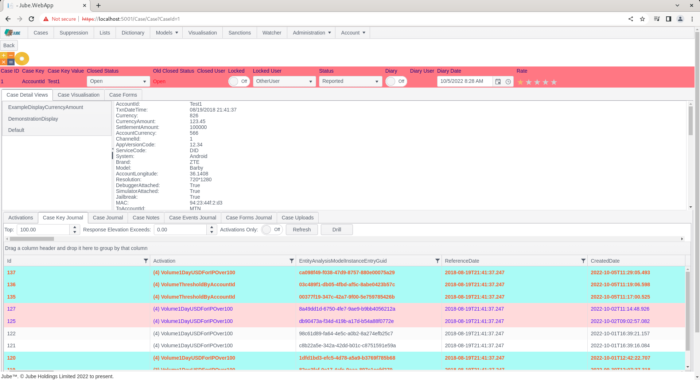
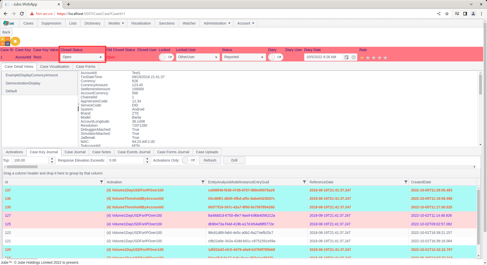
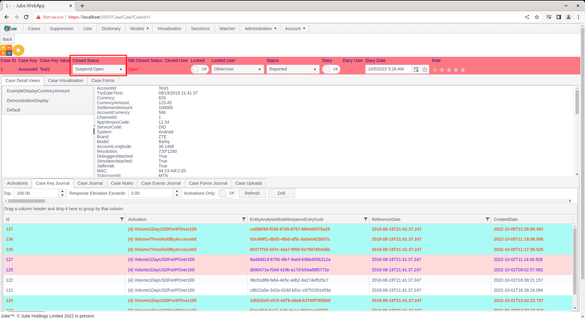
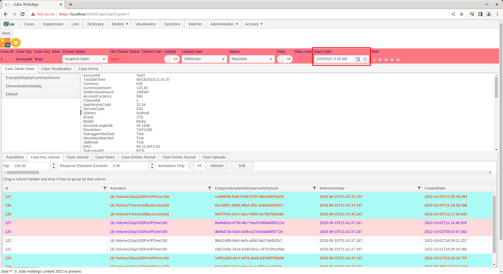
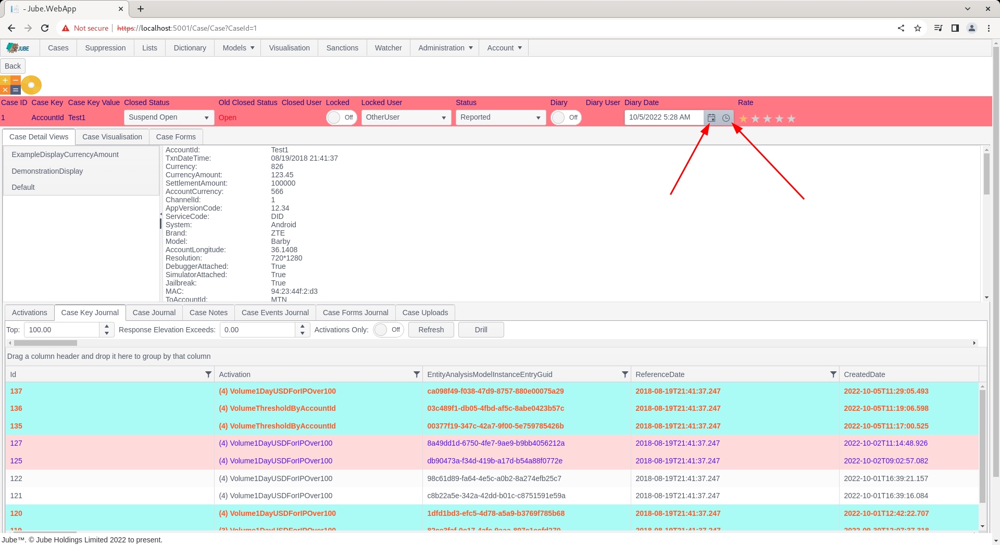
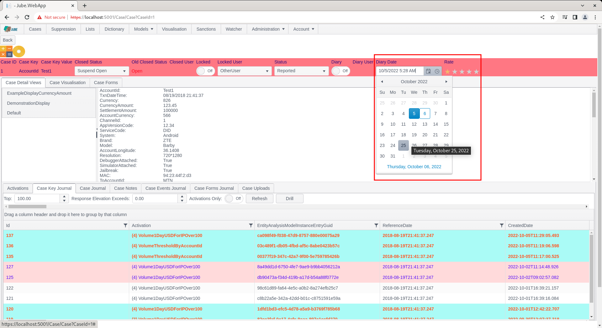
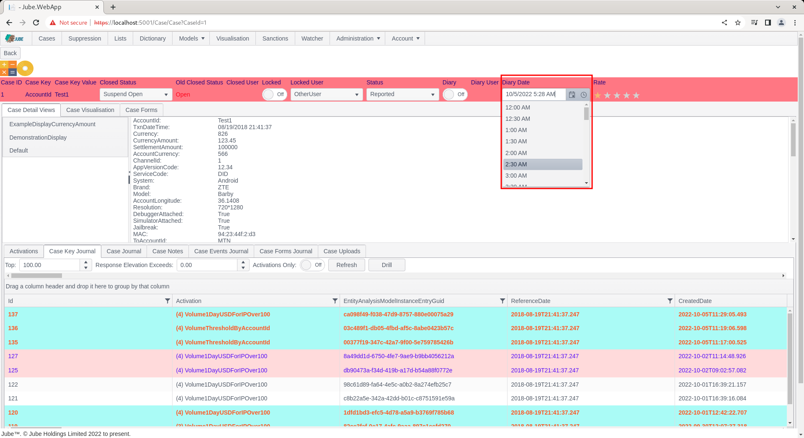
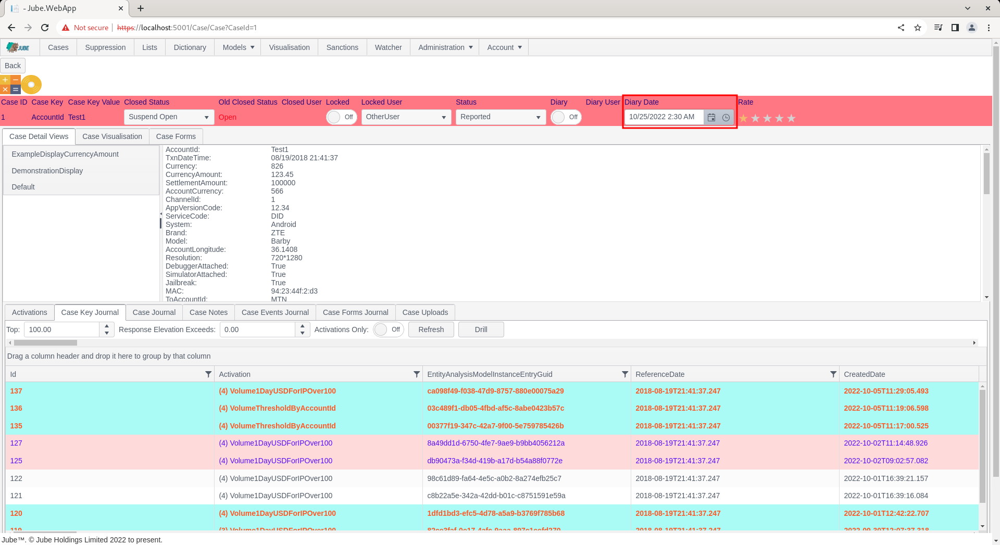
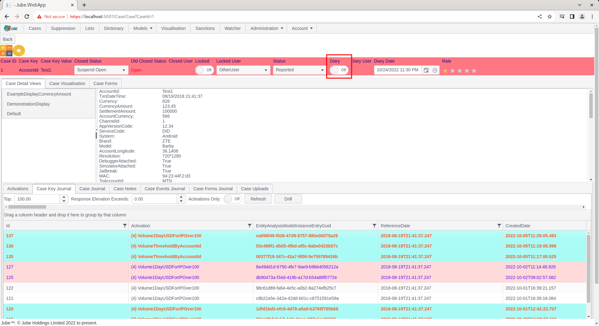
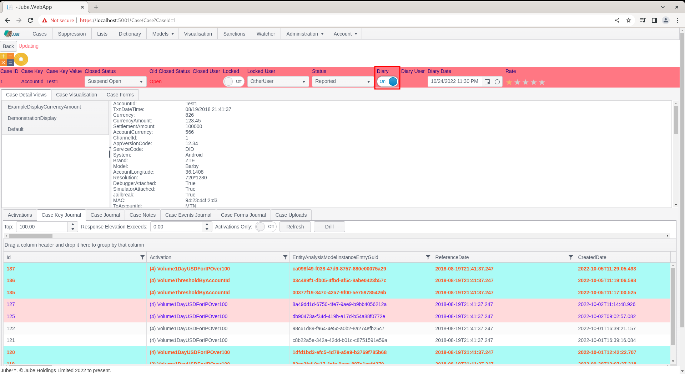

# Working Closed, Diary Date and Suspend

The Closed Status has the following dispositions:

| Name           | Description                                                                                                                                                                                                                                                            |
|----------------|------------------------------------------------------------------------------------------------------------------------------------------------------------------------------------------------------------------------------------------------------------------------|
| Open           | The case is open and ready to be worked. No other case can be created for the Case Key and Case Key Value for this case workflow.                                                                                                                                      |
| Suspend Open   | The case has been set to a pending status and on Diary Date expiration,  the case status will change to Open. No other case can be created for the Case Key and Case Key Value for this case workflow.                                                                 |
| Suspend Closed | The case has been set to a pending status and on Diary Date expiration,  the case status will change to Closed. No other case can be created for the Case Key and Case Key Value for this case workflow.                                                               |
| Closed         | The case has been closed and a new case can be created for the Case Key and Case Key Value for this case workflow.                                                                                                                                                     |
| Suspend Bypass | The case has been set to a pending status and on Diary Date expiration, the case status will be changed to closed.  The Suspend Bypass status is akin to an invisibility status and is used to sample out case records that would have otherwise caused case creation. |

Navigate to a case record via either fetch or skim:

<!-- TODO(screenshot): file=cases-workspace-case-example.png route=/cases state="Case before suspension; replaces the Razor-era CaseExample.png" -->

To place a case into a Suspend Open status, which will (subject to the EnableCasesAutomation being True as an
Environment Variable) return to an open status upon Diary Date expiry, start by navigating to the drop down containing
Closed Status:

<!-- TODO(screenshot): file=cases-workspace-location-of-closed-status.png route=/cases state="Closed status control; replaces the Razor-era LocationOfClosedStatus.png" -->

Click the Suspend Open Status which will update the case status to that Closed Status:

<!-- TODO(screenshot): file=cases-workspace-updated-to-suspend-open.png route=/cases state="Case suspended; replaces the Razor-era UpdatedToSuspendOpen.png" -->

It is important that the cases workflow filters are used to remove the Suspend Open (and Closed) statuses from view, the
intention is that such status be judged as being hidden from view for a period of time (i.e. suspended).

Subject to the EnableCasesAutomation being True as an Environment Variable, the engine will ensure that on the
expiration of the diary date, it will be moved back to an open status such that it is eligible for view. To set a Diary
Date, note the Date Time Picker under the label Diary Date:

<!-- TODO(screenshot): file=cases-workspace-location-of-diary-date.png route=/cases state="Diary date control; replaces the Razor-era LocationOfDiaryDate.png" -->

Note the Date and Time selection buttons adjacent to the free hand date selection:

<!-- TODO(screenshot): file=cases-workspace-date-time-selection-buttons.png route=/cases state="Diary date picker; replaces the Razor-era DateTimeSelectionButtons.png" -->

Pick a date by selecting the calendar icon alongside the date and time picker (or typing freehand):

<!-- TODO(screenshot): file=cases-workspace-selecting-a-date-for-suspend-open.png route=/cases state="Date chosen; replaces the Razor-era SelectingADateForSuspendOpen.png" -->

Then optionally a time by selecting the clock icon alongside the date time picker (or by typing freehand):

<!-- TODO(screenshot): file=cases-workspace-selecting-a-time-for-suspend-open.png route=/cases state="Time chosen; replaces the Razor-era SelectingATimeForSuspendOpen.png" -->

Upon changing the date time picker, the case record will be updated:

<!-- TODO(screenshot): file=cases-workspace-updated-date-time-picker.png route=/cases state="Picker after selection; replaces the Razor-era UpdatedDateTimePicker.png" -->

Note that unless the Diary button has been toggled, no background administration will be performed:

<!-- TODO(screenshot): file=cases-workspace-location-of-diary-button.png route=/cases state="Diary panel in the peek; replaces the Razor-era LocationOfDiaryButton.png" -->

Only when the Diary toggle button is set to true, is the inference that the case is in a diary and pending state:

<!-- TODO(screenshot): file=cases-workspace-case-diary-set-to-true.png route=/cases state="Case with a diary set; replaces the Razor-era CaseDiarySetToTrue.png" -->

The background engine upon lapse of the Diary Date will set the Diary toggle button to False. It follows that it is not
the Diary Date itself that dictates the case being in a Diary state, rather the flag (which is important for the
creation of cases workflow filters).

Upon lapse of the Diary Date - again, only if the Diary flag is set to True - the Diary flag will be toggled to No. At
the point the Diary flag is set to No, the Suspend status is evaluated. If the Closed Status is of Suspend Open, then
the Closed Status becomes Open. If the Closed Status is of Suspend Bypass or Suspend Closed, then the Closed Status
becomes Closed.

## Close Reason

When a case is closed the confirmation asks for an optional Reason for closing and an optional Note of up to 1000
characters. The reason is one of a fixed list:

| Reason                                  | Typical use                                                           |
|-----------------------------------------|-----------------------------------------------------------------------|
| False positive: known customer activity | The activity is normal for this customer.                             |
| False positive: rule too broad          | The rule matched something it was never meant to; a tuning candidate. |
| Duplicate of another case               | Another case already covers the same activity.                        |
| Insufficient evidence                   | There is not enough to act on.                                        |
| Suspicion confirmed and reported        | The case was escalated or filed.                                      |
| Fraud confirmed, loss prevented         | Fraud was confirmed and the loss was stopped.                         |
| Customer contacted and explained        | The customer confirmed or explained the activity.                     |
| Other                                   | Anything else; use the Note.                                          |

The reason and note are stored on the case (Case.ClosedReasonId and Case.ClosedReasonNote) when the update that closes
it is made. A case that is already closed keeps the reason it was closed with, and the reason is cleared when the case
is reopened. The reason complements the Outcome of the closing status (Confirmed, Not confirmed or Not an outcome),
which remains what the analytics read, and makes the rule effectiveness figures explainable: a rule whose closed cases
are mostly "False positive: rule too broad" is a different problem from one whose cases are mostly "Duplicate of another
case".

To count closed cases by rule and reason, query the Case table with the AskJooby SQL tool or a Visualisation datasource,
grouping on EntityAnalysisModelActivationRuleGuid and ClosedReasonId for rows where ClosedStatusId is 3.

<!-- TODO(docs): the reason is optional. Add a per-workflow setting to make it mandatory for closing statuses whose outcome is Confirmed or Not confirmed, and describe it here. -->
<!-- TODO(docs): the case analytics (per-rule precision and false positive cost) do not yet break down by close reason; add the breakdown to CaseAnalyticsService and the Quality tab, and document it. -->
<!-- TODO(docs): show the close reason and note on the case header and in the Case Key Journal event list once the case is closed. -->
<!-- TODO(screenshot): file=case-close-reason.png route=/cases/{id} state="the Close confirmation open with the reason selected and a note typed" -->
<!-- TODO(docs): the reason labels are translated for every locale in the SPA; the validator error codes ClosedReasonIdInclusiveBetween and ClosedReasonNoteMaximumLength have no localised message yet. -->
