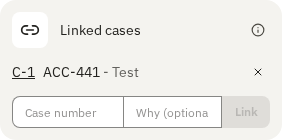

# Working Linked Cases

Two cases are often one story: two accounts having received money from the same scam, or a customer and the business they control. Cases are grouped by their Case Key Value, it follows that cases on different keys are not related unless an analyst states as much. A link exists for the purposes of recording that statement, so that each case is presented alongside the other.

## Where it lives

Navigate to a case record from the Cases page. Links are maintained in the card titled Linked cases in the Decide pane, under On this case, beneath the Tags card. As the card acts in place, there is nothing further to open.

SHOT id=case-linked-cases-card
     route=/cases
     steps=open-demo-case, scroll-to:Linked cases
     frame=section:Linked cases
     state=the Decide pane of a demonstration case with the Linked cases card listing two linked cases, each with its case number, key value and reason, one of them marked Closed
     conveys=linked cases are listed in the Decide pane with the reason for the link, and each opens the other case
     alt=The Linked cases card in the Decide pane listing two linked cases with their key values and reasons, one marked Closed, above the boxes for linking a further case



## Linking and unlinking

The card lists the cases linked to the case in view, each with its case number, which opens that case, its Case Key Value, the reason given, and the word Closed where the case is closed. Where there are none, No linked cases is stated.

To link a case, the following is taken:

| Value          | Description                                                             | Example                     |
|----------------|-------------------------------------------------------------------------|-----------------------------|
| Case number    | The number of the other case. Required.                                 | 1042                        |
| Why (optional) | The reason for the link, limited to 500 characters.                     | Both paid by the same payer |

Link commits the link, and the cross beside a linked case removes it. A link is symmetrical, which is to say that it appears on both cases, and removing it from either side removes it from both.

The Case number is typed as the digits alone, for example 1042, or in the form in which a case is referred to elsewhere, C-1042, a leading # being tolerated likewise. Link remains disabled while the box holds anything other than a whole number above zero of up to nine digits, or holds the number of the case in view. The reason will not accept more than 500 characters.

Upon a link being made the message Cases linked is shown, the two boxes are cleared, and the other case joins the list. The cross acts at once without asking for confirmation, and is confirmed by Link removed. It is not necessary to hold either case, and a closed case can be linked as readily as an open one. While the links are being read a placeholder is drawn, and where they cannot be read the card states Could not load the linked cases.

The help mark beside the title reads "Cases you link are shown together on each of them, for example two accounts of one scam. Anyone who can see a case sees its links to cases they can also see."

The demonstration data carries an example. The cases on ACC-441 and ACC-778 are linked with the reason Both accounts were used from device DEV-8831A, so the Linked cases card of either lists the other, with that reason, and selecting the case number moves from one to the other.

## Validation

A link is validated in the server, and is rejected where:

* Either case does not exist or is not visible to the user, in which circumstance it is reported that the case was not found.
* The case is linked to itself.
* The two cases are already linked, a pair being linked only once.
* The reason is longer than 500 characters.

The messages shown on the page are as follows:

| Circumstance                                         | Message                                      | Status |
|------------------------------------------------------|----------------------------------------------|--------|
| The other case does not exist, or is not visible     | That case was not found.                     | 404    |
| The two cases are already linked                     | Those cases are already linked.              | 409    |
| The case is linked to itself, through the API        | A case cannot be linked to itself.           | 400    |
| Either case number is missing, through the API       | Both cases are required.                     | 400    |
| The reason is over 500 characters, through the API   | The reason must be at most 500 characters.   | 400    |
| Removing a link that no longer exists                |                                              | 404    |

A case that exists but cannot be seen and a case that does not exist are answered alike, so that linking cannot be used to discover whether a case number is in use.

## What a link does not do

A link is a statement for the reader of the case and nothing more:

* Linking and unlinking each write an event on both cases, shown in the Events of each as Case linked, with the other case and the reason, and Case unlinked, with the other case, alongside the user and the time.
* A link is not carried into the Case Key Journal or the Network, and it takes no part in the ranking of the case.
* Links are not moved between environments by Preservation.
* Ask Jooby has no tool to read, make or remove a link.
* A link joins two cases that already exist and does not create one. Opening a case in the absence of an alert, as an ad hoc investigation, is not available by this means.

## Example

The API underlying the card is as follows, each POST taking the two case numbers:

```http
GET /api/CaseLink/ByCaseId/{caseId}
POST /api/CaseLink/Link
POST /api/CaseLink/Unlink
```

A link is made with the two case numbers and, optionally, the reason:

```json
{
  "caseId": 1041,
  "otherCaseId": 1042,
  "reason": "Both paid by the same payer"
}
```

## Permissions and security

Linking, unlinking and viewing links requires permission 1, Read Write Case. Making or removing a link requires both cases to be visible to the user, which is to say that a role of the user is granted the Case Workflow and the current status of each.

A link made by someone with wider access is shown to a user only for the cases that user can see. The existence, and the key, of a case that a user cannot see are never revealed through a link.
