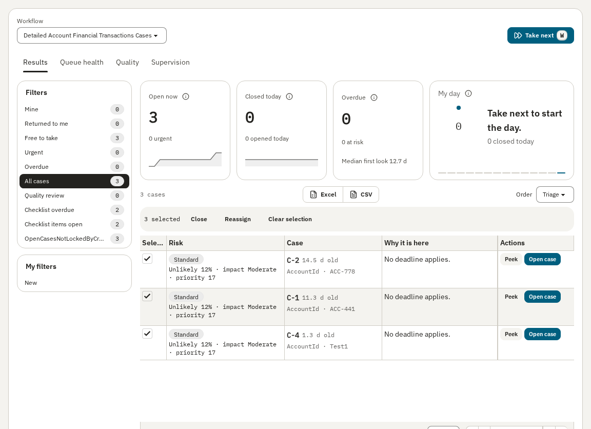

# Working Lock, Allocation and Unlock

When a case is locked to a user, it is owned by that user until such a time that it is unlocked or the lock is allocated to another user. Assignment is the lock, which is to say that there is no assignee separate from the locked user: a locked case is assigned to the user holding it, and an unlocked case is free for anyone, with access to it, to take.

## Where it lives

The lock is shown wherever a case is shown. In the list of the Cases page the Status column reads Held by you, Held by followed by the user, or Free to take, and in the header of the case page the lock reads Held by followed by the user, or Not held.

The lock is changed from the top of the Decide pane of the case page, described in [Navigating Case Record](../WorkingNavigatingCaseRecord/index.html), which states the holder and presents Take where the case is not held and Release where it is held by the user. Where the case is held by another user neither is presented, and the pane states that a supervisor can break this lock. The Locked toggle and the Locked User drop down of earlier versions are replaced by these controls.

SHOT id=case-management-lock-allocation-unlock-queue
     route=/cases
     steps=click:All cases, toggle:Select case, toggle:Select case, toggle:Select case
     frame=page
     state=the list of the Cases page with a mix of cases held by the signed in user, held by other analysts and free to take in the Status column, three rows ticked and the bar for the selection showing above the list
     conveys=the Status column says who holds each case, and several cases can be closed or reassigned at once
     alt=The list of cases with the Status column showing which are held and by whom, three cases ticked and the selection bar offering Close, Reassign and Clear selection



## Lock

A case becomes locked to a user in one of the following ways:

| Manner    | Description                                                                                                                                                                                 |
|-----------|---------------------------------------------------------------------------------------------------------------------------------------------------------------------------------------------|
| Take next | The case is taken from the top of the queue and automatically locked, as described in [Working Skim, Lock and Next](../WorkingSkimLockNext/index.html).                                    |
| Take      | In the Decide pane of a case that is open and not held. Take is not available for a closed case.                                                                                            |
| Reassign  | A supervisor, or a bulk reassignment, locks the case to a named analyst, as described below.                                                                                                |

While a case is locked to a user nobody else can change it. A change to the status, the closing of the case, a note, a form, a file or a tick of the checklist by any other user is refused, the case being reported as locked by another user. The holder of the lock, by contrast, may always act upon the case, and a case that is not held is open to everyone having access to it.

Changing the lock is a single conditional update. If someone else took or released the case between the case being read and the change being saved, the request is refused with a conflict rather than overwriting what the other user did.

Taking a case is recorded in the events of the case as Locked, and upon a case being taken the checklist for its status is brought up to date.

The top of the Decide pane therefore reads in one of three ways, and it is from this that the remainder of the pane is to be understood:

| The pane reads                 | The control offered                     | Meaning                                                                                              |
|--------------------------------|-----------------------------------------|------------------------------------------------------------------------------------------------------|
| Not held                       | Take, disabled where the case is closed | Nobody holds the case, and anyone with access may change it or take it.                              |
| Held by you                    | Release                                 | The case is assigned to the user, and nobody else may change it.                                     |
| Held by, followed by the user  | None, with A supervisor can break this lock | The case is assigned to someone else, and a change attempted by the user is refused.             |

Take and Release act at once, without asking for confirmation, and are confirmed by the message Case updated, upon which the header, the Decide pane and the Status column of the Cases page all follow. A change refused on account of the lock is answered with The case is locked to another user. By way of illustration, an analyst opening the demonstration case on ACC-441 from the list, by Open case, finds it Not held, selects Take, and from that moment a colleague opening the same case finds it Held by, followed by the name of the analyst, with neither Take nor Release offered.

## Unlock

To unlock a case record, it is a simple matter of clicking Release in the Decide pane, upon which the case record is updated and is no longer considered locked, and it returns to the queue as Free to take. Locked cases do not automatically unlock, hence a case should be released if work on it stops.

## Allocation

To allocate the lock to another user is to hand the case to that user. The case page does not offer a control for this, the function having moved to the Supervision tab of the Cases page, where a supervisor may Reassign a case to an analyst chosen from those eligible, or Break lock such that anyone may take it. This is so even for a lock the supervisor does not hold, and both are described in [Working Case Supervision](../WorkingCaseSupervision/index.html). Several cases can be handed over at once with Reassign in bulk, described below.

In all cases the lock can only be handed to an analyst who is eligible for the case, which is to say a user who:

* is in the tenant, is active, and is not locked out;
* has a role granted permission 1, Read Write Case; and
* has a role granted both the Case Workflow and the Cases Workflow Status the case is in.

This is the same rule to which supervisors are held when reassigning, and it is enforced by the server for a change made through the API also (`PUT /api/Case` with a different Locked User), where a user who is not eligible is refused as a validation error on Locked User, with the error code `LockedUserInTenant`.

A change of the locked user is recorded in the events of the case as Allocated, with the user before and the user after, and a lock broken by a supervisor is recorded as Lock broken.

## Bulk Close and Bulk Reassign

On the Cases queue each row has a checkbox. Selecting one or more rows shows a bar with the number selected and three buttons: Close, Reassign and Clear selection. Up to 500 cases can be selected at once, and selections for cases that leave the list (for example after a re-sort or refresh) are dropped.

Close asks for the optional reason and note described under Close Reason in [Working Closed, Diary Date and Suspend](../WorkingClosedDiarySuspend/index.html) and applies them to every selected case. Reassign asks for the user name of an analyst, typed rather than chosen from a list, and locks every selected open case to them, recording the hand-over in the events of each case.

Neither action is a shortcut around the single-case rules. Each case goes through exactly the path a single close or reassignment takes, with the permissions of the person who made the request, so a case that could not be closed or reassigned one at a time is not closed or reassigned in bulk. The cases that could not be handled are skipped, the rest are done, and a message says how many were done and why the others were skipped:

| Skipped because                                 | Meaning                                                                                                             |
|-------------------------------------------------|---------------------------------------------------------------------------------------------------------------------|
| Not found or not visible                        | The case does not exist or the user has no role granted on its workflow and status.                                 |
| Already closed                                  | Nothing to do.                                                                                                      |
| Held by another user or changed meanwhile       | Another analyst holds the lock, or the case changed between being read and being updated.                           |
| Not valid for this case or analyst not eligible | The analyst is not in the tenant, lacks the Read Write Case permission or lacks the workflow or status role.        |
| Checklist incomplete                            | The case has required checklist items still open (closing only).                                                    |

The bar reads, for example, "3 selected". Close asks Close 3 cases? and explains that "Every selected case that you can close is closed with the reason and note below. Cases held by someone else, already closed or blocked by an incomplete checklist are skipped and reported.", the note being limited to 1,000 characters. Reassign asks Reassign 3 cases?, explains that "Every selected open case is locked to the analyst you name, if they are eligible for it. The others are skipped and reported.", and takes the Analyst user name, the confirmation being disabled until one has been typed. Where everything was done the message reads "3 cases updated.", and otherwise, for example, "2 cases updated, 1 skipped: Held by another user or changed meanwhile.". An attempt to tick more than 500 cases is answered with At most 500 cases can be selected at once.

The Reassign button of the bar is drawn only for a holder of permission 18, Read Write Case Workflow, to whom alone the server permits a bulk reassignment.

The endpoints are `POST /api/CaseBulk/Close` and `POST /api/CaseBulk/Reassign`, each taking the Case Ids, and returning for each case whether it was done and, where it was not, the reason it was skipped:

```http
POST /api/CaseBulk/Close
Content-Type: application/json

{
  "caseIds": [1234, 1235, 1236],
  "closedReasonId": 3,
  "closedReasonNote": "Covered by C-1201"
}
```

```http
POST /api/CaseBulk/Reassign
Content-Type: application/json

{
  "caseIds": [1234, 1235, 1236],
  "toUser": "Robert"
}
```

## Permissions and security

Taking, releasing and closing a case, singly or in bulk, require permission 1, Read Write Case. Reassigning a case, breaking a lock and reassigning in bulk require permission 18, Read Write Case Workflow, being the permission of supervision, together with a role granted the Case Workflow. Bulk close and bulk reassign are not available to Ask Jooby as operations.
