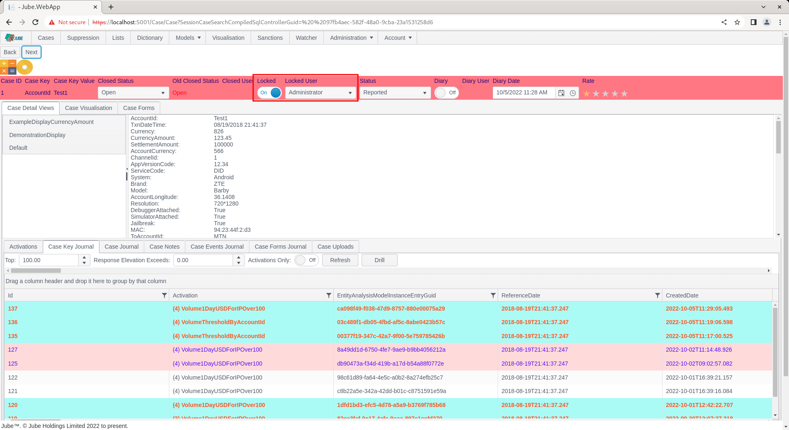
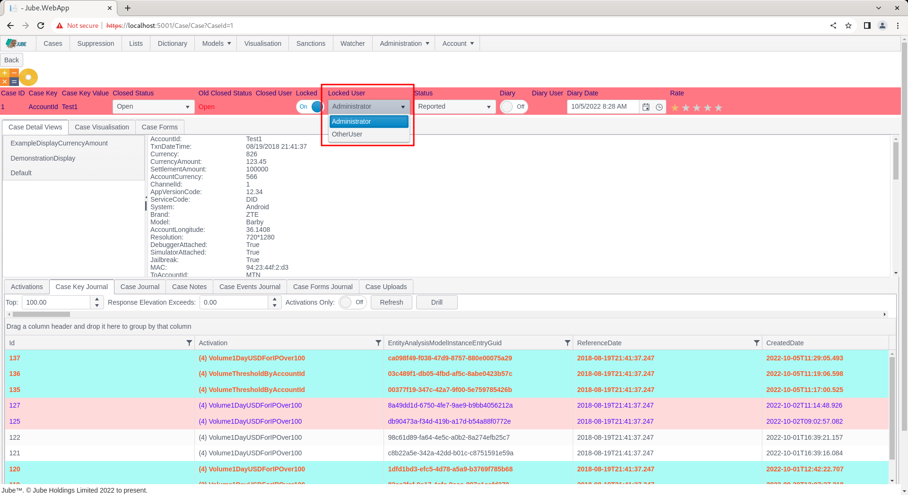
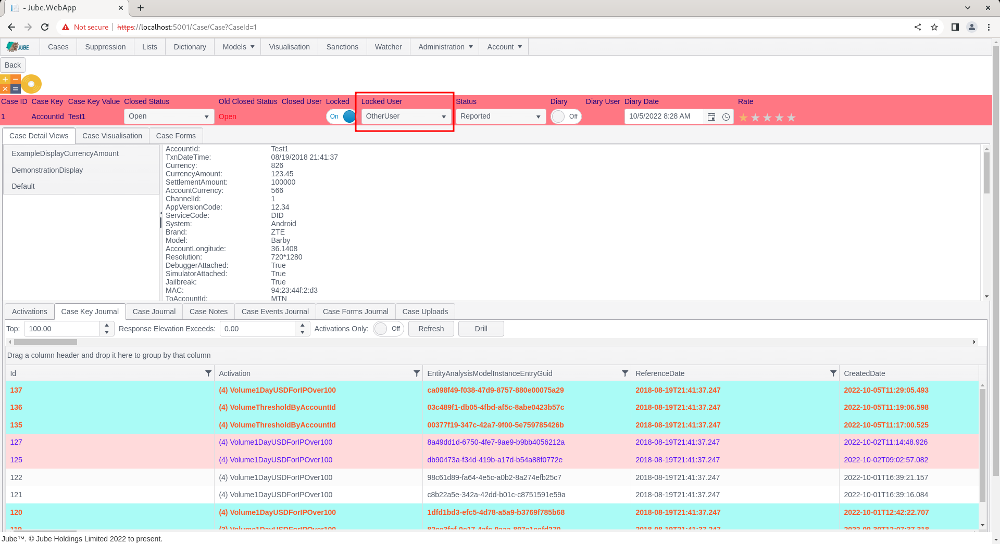
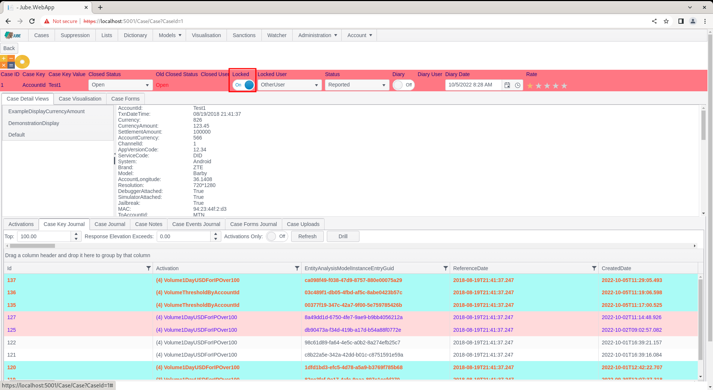
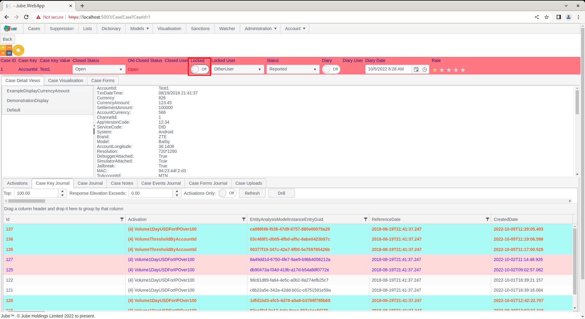

# Working Lock, Allocation and Unlock

When a cases is locked to a user, it is owned by that user until such a time that it is unlocked or the user allocates
the locked status to another user.

In the following, the Case Key Value combination AccountId = Test1 has been Skimmed, therefore automatically locked:

<!-- TODO(screenshot): file=cases-workspace-case-locked-to-user.png route=/cases state="Case locked to the signed-in analyst; replaces the Razor-era CaseLockedToUser.png" -->

Noting two case status properties, Locked and Locked User, to allocate the lock status to another user, the Locked User
drop down can be used to search for, then select, another system user in the tenant:

<!-- TODO(screenshot): file=cases-workspace-other-user-to-lock-to.png route=/cases state="Reassign picker showing eligible analysts only; replaces the Razor-era OtherUserToLockTo.png" -->

Click on a new user after which the case will update to lock to that user:

<!-- TODO(screenshot): file=cases-workspace-updated-to-other-user.png route=/cases state="Case after the hand over; replaces the Razor-era UpdatedToOtherUser.png" -->

To unlock a case record, it is a simple matter of sliding the Locked toggle button to False, or unchecked:

<!-- TODO(screenshot): file=cases-workspace-update-locked-to-unlocked.png route=/cases state="Releasing the lock; replaces the Razor-era UpdateLockedToUnlocked.png" -->

The case record will be updated and no longer be considered locked:

<!-- TODO(screenshot): file=cases-workspace-updated-locked-to-unlocked.png route=/cases state="Case free for all; replaces the Razor-era UpdatedLockedToUnlocked.png" -->

<!-- TODO(docs): assignment is the lock: there is no separate assignee, an unlocked case is free for all. Verify this wording with the owner. -->
<!-- TODO(docs): handing the lock to another analyst on the case record is now refused unless that analyst is in the tenant, holds the Read Write Case permission and has a role granted both the workflow and the status the case is in (the same rule supervisors are held to when reassigning). Error key LockedUserInTenant. -->
<!-- TODO(docs): changing the lock is now one conditional update: if someone else took or released the case between reading and saving, the request is refused with a conflict instead of overwriting. -->
<!-- TODO(docs): supervisors can break or reassign a lock they do not hold from the Supervision tab, see Working Case Supervision. -->

## Bulk Close and Bulk Reassign

On the Cases queue each row has a checkbox. Selecting one or more rows shows a bar with the number selected and three
buttons: Close, Reassign and Clear selection. Up to 500 cases can be selected at once; selections for cases that leave
the list (for example after a re-sort or refresh) are dropped.

**Close** asks for the optional reason and note described under Close Reason and applies them to every selected case.
**Reassign** asks for the user name of an analyst and locks every selected open case to them, recording the hand-over in
the case journal.

Neither action is a shortcut around the single-case rules. Each case goes through exactly the path a single close or
reassignment takes, with the permissions of the person who made the request, so a case that could not be closed or
reassigned one at a time is not closed or reassigned in bulk. The cases that could not be handled are skipped, the rest
are done, and a message says how many were done and why the others were skipped:

| Skipped because                                 | Meaning                                                                                                      |
|-------------------------------------------------|--------------------------------------------------------------------------------------------------------------|
| Not found or not visible                        | The case does not exist or you have no role granted on its workflow and status.                              |
| Already closed                                  | Nothing to do.                                                                                               |
| Held by another user or changed meanwhile       | Another analyst holds the lock, or the case changed between being read and being updated.                    |
| Not valid for this case or analyst not eligible | The analyst is not in the tenant, lacks the Read Write Case permission or lacks the workflow or status role. |
| Checklist incomplete                            | The case has required checklist items still open (closing only).                                             |

The endpoints are `POST /api/CaseBulk/Close` and `POST /api/CaseBulk/Reassign`. Closing needs the Read Write Case
permission; reassigning needs the supervision permission used by single reassignment.

<!-- TODO(docs): the reassign dialog takes a typed user name; replace it with a picker of the analysts eligible for every selected case once an eligibility endpoint for several cases exists. -->
<!-- TODO(docs): bulk close and reassign are not agent tools (no AskJooby operation); decide whether they should be. -->
<!-- TODO(screenshot): file=cases-bulk-bar.png route=/cases state="the Cases queue with three rows ticked and the bulk bar showing" -->
<!-- TODO(screenshot): file=cases-bulk-close.png route=/cases state="the bulk close confirmation with a reason chosen" -->
<!-- TODO(docs): add a Playwright journey for bulk close; the unit and service tests cover the selection and the server rules only. -->
